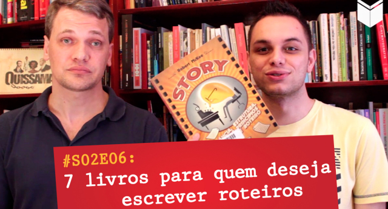

# 7 livros essenciais para quem quer escrever roteiros

Por [Diego Schutt](http://ficcao.emtopicos.com/ "Visit Diego Schutt’s website") em 17/10/2014 em [destaque](http://ficcao.emtopicos.com/category/destaque/), [dicas](http://ficcao.emtopicos.com/category/dicas/), [inspiração](http://ficcao.emtopicos.com/category/inspiracao/), [storytelling](http://ficcao.emtopicos.com/category/storytelling/)

**0

[**](http://ficcao.emtopicos.com/2014/10/livros-escrever-roteiros/#) 7

O [Homo Literatus](http://homoliteratus.com/) segue com a série “A Arte de Contar Histórias por Escrito”, onde o Vilto Reis, [editor](http://ficcao.emtopicos.com/about/autor/ "editor") do site, e o escritor Maicon Tenfen falam sobre o processo de criação de grandes escritores, o desenvolvimento de personagens e outros temas relacionados à construção de [universos de ficção](http://ficcao.emtopicos.com/2014/08/universo-ficcao-bigbang/ "O Big Bang dos universos de ficção") com palavras.

No**sexto episódio** **da segunda temporada**, Vilto e Maicon compartilham uma lista de livros essenciais para quem quer aprender a escrever [roteiros](http://ficcao.emtopicos.com/escrever-roteiros/ "roteiros").

Assista ao vídeo abaixo.

**Livros citados no programa:**- O Manual do Roteiro, de Syd Field- O Herói de Mil Faces, de Joseph Campbell- A Jornada do Escritor, de Cristopher Vogler- O Roteirista Profissional, de Marcos Rey- O Poder do Clímax, de Luiz Carlos Maciel- Por Dentro do Roteiro, de Tom Stempel- Story – Substância, [Estrutura](http://ficcao.emtopicos.com/estrutura/ "Estrutura"), [Estilo](http://ficcao.emtopicos.com/voz-de-escritor/ "Estilo") e os Princípios da Escrita de Roteiro, de Robert McKee

**Filme que aparece no fim do programa:**- Adaptation (em português: Adaptação), 2002. Direção de Spike Jonze. Roteiro de Charlie Kaufman.

**Filme que aparece no fim do programa:**[O maior erro dos aspirantes a roteirista de televisão e cinema](http://ficcao.emtopicos.com/2014/01/tecnicas-hollywood-escrever-historias/)  
[A importância de roteiros não produzidos e livros não publicados](http://ficcao.emtopicos.com/2013/10/roteiro-cinema-tv-robert-mckee/)  
[4 técnicas hollywoodianas para criar histórias envolventes](http://ficcao.emtopicos.com/2014/01/tecnicas-hollywood-escrever-historias/)  
[As 15 melhores dicas da Pixar para criar histórias memoráveis](http://ficcao.emtopicos.com/2013/06/dicas-pixar-criar-historias/%22)

### Antes de reproduzir qualquer texto no seu blog, leia os TERMOS DE USO do site. Link no menu principal. Esse texto ajudou você? Vou ficar feliz em saber. Curta, +1, deixe um comentário e leia também:

- [A Jornada do Herói no filme “Star Wars – Uma nova…](http://ficcao.emtopicos.com/2014/09/jornada-do-heroi-historias/)
- [Pulp Fiction e a jornada do herói invertida](http://ficcao.emtopicos.com/2014/09/jornada-heroi-invertida/)
- [Como elaborar a trama de uma história](http://ficcao.emtopicos.com/2014/09/elaborar-trama-historia/)

## Sobre o Autor

Diego Schutt[Ver todos os artigos por Diego Schutt **](http://ficcao.emtopicos.com/author/Diego/)

Diego Schutt é escritor e especialista em storytelling e criação de universos de ficção. Estudou escrita criativa na Austrália, Suíça, Estados Unidos, Inglaterra, Alemanha e até mesmo no Brasil. Há 5 anos, ele escreve e edita o Ficção em Tópicos, o site mais completo sobre storytelling em Português, que oferece serviços de consultorias individuais, além de cursos e oficinas de formação de escritores.

**Share:

0
 0
Google +0
 0
 0

**Tags: [cinema](http://ficcao.emtopicos.com/tag/cinema/), [estrutura](http://ficcao.emtopicos.com/tag/estrutura/), [roteiros](http://ficcao.emtopicos.com/tag/roteiros/), [storytelling](http://ficcao.emtopicos.com/tag/storytelling/)

[**Link Permanente](http://ficcao.emtopicos.com/2014/10/livros-escrever-roteiros/)

## Textos Relacionados

- **1

  

  [Dica 98: Tenha consciência da ideia-chave da história.](http://ficcao.emtopicos.com/2012/12/dica-ideia-chave-historia/ "Permanent Link to Dica 98: Tenha consciência da ideia-chave da história.")
- **0

  

  [Sobre ensinar escritores a mergulhar sem colocar o dedo no nariz](http://ficcao.emtopicos.com/2014/07/ensinar-escritores/ "Permanent Link to Sobre ensinar escritores a mergulhar sem colocar o dedo no nariz")
- **2

  

  [Criação e criticismo não podem ser vendidos separadamente.](http://ficcao.emtopicos.com/2014/01/criticar-escritores-historias/ "Permanent Link to Criação e criticismo não podem ser vendidos separadamente.")
- **2

  

  [Coloque sua bunda onde seu coração quer estar.](http://ficcao.emtopicos.com/2013/11/coloque-a-bunda-onde-seu-coracao-quer-estar/ "Permanent Link to Coloque sua bunda onde seu coração quer estar.")
 

## 0 Comentários

## [Adicionar comentário](http://ficcao.emtopicos.com/2014/10/livros-escrever-roteiros/#)

Your email address will not be published. Required fields are marked \*

Nome \*

Email \*

Website

Comentários

Me envie e-mails com futuros comentários sobre esse texto. Você também pode [receber atualizações](http://ficcao.emtopicos.com/comment-subscriptions?srp=8423&sra=s) sem comentar.

[Uma revista dedicada a Storytelling**](http://ficcao.emtopicos.com/2014/10/story-magazine-robert-mckee/)

 
 

### ESTÃO ABERTAS AS INSCRIÇÕES PARA A EDIÇÃO DE NOVEMBRO DO CURSO/OFICINA JARDINEIRO DE IDEIAS

Conheça mais detalhes sobre o Jardineiro de Ideias, um curso/oficina TOTALMENTE ONLINE que ensina a plantar pensamentos na página e colher histórias. [INSCRIÇÕES ABERTAS! CLIQUE AQUI PARA SABER MAIS.](http://ficcao.emtopicos.com/cursos/escrita-criativa-online-jardineiro-de-ideias/)

### NEWSLETTER: Cadastre-se para receber emails quando novos textos forem publicados no site

Seu nome:

Email:

### Tópicos

[bacana,](http://ficcao.emtopicos.com/tag/bacana/ "26 topics")
[cinema,](http://ficcao.emtopicos.com/tag/cinema/ "6 topics")
[ciência da ficção,](http://ficcao.emtopicos.com/tag/ciencia-da-ficcao/ "6 topics")
[começar a escrever,](http://ficcao.emtopicos.com/tag/comecar-a-escrever/ "81 topics")
[concursos,](http://ficcao.emtopicos.com/tag/concursos/ "3 topics")
[consultorias,](http://ficcao.emtopicos.com/tag/consultorias/ "13 topics")
[criatividade,](http://ficcao.emtopicos.com/tag/criatividade/ "50 topics")
[edição,](http://ficcao.emtopicos.com/tag/edicao/ "11 topics")
[escrever livro,](http://ficcao.emtopicos.com/tag/escrever-livro/ "27 topics")
[estrutura,](http://ficcao.emtopicos.com/tag/estrutura/ "39 topics")
[fantasia,](http://ficcao.emtopicos.com/tag/fantasia/ "1 topic")
[filmes,](http://ficcao.emtopicos.com/tag/filmes/ "10 topics")
[gêneros literários,](http://ficcao.emtopicos.com/tag/generos-literarios/ "3 topics")
[histórias desconstruídas,](http://ficcao.emtopicos.com/tag/historias-desconstruidas/ "3 topics")
[histórias infantis,](http://ficcao.emtopicos.com/tag/historias-infantis/ "1 topic")
[ideias,](http://ficcao.emtopicos.com/tag/ideias/ "3 topics")
[jornada do herói,](http://ficcao.emtopicos.com/tag/jornada-do-heroi/ "3 topics")
[meus textos,](http://ficcao.emtopicos.com/tag/meus-textos/ "2 topics")
[NaNoWriMo,](http://ficcao.emtopicos.com/tag/nanowrimo/ "4 topics")
[narrativa,](http://ficcao.emtopicos.com/tag/narrativa/ "12 topics")
[personagem,](http://ficcao.emtopicos.com/tag/personagem/ "21 topics")
[produtividade,](http://ficcao.emtopicos.com/tag/produtividade/ "35 topics")
[publicidade,](http://ficcao.emtopicos.com/tag/publicidade/ "1 topic")
[reinvention summit,](http://ficcao.emtopicos.com/tag/reinvention-summit/ "11 topics")
[revisão,](http://ficcao.emtopicos.com/tag/revisao/ "11 topics")
[roteiros,](http://ficcao.emtopicos.com/tag/roteiros/ "10 topics")
[steven pressfield,](http://ficcao.emtopicos.com/tag/steven-pressfield/ "7 topics")
[storytelling,](http://ficcao.emtopicos.com/tag/storytelling/ "71 topics")
[séries de tv,](http://ficcao.emtopicos.com/tag/series-de-tv/ "3 topics")
[TED,](http://ficcao.emtopicos.com/tag/ted/ "7 topics")
[técnicas,](http://ficcao.emtopicos.com/tag/tecnicas/ "75 topics")
[voz de escritor](http://ficcao.emtopicos.com/tag/voz-de-escritor/ "11 topics")

### Os mais lidos da semana

- [Um minicurso de Neil Gaiman para quem quer ser escritor.](http://ficcao.emtopicos.com/2013/09/neil-gaiman-escritor-dicas/ "Um minicurso de Neil Gaiman para quem quer ser escritor.")
- [Dica 1: Crie o hábito de organizar ideias em narrativas.](http://ficcao.emtopicos.com/2010/08/dica-1-quer-escrever-melhor-pratique-regularmente/ "Dica 1: Crie o hábito de organizar ideias em narrativas.")
- [7 coisas todo escritor iniciante precisa saber](http://ficcao.emtopicos.com/2013/04/escritor-iniciante-escrever/ "7 coisas todo escritor iniciante precisa saber")
- [Qual a pessoa mais indicada para criticar suas histórias?](http://ficcao.emtopicos.com/2014/10/criticar-historias-escritor/ "Qual a pessoa mais indicada para criticar suas histórias?")
- [Dica 2: Decida os gêneros que você quer escrever.](http://ficcao.emtopicos.com/2010/08/dica-2-decida-os-generos-que-voce-quer-escrever/ "Dica 2: Decida os gêneros que você quer escrever.")

### Textos Recentes

- [7 livros essenciais para quem quer escrever roteiros](http://ficcao.emtopicos.com/2014/10/livros-escrever-roteiros/)
- [Uma revista dedicada a Storytelling](http://ficcao.emtopicos.com/2014/10/story-magazine-robert-mckee/)
- [Qual a pessoa mais indicada para criticar suas histórias?](http://ficcao.emtopicos.com/2014/10/criticar-historias-escritor/)
- [Tempo narrativo em histórias de ficção](http://ficcao.emtopicos.com/2014/10/tempo-narrativo-historias/)
- [Storytelling e a arte de navegar informações em busca de sabedoria](http://ficcao.emtopicos.com/2014/09/storytellers-storytelling-historias/)
- [A diferença entre mistério e suspense](http://ficcao.emtopicos.com/2014/09/misterio-suspense-historias/)
- [Você aceitaria um real para contar uma história?](http://ficcao.emtopicos.com/2014/09/historia-um-real/)
- [História x estória, um conflito histórico](http://ficcao.emtopicos.com/2014/09/historia-ou-estoria/)
- [Pulp Fiction e a jornada do herói invertida](http://ficcao.emtopicos.com/2014/09/jornada-heroi-invertida/)
- [5 habilidades fundamentais de um bom escritor de ficção](http://ficcao.emtopicos.com/2014/09/habilidades-escritor-ficcao/)
