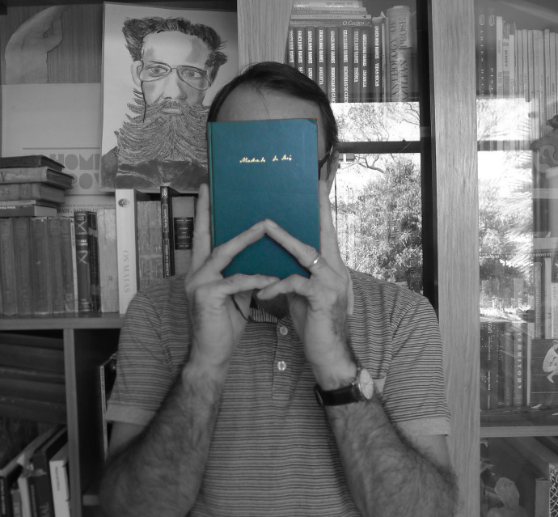

*O alienista* é muito mais que a história das peripécias e frustrações de um médico ao testar teorias sobre a loucura nos habitantes de uma cidadezinha. É exemplar até sob o ponto de vista da teoria literária, exemplo clássico de como é problemático definir o gênero “conto”. Há quem o chame de novela, classificação dos franceses para textos assim, com mais de vinte páginas. E isso nos obriga a, machadianamente, interromper essa resenha para uma pequena digressão sobre a natureza do conto.

Tão clichê quanto citar *O alienista* como modelo de conto-que-pode-ser-novela-e-vice-versa é lembrar, nessa hora, a ideia de que o conto é o texto que vence o leitor por nocaute, diferente do romance, vencedor por pontos. Julio Cortázar, considerado o autor da definição, lançada [numa palestra em Cuba, por volta de 1970,](http://www.literatura.us/cortazar/aspectos.html) atribuiu a frase a um anônimo “escritor argentino, muito amigo do boxe”.

Essa analogia violenta só vale mesmo para quem entende a leitura como um “combate” entre o texto e o leitor. O próprio Cortázar admite ver, no contista, “um boxeador muy astuto”, que administra cada golpe pensando no efeito derradeiro; mas, para ele, o que faz do conto um conto não é nenhuma pancadaria textual. Não é um embate, é a noção de “limite”, de “economia de meios”, de “corrida contra o relógio”.

Definição por definição, [a do Ricardo Piglia, também clichê nesse debate, é mais rica](http://www.poscritica.uneb.br/wp-content/uploads/2014/08/piglia-ricardo-formas-breves.pdf): todo conto apresenta uma história enquanto desenvolve outra, escondida. Piglia, com essa definição, indicou, para mim, algo essencial: paralelamente ao relato aparente do conto, que se concentra em um incidente, um personagem ou um horizonte particular, há, obrigatoriamente, um comentário, uma narrativa, uma descrição que torna mais clara ou saborosa a história principal e amplia ou sofistica nossa visão de mundo.

Não é um enigma a ser desvendado, mas uma “verdade secreta sob a superfície oculta da vida”. Mal comparando, a breve melodia do conto se faz acompanhar, sempre, de uma harmonia que a sustenta e lhe dá sentido.

Ou seja, a luta do contista não é para derrubar o leitor, mas para envolvê-lo rapidamente e completamente em sua dança. Outro teórico, menos citado nesse ringue, o [Merleau-Ponty](http://pt.scribd.com/doc/55690416/A-Prosa-Do-Mundo-Merleau-Ponty), compara o jogo entre texto e leitor ao fósforo aceso que, magicamente, incendeia a madeira. No conto, digo eu, não há incêndio romanesco, com focos aqui e ali, mas uma fogueira controlada que queima, juntos, contista e leitor.

Antes que a leitora se enfade e nos troque por algum link mais atraente, passemos, então, ao nosso alienista. Em um tweet, o enredo se resumiria assim: estudioso da loucura tranca quase toda a cidade no hospício, mas solta todo mundo e tranca a si mesmo ao concluir que louco, mesmo, é ele.

Um tweet é pouco para o conto de Machado, como se vê.

O narrador, na terceira pessoa, quase descritivo, com adjetivos elogiosos carregados de intenções irônicas, apresenta as descobertas contraditórias de Simão Bacamarte, o sábio psiquiatra. Enquanto relata as desventuras científicas do estudioso que descobre ser a loucura o estado normal dos indivíduos e os normais os verdadeiros loucos, Machado implode as pretensões de encontrar uma receita racional e definitiva para as ações humanas. Argumentos razoáveis levam a consequências absurdas – mais ou menos como o neoliberalismo desenfreado, baseado nas expectativas racionais da década de 90, gerou, há alguns anos, a pior crise econômica já enfrentada pelo capitalismo.

O tom farsesco não vem só do esforço para separar demência e normalidade; está ligado à própria confiança na racionalidade humana. Já no início, o casamento de Bacamarte com uma viúva “nem bonita, nem simpática” se justifica por sua “constituição anatômica e fisiológica robusta”, garantia de filhos fortes e saudáveis (que não vieram). O conto do alienista tem, no limite, como história meio oculta, a aventura paralela do próprio Bacamarte ligada ao fracasso da razão.

Na história aparente, o protagonista é o cientista que age em Itaguaí e mobiliza as ferramentas do poder social e político para executar seu experimento, afinal frustrado. Há quem veja nesse conto de Machado uma antecipação da crítica do filósofo Michel Foucault à relação entre o saber e o poder e suas instituições controladoras. Na história paralela do alienista, Bacamarte está só, com a pureza de sua fé na ciência; e só ao fim do conto ele vê – e nos conta – a grandeza de sua solidão.

Como todo clássico, *O alienista* é cheio de facetas, que se atualizam com a leitura. Ele mostra, por exemplo, como são férteis as teorias conspiratórias do populacho desinformado, quando não há acesso aos mecanismos do poder. Quando Bacamarte começa a trancar seus “loucos”, movido por legítimos propósitos científicos (ou não?), a população desconfia dele, e imagina motivações mesquinhas, sejam ciúmes, vingança ou cobiça. Houvesse Facebook naquela época, provavelmente seria o veículo para o falatório dos personagens incapazes de compreender a lógica dos poderosos.

Fico por aqui sem esgotar a riqueza do conto machadiano, que, além de tudo, é divertidíssimo, e me permite também comentar uma personagem real que mereceria a atenção de Simão Bacamarte. Chama-se Patrícia Secco, dona de um projeto para atrair leitores jovens simplificando autores como… Machado de Assis, em obras como… *O alienista*. São tantas as deturpações que ela fez na história (não somente no texto), que o livro editado com financiamento público e distribuído por ela com o título “O Alienista” deveria ser lido pelo Procon.

Para não alongar a resenha, dou o link de um obstinado que comparou os dois textos, palavra a palavra e encontrou barbaridades. Infelizmente, o relato dessa investigação começa com um arrazoado reacionário que mostra total desconhecimento do autor sobre a pedagogia de Paulo Freire. Mas o final é um verdadeiro nocaute. Pulem diretamente para a parte com o subtítulo *Machado para consumo próprio*: [aqui](http://www.jornalopcao.com.br/reportagens/discipula-de-paulo-freire-assassina-machado-de-assis-4399/).

*O alienista* foi publicado no livro *Papéis Avulsos*, de 1882, época em que os árabes, de quem herdamos os numerais, a astronomia e muita medicina, eram, inclusive no Corão, modelo do espírito científico – e assim foram vistos por Machado de Assis. É um conto perfeito, que sempre desperta em mim a santa e nobre inveja dos admiradores.

## **Trecho do conto ‘O alienista’, de Machado de Assis**

> Bacamarte espetara na pobre senhora um par de olhos agudos como punhais. Quando ela acabou, estendeu-lhe a mão polidamente, como se o fizesse a própria esposa do vice-rei e convidou-a a ir falar ao primo. A mísera acreditou; ele levou-a à Casa Verde e encerrou-a na galeria dos alucinados.  
>  A notícia dessa aleivosia do ilustre Bacamarte lançou o terror à alma da população. Ninguém queria acabar de crer que, sem motivo, sem inimizade, o alienista trancasse na Casa Verde uma senhora perfeitamente ajuizada, que não tinha outro crime senão o de interceder por um infeliz.

## **Trecho do conto ‘Mentira’, de Sergio Leo**

> Isso é falso. Você lê que eu ando pelo calçadão da praia e que entro na rua Constante Ramos, olho distraído as mesas do bar e sigo até a rua Barata Ribeiro, mas isso não é verdade. Já passei faz tempo pelo bar, pela Constante Ramos e pela esquina da Barata Ribeiro. De onde estou, não vejo o céu de Copacabana, nem os prédios, de pintura gasta e esquadrias velhas; o que há é um teclado, e eu cato milho porque nunca vi importância em aprender a datilografar, nem sei mais se ainda se ensina datilografia, hoje se digita. Aliás, não há nem isso, teclado ou digitação; enquanto você lê, eu provavelmente nem me lembro das palavras que escrevi, e que você está lendo nesse exato momento.

**Sergio Leo** é escritor, jornalista e artista plástico. Ganhou o prêmio Sesc de Literatura 2008 com seu livro de contos *Mentiras do Rio*. Publicou, em 2014, o livro-reportagem *Ascensão e Queda do Império X*, sobre o fracasso empresarial de Eike Batista e o livro-conto *Segundas Pessoas*, pela coleção Formas Breves da e-galáxia. Participou da coletânea *Desassossego*, organizada por Luis Ruffato para a editora Mombak. É colunista do jornal Valor Econômico. Participou das mostras *Diálogos da Resistência* e *MeuMuseu Expoexperimento*, no Museu Nacional de Brasília.

The post [Sergio Leo resenha seu conto predileto: ‘O alienista’, de Machado de Assis](http://homoliteratus.com/programado-16-9-sergio-leo-resenha-seu-conto-predileto-o-alienista-de-machado-de-assis/) appeared first on [Homo Literatus](http://homoliteratus.com).
