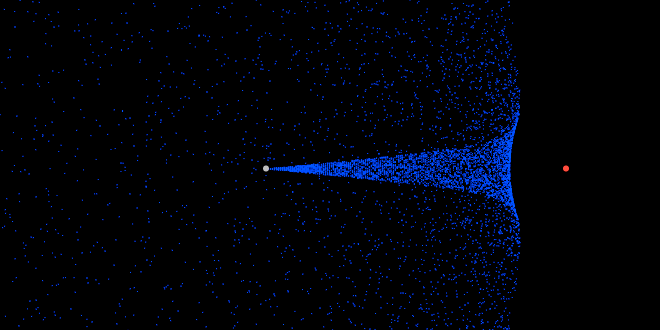

# Build a JavaScript Particle System in 200 Lines

In less than 200 lines of vanilla JavaScript you will have a flexible particle system with multiple emitters and fields that repel and attract thousands of particles.

This started as a [personal project](http://jarrodoverson.com/static/demos/particleSystem/) that ended up as a [Chrome Experiment](http://www.chromeexperiments.com/detail/gravitational-particle-system-sandbox/?f=) 2 to 3 years ago when I started becoming serious about JavaScript development. I am not a mathematician, physicist, or game developer so there are likely many better ways to approach some of the logic here. Even still, it was an excellent way for me to learn about JavaScript performance during that time.

The biggest takeaway from this project was just how insignificant the barrier to entry is for graphic development right now. If you have a text editor and a browser, you can make engaging visualizations or even video games *right now*.

## Setting up your environment

There’s no point in going too deep into the canvas element and its 2d context because there are [better articles](https://developer.mozilla.org/en-US/docs/Web/Guide/HTML/Canvas_tutorial) dedicated to it. If you need further information, there is [plenty to choose from](https://www.google.com/search?q=canvas+tutorials&oq=canvas+tutorials).

|  |  |
| --- | --- |
|  | DOCTYPE  canvascanvas |

Yep, that’s it. This is the world we live in now. Three nested tags is all we need to get a usable environment off the ground.

To give us a cleaner foundation, let’s add some style to eliminate padding and add a black background.

|  |  |
| --- | --- |
|  |   canvascanvas |

## The Canvas Object

To access our canvas we just need to grab the element any way you are comfortable with.

|  |  |
| --- | --- |
|  | canvasdocumentquerySelector'canvas' |

The canvas element has multiple “contexts” and what we’re looking for right now is the basic 2d context, allowing us to manipulate the canvas as a bitmap with a variety of [classic methods](https://developer.mozilla.org/en-US/docs/Web/API/CanvasRenderingContext2D).

|  |  |
| --- | --- |
|  | canvasgetContext |

In order to maximize our drawing area, we can also set the canvas dimensions to fill the entire window

|  |  |
| --- | --- |
|  | canvaswidthwindowinnerWidth  canvasheightwindowinnerHeight |

## The Animation Loop

The animation loop is the first foreign concept you’ll come across if you’re coming from traditional application development. When dealing with graphics in this way you’ll want to manage your state of the system separately from the drawing so you’ll have two distinct steps for the update and the draw. You’ll also need to clear the current canvas and then queue up the next animation cycle. The process can be summed up in the code below.

|  |  |
| --- | --- |
|  | function  clear  update  queue |

Clearing the canvas in our case is a single line, but it could become more complicated when dealing with multiple buffers or drawing states.

|  |  |
| --- | --- |
|  | functionclear  clearRectcanvaswidthcanvasheight |

Queueing up the next cycle could be a  setTimeout()  but that would also make our animation run when we didn’t have focus, so we use the offered [requestAnimationFrame API](https://developer.mozilla.org/en-US/docs/Web/API/window.requestAnimationFrame) in order to defer to the browser to tell us when we should animate our next frame. This method is mostly unprefixed now but if you need to manage compatibility with older browsers, please see [Paul Irish’s solution](http://www.paulirish.com/2011/requestanimationframe-for-smart-animating/).

|  |  |
| --- | --- |
|  | functionqueue  windowrequestAnimationFrame |

The  update()  and  draw()  functions compose the vast majority of logic but you can stub them out for now and then initiate the first run of your loop to set up a solid foundation for canvas experimentation.

|  |  |
| --- | --- |
|  | functionupdate  // stub  function  // stub |

The final code for the foundation should look like below. The way you organize and set up the rest of the code is up to you, but the complete example will be linked at the bottom of the article for demo and comparison.

|  |  |
| --- | --- |
|  | canvasdocumentquerySelector'canvas'  canvasgetContext  canvaswidthwindowinnerWidth  canvasheightwindowinnerHeight  function  clear  update  queue  functionclear  clearRectcanvaswidthcanvasheight  functionupdate  // stub  function  // stub  functionqueue  windowrequestAnimationFrame |

## Particle basics

At the base of any Particle, we just have a moving point in (2d) space. To represent this state we’ll need to store, at the least: position, velocity, and acceleration. Each of these can be represented by a two dimensional vector so we’ll start there.

### Vector

This object will be used **often**. If we’re animating 10,000 particles at 30 frames per second and we’re using a Vector for 3 properties of each particle (not including interstitial and end states) we’re creating and throwing away almost one million objects every second. Given that usage, Vector is a obvious target for optimization. While I’ll take into account some performance optimizations elsewhere, I’ll be opting for readability over performance more often than not here. Don’t get hung up overthinking this yet.

A 2d vector at its core is just a representation of an X and a Y coordinate.

|  |  |
| --- | --- |
|  | functionVector |

There are a slew of utility methods that can hang off of Vector but the only ones that we’ll need for the immediate future are:

|  |  |
| --- | --- |
|  | // Add a vector to another  Vectorprototypefunctionvector  vector  vector  // Gets the length of the vector  VectorprototypegetMagnitudefunction  return  // Gets the angle accounting for the quadrant we're in  VectorprototypegetAnglefunction  returnatan2  // Allows us to get a new vector from angle and magnitude  VectorfromAnglefunctionanglemagnitude  returnVectormagnitude \*anglemagnitude \*angle |

### Particle

Now that we can represent Vectors we can put together our particle object. We can pass in each property or default to a stationary particle located at the origin,  .

|  |  |
| --- | --- |
|  | functionParticlepointvelocityacceleration  positionpointVector  velocityvelocityVector  accelerationaccelerationVector |

Each frame we’re going to want to move our particle and the method to do this is pretty straightforward and intuitive. If we are accelerating, modify the velocity. Afterward, add the velocity to the position.

|  |  |
| --- | --- |
|  | Particleprototypefunction  // Add our current acceleration to our current velocity  velocityacceleration  // Add our current velocity to our position  positionvelocity |

### Particle Emitter

The emitter ends up just being a central point that dictates the type of particles that are emitted from it. The emitter could be a mouse click, a rocket pack, firework, or a smoldering campfire and could emit particles that sparkle and fade, have their own propulsion or are effected by gravity.

Our emitters will just push out particles from a set point, at a set rate, and across a set angle.

|  |  |
| --- | --- |
|  | functionEmitterpointvelocityspread  positionpoint// Vector  velocityvelocity// Vector  spreadspread// possible angles = velocity +/- spread  drawColor"#999"// So we can tell them apart from Fields later |

To get our particles we’ll need the emitter to spawn them. This amounts to just creating a new  Particle  with values derived from our emitter’s properties and this is where our  Vector.fromAngle  method comes in handy.

|  |  |
| --- | --- |
|  | EmitterprototypeemitParticlefunction  // Use an angle randomized over the spread so we have more of a "spray"  anglevelocitygetAnglespreadrandomspread \*  // The magnitude of the emitter's velocity  magnitudevelocitygetMagnitude  // The emitter's position  positionVectorpositionposition  // New velocity based off of the calculated angle and magnitude  velocityVectorfromAngleanglemagnitude  // return our new Particle!  returnParticlepositionvelocity |

## Our First Animation!

We have nearly everything we need to start simulating the state of a particle system so now we can start building our  update()  and  draw()  methods

To manage our state, we’ll need containers for our particles and emitters which can be simple arrays.

|  |  |
| --- | --- |
|  | particles  // Add one emitter located at `{ x : 100, y : 230}` from the origin (top left)  // that emits at a velocity of `2` shooting out from the right (angle `0`)  emittersEmitterVectorVectorfromAngle |

What might our update function look like? We’d need to generate new particles and them move them. We might want to bound them to a certain rectangle so we don’t have to occupy the entire canvas at all times.

|  |  |
| --- | --- |
|  | // new update() function called from our animation loop  functionupdate  addNewParticles  plotParticlescanvaswidthcanvasheight |

The  addNewParticles()  function is straightforward; for each emitter, emit a number of particles and store each in our particles array.

|  |  |
| --- | --- |
|  | maxParticles// experiment! 20,000 provides a nice galaxy  emissionRate// how many particles are emitted each frame  functionaddNewParticles  // if we're at our max, stop emitting.  particleslengthmaxParticlesreturn  // for each emitter  emitterslength  // for [emissionRate], emit a particle  emissionRate  particlesemittersemitParticle |

The  plotParticles()  function is similarly straightforward with a little catch. We don’t want to keep track of particles that have gone out of the bounds of rendering, so we need to manage that and make room for new particles to be emitted. This is where the bounds arguments come into play; we might only want to render a small portion of the screen with particles. In this case we’re ok with being bound by the canvas.

|  |  |
| --- | --- |
|  | functionplotParticlesboundsXboundsY  // a new array to hold particles within our bounds  currentParticles  particleslength  particleparticles  particleposition  // If we're out of bounds, drop this particle and move on to the next  boundsXboundsYcontinue  // Move our particles  particle  // Add this particle to the list of current particles  currentParticlesparticle  // Update our global particles, clearing room for old particles to be collected  particlescurrentParticles |

Our state is now being updated every frame, and we just need to draw something. We’re simply drawing squares here but you could draw sparks, smoke, water, birds or falling leaves. Particles! They’re everything and everywhere!

|  |  |
| --- | --- |
|  | particleSize  functiondrawParticles  // Set the color of our particles  fillStyle'rgb(0,0,255)'  // For each particle  particleslength  positionparticlesposition  // Draw a square at our position [particleSize] wide and tall  fillRectpositionpositionparticleSizeparticleSize |

That’s it! You can this state demoed at codepen : [Emitter demo](http://cdpn.io/chGDt)

## Adding Fields

In our system, a field is just a point in space that attracts or repels. The mass can be positive (attractive) or negative (repelling). I used a setter for   so that  drawColor  can be updated depending on whether the field attracted (green) or repelled (red).

|  |  |
| --- | --- |
|  | functionFieldpoint  positionpoint  setMass |

|  |  |
| --- | --- |
|  | FieldprototypesetMassfunction  drawColor"#f00""#0f0" |

We can now set up our first Field in our system a similar way to our emitters.

|  |  |
| --- | --- |
|  | // Add one field located at `{ x : 400, y : 230}` (to the right of our emitter)  // that has a mass of `-140`  fieldsFieldVector |

We’ll need each of our particles to update its velocity and acceleration based on our fields so we’ll need to add a method to the  Particle  prototype. Some of the internal logic would make sense as  Vector  methods but they’ve been inlined here to improve performance on an expensive method called very often.

|  |  |
| --- | --- |
|  | ParticleprototypesubmitToFieldsfunctionfields  // our starting acceleration this frame  totalAccelerationX  totalAccelerationY  // for each passed field  fieldslength  fieldfields  // find the distance between the particle and the field  vectorXfieldpositionposition  vectorYfieldpositionposition  // calculate the force via MAGIC and HIGH SCHOOL SCIENCE!  forcefieldvectorX\*vectorXvectorY\*vectorY  // add to the total acceleration the force adjusted by distance  totalAccelerationXvectorX \*force  totalAccelerationYvectorY \*force  // update our particle's acceleration  accelerationVectortotalAccelerationXtotalAccelerationY |

We already have our  plotParticles  function, we can now just plug in  submitToFields  right before we move the particles.

|  |  |
| --- | --- |
|  | functionplotParticlesboundsXboundsY  currentParticles  particleslength  particleparticles  particleposition  boundsXboundsYcontinue  // Update velocities and accelerations to account for the fields  particlesubmitToFieldsfields  particle  currentParticlesparticle  particlescurrentParticles |

It would be nice to also visualize our fields and emitters, so we can add a utility method and a call in our  draw()  function to do so.

|  |  |
| --- | --- |
|  | // `object` is a field or emitter, something that has a drawColor and position  functiondrawCircleobject  fillStyleobjectdrawColor  beginPath  objectpositionobjectpositionobjectSize  closePath |

|  |  |
| --- | --- |
|  | // Updated draw() function  function  drawParticles  fieldsforEachdrawCircle  emittersforEachdrawCircle |

## Demos

Congratulations! You can see the final demo here at copepen.io [JavaScript Particle System Demo](http://cdpn.io/KtxmA)

Play around with a variety of different emitter and field combinations. Turn the mouse into a field or emitter by tracking the mouse position and updating the position of an emitter or field. Fork the codepen and try something new!

You can try the following combinations of emitters and fields.

|  |  |
| --- | --- |
|  | emitters  EmitterVectorVectorfromAngle  fields  FieldVector  FieldVector  FieldVector |

[demo](http://cdpn.io/pkEqs)

|  |  |
| --- | --- |
|  | emitters  EmitterVectorVectorfromAngle  fields  FieldVector  FieldVector |

[demo](http://cdpn.io/zyGln)
