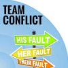
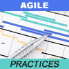

# Working Together, Sitting Apart bd7561a9b3f6d86f95456102e912bb77.jpeg

Posted by
[Hugo Messer](http://www.infoq.com/author/Hugo-Messer)
on
Oct 05, 2014
*|*
[Discuss](http://www.infoq.com/articles/working-together-sitting-apart#theCommentsSection)

- Share
- [[anexo ausente]](http://www.addthis.com/bookmark.php?v=250&username=infoq)
- |
- [Share on facebook](http://www.infoq.com/articles/working-together-sitting-apart# "Facebook")
- [Share on digg](http://www.addthis.com/bookmark.php?v=300&winname=addthis&pub=infoq&source=tbx-300&lng=pt-BR&s=digg&url=http%3A%2F%2Fwww.infoq.com%2Farticles%2Fworking-together-sitting-apart&title=Working%20Together%2C%20Sitting%20Apart&ate=AT-infoq/-/-/5447bb36c3d44cee/2&frommenu=1&uid=5447bb36b9c186b4&ct=1&tt=0&captcha_provider=nucaptcha "Digg")
- [Share on dzone](http://www.addthis.com/bookmark.php?v=300&winname=addthis&pub=infoq&source=tbx-300&lng=pt-BR&s=dzone&url=http%3A%2F%2Fwww.infoq.com%2Farticles%2Fworking-together-sitting-apart&title=Working%20Together%2C%20Sitting%20Apart&ate=AT-infoq/-/-/5447bb36c3d44cee/3&frommenu=1&uid=5447bb3616b67911&ct=1&tt=0&captcha_provider=nucaptcha "Dzone")
- [Share on twitter](http://www.infoq.com/articles/working-together-sitting-apart# "Tweet")
- [Share on reddit](http://www.addthis.com/bookmark.php?v=300&winname=addthis&pub=infoq&source=tbx-300&lng=pt-BR&s=reddit&url=http%3A%2F%2Fwww.infoq.com%2Farticles%2Fworking-together-sitting-apart&title=Working%20Together%2C%20Sitting%20Apart&ate=AT-infoq/-/-/5447bb36c3d44cee/4&frommenu=1&uid=5447bb3660c6a810&ct=1&tt=0&captcha_provider=nucaptcha "Reddit")
- [Share on delicious](http://www.addthis.com/bookmark.php?v=300&winname=addthis&pub=infoq&source=tbx-300&lng=pt-BR&s=delicious&url=http%3A%2F%2Fwww.infoq.com%2Farticles%2Fworking-together-sitting-apart&title=Working%20Together%2C%20Sitting%20Apart&ate=AT-infoq/-/-/5447bb36c3d44cee/5&frommenu=1&uid=5447bb3625d54ec1&ct=1&tt=0&captcha_provider=nucaptcha "Delicious")
- [Share on email](http://www.infoq.com/articles/working-together-sitting-apart# "Email")
- ["Read later"](http://www.infoq.com/articles/working-together-sitting-apart#)
- ["My Reading List"](http://www.infoq.com/showbookmarks.action)

There are essentially two factors that determine whether your offshoring adventure is successful or not – people and process. Some people will claim that process is the most important factor, while others will argue that people are number one. When I started with nearshoring about 8 years ago, I believed in process. I believed that offshoring would work by building a factory-like process. Today, I am convinced that although process is crucial, people are primary. Use an excellent process with the wrong people and the outcome will disappoint you. Hire the best people available without any process and the outcome will surprise you. If you do not hire the right people, they may not even think about process and instead just ‘get going’. This usually leads to all kinds of communication and project management problems.

An earlier version of this article has been published in the book ‘How to organize offshore and nearshore collaboration’. This book is part of a [series of books on managing remote teams](http://bookoffshoring.bridge-outsourcing.com/).

This article is the first article in a series of articles on managing remote teams. I will share my experience in developing a rock-solid process for remote collaboration. As people sit apart in (several) remote locations, extra attention must be paid to articulating how people work together. At [Bridge](http://bridge-outsourcing.nl/), we have developed a workshop that we always provide for new customers. The chapters in the work book that we have created are the key ingredients to making a remote collaboration effective:

Related Vendor Content

### [Agile for Dummies](http://www.infoq.com/vendorcontent/show.action?vcr=3042&utm_source=infoq&utm_medium=VCR&utm_campaign=vcr_articles_click)

### [Cloud-Enabled Software Development and Testing: Putting the Agile into the Infrastructure](http://www.infoq.com/vendorcontent/show.action?vcr=3020&utm_source=infoq&utm_medium=VCR&utm_campaign=vcr_articles_click)

### [Five vital steps for successful software delivery in a chaotic world](http://www.infoq.com/vendorcontent/show.action?vcr=3045&utm_source=infoq&utm_medium=VCR&utm_campaign=vcr_articles_click)

### [Navigating the Agile Testing Tool Landscape](http://www.infoq.com/vendorcontent/show.action?vcr=3041&utm_source=infoq&utm_medium=VCR&utm_campaign=vcr_articles_click)

### [NoSQL Performance Benchmark: Cassandra, MongoDB, and Couchbase](http://www.infoq.com/vendorcontent/show.action?vcr=2981&utm_source=infoq&utm_medium=VCR&utm_campaign=vcr_articles_click)

1. **Process**: How do we work?
2. **Responsibilities**: Who does what?
3. **Project Management Tool**: How do we track projects?
4. **Communication**: How (often) do we communicate?
5. **Performance**: What and how do we measure performance and progress?
6. **Coding standard**: What is our standard?
7. **Time registration**: How do we track time?
8. **Creating ‘Co-workers’**: How will we perform together and become friends?

I will discuss three of these ingredients – process (the ‘way we work’, comprising things like planning, requirements, testing), responsibilities, and performance. You can [download a free copy of the workbook on our website](http://bridge-outsourcing.nl/knowledge-center).

## 1. Process

The natural inclination of most people is to ‘just get going’ on their (software) projects. They select a partner in Eastern Europe or India (spend a lot of time on RFIs and RFPs) and then ‘get to work’, ‘start the project’. Especially, if the outsourcing relationship is based on fixed prices, the expectation is that the partner knows how to handle the project. Requirements are made, sent to the supplier, and now we sit and wait till the results are delivered on the agreed date. But, will this work?

Of course, as an outsourcing ‘buyer’, you should expect the outsourcing partner to know how outsourcing works. The remote team must know how to serve you well and make your project a success. And it is likely that they know all this. But do you?

And do they know how to make it work specifically for your situation and your project? Many outsourcing vendors are by nature technology companies. They are good at building stuff. But that does not mean that they are able to make a complex collaboration across cultures, time zones, and languages work smoothly. I recently spoke to a CIO from a big bank in the Netherlands. What he told me is that whenever he sends an RFP to an offshore vendor, he inevitably gets responses that deep dive into technological solutions. What he’s always looking for are companies that explain him how they propose to deliver the solution he needs: what people they will engage, what process they suggest, how they propose to collaborate with the onshore product owner.

Before the offshore team starts executing the project, before they start analyzing your requirements, or writing the code, it is crucial that you discuss in one meeting with both the onshore and offshore team joining, how you are going to work. The starting point is the way you work right now and/or the way the vendor works. Hence, two approaches are meeting here – the way you work and the way the vendor works – which means that one of you (or both) has to adapt and change behavior.

Software development is a creative process. Just pouring requirements in to a standardized process to get a finished product, would be a dream come true for any customer. But this is not the way a creative process works. In the past, software development followed the construction approach and people developed the waterfall model. This model has defined the way of working for about two decades. Today, everything is about ‘agile’. A creative process is agile by default. In the rest of the article, and to keep it simple, I will use waterfall and scrum as the two extremes on a spectrum of processes.

### How do you work today?

Are you following a method that resembles the waterfall model or are you truly agile? Do you use scrum as most companies do? Do you apply extreme programming or Kanban perhaps? At Bridge, we build remote dedicated teams that supplement an internal IT department. I have learned that the most challenging customers are service providers (as opposed to companies building a product). Especially, if you are a small service provider like an internet agency, it is extremely challenging to make offshoring work. You are, in most cases, forced by customers to work for a fixed price. Probably you provide this fixed price by using a waterfall model. If you are a bigger service provider, it is quite another story. As a big service provider, you are basically building ‘products’ for your customers in long-term projects. Therefore, you have more time and flexibility to build a process that produces the desired outcome. Because both partners in such case have more time to develop a joint collaboration process, even price or time constrained projects have a bigger chance of success.

Now, please take some time to build an understanding about how you really work. I myself have experienced that scrum is based on some principles and not on rigid processes. Because people follow ‘principles’, there are still many ways to create a way of working. This results in many companies believing they follow scrum while they are actually using waterfall or Kanban or something similar. If you want to establish a smooth, integrated way of collaborating with your remote team, you must clearly tell them how you (think you) work and how you would like to work (the improvements you see in your own process). Often, the way of working is not formalized (in documents or drawings). People have built a way of working which your current team understands subconsciously. However, the new remote team also must consciously adapt to the new way of working that you mutually agree upon. So on top of discussing on the way of working, commit it on paper, draw it, and make it explicit. If you use only verbal ways to communicate how you work, it is likely that you may not see or understand them the same way once you get going.

### How do you estimate the work?

A crucial challenge in the waterfall model lies in the estimation of a project. Let’s look at your personal planning. How do you personally plan your week? If you look at the priorities you have for the week, are you able to estimate how much time each will take accurately? If you do that estimate your work for the upcoming month? For the upcoming quarter? To identify the accuracy of your estimation, compare your approximated time with the actual time taken to complete the tasks within the estimated time period. You are probably off track by 2-3 times for the week and 5-10 for the quarter.

We expect software developers to come up with good estimates and we invent all kinds of methods to make them more accurate. But, do we even get close to reality? Normally, projects for your customers need to be estimated in advance. Therefore, a simplified calculation is often being used to speed up the bidding process. Given this fact, one must not overlook that after you have won the bid, at a certain point of time, the offshore team is supposed to estimated the workload too. And it is very likely that they are off track from your estimate (and you were off track already anyway!).

In case you are working this way and cannot change the waterfall model, it is advisable to find an offshore partner who uses the same process – a partner who is used to working on a fixed price and whose process matches with your estimates. I recommend that you should change the process if possible. You can start by introducing some elements of scrum to your current process and changing the process step-by-step, possibly already in sync with your offshore partner Take the time to introduce agile principles and scrum, train your team on scrum practices, and get some of your employees certified as product owners or scrum masters. Implementing this change will take a few months, and can be established with the help of your offshore partner before starting projects with your remote team.

If you are already working with agile or scrum, that is great. You probably use planning poker (or another variant) to get an estimate of each user story that the whole team buys into. And if you need to estimate an entire project, you can roughly estimate the scope and use the flexibility of scrum for adjusting the workload per sprint to eventually fit the scope. The ideal case is of course to have the whole team, including the offshore team members, join the sprint planning and commit to the scope.

### How do we define requirements?

One of the most challenging aspects of software development is to know what needs to be built, and to express this through clear requirements. Also add the distance along with different time zones, languages and cultural differences to this, and the challenge quadruples.

The waterfall model is based on the assumption that we can figure out upfront, what to build. I believe that if we spend a lot of time, indeed we can, but only with a probability of 75-80 percent and thus deal with the risk of building something that is outdated by the time it is ready. If we choose this path in a remote collaboration, it is essential to establish clear guidelines for making requirements or specifications. Some questions that must be addressed are:

- Which details are essential for the specifications?
- Do we create separate technical specifications? If yes, which specifications are essential?
- How will the offshore team be involved in developing or extending the specifications?
- How are additions, (priority) changes and deletions to the specifications discussed, agreed upon, and stored?

The answers to these questions must be committed on (electronic) paper, so that each team member has a clear understanding of how the requirements are being set. As a supplement to these guidelines, it is helpful to attach an example of the ‘ideal specification’.

The most fundamental question is 'who creates the specifications?'. The natural inclination of people is to create the specifications onshore because it is closer to the customer. But think about this carefully. When committing something on paper, you give extensive thoughts to it, based on many discussions you have had with your customer before. The remote team, however, is being excluded from this interaction. So you are sending requirements that are clear to you, and a mystery to your remote team. The earlier you involve the remote team in developing the solution and the requirements, the easier it will be for them to understand the process and what needs to be built.

If you follow an agile development process, instead of specifications, discussions and meetings are the starting point. When it comes to specifications, not only one person, but the whole team is engaged in developing demands.

First, the product owner speaks to the client or user, translates the requirements into user stories, and then the scrum master and the development team (designers, coders, testers, architects) further specify the solution for each user story. It is important to clearly understand how this process works in your company.

I have observed that sometimes companies call it ‘scrum’, even though they are not really following this method. In this case, for example, the product owner (or a person who is both owner and scrum master) would talk to the customer, describe the user stories in detail, prescribe the solution-sometimes up to the level of the technical implementation - , and then send the ‘user stories’ to the development team. If you handle it like this, you have created a mini waterfall model. Although this approach can work, it is crucial that the remote team and you are aware of applying this model because it has an impact on the level of involvement and clarity in understanding your requirements.

### How do we create a plan?

Since the eBook How To Organize Offshore and Nearshore Collaboration contains an entire chapter on planning, this article will only highlight the important questions.

If you use a waterfall model, you have probably developed a standardized way of creating project plans using tools like Microsoft Project. Thinking about the way you make plans, helps you providing an explicitly written concept for your remote team. Are you going to involve the offshore team in the planning? Will they create the designs and get them approved by you? Will you create the plans for them to execute?

In scrum, are you performing the sprint planning carefully? Is the whole team involved in the planning? How do you calculate the hours available in the sprint? Are your people able to work productively on user stories 80% or at least 50% of the time? Who commits to the sprint?

### Who’s testing what?

Testing is a grey area in software development that is never organized in the same way in every company. Most companies expect their software developers to test their own work (but, what is ‘acceptable’ in that case?), after which a project manager does some final testing before sending it to the end customer or user. Larger teams have a separate tester in their team or a testing department which evaluates the features or user stories once they have been completed by the developer. Some scrum teams follow peer testing where one programmer tests the work of the other. In addition, some work with group testing where the whole scrum team gathers at one PC on the final day of the sprint to test together.

The important part here is to document your current testing process in the organization. What do you expect from each individual? How are you going to adjust the way you test the new situation with remote team members? What are the acceptance criteria or the definition of 'done'? Write everything down, discuss it with the remote team, and get a clear mutual understanding on how testing has to be done.

## 2. Responsibilities

If you put a team together and let them ‘get started’, they may or may not somehow manage to complete your projects. In my view, it is crucial to discuss what each person is responsible for and write it down before the team starts working.

The best starting point is at the company level. What are the responsibilities on either side? The primary aspect, which is relevant, is the project or product responsibility. Who is accountable for planning and setting deadlines? Who does the project management? A clear demarcation line (also contractually) can be the key to answer all these questions. Some other factors are: Who takes care of people management? Who ensures that every 3-6 months the team members discuss their personal development with their manager? Who decides on and organizes training?

In scrum, the most important roles to ‘assign’ are the product owner and the scrum master. In the waterfall model, these questions are similar, although the roles are named differently.

The most efficient way to distribute the responsibilities in an offshore setting, is to have the product owner onshore, as close to the customer as possible. There can be a second product owner offshore, even though this may complicate things if your project is relatively small. The scrum master can be either offshore and/or onshore. The frequently used variants are:

A. The onshore product owner talks to the offshore scrum master (plus the team).

B. The onshore product owner talks to the offshore product owner.

C. The onshore scrum master talks to the offshore scrum master.

D. The onshore scrum master talks to the offshore development team.

Ideally, the customer or end user talks to the whole team in the sprint planning sessions or even better, sits in the office ‘with’ the (virtual) scrum team (either onshore, offshore, or mixed). In most cases, however, the product owner talks to the customer and communicates all the user stories to the team. No matter what setting you choose, the whole team (including the product owner and scrum master) uses video conferencing for the sprint planning.

Some questions to be answered to create clarity in the responsibilities are:

- Who is responsible for describing the implementation of the user stories (functionally and/or technically)? Is it the onshore or the offshore scrum master?
- How much can the product owner describe?
- Who is responsible for making the decisions on what and when to build during a sprint? What if that person is not available because of time differences?
- Who is responsible for giving a demo?
- To whom should the demo be given?
- Who conducts tests on the functionality?

In order to be able to complete your list of responsibilities for each person and/or role, I will continue with similar questions:

One crucial role in an offshore collaboration is a 'process manager' (also called delivery manager, quality manager, or similar terms). This person's responsibility lies outside the project and his core accountability is to ensure a smooth communication between the onshore and offshore teams. In a larger setting, for instance, it is even good to have this role both on the onshore team and the offshore team. These process managers discuss on a weekly basis and evaluate the current performance. As they are not involved in the day to day details of the projects, they keep an outside view and can provide valuable feedback on the way the team communicates; they can review the process to check if you are still on track; they can safeguard contractual agreements on project responsibility, etc.

A collaboration where we used this was for a customer that built an [online dating platform](http://www.kizzle.net/). The product owner was located in the client office in Zurich, as well as the scrum master. The ‘onshore’ process manager was based in the Netherlands and the offshore process manager in Kiev, together with the team. The CEO initially acted as the product owner. During the weekly meetings, we uncovered a problem in his availability for the team. While the team often had questions about user stories, he wasn’t always available for direct feedback, which caused delays. We decided that a new product owner needed to be engaged in the Zurich office. Once this new PO got involved, the number of impediments declined substantially and the velocity went up. In many cases, if the process manager don’t meet weekly, such availability issue might go undiscussed for weeks or months, derailing the project and the relationship.

## 3. Performance

On the company level, there is basically only one question: Is this collaboration delivering the value we want? In Bridge, we ask this question every week back and forth. It is not a one-way street. The onshore and the offshore team must be comfortable with the collaboration. The goal is to create a partnership, to collaborate, to create synergies, and 1+1=3. After all, this is what it is all about. Of course, you can also measure response time, productivity, or other variants that are linked to your SLA.

The same question can be asked on the team level where there are several teams working on different projects with different project leaders.

The most crucial performance to be evaluated is on the individual level. Teams consist of people, so we need to have someone to assess each individual's skills. It is best if the scrum master (either onshore or offshore) does this assessment once a month or quarter. In Bridge, we ask our customers to rate individual team members every month. We use a ranking of 1-10 to keep things clear. By default, we use the following set of questions (depending on the importance of a certain area for the project, we modify the questions):

Is the programmer:

- Meeting your expectations?
- Responding appropriately to the tasks you assign?
- Effective in making decisions on his own?
- Understanding the economic model of the product/project?
- Open to receiving feedback?
- Completing tasks within the agreed timelines?
- Apt for your future projects?

Along with these ‘formal’ performance evaluations, a meeting rhythm must be established. If you follow scrum, you can provide team feedback in the daily, demo, and retrospective meetings. We also have a weekly meeting with the process managers (see previous paragraph) in which each ‘shore’ can give a weekly rating on the collaboration as described above. Once a quarter, we meet personally with the individual, our HR manager, and the process manager. In some cases, our customers join or take over this quarterly personal development meeting.

For large enterprise settings, the ebook ‘How to organize offshore and nearshore collaboration’ contains a valuable (the chapter of Erwin de Bont) provides you with a framework for measuring performance and KPIs.

## Conclusion

To lay a solid foundation for a remote collaboration, it is important to create ‘think time’ before ‘doing’. Before you start your project, think about the way you work today and how you will modify this way of working with (part of) the team offshore (**process**). The topics that you could cover are:

- What steps do we follow?
- How do we arrive at estimates?
- How do we list our requirements?
- How do we plan?
- Who tests what?

You can discuss these questions in a session where both the onshore and offshore team members are present. During or after the meeting, commit the process on paper. Describe the **responsibilities** of each person involved, up to the last detail. And finally, invent a solid framework for providing feedback and rating to each other, the company, teams, and individuals.

And now, you are probably thinking: "Great! We have nailed all these things down, discussed them for hours, written them down, and they will end up in the (virtual) drawer. Nobody will ever look at them again and we will get going.” Yes, probably you will do so, because that is a natural tendency.

Nevertheless, the team has used their brains to think about ‘how’ to collaborate before actually doing so. This creates bonding and in itself creates a more effective way of working. Now, it is your responsibility to keep this document out of the drawer, use it in your meeting rhythm, and update it as you go, so that it becomes a living plan or practice!

## About the Author

**Hugo Messer** has been building and managing teams around the world since 2005. His passion is to enable people that are spread across cultures, geographies, and time zones to collaborate. Whether it’s offshoring or nearshoring, he knows what it takes to make a global collaboration work. To know more about Hugo, check out his [website](http://www.hugomesser.com/). You can also read the [blog](http://bridge-outsourcing.nl/) or watch videos at Youtube.

- Sections
- [**Process & Practices**](http://www.infoq.com/process-practices)
- Topics
- [Requirements](http://www.infoq.com/Requirements)
- [Scrum](http://www.infoq.com/scrum)
- [Testing](http://www.infoq.com/Testing)
- [Software Testing](http://www.infoq.com/software_testing)
- [Outsourcing](http://www.infoq.com/outsourcing)
- [Project Management](http://www.infoq.com/PM)
- [Estimating](http://www.infoq.com/Estimating)
- [Customers & Requirements](http://www.infoq.com/cust_requirements)
- [Teamwork](http://www.infoq.com/teamwork)
- [Planning](http://www.infoq.com/planning)
- [Agile](http://www.infoq.com/agile)
- [Collaboration](http://www.infoq.com/collaboration)
- [Process](http://www.infoq.com/Process)

Related Editorial

### [Interview with Eduardo Miranda about Estimating and Planning Agile Projects](http://www.infoq.com/articles/eduardo-miranda-estimating-planning-agile?utm_source=infoq&utm_medium=related_content_link&utm_campaign=relatedContent_articles_clk)

### [Back to the Future](http://www.infoq.com/presentations/philosophy-quality-lessons?utm_source=infoq&utm_medium=related_content_link&utm_campaign=relatedContent_articles_clk)

### [Applying Use Cases in Agile: Use Case 2.0, Slicing and Laminating](http://www.infoq.com/news/2014/02/use-cases-agile?utm_source=infoq&utm_medium=related_content_link&utm_campaign=relatedContent_articles_clk)

### [Behaviour-Driven Development: Value through Collaboration](http://www.infoq.com/news/2013/12/bdd-value-collaboration?utm_source=infoq&utm_medium=related_content_link&utm_campaign=relatedContent_articles_clk)

### [Meet Elaine: A Persona- Driven Approach to Exploring Architecturally Significant Requirements](http://www.infoq.com/articles/persona-approach-architectural-requirements?utm_source=infoq&utm_medium=related_content_link&utm_campaign=relatedContent_articles_clk)

Related Research

[Common Causes of Team Conflict](http://www.infoq.com/research/dealing-with-team-conflicts?utm_source=infoqresearch&utm_campaign=rr-content)[What are the Most Important and Adoption-Ready Agile Practices?](http://www.infoq.com/research/agile-practises?utm_source=infoqresearch&utm_campaign=rr-content)[How Do You Unit Test Your JavaScript Code?](http://www.infoq.com/research/javascript-unit-testing?utm_source=infoqresearch&utm_campaign=rr-content)

### Tell us what you think

Community comments
[Watch Thread](#)

- Popular
- [10 days](#)
- [40 days](#)
- [6 months](#)

### [Leslie Lamport on Distributed Systems and Precise Thinking](http://www.infoq.com/news/2014/10/ser-lamport-interview?utm_source=infoq&utm_medium=popular_links_homepage)

### [Mixing Agile with Waterfall for Code Quality](http://www.infoq.com/news/2014/10/agile-waterfall-code-quality?utm_source=infoq&utm_medium=popular_links_homepage) [3](http://www.infoq.com/news/2014/10/agile-waterfall-code-quality?utm_source=infoq&utm_medium=popular_links_homepage#theCommentsSection)

### [Martin Thompson Discusses the Reactive Manifesto 2.0](http://www.infoq.com/news/2014/10/thompson-reactive-manifesto-2?utm_source=infoq&utm_medium=popular_links_homepage)

### [Fear Driven Development](http://www.infoq.com/news/2014/10/FDD?utm_source=infoq&utm_medium=popular_links_homepage) [2](http://www.infoq.com/news/2014/10/FDD?utm_source=infoq&utm_medium=popular_links_homepage#theCommentsSection)

### [Lessons Learnt Using Microservices](http://www.infoq.com/news/2014/10/droplet-lessons?utm_source=infoq&utm_medium=popular_links_homepage)

### [Jonas Bonér on Reactive Systems Anti-Patterns](http://www.infoq.com/articles/reactive-programming-anti-patterns?utm_source=infoq&utm_medium=popular_links_homepage)

### [Google to remove support for SSL 3.0](http://www.infoq.com/news/2014/10/google-ssl3?utm_source=infoq&utm_medium=popular_links_homepage) [7](http://www.infoq.com/news/2014/10/google-ssl3?utm_source=infoq&utm_medium=popular_links_homepage#theCommentsSection)

## Educational Content

- [All](http://www.infoq.com/articles/working-together-sitting-apart#)
- [Articles](http://www.infoq.com/articles/working-together-sitting-apart#)
- [Presentations](http://www.infoq.com/articles/working-together-sitting-apart#)
- [Interviews](http://www.infoq.com/articles/working-together-sitting-apart#)
- [Books](http://www.infoq.com/articles/working-together-sitting-apart#)
- [Research](http://www.infoq.com/articles/working-together-sitting-apart#)

## [DevOps in Telecoms – Is It Possible?](http://www.infoq.com/articles/devops-telecoms "DevOps in Telecoms – Is It Possible?")

[Joachim Bauernberger](http://www.infoq.com/author/Joachim-Bauernberger "Joachim Bauernberger")
Sep 30, 2014

## [Carol McEwan on the State of the Scrum Alliance](http://www.infoq.com/interviews/agile2014-mcewan-scrum "Carol McEwan on the State of the Scrum Alliance")

[Carol McEwan](http://www.infoq.com/author/Carol-McEwan "Carol McEwan")
Sep 30, 2014

## [Book Review: Pro Website Development and Operations](http://www.infoq.com/articles/book-review-pro-website "Book Review: Pro Website Development and Operations")

[Manuel Pais](http://www.infoq.com/author/Manuel-Pais "Manuel Pais")
Sep 29, 2014

## [Nico Bevacqua on Writing Modular JavaScript](http://www.infoq.com/interviews/Bevacqua-Modular-JavaScript "Nico Bevacqua on Writing Modular JavaScript")

[Nicolas Bevacqua](http://www.infoq.com/author/Nicolas-Bevacqua "Nicolas Bevacqua")
Sep 29, 2014

## [Let Me Graph That For You](http://www.infoq.com/articles/let-me-graph-that-for-you "Let Me Graph That For You")

[Ian Robinson](http://www.infoq.com/author/Ian-Robinson "Ian Robinson")
Sep 29, 2014

## [An Unseen Interface](http://www.infoq.com/presentations/speech-ui-mobile "An Unseen Interface")

[Halle Winkler](http://www.infoq.com/author/Halle-Winkler "Halle Winkler")
Sep 28, 2014

- [Older](http://www.infoq.com/articles/working-together-sitting-apart#)

Sponsored Links

### InfoQ Weekly Newsletter

Subscribe to our Weekly email newsletter to follow all new content on InfoQ

[[anexo ausente]](http://www.infoq.com/newsletter_sample.html)
