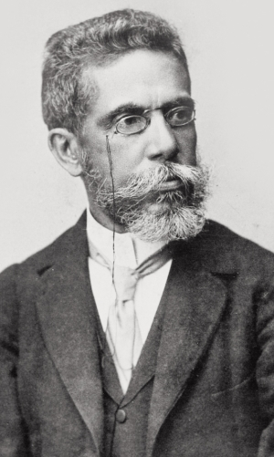
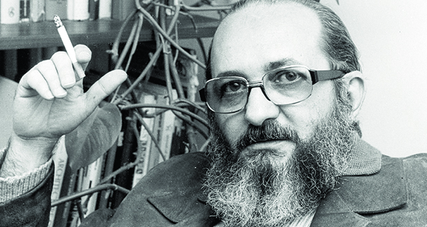
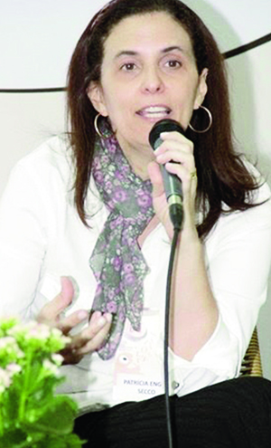
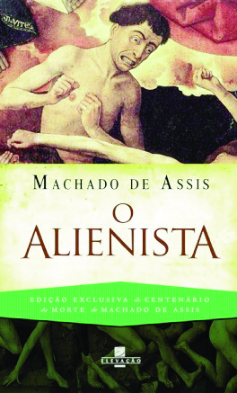

[Obra Falsificada](http://www.jornalopcao.com.br/assunto/obra-falsificada/)

# Discípula de Paulo Freire assassina Machado de Assis

[Edição 2028](http://www.jornalopcao.com.br/edicao/edicao-2028/)

**Em sua arbitrária simplificação de Machado de Assis, em que comete erros primários de intepretação de texto, a escritora-empresária Patrícia Secco embrutece o espírito do leitor ao falsear o mestre e descaracterizar seus personagens**

Machado de Assis: adaptação demagógica comete erros graves de interpretação de textos e destrói a universalidade do autor | Foto: Wikipédia

**José Maria e Silva**

Localizado nas proximidades do Viaduto do Chá, que, desde a inauguração em 1892, se tornou, durante muitos anos, o principal cartão postal da cidade de São Paulo, o Vale do Anhangabaú será palco, em ju-nho próximo, de um evento literário inusitado — um túnel construído não por concreto, mas por 60 mil livros. Trata-se do lançamento da nova edição de uma das mais importantes obras da língua portuguesa de todos os tempos, a novela “O Alienista”, de Machado de Assis, que, depois da morte do escritor em 1908, separou-se de “Papéis A­vulsos”, o volume de contos em que fora originalmente publicado em 1882, e se tornou um livro autônomo, traduzido em vários idiomas. Mas não se trata exatamente da obra-prima de Machado — o que o leitor vai encontrar nesse lançamento faraônico é uma adaptação de “O Alienista”, coordenada pela escritora Patrícia Secco e patrocinada pelo Ministério da Cultura, por intermédio da Lei Rouanet.

“Entendo por que os jovens não gostam de Machado de Assis. Os livros dele têm cinco ou seis palavras que não entendem por frase. As construções são muito longas. Eu simplifico isso”, disse Patrícia Secco, em 4 de maio último, numa entrevista ao jornalista Chico Felliti, da “Folha de S. Paulo”. Proprietária da Secco Assessoria Empresarial S/C Ltda., que juntamente com sua pessoa física já teve aprovados no Ministério da Cultura projetos que somam cerca de R$ 10 milhões captados, Patrícia Secco produz literatura infanto-juvenil em ritmo industrial, com mais de 200 títulos publicados, a maioria com temas da moda, como meio ambiente, direitos humanos e inclusão social. Com o propósito de facilitar a leitura de quatro clássicos da literatura brasileira, Secco pedira autorização ao Ministério da Cultura para captar R$ 1,53 milhão; por incrível que pareça, foi autorizada a captar R$ 1,45 milhão, ou seja, quase o montante que havia pedido para seu projeto. Na prática, conseguiu captar uma cifra milionária — R$ 1,039 milhão — para produzir dois livros a serem lançados num mesmo volume: “O Alienista”, de Machado de Assis, e “A Pata da Gazela”, de José de Alencar.

A princípio, a ideia de adaptar um clássico não é necessariamente condenável, especialmente se for para crianças. As adaptações de clássicos da literatura — começando pela Bíblia — devem ser tão antigas quanto o ato de ler. Em sua já clássica “Uma História da Leitura”, o argentino-canadense Alberto Man­guel conta que, em 1387, John de Trevisa, que estava traduzindo do latim para o inglês a epopeia “Polychronicon”, do monge beneditino Ranulf Higden (c. 1280-1364), resolveu fazê-lo não em versos, mas em prosa, pois sabia que o público já não queria ouvir uma recitação pública da obra (que, por sinal, se tornaria muito popular no século XV), preferindo lê-la diretamente. Da mesma forma, a “Divina Comédia”, de Dante Alighieri, originalmente escrita em versos, mereceu adaptações em prosa e versões condensadas para crianças, que exploram o viés aventureiro de sua viagem ao Inferno, Purgatório e Céu, transformando-o numa espécie de Julio Verne do espírito.

Uma das primeiras justificativas para se adaptar uma obra é, sem dúvida, sua extensão. Poucas crianças são capazes de ler um romance ou uma epopeia que se estende por mais de 500 páginas. A boa adaptação é uma espécie de resumo que tenta extrair a essência da obra sem desvirtuá-la. Carlos Heitor Cony, que adaptou diversos clássicos para o público infanto-juvenil, como Dostoievski, Melville, Mark Twain, Dumas, Gogol, Eça, Manoel An­tônio de Almeida e Julio Verne, ao ser indagado numa entrevista à revista “Cult” se reescrevia ou resumia os livros, respondeu: “Era uma condensação. Eu eliminava pontos mortos, alguns diálogos, detalhes técnicos. Deixava o texto mais denso. Mas preservava a história, o clima e principalmente a expectativa”. Cony foi taxativo: “O bom adaptador não falseia o original”.

##### **Facilitação de Machado nega o escritor**

Paulo Freire: pedagogia análoga à escravidão condena o pobre à fala de tijolo, como se um operário não pudesse ouvir estrelas | Foto: Wikipédia

Infelizmente, Patrícia Secco falseia Machado de Assis. Além de lhe desfigurar o estilo, ela o emburrece. Sua adaptação é um retrocesso, que sacrifica até os avanços linguísticos do estilo machadiano, já ousadamente próximo da linguagem coloquial, numa antecipação das vanguardas do modernismo que só iriam se consolidar no Brasil quase meio século de-pois. A autora esqueceu-se de que Machado, assim como Borges, Beckett, Graciliano, não dá para ser adaptado em prosa sem que se perca a essência de sua arte. A obra machadiana é basicamente linguagem. Em seus romances, não há enredos rocambolescos nem profusão de personagens, como há em Homero, Cervantes e nos clássicos românticos. Mesmo “O Alienista”, talvez o enredo mais movimentado de toda a sua obra, depende substancialmente da linguagem, pois é nela que moram a argúcia e a ironia do conto.

Para justificar sua adaptação, Patrícia Secco recorre a afirmações demagógicas. “Estou horrorizada. É muito triste pensar que algumas pes-soas acham que Machado de Assis, o mestre da literatura brasileira, não pode ser lido pelo sr. José, eletricista do bairro do Espinheiro, que, apesar de gostar de ler, não cursou mais que o primário, ou pelo Cristiano, faxi-neiro de uma farmácia de Boa Viagem, que não sabe nem mesmo o significado da palavra boticário”, disse a escritora-empresária à repórter Maria Fernanda Rodrigues, do “Estadão”, em matéria de 9 de maio último. Ora, quem disse que um faxineiro não pode compreender Machado de Assis? Se fosse assim, o próprio Machado — descendente de agregados e ex-escravos, somente com o ensino primário — nem existiria. Foi justamente porque em seu tempo não existia uma Patrícia Secco facilitando-lhe Camões, Vieira e Almeida Garrett que o Machadinho do Morro do Livramento embebeu-se dos clássicos, aprendeu francês sozinho e não apenas se tornou capaz de compreender os mestres da literatura universal como até mesmo se tornou um deles.

Com sua adaptação de “O Alienista”, a escritora-empresária Patrícia Secco destrói a universalidade da literatura de Machado de Assis com a pequenez ideológica da pedagogia de Paulo Freire. Foi o criador da “Pedagogia do Oprimido”, uma espécie de marxismo de autoajuda, quem consagrou a tese pedagógica de que o aprendizado é um epifenômeno das circunstâncias materiais e é somente a partir delas que se pode alfabetizar uma criança e despertar-lhe a consciência. O pedagogo brasileiro foi um grande admirador de Mao Tsé-Tung e, assim como o monstruoso comunista chinês mandava os lavradores arrancarem até as flores nativas, porque eram inúteis no universo do trabalho, Paulo Freire também arranca as palavras burguesas da cartilha do trabalhador, determinando a alfabetização a partir das tais “palavras geradoras”, como “tijolo”. É o que chamo de pedagogia análoga à escravidão — o filho do lavrador deve ter os olhos presos ao chão e está proibido de ouvir estrelas.

Patrícia Secco professa a mesma filosofia: se o faxineiro da farmácia não sabe o que é “boticário”, que se arranque então essa maldita palavra dos textos clássicos. Nunca ocorreu a ela que seria muito mais fácil, barato e respeitoso oferecer um dicionário ao faxineiro? Aliás, um trabalhador que resolva ler “O Alienista” — e isso está longe de ser raro — nem precisará de dicionário para descobrir o significado dessa palavra. O próprio conto, que sempre associa o boticário Crispim Soares a remédios, já lhe oferece a resposta. Além disso, tão logo veja a palavra no texto, o faxineiro irá se lembrar de que existe uma rede de perfumaria com esse nome e, por associação de ideias, poderá lembrar-se da palavra “botica” que pode ter ouvido a um parente mais velho. Caso não disponha de um dicionário em casa, o faxineiro machadiano sempre poderá consultar uma pessoa letrada de seu meio, parente ou um conhecido, que se não for capaz de sanar sua dúvida, saberá onde encontrar a resposta. Ou Patrícia Secco acha que só existe vida inteligente em seu meio social e que nas classes pobres não há ninguém capaz de trocar ideias com um faxineiro interessado em literatura?

##### **Censo de 1872 abalou a literatura brasileira**

O psicólogo Yves de La Taille, professor da USP e autor do livro “Limites”, considera que os limites morais comportam três dimensões, uma das quais significa desafio — uma pessoa, além de respeitar limites em face dos direitos dos outros e de impor limites em defesa de sua intimidade, deve também superar limites, o que significa superar a si mesma, buscando a maturidade e a excelência. É tudo o que Pa­trí­cia Secco não quer do leitor, com sua simplificação dos clássicos. Nin­guém aprende sem esforço próprio, recebendo tudo de mão bei­jada. Graciliano Ramos começou a ser escritor quando se sentiu de­safiado pelas mesóclises da “Carta de ABC”, do lendário A­bí­lio César Borges, o Barão de Ma­caú­bas, que trazia a máxima “fala pouco e bem, ter-te-ão por al­guém”. A frase o levaria a indagar à sua meia-irmã Mocinha se “ter-te-ão” era um homem. Co­mo Mo­ci­nha, a adolescente se­mial­fabetizada que o ensinou a ler, também não tinha ideia do que fosse aquilo, o me­nino Gra­ci­li­ano, enfezado vi­vente das Alagoas, criado a cascudos e beliscões, teve que descobrir so­zinho, devorando, antes dos dez anos, a prosa romântica de José de A­lencar, bem mais distante da linguagem comum do que a linguagem coloquial de Machado de Assis.

Ao se dar conta da indignação que sua proposta suscitou no País, desde um abaixo-assinado contrário até artigos e editoriais — Patrícia Secco publicou na “Folha de S. Paulo”, no dia 13 de maio, uma defesa de sua adaptação. O título do artigo não poderia ser menos machadiano: “Machado não gostaria de permanecer desconhecido para quem não lê”. Que afirmação mais esdrúxula! Ma­chado, revolucionariamente, sabia-se texto e, como tal, sabia-se também de­pendente do leitor. Em sua tese “Os Leitores de Machado de Assis” (Editora da USP, 2004), o professor da USP Hélio de Seixas Guimarães chega a sustentar que a obra machadiana foi influenciada pelo Censo de 1872 (o primeiro realizado no Brasil e divulgado em 1876), ao revelar que apenas 18,6% da população livre e 15,7% da população total, incluindo escravos, sabiam ler e escrever. “A tomada de consciência da escassez de leitores, problema que se inscreve de maneira cada vez mais radical em seus romances, parece-me fator relevante para ajudar a guinada que o escritor imprimiu a sua carreira”, escreve Seixas Guimarães.

Mas Machado de Assis, como sociólogo e psicólogo nato, também estava preocupado com os que não sabem — ou não querem — ler, oferecendo-lhes não a literatura-texto, mas a literatura-ins­tituição, encarnada na Acade­mia Brasileira de Letras, que detém até o monopólio legal da lín-gua, tão grande é a sua importância. Aliás, ao contrário do que pensa Patrícia Secco, isso torna Machado de Assis o escritor mais conhecido pelos que não sabem — ou não querem — ler, no­meando ruas e escolas e simboli-zando as letras nacionais da mes­ma forma que o desgrenhado Be­ethoven simboliza a música para quem nunca pisou numa sala de concerto e só conhece da música erudita o eterno “tchan-tchan-tchan” da Quinta Sinfonia. No pró­prio modo de composição da ABL, que aceita políticos e notáveis travestidos de escritores (como o Barão do Rio Branco, Marco Maciel e Ivo Pitan­guy), Machado de Assis revelou toda sua engenharia político-institucional, dando à literatura brasileira uma dignidade social que ela jamais poderia alcançar numa nação de analfabetos se continuasse sendo produzida em bares, por uma despreocupada geração de boêmios.

E quando procurou fazer da literatura brasileira também uma instituição social descarnada do texto, capaz de chamar a atenção da sociedade por outros meios, Machado de Assis não estava pensando exatamente nas camadas populares da nação — estou certo de que ele pensava, sobretudo, na preguiçosa elite nacional, que, mesmo sabendo e podendo ler, não lia, nem em seu tempo, nem hoje. Machado estava consciente de que, mesmo entre as elites, eram poucos os que tinham o habito da leitura, tanto que seu grande amigo José de Alencar se queixava de que o público conhecia mais “O Guarani” pelo teatro do que pelo texto do romance em si. Portanto, Patrícia Secco revela todo o seu preconceito contra os pobres quando cita uma pesquisa da Fundação Perseu Abramo mostrando que 58% dos brasileiros não leram nenhum livro nos últimos seis meses e, logo em seguida, afirma que, “por trás desses números existem rostos e vidas”, mas ao desvendá-los só se lembra de pessoas como “Seu Roberto, motorista de táxi, o Cristiano, caixa da farmácia da esquina, a Dona Nice, copeira do escritório”, pois, segundo ela, “eles são não leitores”.

Ora, só eles? E quantos são leitores entre as elites econômica, social e política do País? Essa preocupação perpassa a obra de vários críticos ao longo do tempo, como José Ve­ríssimo, Sílvio Romero e Otto Maria Carpe-aux, que se an­gus­tiavam com o grande número de profissionais liberais, como médicos, engenheiros, advogados, professores e outros profissionais de nível su­perior, que passam ao largo da li­teratura, limitando-se às leituras técnicas de suas respectivas áreas e re­servando o tempo livre para outras formas de lazer, que nada têm a ver com as letras. Por isso, quando se pensa em pobre como sinônimo de não leitor, o que se quer, no fundo, é uma justificativa para arrancar dinheiro dos cofres públicos.

##### **Simplificar livros agrava o problema da leitura**

Escritora-empresária Patrícia Secco: R$ 10 milhões captados no Ministério da Cultura e produção de literatura infanto-juvenil em ritmo industrial

Linguagem difícil nunca foi o maior empecilho à leitura. Mário de Andrade, com seu espírito galhofeiro, disse que para se gostar de Machado de Assis é preciso já nascer velho. Eu vou mais longe: para se gostar de literatura é preciso envelhecer cedo. Por isso, o Eclesiastes diz que “o muito estudar enfado é da carne”. Em nenhuma época ou lugar, a leitura foi a mais popular das formas de lazer. A literatura é a mais reflexiva das artes e a maioria das pessoas abomina reflexão, que, para muitos, rima com depressão. Isso ocorre também com a música erudita. Quantas pessoas, ricas ou pobres, formadas ou não, tão logo se sentem tocadas por um concerto de Mozart, uma sonata de Beethoven, logo tendem a afastá-las dos ouvidos, pedindo uma “música alegre”, sob a alegação de que aquele tipo de música lhes provoca tristeza?

Creio que isso ocorre com qualquer povo, só que, no Brasil, fugir da reflexão como o diabo foge de cruz não é uma característica só das massas, mas também das elites. Uma frase de Machado de Assis talvez explique esse fenômeno: “A verdadeira ciência não é a que se incrusta para ornato, mas a que se assimila para nutrição”. Infelizmente, no Brasil, a educação nunca foi um meio de edificação intelectual e moral do indivíduo, como pregava Machado, mas um salvo-conduto para o sucesso social. Nas nações que levam a sério o conhecimento, o indivíduo primeiro busca o saber e, como consequência, conquista o diploma. No Brasil dá-se o contrário: o sujeito busca avidamente o diploma e, se sobrar tempo, vai à cata de algum conhecimento para fingir que não é de todo ignorante. Por isso, lê-se pouco no Brasil, mesmo entre a gente letrada: ler exige uma posição de sentido do espírito — que é cada vez mais rara numa nação que sempre desprezou o mérito.

Simplificar livros não resolve o problema — pelo contrário, agrava-o. Iniciativas como a de Patrícia Secco abastardam o povo brasileiro ao impedi-lo de conhecer o verdadeiro Machado de Assis, sufocado por uma montanha de 600 mil falsificações de sua obra. Nesta semana que passou, dormi menos de três horas por dia, em média, varando as madrugadas na comparação — linha por linha — da sagrada escritura de “O Alienista” de Machado de Assis com o apócrifo de mesmo nome da escritora Patrícia Secco. Ao cabo dessa ingente labuta (que Secco, toscamente, “traduziria” por “ao fim desse grande trabalho”), faço minha a indignação de Alcides Vilaça, professor da USP: “Apre­sentar como sendo de Machado de Assis uma mutilação bisonha de seu texto não devia dar cadeia?” Sim, devia dar cadeia, sobretudo para os tecnocratas do MEC que torraram mais de R$ 1 milhão dos cofres públicos nessa falsificação grosseira de Machado de Assis.

##### **Machado de Assis para consumo próprio**

Nem se pode chamar de adaptação esse trabalho de Patrícia Secco. Em sua arbitrária simplificação de “O Alienista”, com graves erros de interpretação de texto, a escritora-empresária embrutece o espírito do leitor ao falsear o estilo de Machado de Assis, descaracterizar seus personagens e descontextualizar sua obra. Segundo ela própria contou a Chico Felliti, da “Folha”, a equipe que “descomplica” o texto é formada “por um monte de gente” (expressão dela, segundo o jornalista), entre eles a própria escritora e “dois jornalistas amigos”. É como pegar pintores de parede num bar e levá-los para restaurar a Capela Sistina. O resultado não poderia ser pior. Onde Machado de Assis escreve: “Uma volúpia científica alumiou os olhos de Simão Bacamarte”; Patrícia Secco traduz: “Uma curiosidade científica iluminou os olhos de Simão Bacamarte”. Além de destruir a musicalidade da frase, a troca de palavras assassina o sentido do texto: “volúpia” tem uma forte conotação sexual, imprescindível para se compreender a paixão de Bacamarte pela ciência, algo que se perde completamente com a palavra “curiosidade”. Além do mais, palavras como “volúpia” e “alumiar” não precisam de tradução: a primeira pode ser lida na Bíblia ou ouvidas em homilias católicas e pregações evangélicas e a segunda, em que pese fazer parte do repertório clássico da língua, é perfeitamente compreensível para qualquer lavrador que nunca frequentou escola, mas sabe perfeitamente o que é uma candeia alumiando.

A impressão que fica é que Patrícia Secco e sua equipe traduziram Machado de Assis para consumo próprio. Ou alguém imagina que uma pessoa esforçada o suficiente para ler um livro não vai ser capaz de compreender, com a ajuda do contexto da obra, palavras e expressões como “congregar”, “atarantado”, “estatelar-se”, “pessoa de consideração”, “déspota”, “laudas”, “demanda”, “estar em erro”, “arruaças e clamores”, “vereança”, “eloquência”, “aritméticos”, “abono”, “vestuário”, “gaiato”, “intuito”, “oficiou”, “lusitana”, “juiz-de-fora” e outras do mesmo nível? Pois todas essas palavras foram substituídas por sinônimos catados arbitrariamente no dicionário sem levar em conta o contexto da obra muito menos o estilo do autor. Analisei minuciosamente a adaptação de Patrícia Secco e hei de voltar a ela. Mas já adianto: trata-se de um caso clínico de analfabetismo funcional, digno de ser recolhido às dependências da Casa Verde de Simão Bacamarte. Em vários momentos, Secco e sua equipe não conseguem compreender o que Machado diz com sua peculiar clareza e desvirtuam completamente o original.

Machado de Assis escreve: “Simão Bacamarte começou por organizar um pessoal de administração; e aceitando essa ideia ao boticário Crispim Soares, aceitou-lhe também dois sobrinhos”. Patrícia Secco deturpa: “Simão Bacamarte começou organizando um pessoal de administração. Convencendo o farmacêutico Crispim Soares, aceitou-lhe também dois sobrinhos”. Reparem no absurdo: a adaptadora transforma o alienista num subordinado do boticário, a quem precisa convencer sobre a necessidade de uma administração em seu próprio manicômio. Em outro trecho, o Padre Lopes diz: “Isso de estudar sempre, sempre, não é bom, vira o juízo”. A adaptadora reescreve: “Isso de estudar sempre, sempre, não é bom, prejudica o juízo”. Chega a ser inacreditável essa troca da popularíssima expressão “vira o juízo” por “prejudica o juízo”, um barbarismo que deve ter revirado o estômago do primeiro verme que roeu as frias carnes do defunto Brás Cubas!

##### **Deturpando o enredo e a história**

Machado conta que, como D. Evarista não conseguia ter filhos, o Dr. Simão Bacamarte “fez um estudo profundo da matéria, releu todos os escritores árabes e outros, que trouxera para Itaguaí, enviou consultas às universidades italianas e alemãs, e acabou por aconselhar à mulher um regímen alimentício especial”. Entretanto, “a ilustre dama, nutrida exclusivamente com a bela carne de porco de Itaguaí, não atendeu às admoestações do esposo; e à sua resistência, — explicável, mas inqualificável, — devemos a total extinção da dinastia dos Bacamartes”. Qual­quer dona de casa sem nenhum estudo compreende que D. Evarista, por amor à saborosa carne de porco de Itaguaí, não quis fazer a dieta proposta pelo marido e, por isso, não conseguiu ter filhos. Agora vejam a versão analfabeto-funcional de Patrícia Secco: “[Simão Bacamarte] acabou por indicar à mulher um regime alimentício especial. A ilustre dama, que deveria se alimentar exclusivamente com a carne de porco de Itaguaí, não atendeu aos conselhos do esposo. E, à sua teimosia — explicável, mas inqualificável — devemos a total extinção da dinastia dos Bacamartes”. Ela simplesmente está dizendo que o alienista receitou uma dieta de carne de porco à esposa, quando foi o contrário.

Mais adiante, quando descreve a revolta dos Canjicas contra a Casa Verde, Machado de Assis narra: “Os dragões pararam, o capitão intimou à multidão que se dispersasse; mas, conquanto uma parte dela estivesse inclinada a isso, a outra parte apoiou fortemente o barbeiro”. Patrícia Secco estropia o texto: “Os soldados pararam, o capitão intimou à multidão que se dispersasse. Mas, enquanto uma parte dela estivesse inclinada a isso, a outra parte apoiou fortemente o barbeiro”. A adaptadora não faz ideia da conjunção “conquanto” e, em vez de recorrer a “embora”, a traduz por “enquanto”, transformado Ma­chado em analfabeto. No mesmo episódio, o escritor diz que o ca­pitão dos “dragões” mandou “carregar contra os Canjicas”. Patrícia Secco traduz “carregar” (que, no contexto, significa “investir contra”) por “disparar”, sem perceber que os dragões — como os “Dragões da Indepen­dência” de hoje — usavam espadas e não armas de fogo. Com isso, o leitor de sua adaptação vai achar que Machado de Assis fazia realismo mágico: uma tropa mete fogo na multidão e essa multidão arrosta as balas, sem medo da morte.

Na arbitrária simplificação de “O Alienista”, com erros de interpretação de texto, escritora embrutece espírito do leitor ao falsear estilo machadiano

Uma das admiráveis qualidades do conto “O Alienista” é o cuidado com que a história aparece nele. Machado de Assis preocupa-se com os mínimos detalhes históricos e escreve que Simão Bacamarte era “o maior dos médicos do Brasil, de Portugal e das Espanhas”. Patrícia Secco corrige para “Espanha”, sem fazer a menor ideia de que, na época colonial em que se passa a história, a Espanha era oficialmente chamada de “Reino das Espanhas”. Em outro trecho, Machado diz que, para D. Evarista, ver o Rio de Janeiro “equivalia ao sonho do hebreu cativo”, sintetizando nessa expressão a sensação de exílio e confinamento que a acanhada Itaguaí produzia no espírito frívolo da mulher de Bacamarte. Patrícia Secco estraga a imagem, substituindo “hebreu cativo” por “judeu cativo”. Ela confunde os hebreus que se tornaram escravos no Egito e foram libertados por Moisés com os filhos da tribo de Judá que, já na terra prometida de Canaã, séculos depois, emprestariam o nome de sua tribo para todo o povo eleito. Se ao citar Dante, Machado tivesse dito, com precisão histórica, “poeta florentino”, não tenho dúvida de que Patrícia Secco iria corrigir para “poeta italiano”. Aliás, numa das raras e lacônicas notas de rodapé, a adaptadora faz isso: ela diz que Averrois é um filósofo e poeta “hispano-árabe”. É o mesmo que chamar Santo Agostinho de filósofo romano-argelino.

Por que Patrícia Secco e sua equipe cometem essa profusão de erros de extrema gravidade ao adaptar o conto de Machado de Assis? Sem dúvida, porque não estão à altura da tarefa. No fundo, a escritora e seus amigos jornalistas, a cada vez que buscam um sinônimo para um termo ou expressão do conto, estão traduzindo a obra para eles próprios e não para o eletricista, o faxineiro, o motorista de táxi, que precisam menos do que eles dessa facilitação. Para se ter uma ideia do quanto é absurda essa adaptação, Machado empregou o termo “transeuntes” e a adaptadora achou por bem substituí-lo pela expressão “os que por ali passavam”. Imagino Patrícia Secco ouvindo uma rádio AM do interior na década de 70, quando o Brasil era muito menos escolarizado do que hoje. Ela ficaria pasmada (ou “espantada” conforme sua tradução de Machado) ao se dar conta de que um dos grandes sucessos de Tonico & Tinoco, dedicado por peões de fazenda às suas respectivas namoradas, era a canção “O Gondoleiro do Amor”, um poema de Castro Alves, cantado pela dupla caipira ao som de violinos. Saudosos tempos em que uma dupla de lavradores elevava o povo até Castro Alves; hoje, gente como Patrícia Secco faz é rebaixar o povo quando dá a ele um Machado de Assis no nível de si mesma.

[**](https://twitter.com/intent/tweet?text=Disc%C3%ADpula%20de%20Paulo%20Freire%20assassina%20Machado%20de%20Assis%20-%20Jornal%20Op%C3%A7%C3%A3o%20http://wp.me/p4o5j7-18X "Divulgue")
[**](https://www.facebook.com/sharer.php?u=http://wp.me/p4o5j7-18X&t=Disc%C3%ADpula%20de%20Paulo%20Freire%20assassina%20Machado%20de%20Assis%20-%20Jornal%20Op%C3%A7%C3%A3o "Divulgue")
[**](https://plus.google.com/share?url=http://wp.me/p4o5j7-18X "Divulgue")
