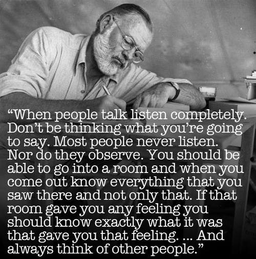
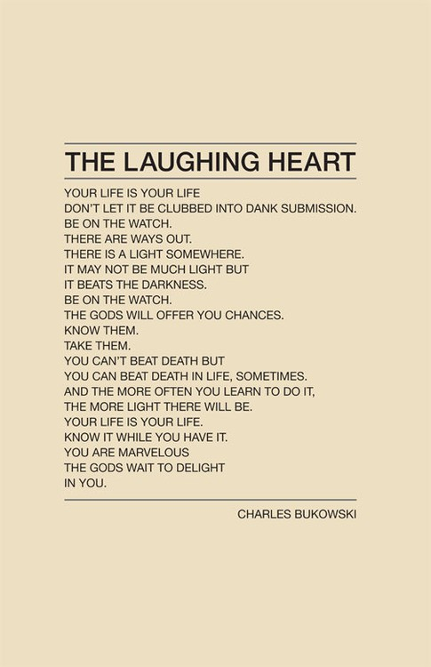
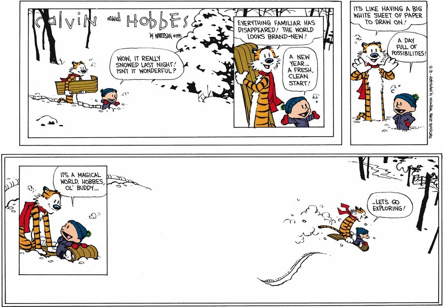

# Conselhos de um velho programador antissocial e ranzinza

#### Ou um breve resumo da minha vida profissional

Faz tempo que quero escrever um texto com dicas para programadores que estão começando agora ou estão com dúvidas sobre que caminhos seguir em suas carreiras. No entanto, sempre tive medo de que esse texto virasse mais um dos inúmeros textos de autoajuda que existem por aí. Esse não é meu estilo. E também não queria que fosse um texto puramente técnico.

Passei os últimos 40 dias bem afastado da minha rotina, sem programar muito e praticamente vivendo a vida de dono de casa, cuidando do Francisco, meu filho de (quase) 2 anos. Durante esse tempo pensei muito na minha carreira, na minha vida, na profissão que optei por seguir. Pensei muito nos caminhos que escolhi, nas oportunidades que agarrei e nas que deixei passar. E a conclusão que cheguei foi a seguinte: no final das contas, nada disso importa.

É claro que suas escolhas definem quem você é, mas você vai ter sempre arrependimentos, vai estar sempre em dúvida, vai sempre achar que seguiu o caminho errado.

O que realmente importa é: eu amo programar, amo conceber e desenvolver produtos. Amo resolver problemas. Isso me faz feliz.

Nós, programadores, estamos sempre insatisfeitos. Acho que nunca vamos estar 100% felizes em um emprego, seja ele no Brasil ou no exterior, em uma startup ou em uma multinacional, como empregado ou empregador. Vai sempre existir política, você vai ter sempre que fazer coisas que não gosta de fazer. É como diria meu sogro, quem fala que ama o seu trabalho está mentindo.

<http://www.someecards.com/usercards/viewcard/MjAxMS00NjgxZTZjMmRkZWNiOTIz>

Ache um emprego que te faça o mais feliz possível. Que te dê espaço para utilizar sua criatividade. Que te dê tempo para praticar e experimentar novas tecnologias. E que, principalmente, te cerque de pessoas como você. Pessoas que te inspiram, que te motivam e que reclamam de tudo e de todos. Uns totais insatisfeitos.

Ache um emprego no qual não seja tão difícil acordar de manhã (ou qualquer que seja o seu horário) e ir trabalhar.

E pare de ler textos sobre *just quit it.* Isso não funciona na prática e são altas as chances de você se arrepender. Pense muito bem antes de tomar uma decisão dessas, converse com as pessoas próximas e procure sempre sair bem.

Aquele velho papo de deixar a porta aberta, mas não é bem isso, é simplesmente não se estressar à toa, com coisas que não importam. Quanto mais cedo você conseguir separar o que é realmente importante das coisas que não tem a menor importância (a grande maioria), tudo vai ser mais tranquilo.

Estamos vivendo uma época paradoxal para desenvolvedores. É muito fácil aprender qualquer coisa hoje em dia e, por isso, você precisa saber tudo. Você precisa ser o melhor em tudo o que faz. Vão sempre te comparar com outros desenvolvedores. Você mesmo vai estar sempre se cobrando, duvidando do seu potencial — sempre vai existir alguém “melhor” do que você.

Isso é uma grande besteira. Cobre menos de você mesmo. Procure aprimorar as coisas que você gosta de fazer. As pessoas são diferentes. Vá devagar, *enjoy the ride.*

Nem todo mundo nasceu pra mudar o mundo e isso foi uma coisa que demorei a entender e aceitar. Mas nada impede você de fazer pequenas mudanças: na sua casa, no seu emprego, no seu círculo social, no seu bairro, na sua cidade, no seu estado e por aí vai.

Aos 34 anos, uma outra conclusão que cheguei foi: esse sou eu, não vou mudar muito mais do que isso e eu tenho que aproveitar minhas qualidades e aceitar meus defeitos.

Esse é um passo importante para a sua vida profissional. Conheça e aprimore suas qualidades e aceite seus defeitos. E, principalmente, seja honesto, fale a verdade, por mais difícil que possa parecer. Seja honesto com você mesmo e com os outros profissionais do seu time/empresa. Fique longe de fofocas, intrigas, conspirações. Os bons profissionais e gestores gostam e valorizam pessoas que falam a verdade, pessoas diretas, mesmo que você diga o contrário do que todo mundo gostaria de ouvir.

Seguindo esse conselho, é ainda muito importante saber a diferença de ser sincero e ser polêmico a troco de nada. É também muito importante aprender a falar as coisas da melhor maneira possível, pensando sempre que do outro lado da conversa está um ser humano com problemas e sentimentos muito iguais aos seus.

<http://www.brainpickings.org/index.php/2013/11/13/hemingway-on-writing-2/>

Confie no seu instinto. No início ele pode te enganar, mas aos poucos vocês vão se entendendo. E, hoje em dia, eu duvido muito menos dele (ainda teimo em duvidar). Eu sei quando um projeto vai dar errado, sei quando um cliente não vai ser um bom frila. É aquele frio na barriga, aquela sensação esquisita de que alguma coisa não está certa. Isso é instinto, converse com ele.

Você ainda vai passar por uma fase de freelancer e ela pode ser definitiva. Durante essa fase, você vai descumprir prazos e assumir compromissos que você não deveria ter assumido. O que separa um freelancer bom de um freelancer ruim é justamente como ele lida com isso.

É normal atrasar, estimativas são estimativas (muitas vezes você vai entregar antes também). Mas avise seu cliente com antecedência. Dê sempre um status de como estão as coisas, se está indo tudo bem ou não. Dê tempo para que ele possa reagir.

Não desapareça, não diga que vai entregar amanhã, não entregue nada malfeito, pela metade, só para cumprir prazos. Isso vai fazer mal para todo mundo, mas principalmente para você. Não é muito difícil ter profissionalismo como frila, as coisas às vezes parecem muito piores do que realmente são.

Seja parceiro do seu cliente/fornecedor, coloque-se no lugar dele. Talvez você também passe por uma fase empresário (definitiva ou não) e nessa hora você vai entender e dar valor aos bons freelancers.

E, por favor, aprenda a dizer não (instinto!).

Todos esses textos sobre programadores falam da importância da família e de socializar. De fato, isso é importante — se você for esse tipo de pessoa. Eu sou bem antissocial e ficar sozinho é extremamente importante pra mim. É uma coisa que me faz feliz e isso não pode ser ruim.

No entanto, saia mais do seu mundo, procure inspiração em outros cantos (isso não quer dizer socializar). Filosofia, arte contemporânea, música, natureza, poesia, voluntariado, andar na rua a esmo, livrarias, brechós, viagens, esportes, cerveja, mitologia, arquitetura, culinária, quadrinhos, vinho, moda, café, videogame, política… qualquer coisa que te dê aquela sensação de novidade, que te faça ter vontade de inventar/construir alguma coisa.

<http://livelovesimple.com/the-laughing-heart-charles-bukowski/>

Funciona assim para mim e para muita gente: a maneira mais fácil de aprender algum assunto é escrevendo sobre ele. Não quer dizer que vai ser assim para você também, mas, no mínimo, você vai estar compartilhando conhecimento, enriquecendo o seu currículo e aprendendo um pouco que seja.

Não estou falando só de um post no seu blog (aquele que você prometeu escrever pelo menos uma vez por semana), estou falando também de projetos open source (enriquece ainda mais o seu currículo). É comum desenvolvedores no início de carreira terem vergonha de seus códigos. Não tenha. Vão falar mal, todo mundo fala mal de tudo, mas você vai aprender muito. Vai ter gente que vai falar bem. Você vai receber pull requests, issues e tudo mais. Pode demorar alguns anos ou pode ser uma coisa que vai explodir e o seu repositório vai para a página de trending repos do Github. Você nunca vai saber.

Se é útil para você, certamente vai ser útil para mais alguém.

E quando alguém te perguntar por que você está tentando reinventar a roda diga que, na verdade, você está desmontando a roda e construindo de novo do seu jeito. Essa é também uma outra ótima forma de aprender.

https://twitter.com/dcancel/status/443831291625361408

Por falar em open source e aprender, leia o código dos outros. É uma das melhores coisas que a cultura open source introduziu na nossa profissão. Por exemplo, se você quer aprender JavaScript, hoje você pode olhar o código-fonte de bibliotecas e frameworks como jQuery, mootools, dojo, Angular. O mesmo vale para qualquer outra linguagem. Na grande maioria das vezes a própria linguagem tem seu código-fonte disponível para você ler. Eu acho isso fantástico e sinto que os programadores mais novos não dão tanto valor assim.

Sobre a pergunta que chega praticamente todo dia no meu e-mail: que linguagem eu devo aprender? Todas e nenhuma. Não vire aquele desenvolvedor chato que defende uma tecnologia e fala mal das outras. Toda linguagem tem seus prós e contras. Toda linguagem tem ideias geniais e implementações desastrosas (umas mais que as outras).

Escolha uma área de atuação principal (a que você gostar mais, a que te deixar mais feliz). Web, desktop, mobile, infraestrutura, segurança, rede etc. Ou duas. Ou quantas você quiser. Mas não tente abraçar o mundo só porque você conhece alguém que consegue fazer isso.

E lembre-se de obter inspiração. Isso vale também para linguagens e áreas de atuação. Não fique focado só no que você gosta, leia sobre outros temas técnicos, mas leia com foco na ideia e não na tecnologia.

Finalizando, o mais importante é aprender sobre produto. O trecho abaixo foi retirado de [um texto escrito por um estagiário do @fat](https://medium.com/building-bowery/99b38a428c07) (Jacob Thornton, um dos criadores do Twitter Bootstrap, atualmente no Medium) e eu concordo 100% com o que ele disse:

> Certa vez eu simplesmente perguntei diretamente a ele
> *[@fat]* como me tornar um programador melhor. Ele me perguntou por que eu iria querer fazer isso. O argumento dele foi: se eu já posso construir qualquer coisa que eu possa imaginar (com pesquisas no Google e tempo suficiente), então qual é o valor em ser um programador melhor? Ao invés disso eu deveria me tornar melhor em construir coisas ou em pensar sobre coisas para construir.

Por mais que você comece desenvolvendo com muito CTRL+C e CTRL+V, se você tiver um produto sensacional no final, que funcione, e que faça as pessoas quererem usá-lo, é isso que vai fazer a diferença. Não é código limpo, ou código bem testado, ou integração contínua, ou deploy automático, ou qualquer coisa do tipo que vai fazer o seu produto um sucesso.

Você precisa, antes de tudo, mudar o seu foco para produtos. Pensar em soluções simples para problemas existentes. Pensar em interfaces, em interações, em processos. Pensar na experiência que o seu usuário vai ter no seu sistema/aplicativo. Isso é uma coisa que pouquíssimos desenvolvedores fazem: se colocar no lugar do usuário. E isso é um grande diferencial.

> “The older I get, the more I believe that the only way to become a better programmer is by not programming.”
>   
> — Jeff Atwood

Já vi projeto bem escrito, com testes e tudo mais, nem ir para o ar, enquanto projetos macarrônicos fazem sucesso até hoje. É aquela história, hoje em dia é muito fácil aprender qualquer coisa na nossa área.

E não me entendam mal. Código limpo, testes, preocupação com manutenibilidade e extensibilidade… são coisas superimportantes, mas você aprende com o tempo.

Naturalmente, durante toda a sua carreira, você vai procurar por maneiras de: escrever menos código; garantir a existência de quase nenhum bug; acabar com aquela sensação de “para implementar essa nova feature só reescrevendo tudo”; e evitar tarefas repetitivas. É uma eterna busca e não sei dizer se um dia acaba. Sempre existe uma maneira melhor de fazer as coisas no nosso mundo. Mas isso não quer dizer que a sua maneira é a errada.

Gostaria de encerrar o texto agradecendo, do fundo do meu coração, a todos que fizeram (ou que ainda vão fazer) parte da minha vida profissional e que ajudaram a moldar quem eu sou hoje em dia, principalmente aqueles que me aturaram nas minhas fases mais difíceis, mais ranzinza e mal-humorado (alô @agencia\_m2br).

Um salve especial a você, programador no início de carreira. Você tem um futuro brilhante (ou não, ou simplesmente um futuro feliz e tranquilo) à sua frente. Não deixe nenhum programador rabugento acabar com seu dia (você ainda vai estar do outro lado), dê risada daquele maldito bug em produção, aprenda com as críticas (construtivas ou não) e, acima de tudo, nunca duvide do seu potencial.

Aqui vai um segredo para você: é tudo código, não existe mágica. É tudo simplesmente código.

[http://www.gocomics.com/calvinandhobbes/1995/12/31](http://www.gocomics.com/calvinandhobbes/1995/12/31#.UzOqCHV50sM)

*Medium Brasil em |* [*Twitter*](https://twitter.com/MediumBrazil) *─* [*Facebook*](https://www.facebook.com/pages/Medium-Brasil/1468266196766987)
