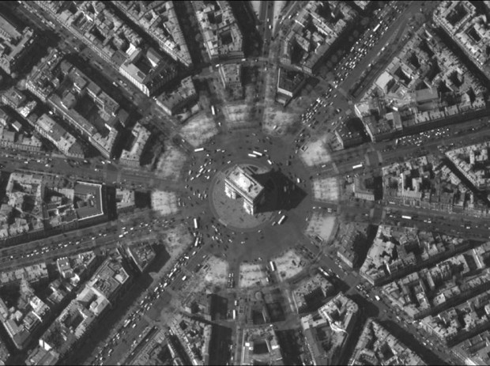
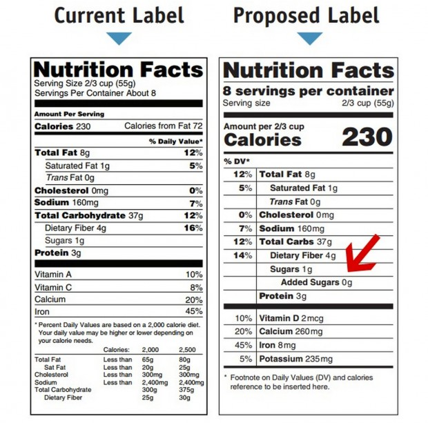
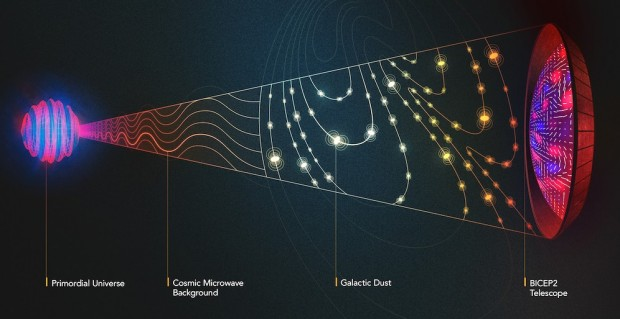
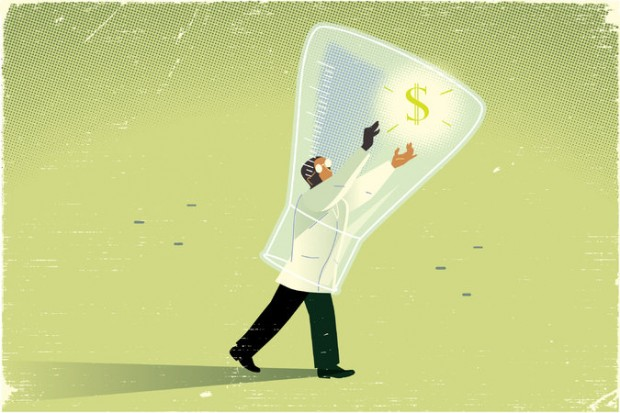
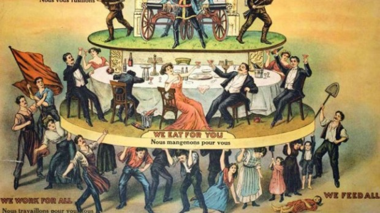
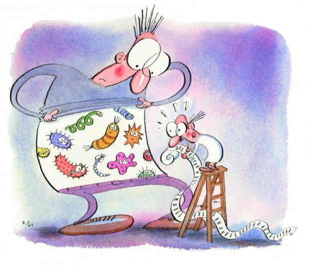
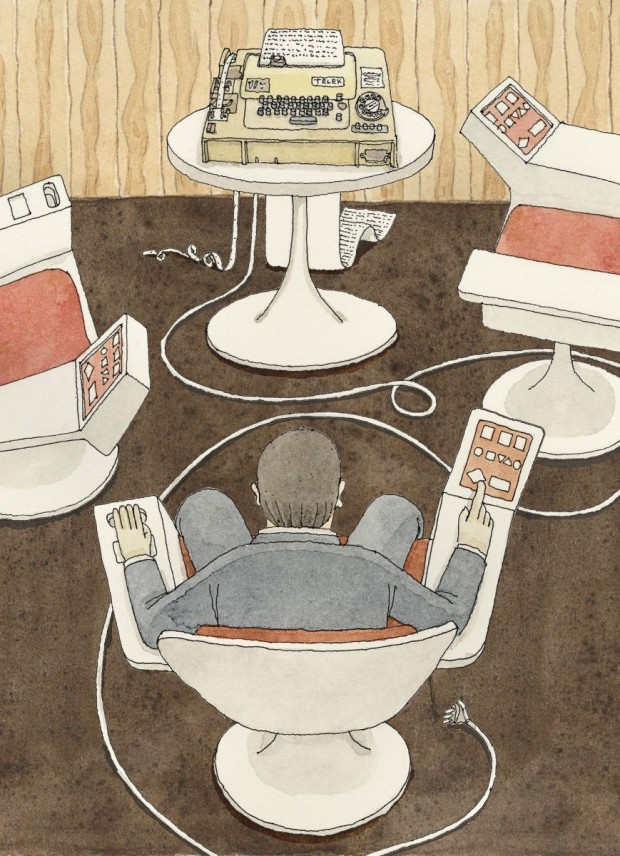

Eu costumo fazer uma frequentemente elogiada curadoria de conteúdo na minha *timeline* no [Facebook](https://www.facebook.com/padma.dorje). Ela é replicada 100% via [Twitter](https://twitter.com/pdorje) – podem me seguir, seja no Facebook, seja no Twitter, que é autopromoção deslavada mesmo.

Já tentei segmentar por assuntos (em vários *feeds*), mas no fim o que vale é que cada um dos links é fidedigno, interessante e passa no meu crivo ético – se sou contra algum conteúdo, e mesmo assim o considero postável, duas condições que são raras juntas, eu faço um pequeno comentário. De forma geral, não comento nada, apenas compartilho.

Esse conteúdo é garimpado de duas fontes principais, além dos feeds cuidadosamente filtrados do próprio Facebook e do Twitter, e algumas fontes secundárias. As fontes principais são o [Hacker News](https://news.ycombinator.com/news) – extremamente voltado a programação e cultura de *startup*, mas também voltado a tecnologia e ciência, e ocasionalmente à cultura, e sempre com comentários muito interessantes – e o [Digg](http://digg.com/). Geralmente, olho os dois sites uma ou duas vezes por dia, o que resulta, após uma filtragem rápida das chamadas, imagens e cabeçalhos em cerca de uma dúzia de abas para analisar. As outras fontes talvez rendem outra dúzia.

Logo desconto diversões e perdas de tempo, e separo as coisas que decido que vão precisar de mais tempo para ler. O resto eu avalio e reposto ou não de acordo com critérios em [contínuo refino](http://papodehomem.com.br/o-que-aprendi-com-a-heuristica-eduardo-pinheiro/). Acabo repostando de 3 a 10 links por dia, além de recomendações de filmes e TV que tenho assistido, e algumas amenidades e comentários.

Embora eu tenha estudado francês, alemão, grego e tibetano, eu [só aprendi mesmo o inglês](http://papodehomem.com.br/antes-de-tudo-o-ingles). Então, peço desculpas, pois todos os links abaixo são apenas nessa língua. A cada 100 ou 200 textos que leio em inglês encontro um em português que tem algum valor literário ou de interesse geral, e não meramente um interesse local (falando de coisas do Brasil).

### [1. Envenenamento por chumbo em Roma – A evidência no esqueleto](http://www.poweredbyosteons.org/2012/01/lead-poisoning-in-rome-skeletal.html)

Já sabíamos que os romanos se intoxicavam com chumbo por questões de praticidade, e porque também apreciavam o gosto da substância. Só não havíamos medido o quão contaminados com a substância os romanos realmente eram.

### [2. A lógica das teorias da conspiração e como refutá-la](http://theconversation.com/the-ironclad-logic-of-conspiracy-theories-and-how-to-break-it-31684)

### [3. George Orwell detona revistas de moda](http://www.newrepublic.com/article/119494/george-orwell-lambasts-american-fashion-magazines)

George Orwell acaba com as revistas de moda, em 1946. Mas ao ler só se fica surpreso com a crítica quanto a haver só cerca de 8% (16 páginas de 200) de textos de conteúdo – 8% hoje parece descomunal, o resto parece igual.

### [4. A reputação de Oscar Wilde precisa de um novo julgamento?](http://www.independent.co.uk/arts-entertainment/theatre-dance/features/is-oscar-wilde-facing-a-retrial-9773718.html)

Oscar Wilde geralmente é visto como tendo sofrido um julgamento injusto. Mas ele hoje seria também condenado, só que por exploração sexual de menor. (Um de meus textos recentes trata da [difícil avaliação ética de Wilde](http://papodehomem.com.br/a-autenticidade-e-o-exemplo-imperfeito-de-oscar-wilde-wtf-41/)).

### [5. As empresas de alimentos estão fazendo de tudo para eliminar essa linha das tabelas de nutrição: “açúcares adicionados”](http://mic.com/articles/92829/food-companies-are-doing-everything-to-keep-this-one-new-line-off-of-nutrition-labels?utm_source=takepart&utm_medium=social&utm_campaign=Oct)

### [6. Jornalistas da Fox são estúpidos demais até pra saber que são estúpidos](http://aattp.org/monty-pythons-john-cleese-fox-news-people-are-too-stupid-to-know-they-are-stupid-video/)

John Cleese aplica o efeito de [Dunning-Krugger](http://en.wikipedia.org/wiki/Dunning%E2%80%93Kruger_effect) nos “jornalistas” da Fox News. Em outras palavras: eles são tão burros que não conseguem sequer entender a dimensão da própria burrice.

*[Link Youtube](https://www.youtube.com/watch?v=wvVPdyYeaQU)*

### [7. A civilização pode sobreviver ao capitalismo que realmente existe?](http://truth-out.org/news/item/26538-can-civilization-survive-really-existing-capitalism-an-interview-with-noam-chomsky)

### [8. A água da Terra é mais velha que o Sol](http://blogs.discovermagazine.com/d-brief/2014/09/25/earths-water-is-older-than-the-sun/#.VCSWtSldUnR)

Anteriormente se pensava que apenas os elementos mais pesados, porque vinham necessariamente de supernovas, não se originaram do sol. Agora se percebe que as coisas são mais misturadas.

### [9. Mark Twain “tira uma” com a cara de outro escritor](http://www.brainpickings.org/2012/01/10/fenimore-coopers-literary-offences-mark-twain/)

Um “rant” de Mark Twain quanto a outro escritor. Rants são tiradas insistentes e raivosas, e no caso de Twain, também altamente espirituosas e divertidas.

### [10. Não retorne à escola. Aprender por si só é muito mais efetivo e recompensador](http://www.brainpickings.org/index.php/2013/05/13/dont-go-back-to-school-kio-stark/?fb_action_ids=10204799773340302&fb_action_types=og.likes)

### [11. Jennifer Lawrence fala sobre o roubo de suas fotos](http://www.buzzfeed.com/rachelzarrell/jennifer-lawrence-speaks-out-on-stolen-pictures?utm_term=4261js4&s=mobile#190euia)

A Jennifer Lawrence fala pela primeira vez da violência sexual e abuso que sofreu de todos que viram suas fotos.

### [12. Links removidos da busca do Google na Europa pelo “direito de ser esquecido”](http://www.nytimes.com/2014/10/04/business/media/times-articles-removed-from-google-results-in-europe.html)

Artigos removidos da busca do Google, mas só na Europa, pelo “direito de ser esquecido”, mostram os problemas inerentes a esse enfoque.

### [13. O culto de Neil Degrasse Tyson](http://www.politico.com/magazine/story/2014/10/the-cult-of-neil-degrasse-tyson-111540.html#.VC4K4hbjj53)

Quando o humanismo vira uma forma de fanatismo irracional.

### [14. A galera que vai visitar a zona contaminada em Chernobyl por diversão](http://roadsandkingdoms.com/2014/the-stalkers/)

### [15. Os sinais do Big Bang podem ser só pó](http://www.simonsfoundation.org/quanta/20140921-big-bang-signal-could-all-be-dust-planck-says/)

O barulho de fundo que identifica o Big Bang em questão – lembra um pouco o dilema de [His Master’s Voice](http://en.wikipedia.org/wiki/His_Master%27s_Voice_%28novel%29).

### [16. A era da obesidade](http://aeon.co/magazine/health/david-berreby-obesity-era/)

Há evidências de que a epidemia não está ligada apenas a acrasia e abusos diretos do capitalismo, mas também a algum tipo de intoxicação, já que afeta até animais de laboratório que comem o mesmo que seus ancestrais magros.

### [17. Os crimes e desvios éticos da Associação Americana de Psicologia](http://www.chalquist.com/apa.html)

Por que não sou um membro da Associação Americana de Psicologia. Listando os vários crimes e desvios éticos da principal associação de psicologia estadunidense.

### [18. Os tipos que ficam acordados à noite tem maior tendência à psicopatia](http://peterjonason.com/uploads/Chronotype.pdf)

### [19. A religião mais seguida fora o cristianismo em cada um dos estados dos EUA](http://www.businessinsider.com/the-largest-religion-in-every-state-other-than-christianity-2014-6?utm_content=buffer2f8d4&utm_medium=social&utm_source=facebook.com&utm_campaign=buffer)

### [20. Um senhor faz arte geométrica com algas microscópicas](http://vimeo.com/90160649)

[Link Vimeo](http://vimeo.com/90160649)

### [21. A ciência do clima não está resolvida ainda](http://online.wsj.com/articles/climate-science-is-not-settled-1411143565)

Já sabemos que a situação é grave, e que a causa é humana — só não sabemos exatamente como será o futuro, nem o que fazer exatamente.

### [22. Os homens que buscam parceiras no Okcupid tem algum critério de idade?](http://www.randalolson.com/2014/09/15/do-men-on-okcupid-follow-the-standard-creepiness-rule/)

Os homens que buscam parceiras no Okcupid seguem a Regra Padrão de Idade Apropriada para Namorar, isto é, uma parceira precisa ter no mínimo metade da idade do pretendente mais 7 anos?

### [23. Para obter mais da ciência, mostre-se a pesquisa rejeitada](http://nyti.ms/1BSGZBy)

A proposta é fomentar publicações a aceitar ou rejeitar os artigos antes da pesquisa ser feita, de acordo com planos de estudo — o que eliminaria o viés com relação ao resultado.

### [24. As mulheres com visão sobre-humana](http://www.bbc.com/future/story/20140905-the-women-with-super-human-vision)

Um pequeno grupo de pessoas pode ver cores “invisíveis” que ninguém mais percebe.

### [25. Os primeiros produtores de discos, a ascensão e queda de Joe Meek e Phil Spector](https://medium.com/cuepoint/the-first-record-producers-909c85d99427)

### [26. Por que a “neve negra” da Groelândia deve preocupar você](http://www.slate.com/blogs/future_tense/2014/09/16/jason_box_s_research_into_greenland_s_dark_snow_raises_more_concerns_about.html?wpsrc=fol_tw)

### [27. Antipirataria é privilégio de classe](http://falkvinge.net/2014/09/17/anti-piracy-is-class-privilege/)

Monitoramento da internet, monopólio de *copyright* e outros métodos de parar o compartilhamento de arquivos não vêm de uma indústria tentando defender seus ganhos, são esforços organizados de negar o acesso a cultura, ferramentas e informações a trabalhadores em nações industrializadas, e ao resto do mundo.

### [28. Por que os estadunidenses sabem tanto sobre esportes e tão pouco de questões internacionais?](http://www.alternet.org/noam-chomsky-why-americans-know-so-much-about-sports-so-little-about-world-affairs)

### [29. O seu corpo é feito em sua maior parte de outros microorganismos? Na verdade, ainda não sabemos](http://www.bostonglobe.com/ideas/2014/09/13/your-body-mostly-microbes-actually-have-idea/qlcoKot4wfUXecjeVaFKFN/story.html)

### [30. As origens socialistas do Big Data](http://www.newyorker.com/magazine/2014/10/13/planning-machine)

Ali no Chile nasceu a ideia de controlar tudo através dos dados.

### [31. A geração TED e o poder da positividade](http://aeon.co/magazine/philosophy/should-generation-ted-take-a-more-sceptical-view/?utm_source=feedburner&utm_medium=feed&utm_campaign=Feed%3A+AeonMagazineEssays+%28Aeon+Magazine+Essays%29)

O entusiasmo incessante realmente ajuda o mundo, ou a geração TED precisa aprender a desenvolver uma visão mais cética?

  
 por Eduardo Pinheiro
  
  
 [[anexo ausente]](http://pubads.g.doubleclick.net/gampad/jump?iu=1051165/PdH_Feed_superbanner/leaderboard&sz=728x90&c=1327913861) 
[anexo ausente]
  
  
  
[[anexo ausente]](http://da.feedsportal.com/r/210474240311/u/49/f/530922/c/32911/s/3f5a21ed/sc/19/rc/1/rc.htm)
  
[[anexo ausente]](http://da.feedsportal.com/r/210474240311/u/49/f/530922/c/32911/s/3f5a21ed/sc/19/rc/2/rc.htm)
  
[[anexo ausente]](http://da.feedsportal.com/r/210474240311/u/49/f/530922/c/32911/s/3f5a21ed/sc/19/rc/3/rc.htm)
  
  
[[anexo ausente]](http://da.feedsportal.com/r/210474240311/u/49/f/530922/c/32911/s/3f5a21ed/sc/19/a2.htm)
[anexo ausente]

[[anexo ausente]](http://feeds.feedburner.com/~ff/PapodehomemLifestyleMagazine?a=rnztxnivAAA:4yEjT8u3Tz4:yIl2AUoC8zA)
[[anexo ausente]](http://feeds.feedburner.com/~ff/PapodehomemLifestyleMagazine?a=rnztxnivAAA:4yEjT8u3Tz4:D7DqB2pKExk)
[[anexo ausente]](http://feeds.feedburner.com/~ff/PapodehomemLifestyleMagazine?a=rnztxnivAAA:4yEjT8u3Tz4:qj6IDK7rITs)
[[anexo ausente]](http://feeds.feedburner.com/~ff/PapodehomemLifestyleMagazine?a=rnztxnivAAA:4yEjT8u3Tz4:-BTjWOF_DHI)

[anexo ausente]
