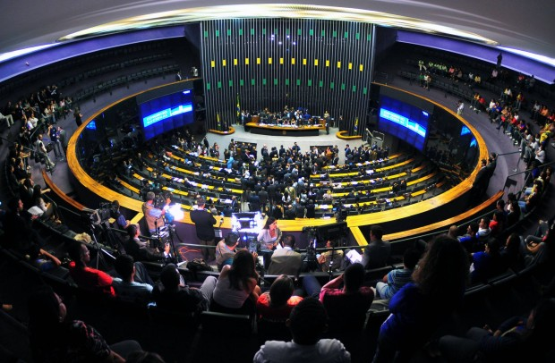
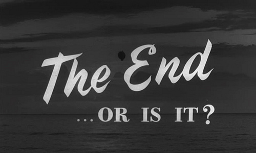

Como advogado militante, tenho a impressão de que a administração pública enxerga o cidadão sempre como uma parte contrária, nunca como sua própria razão de ser.

Queria abrir um parênteses entre nós e me permitir sonhar um pouco. Já imaginou um partido político que não estivesse interessado em nenhuma outra forma de poder senão o exercício pleno do cargo legislativo? Um partido que não almejasse administrar o país, o Estado e os Municípios, mas simplesmente legislar e fiscalizar os atos do Poder Executivo?

Eu particularmente acredito muito nessa ideia.

Mas seja para criticar minha impressão sobre a administração pública enxergar o cidadão como parte contrária ou para sonhar com outras formas de se fazer política, precisamos antes entender como funcionam as coisas. Ou nos tornamos ativistas de sofá.

No primeiro texto da série “[Para entender política](http://papodehomem.com.br/secoes/series/para-entender-politica/)“, tratei brevemente da separação dos Poderes Executivo, Legislativo e Judiciário. Portanto, a noção geral você já tem: o Executivo administra, o Legislativo cria normas e o Judiciário julga conflitos.

Essa separação não é tão estanque, e, por vezes, o Legislativo julga e o Executivo legisla.

O propósito deste texto, o quarto da série, é avançar um pouco mais nesse assunto e esclarecer como este assunto também pode aprimorar sua opinião política.

### Como funciona o Legislativo

A Câmara dos Deputados

O Brasil adota um processo legislativo bicameral, ou seja, ele se fraciona em duas casas: a Câmara dos Deputados e o Senado Federal, que, juntos, formam o Congresso Nacional.

A Constituição Federal nos diz que a Câmara dos Deputados compõe-se de representantes do povo, enquanto que o Senado Federal compõe-se de representantes dos Estados e do Distrito Federal.

Assim, não é bem verdade quando se diz que os todos os políticos nos representam, pelo menos do ponto de vista jurídico. Os Deputados Federais, que ocupam a Câmara dos Deputados, sim, representam os cidadãos. Já a função dos Senadores é de atuar em defesa dos Estados que os elegeram, e não diretamente em defesa da população.

Como já sabemos, a função primordial do Legislativo é produzir normas. Seria muito legal discutir o processo legislativo completo, mas talvez isso valha um texto exclusivo pois, além de longa, a discussão pressupõe conhecimento básico sobre a hierarquia das normas no ordenamento jurídico, o que ainda não incluí na série de textos Para entender política.

Por ora, fique com a ideia de que o processo legislativo difere para diferentes tipos de normas e pode envolver diferentes quóruns de aprovação, sessões de votação separadas ou conjuntas das casas e muitas comissões de análise e estudo das propostas.

A diferença entre as duas casas não é só de representação. Cada uma delas tem competências específicas, mas complementares. De novo, não cabe neste texto o detalhamento das competências de cada casa – se tiver curiosidade, dá uma olhada nos artigos 49, 51 e 52 da Constituição Federal e mata a curiosidade. O que eu quero fazer, mesmo, é chamar a atenção para uma informação um pouco menos óbvia e que normalmente passa despercebida: **o Poder Legislativo possui poderes que vão muito além da produção de leis**.

Além das atribuições legislativas, o Poder Legislativo tem atribuições de fiscalização, controle e julgamento. Nelas estão incluídos os seguintes:

**(i)** Poder de pedir informações de quaisquer órgãos subordinados à Presidência da República (sendo que se tal órgão desobedecer o pedido, isso pode ser considerado crime de responsabilidade);

**(ii)** Formação de comissões parlamentares de inquérito – as famosas CPI –, que possuem poderes de investigação iguais das autoridades judiciais;

**(iii)** Controle das contas da Presidência da República, com ajuda do Tribunal de Contas;

**(iv)** Fiscalização e controle dos atos do Poder Executivo;

**(v)** Julgamento de crimes de responsabilidade do Presidente da República, Ministros do Supremo Tribunal Federal, do Procurador-Geral da República e do Advogado-Geral da União (um crime de responsabilidade é aquele que atenta contra a Constituição Federal); e

**(vi)** Aprovação do orçamento anual e planejamento plurianual, que estabelece, de forma regionalizada, as diretrizes, objetivos e metas da administração pública federal para investimentos e para a manutenção de programas de duração continuada.

Essas competências tão displicentemente ignoradas por nós evidenciam como estamos errados em superestimar o Presidente da República, pois ele deveria ser devidamente controlado pelo Poder Legislativo.

E como estamos ainda mais errados em subestimar o Poder Legislativo, pois ele é o Poder que pode de fato obrigar o Presidente da República a agir conforme o ordenamento nacional e, em última instância, conforme os interesses da população.

A existência desses poderes de fiscalização é o principal motivo pelo qual entendo que um Legislativo politicamente controlado pelo Executivo não pode dar coisa boa, pois, neste cenário, o Executivo, que já concentra uma enorme liberdade de ação, age com a certeza de que não terá suas decisões questionadas.

A compra de apoio político é tema dos mais relevantes em teoria política e ocorre nas mais diversas formas, como, por exemplo: coligações partidárias para obter maior tempo de televisão, loteamento de cargos públicos de primeiro e segundo escalão, promessa de obras em nichos eleitorais específicos e, até mesmo, dinheiro vivo.

Honestamente, não vejo muita diferença entre vender apoio político em troca de cargo na administração pública ou de dinheiro – ambas são deturpações da função política do Poder Legislativo e evidenciam como os políticos se apropriam do cargo e o usam em benefício próprio ou do partido.

Apenas para finalizar as considerações básicas sobre o Legislativo, o sistema bicameral normalmente é criticado por ser um modelo pouco favorável a reformas. Isso porque o veto a uma mudança legislativa, ou mesmo a postergação de sua análise para um futuro incerto, é politicamente mais fácil no Senado (pois há menos pessoas envolvidas), do que na Câmara dos Deputados (um ambiente com mais agentes políticos). Se houvesse somente uma casa legislativa, numerosa, esse manejo político seria um pouco mais trabalhoso.

### Seguindo, como funciona o Executivo

Gabinete presidencial no Palácio do Planalto | Foto: Roberto Stuckert Filho/PR.

Finalizado o Poder Legislativo, passemos para o Poder Executivo, que é exercido pelo Presidente da República, auxiliado pelos Ministros de Estado.

No nosso sistema presidencialista, a Presidência acumula funções de chefia de Estado, relacionadas principalmente a relações internacionais, e de chefia de governo, referentes a questões internas.

É este o Poder que determina onde serão investidos os recursos do país, separa quais áreas serão priorizadas, desenvolve e aplica políticas públicas e executa as leis criadas pelo Poder Legislativo. Pela sua própria natureza, o Poder Executivo possui bastante discricionariedade – forma de agir onde não há no agente qualquer restrição ou limite – em suas atividades, motivo pelo qual seria saudável sua constante fiscalização por parte do Legislativo e do Judiciário.

Diante de tamanha liberdade de ação, perceba como é importante fazer a escolha do chefe do Poder Executivo com base nos programas de governo que os candidatos divulgam, pois, em tese, eles representam a visão que o político tem para o país. Você pode até simpatizar mais com um candidato do que com outro, mas, afora a simpatia, você compartilha de sua visão de país?

Antes disso: você já refletiu [sobre suas próprias preferências políticas](http://papodehomem.com.br/um-chamado-a-divergencia-positiva/)?

Você pode escolher, por exemplo, dar mais relevância à economia, às relações internacionais, à desigualdade social, aos direitos humanos ou ao meio ambiente, e então escolher o candidato que mais se alinha com suas preferências.

Quando estiver refletindo sobre suas preferências políticas, seja realista: os recursos do país são finitos e não dão conta de tratar de todos os temas de forma satisfatória, por isso preferências devem ser escolhidas. Se você defende a redução de impostos, saiba que isso afetará a qualidade dos serviços públicos; se você almeja a redução da inflação, saiba que isso reduz o crescimento e pode aumentar o desemprego.

Discutir política de forma madura é adotar posições e suportar prós e contras (aliás, não seria maturidade a capacidade de realizar escolhas conscientes e bancar suas consequências?). Defender educação em período integral, saúde de primeiro mundo, redução da inflação, crescimento econômico de dois dígitos, diminuição dos tributos e fim da desigualdade social, assim, tudo junto, não dá. Ninguém disse que é fácil, mas, para você se definir politicamente, você precisa fazer escolhas e ter preferências.

Sinceramente, o Poder Executivo é menos interessante para mim, pois se apresenta como um grande administrador (e, lembrem-se, eu sou jurista; para os politólogos, a coisa é diferente).

Como cidadão, procuro me inteirar sobre quais políticas estão sendo executadas, quais as prioridades de investimento e quais os rumos que o Presidente aponta para o país, tentando fazer uma constante avaliação de acordo com a minha escala de preferências. Mas isso sou eu, e estou aberto a sugestões.

### Por fim, como é o Judiciário

Supremo Tribunal Federal

No esforço de tratar da separação dos Poderes de forma sucinta, passemos já para o Poder Judiciário, cuja principal função é resolver conflitos de interesse nos casos concretos, com base no ordenamento jurídico.

Assim, quando houver divergência sobre quem está errado e quem está certo, o Judiciário deve ser acionado e a ele cabe resolver a pendenga. O que ele decidiu, está decidido, e pronto.

O julgamento de um conflito por uma parte imparcial é um importante meio de pacificação social, pois evita que a discussão sobre determinado assunto se perdure infinitamente no tempo e impõe um fim, com uma solução que deve ser considerada correta.

O Judiciário tem diversos órgãos com diferentes competências, conhecidos por um monte de siglas. Vou quebrar seu galho e fazer um resumão para que você não se sinta muito perdido lendo o caderno de política:

**(i)** STF, ou Supremo Tribunal Federal, que é a cúpula do Poder Judiciário e tem como objetivo primordial a defesa da Constituição Federal e da Federação.

**(ii)** STJ, ou Superior Tribunal de Justiça, cuja principal função é proteger a [incolumidade](http://www.direitonet.com.br/dicionario/exibir/945/Incolumidade) das leis federais;

**(iii)** TST, ou Tribunal Superior do Trabalho, que é a última instância para julgamentos referentes a relações de trabalho;

**(iv)** TSE, ou Tribunal Superior Eleitoral, que julga conflitos referentes ao direito político-eleitoral; e

**(v)** Superior Tribunal Militar, que se ocupa dos crimes militares.

Esses são os órgãos de cúpula, ou seja, as últimas instâncias de decisão sobre os respectivos assuntos.

Eles também têm competências específicas para julgar ocupantes de determinados cargos políticos que, por sua relevância, não seguem o caminho normal do processo. Assim, por exemplo, o STF deve julgar os crimes do Presidente da República (lembrando que os crimes de responsabilidades são julgados pelo Legislativo), dos membros do Congresso Nacional e seus próprios ministros, enquanto que o STJ julga os crimes comuns dos Governadores.

O Poder Judiciário, seguindo a lógica do Federalismo, também se divide em Federal, para os assuntos que envolvem interesses nacionais, e em Estadual, para aqueles temas de impacto local. Por isso há os Tribunais Regionais Federais e os Tribunais de Justiça, estes últimos em âmbito estadual. A divisão não é exatamente assim, mas essa é a ideia geral que eu gostaria que você levasse deste texto.

O Judiciário é um excelente instrumento político a ser utilizado pelo cidadão. Isso porque, se você sofrer restrição ilegal de seus direitos por parte da administração pública, por exemplo, você pode ingressar no Judiciário para que ele a force a cumprir a lei. Acredite, a administração pública, em todos os níveis federativos, adota ordinariamente procedimentos que ilegalmente afetam os direitos dos cidadãos, e você precisa lutar contra isso.

Cobrança de tributos de pessoas erradas, retenção de informação pessoal do cidadão, concessão de benefícios previdenciários em desacordo com a legislação vigente, é tanta coisa que até inventaram o “mandado de segurança”, que é uma ação especial contra atos ilegais de autoridades.

E embora seja o saco predileto de pancadas do Judiciário, não é só contra o Executivo que o Judiciário pode atuar. Se o Legislativo fizer corpo mole e deixar de legislar sobre determinado assunto, deixando-o sem regulamentação em detrimento dos direitos do cidadão, ele pode ordenar-lhe que tome providências. É importante notar, porém, que o Judiciário nunca age por si: ele precisa ser provocado por alguém para poder tomar uma decisão.

E embora seja o saco predileto de pancadas do Judiciário, não é só contra o Executivo que o Judiciário pode atuar. Se o Legislativo fizer corpo mole e deixar de legislar sobre determinado assunto, deixando-o sem regulamentação em detrimento dos direitos do cidadão, [ele pode conceder direitos aos indivíduos mesmo sem a regulamentação do Legislativo](http://www.ambito-juridico.com.br/site/index.php?n_link=revista_artigos_leitura&artigo_id=11276). É importante notar, porém, que o Judiciário nunca age por si: ele precisa ser provocado por alguém para poder tomar uma decisão.

Enfim, eu, sendo advogado atuante, tenho um monte – sério, um MONTE – de considerações sobre o sistema judiciário brasileiro que, assim como outros tantos temas, ficarão para depois, mas espero que essas noções básicas ajudem a clarear um pouco as coisas.

### Final?

Chegamos, assim, ao fim provisório dessa série [para entender política](http://papodehomem.com.br/secoes/series/para-entender-politica/), que pretendeu dar um panorama geral da organização do nosso país do ponto de vista jurídico de uma forma descontraída e simples. Pelo tanto de pontas sem desfecho que eu deixei nos textos, parece que eu previ inconscientemente uma vontade de continuar a escrever.

Por ora, queria agradecer ao PapodeHomem, pela edição cuidadosa dos textos, e à TJ, revisora particular das mais valiosas. Todos os textos foram escritos com base do [Curso de Direito Constitucional Positivo do José Afonso da Silva](http://www.saraiva.com.br/curso-de-direito-constitucional-positivo-37-ed-2014-6840975.html), um clássico de fácil leitura que recomendo para quem quiser se aprofundar nos temas tratados.

No mais, aguardo ansioso seus comentários para prolongarmos as discussões.

\* \* \*

*Nota do editor: Guilherme por aqui, pessoal. Devolvo o agradecimento ao Thiago. Foi um prazer e um aprendizado sem tamanho editar pessoalmente cada um dos textos dele.*

*Esse é o quarto e último texto planejado, a priori, para a série “[Para entender política](http://papodehomem.com.br/secoes/series/para-entender-politica/)“, por meio da qual pretendemos elucidar, de maneira apartidária, conceitos políticos básicos para que possamos ter diálogos mais produtivos sobre esse tema tão importante.*

*A série seguir viva depende de vocês. Por favor, se manifestem com suas sugestões para o futuro dela nos comentários!*

  
 por Thiago Trung
  
  
 [[anexo ausente]](http://pubads.g.doubleclick.net/gampad/jump?iu=1051165/PdH_Feed_superbanner/leaderboard&sz=728x90&c=874752902) 
[anexo ausente]
  
  
  
[[anexo ausente]](http://da.feedsportal.com/r/210474443222/u/49/f/530922/c/32911/s/3f8a3ab0/sc/27/rc/1/rc.htm)
  
[[anexo ausente]](http://da.feedsportal.com/r/210474443222/u/49/f/530922/c/32911/s/3f8a3ab0/sc/27/rc/2/rc.htm)
  
[[anexo ausente]](http://da.feedsportal.com/r/210474443222/u/49/f/530922/c/32911/s/3f8a3ab0/sc/27/rc/3/rc.htm)
  
  
[[anexo ausente]](http://da.feedsportal.com/r/210474443222/u/49/f/530922/c/32911/s/3f8a3ab0/sc/27/a2.htm)
[anexo ausente]

[[anexo ausente]](http://feeds.feedburner.com/~ff/PapodehomemLifestyleMagazine?a=r8xDBxDaGEc:WUuNzWw4x5Y:yIl2AUoC8zA)
[[anexo ausente]](http://feeds.feedburner.com/~ff/PapodehomemLifestyleMagazine?a=r8xDBxDaGEc:WUuNzWw4x5Y:D7DqB2pKExk)
[[anexo ausente]](http://feeds.feedburner.com/~ff/PapodehomemLifestyleMagazine?a=r8xDBxDaGEc:WUuNzWw4x5Y:qj6IDK7rITs)
[[anexo ausente]](http://feeds.feedburner.com/~ff/PapodehomemLifestyleMagazine?a=r8xDBxDaGEc:WUuNzWw4x5Y:-BTjWOF_DHI)

[anexo ausente]
