Já dá pra dar um tempo nos cálculos malucos com taxas, impostos, fretes e conversões de moeda! A oferta de artigos e acessórios masculinos no Brasil está crescendo, e há coisas tão legais em território brasileiro quanto as que você encontra lá fora. Não que aqui a gente tropece em marcas bacanas todos os dias, mas já é possível identificar a presença de uma nova geração de marcas e empreendedores, que prezam pela qualidade e design para transformar ideais em objetos de desejo.

Me vejo como parte desse mercado em expansão, e posso dizer que boa parte dos sentimentos que levaram à criação da [Cutterman](http://cutterman.co/), marca especializada em artigos de couro que comecei junto com meu sócio Rafael, vieram dessa carência ou insatisfação que existia. Muitos perguntam se alguém de nossas famílias mexia com couro ou se tínhamos um avô sapateiro, mas a verdade é que foi um mergulho rumo a um mundo totalmente novo. Aproveitamos nossas formações e  experiências profissionais para nos dedicarmos a desenvolver uma coisa só nossa, que transmitisse muito do que somos e aquilo no que acreditamos. Acho que até agora trilhamos um caminho bacana de reconhecimento, e boa parte das coisas legais que resolvi apresentar nesse texto nós conhecemos durante a nossa jornada.

Aí vai uma listona com produtos nacionais dignos de ganhar muitos likes no seu Tumblr ou Pinterest e ocupar um lugar na sua casa.

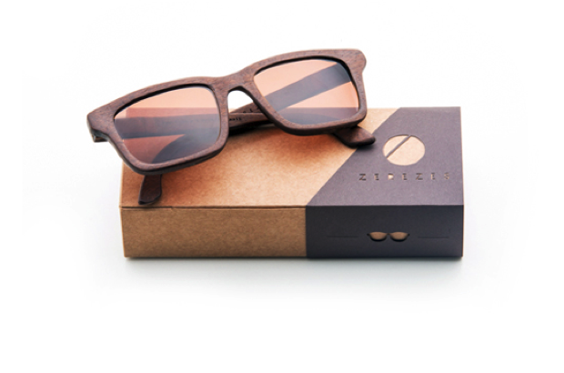

Sustentabilidade é um dos traços da [marca Zerezes](http://zerezes.com.br/ "Acesse o site da Zerezes"), que fabrica óculos a partir de madeiras descartadas e restos de serragem. As lentes de altíssima qualidade e o critério no acabamento manual transformam as peças em verdadeiras jóias.

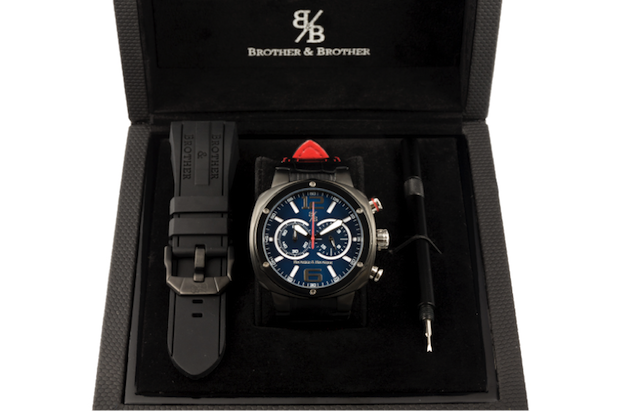

Na [Brother and Brother Relógios customizados](https://www.brotherandbrother.com/ "Acesse a página de Brother and Brother"), você cria seu relógio em quatro etapas e a marca monta pra você. São mais de 450 mil combinações possíveis! Eles iniciaram as vendas pela internet, mas agora já inauguraram a primeira loja em um shopping em São Paulo.

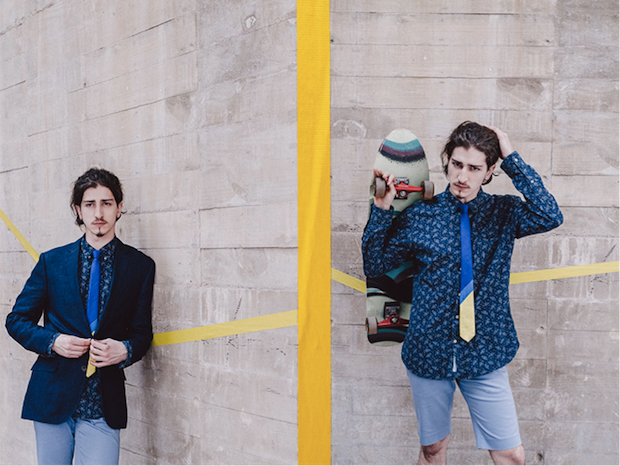

[New Gents](http://www.newgents.com.br/ "Acesse o site da New Gents") é uma marca com foco em gravatas, mas que aos poucos vai expandindo seu mix de produtos com outros acessórios. O conceito criativo das coleções é muito bem pensado e as peças fogem da monotonia.

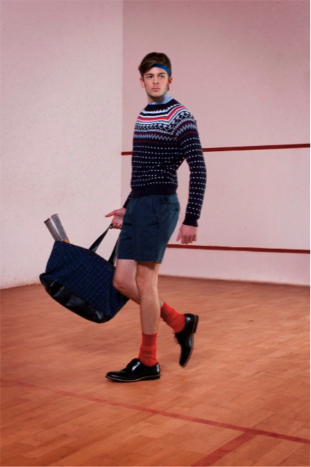

[OpenStudio](https://www.google.com.br/webhp?sourceid=chrome-instant&ion=1&espv=2&ie=UTF-8#safe=off&q=openstudio "Acesse a loha da OpenStudio") é uma marca com coleções casuais enxutas, mas que possuem peças com muita personalidade. A produção é toda local, e as tiragens super limitadas transformam a marca em um objeto de desejo. Na foto, destaque para o Pull Over Jacquard Wimbledon.

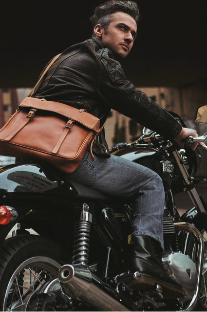

Apesar da [Pine Ax](http://pineax.com/ "Acesse a pineax") ter foco nas bolsas femininas, a marca já começou a produzir algo voltado para os homens. Na foto, Velo Saddlebag 100% em couro feita artesanalmente em Curitiba.

A mochila The Explorer, da nossa [Cutterman Co](http://cutterman.co/loja/ "Acesse a cuterman"), foi criada para desbravadores urbanos ou não. Prática e versátil, ela é companheira para o dia-a-dia ou uma pequena viagem de fim de semana. Sucesso de venda, ela é confeccionada em couro, lona de algodão resistente e disponível em 4 cores: navy, black, caqui e brown.

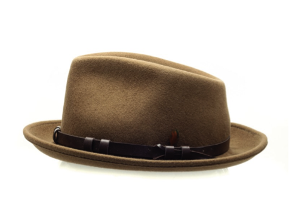

Com os chapéus super em alta, muita gente se pergunta onde encontrar aqui no Brasil. Os da Pralana usam lã certificada e posseum um acabamento top. A marca não vende diretamente ao público, e por isso você precisa achar uma loja que trabalhe com a linha deles.

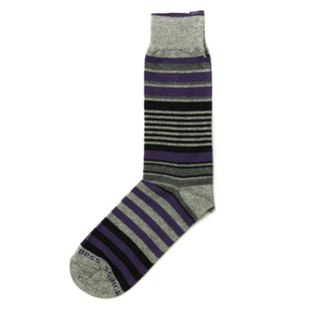

Aposente aquelas meias brancas do pacotão de 6 unidades: elas só são permitidas na academia e olhe lá. A [Inverness](http://rss.feedsportal.com/c/32911/f/530922/s/3f9577a6/sc/27/l/0Lpapodehomem0N0Bbr0C210Eartigos0Ee0Eacessorios0Epara0Ehomens0Emade0Ein0Ebrazil0C/www.inverness.com.br/ "Acesse o site da inverness"), que tem fábrica em São José dos Campos, possui alguns modelos muito legais.

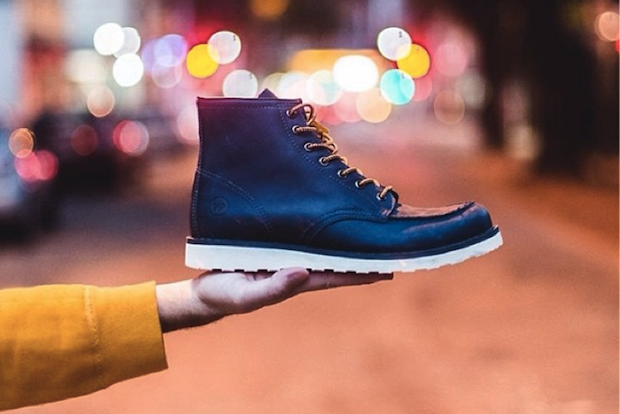

A West Coast, uma das marcas pioneiras no workwear brasileiro, tem feito botas duráveis e extremamente confortáveis de olho nas últimas tendências do que acontece lá fora. No detalhe, bota Moc Toe Baltimore.

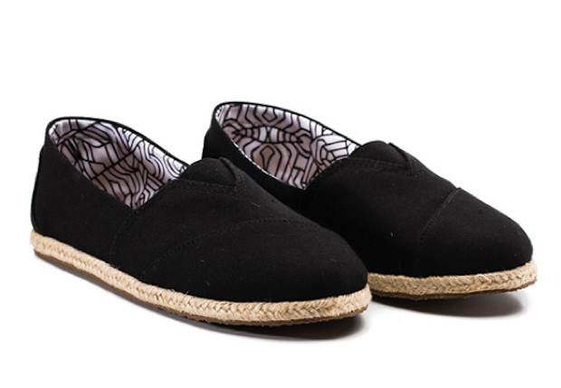

Com o verão chegando as alpargatas podem ser uma boa pedida. Este modelo da [Aragana](http://www.araganaconcept.com "leia mais na aragana") tem a sola de borracha – menos tradicional, porém mais confortável.

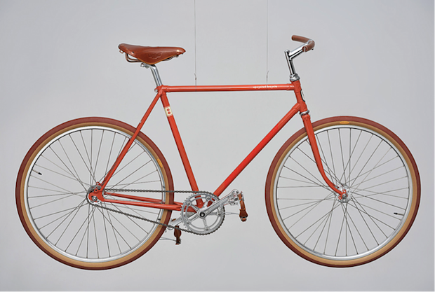

A [Old Body New Soul](http://www.obns.com.br/) garimpa, restaura e faz releituras de design exclusivas para conceber bicicletas extremamente lindas (e caras também).

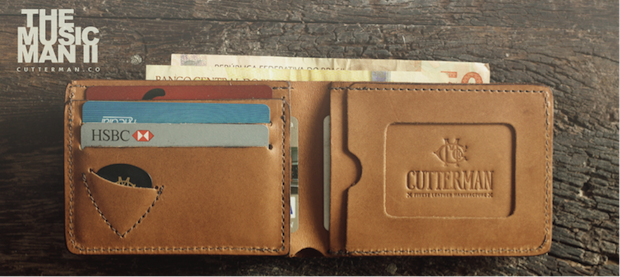

A pegada do [design da Cutterman](http://cutterman.co/loja/ "loja da cutterman") é misturar o refinado e o rústico. Essa é a carteira Musicman II. Ela é feita a mão, 100% em couro e conta com o charmoso porta-palhetas pra quem arranha um violão.

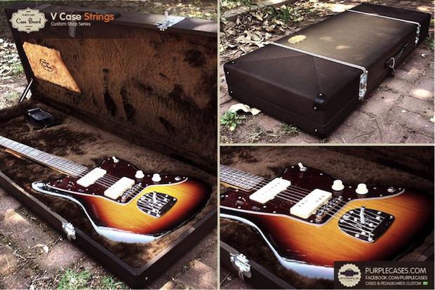

Boa parte da vida útil do seu instrumento será definida por como você acomoda e transporta a criança. A [Purple Case](http://purplecases.com/ "Acesse purple cases"), que começou despretenciosa, já oferece uma linha robusta de cases para boards de pedais, guitarras e baixos.

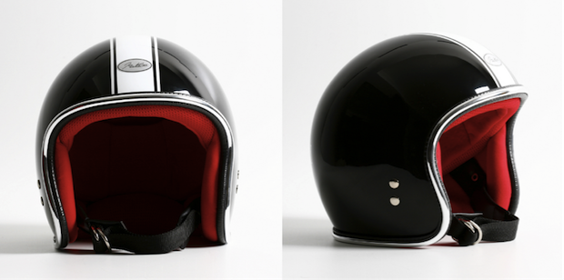

Os capacetes do tipo Open Face são um ícone principalmente pra galera das motos custom. Apesar de não serem os que oferecem a maior proteção, eles definitivamente são os capacetes mais legais pra rodar na cidade.  
 [Joe King](http://www.joeking.com.br/ "Acesse Joe King"), de São Paulo, pinta os dele à mão e aceita encomendas personalizadas.

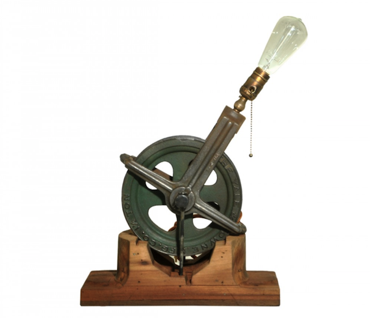

A origem da [Desmobilia](http://www.desmobilia.com.br) passa por garimpar, restaurar e reinventar móveis inspirados em design vintage, e isso persiste até hoje. Upcycle é uma das linhas deles que produz peças de design industrial únicas (de luminárias a sofás) a partir de antigos objetos reciclados.

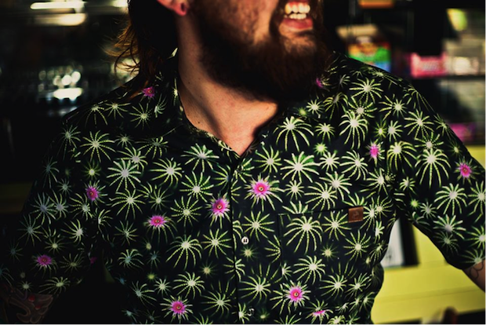

Dion Ochner[, a marca curitibana que tem as camisetas em seu DNA, está investindo cada vez mais na camisaria](http://dionochner.com.br/2014/) com peças contemporâneas carregadas de referências, qualidade na matéria-prima e cuidado na apresentação do produto.

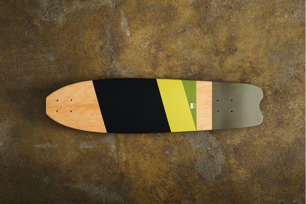

A [ITSU](http://www.oficinaitsu.com/ "Acesse a oficina Itsu") se auto denomina uma oficina criativa que, além de criar a sua própria linha de produtos, também executa projetos de design on demand. O modelo Tuna é um dos vários skates fabricados pela marca. Dá mais vontade de pendurar na parede do que dar um rolê.

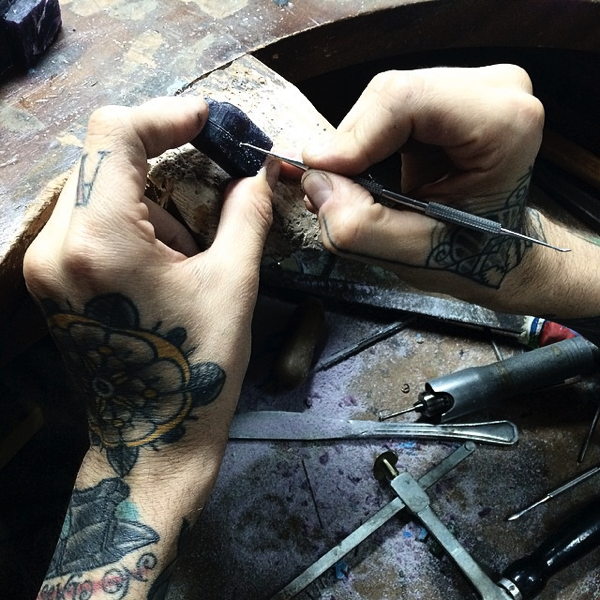

Brincos, anéis e colares da [joalheria Skull](http://skullonline.com/ "acesse a skull online") são feitos à mão de maneira rudimentar e misturam sofisticação com um ar rock’n roll. Joalheria para homem com cara de homem.

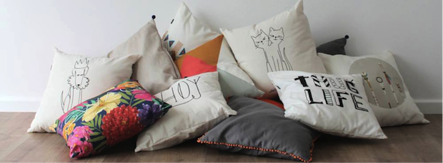

Sua casa reflete o que você é, e não é só por que você é homem que irá deixar de ajeitar o cafofo. Também de Curitiba, a [Astor tem almofadas](http://www.astorhome.com/almofadas-ct-563be), panos de prato e produtos para decoração que toda casa gostaria de experimentar.

Independente de sua aptidão para o uso de bonés, vale olhar para os caras da [Rosario 341](http://www.rosario341.com.br/). Estão com uma coleção de encher os olhos e a cabeça.

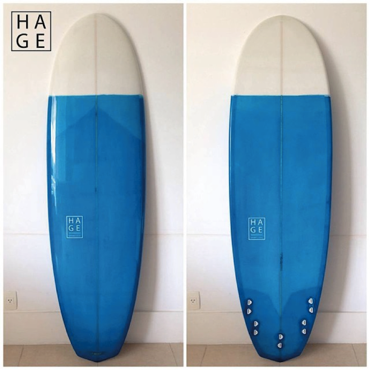

Inspirada no surf e na arte, a [Hage Surfboards](http://www.hagesurfboards.com) produz pranchas pigmentadas exclusivas sob encomenda. É uma mais linda que a outra e até você que nunca surfou ficou balançado.

### \*\*\*

Que outros artigos e acessórios artesanais, Made In Brazil, você conhece e te chamam a atenção? Compartilhe conosco nos comentários para conversarmos e trocar referências

  
 por Gustavo Oliveira
  
  
 [[anexo ausente]](http://pubads.g.doubleclick.net/gampad/jump?iu=1051165/PdH_Feed_superbanner/leaderboard&sz=728x90&c=1974986863) 
[anexo ausente]
  
  
  
[[anexo ausente]](http://da.feedsportal.com/r/210474497963/u/49/f/530922/c/32911/s/3f9577a6/sc/27/rc/1/rc.htm)
  
[[anexo ausente]](http://da.feedsportal.com/r/210474497963/u/49/f/530922/c/32911/s/3f9577a6/sc/27/rc/2/rc.htm)
  
[[anexo ausente]](http://da.feedsportal.com/r/210474497963/u/49/f/530922/c/32911/s/3f9577a6/sc/27/rc/3/rc.htm)
  
  
[[anexo ausente]](http://da.feedsportal.com/r/210474497963/u/49/f/530922/c/32911/s/3f9577a6/sc/27/a2.htm)
[anexo ausente]

[[anexo ausente]](http://feeds.feedburner.com/~ff/PapodehomemLifestyleMagazine?a=vcS3FmzN9qU:kFKmThntQBo:yIl2AUoC8zA)

[[anexo ausente]](http://feeds.feedburner.com/~ff/PapodehomemLifestyleMagazine?a=vcS3FmzN9qU:kFKmThntQBo:qj6IDK7rITs)
[[anexo ausente]](http://feeds.feedburner.com/~ff/PapodehomemLifestyleMagazine?a=vcS3FmzN9qU:kFKmThntQBo:-BTjWOF_DHI)

[anexo ausente]
