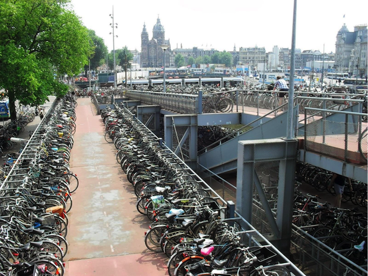
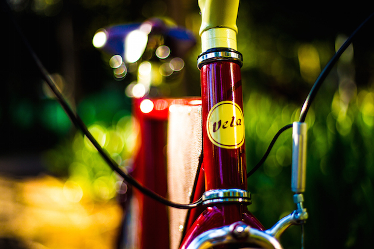
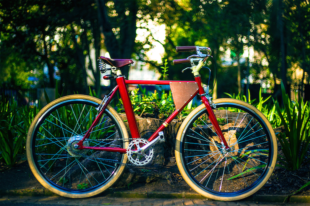

Quando chega o fim do expediente, o momento de decisão se repete em vários cantos do País. Você vai direto pra casa ou fica pro happy hour com os caras do trampo, para evitar o trânsito?

Na hora do rush, nenhuma opção parece boa. Em uma, você se força a ficar trocando uma ideia fraca com aquele cara que toma duas cervejas depois do trabalho e já começa a falar cuspindo e te encostando. Nas outras, passa duas horas em pé – esmagado no canto de um ônibus cheio esperando o seu ponto chegar – ou duas sentado, parado em um carro preso no trânsito. Nada pior nessa vida. Pise na embreagem. Passe a primeira, acelere por um segundo pro carro pegar um embalo e freie. Pise na embreagem. Coloque a marcha no ponto morto, solte a embreagem e repita isso mais 257 vezes até chegar em casa.

Para amenizar a situação, as prefeituras e os governos brasileiros se apressam para por em prática uma das soluções que ajudaram a amenizar o problema em capitais da Europa, América e Ásia: as ciclovias.

Em Amsterdam eles já entenderam o recado. Aparentemente, o problema agora são os bicicletários.

Faz sentido, mas causa polêmica. Em São Paulo, algumas pessoas criticam [(e vandalizam, colocando tachinhas](http://g1.globo.com/sao-paulo/noticia/2014/10/ciclistas-reclamam-de-pneus-furados-por-tachinhas-em-ciclovia-em-sp.html "Pessoas vandalizam ciclofaixa de pinheiros")) a forma como os 400 km de ciclovias previstas para os próximos anos vem sendo implantadas: tomando lugares antes destinados aos estacionamentos em mão dupla. Considerando que a malha viária da cidade conta hoje com cerca de 13.000 km de ruas pavimentadas, esses 400km representam cerca de 3% de todo o espaço dedicado a levar o cidadão de um ponto A a um ponto B. Até que é um bom começo, mas quando você considera que aquele último km até o portão do seu prédio não terá ciclovia, pode dar um calafrio.

Os automóveis chegam em qualquer lugar. Os ônibus chegam em áreas bem abrangentes. Os pedestres caminham onde as calçadas chegam. Os ciclistas, até então contavam as seguintes opções:

a) Trafegar pela calçada enquanto nenhum pedestre aparece. Quando aparecer, calma, MUITA CALMA;

b) Se aventurar pela rua e correr o risco de ser empurrado por um ônibus e cair embaixo dele. Feio…

Com as ciclovias, o ciclista pode finalmente se locomover com o meio de transporte de sua escolha de forma segura, sem precisar se preocupar com um veículo pesado se aproximando por trás a 90km/h enquanto pedala tranquilo a 20km/h. É algo tenso, e não é só aqui no Brasil que isso acontece não.

A implantação em massa das ciclovias começou a rolar pelo mundo há relativamente pouco tempo (com exceção de alguns países europeus onde as crianças já nascem com um chip de cultura ciclística implantado em seus pequenos cérebros). E a implantação dessa cultura não está sendo fácil em lugar nenhum do planeta. Quando alguém vier te falar que “Ahhh, mas agora tão achando que o Brasil virou o Canadá minha gente. Pelamorrr!!”, mostre esse vídeo abaixo, que retrata a experiência de se andar de bike na ciclofaixa de Toronto.

*“É, parece que esse trailer sem rodas deve ficar se curtindo na ciclofaixa mais uns dias”*

Em [Nova York](https://www.youtube.com/watch?v=bzE-IMaegzQ "assista mais sobre as bikes em NY") e na [California](https://www.youtube.com/watch?v=KRTVzE-dtxM "Assista mais sobre as bikes na Califórnia") os problemas também existem. Estamos todos aprendendo.

Ainda que os 400km de ciclovias paulistanas ainda estejam longe de sua conclusão, se locomover de bike já é uma boa solução por aqui. O respeito ao ciclista vai crescendo aos poucos entre os motoristas e, se você estiver de capacete em uma bike bem sinalizada – faróis dianteiro e traseiro são os mais importantes, mas uma campainha e espelho retrovisor também ajudam bastante –, a chance de algum engraçadinho te zoar diminui muito. Andar de bicicleta é mais rápido, é saudável, é sustentável, não polui, não ocupa espaço, é fácil de manobrar, é fácil de achar vaga, é barato para comprar e para manter, anda na grama, entra no parque, deixa o corpo em forma… E quanto mais gente usar, melhor fica.

Imagine uma rua dividida em três corredores. Se deletássemos todos os carros de uma faixa e cada pessoa dentro desses carros ganhasse uma bike para se locomover, elas não ocupariam o espaço que um carro ocupa ainda que o automóvel original estivesse lotado, com 5 pessoas. Aí, as ruas ficariam disponíveis para as pessoas que realmente **precisam** do carro, e elas passariam menos tempo no trânsito (ocupando o espaço das ruas por menos tempo). É um sonho, mas  temos que começar de alguma forma.

*Hora do Rush das bikes em Estocolmo*

## \*\*\*

“Mas cara, e o suor para chegar no trabalho? E as ladeiras? Você não espera que eu, que no máximo ando de casa até a parada do ônibus, comece de um dia pro outro a fazer o estilo surfista urbano, deslizando pelo mar brabo feito de terra que é o relevo da minha cidade. Certo?”

Não, isso não é esperado. E certamente não do dia pra noite. Se você começar aos pouquinhos, pedalando umas 3x por semana, fica mais fácil ir se acostumando e pegando o jeito para depois fazer a sua estreia e ir até o trabalho ou faculdade. E  se você estiver reticente com essa ideia pois já teve experiências anteriores que te traumatizaram ou por conta daquela ladeira na porta de casa que inviabiliza todo o projeto, talvez a solução mais apropriada seja uma bike elétrica.

Hoje, as bikes elétricas disponíveis no mercado se apresentam em diversos modelos – aqueles com mais autonomia, que prometem andar até 50km com o auxílio do motor, ou as dobráveis, que ocupam menos espaço. Mas quando decidi escolher algumas dessas como parte da minha determinação de deixar o carro em casa, nenhuma me chamou muito a atenção. Os modelos eram pesados (inclusive os dobráveis), sem muito apelo estético e caros. Foi por isso que, quando um amigo engenheiro me contou que estava desenvolvendo uma bike elétrica para uso próprio, resolvi me juntar a ele e construir um modelo que, pra gente, parece o ideal.

Incomodados com a bateria e os fios que ficam expostos, demos um jeito de construir nosso próprio modelo de quadro, em que tudo isso fica oculto. Não queríamos sentir falta de nada que um carro nos entrega, então colocamos um motor forte – para fazer as vezes do ar condicionado com um ventinho na cara – e um carregador USB, que nos permite carregar o celular enquanto o som toca no alto-falante (não se pedala com fone de ouvido). Essa ideia, aliás, tem se mostrado bem legal. Às vezes passo por algumas pessoas que só escutam um trechinho da música que estou ouvindo, mas gritam a próxima parte. Já aconteceu umas 3 vezes, e sempre me faz sorrir.

Quando vimos que a nossa bicicleta podia se tornar um belo produto, acrescentamos um sistema de segurança com alarme à prova de movimento e giro nos pedais, com rastreador GPS. Também para facilitar a vida, demos um jeito de fazer a bike ser carregada de duas maneiras: direto no quadro ou removendo a bateria e a levando pra casa. Em menos de 2h30, a carga vai de 0 a 100% (nos outros modelos que existem hoje no mercado, a recarga demora umas 5h ou 6h).

O resultado desse sonho de desenvolver a bike ideal? A Vela, que, como nos barcos, é movida pelo remo – as nossas pernas – e pelo vento.

A Vela é um projeto que tem como objetivo principal fazer as pessoas se convencerem a deixar o carro em casa e assumirem um outro meio de transporte para se locomoverem pela cidade. Justamente por isso, apesar de entregar muito mais do que os modelos atualmente disponíveis, ela vai ocupar a mesma faixa de preço.

Não queremos um produto premium guardado em um quintal gigante. Queremos a Vela nas ruas, facilitando a vida das pessoas e dando mais tempo para elas **viverem**. Queremos que essas pessoas percebam que,  adotando a bike, sobra mais tempo pra se dedicar ao que realmente importa e, por que não, desenvolver outros projetos que busquem melhorar a vida das pessoas. Queremos que o carro fique obsoleto para quem tem condições de aposentá-lo, que as pessoas tenham mais saúde e também que o ar seja mais puro.

Como eventualmente encontramos $$empecilhos$$ pra seguir em frente, subimos nosso projeto no [Catarse](http://www.catarse.me/velabikes "Veja a página no Catarse da Vela Bikes") pra levantar uma grana e, se tudo der certo, entregar as primeiras unidades a partir de fevereiro de 2015. Assista ao vídeo da Vela, conheça mais sobre o projeto, nos ajude como puder e, principalmente: dê a chance para uma bike mudar sua vida.

;

Você também pode acompanhar nosso progresso pela página no [Facebook](http://www.facebook.com/velabikes "Acesse o Facebook da Vela Bikes").

  
 por Guilherme Carneiro
  
  
 [[anexo ausente]](http://pubads.g.doubleclick.net/gampad/jump?iu=1051165/PdH_Feed_superbanner/leaderboard&sz=728x90&c=715356867) 
[anexo ausente]
  
  
  
[[anexo ausente]](http://da.feedsportal.com/r/210474499752/u/49/f/530922/c/32911/s/3f98ea4a/sc/27/rc/1/rc.htm)
  
[[anexo ausente]](http://da.feedsportal.com/r/210474499752/u/49/f/530922/c/32911/s/3f98ea4a/sc/27/rc/2/rc.htm)
  
[[anexo ausente]](http://da.feedsportal.com/r/210474499752/u/49/f/530922/c/32911/s/3f98ea4a/sc/27/rc/3/rc.htm)
  
  
[[anexo ausente]](http://da.feedsportal.com/r/210474499752/u/49/f/530922/c/32911/s/3f98ea4a/sc/27/a2.htm)
[anexo ausente]

[[anexo ausente]](http://feeds.feedburner.com/~ff/PapodehomemLifestyleMagazine?a=0Md9czHudl8:HyIowYkAp8o:yIl2AUoC8zA)
[[anexo ausente]](http://feeds.feedburner.com/~ff/PapodehomemLifestyleMagazine?a=0Md9czHudl8:HyIowYkAp8o:D7DqB2pKExk)
[[anexo ausente]](http://feeds.feedburner.com/~ff/PapodehomemLifestyleMagazine?a=0Md9czHudl8:HyIowYkAp8o:qj6IDK7rITs)
[[anexo ausente]](http://feeds.feedburner.com/~ff/PapodehomemLifestyleMagazine?a=0Md9czHudl8:HyIowYkAp8o:-BTjWOF_DHI)

[anexo ausente]
