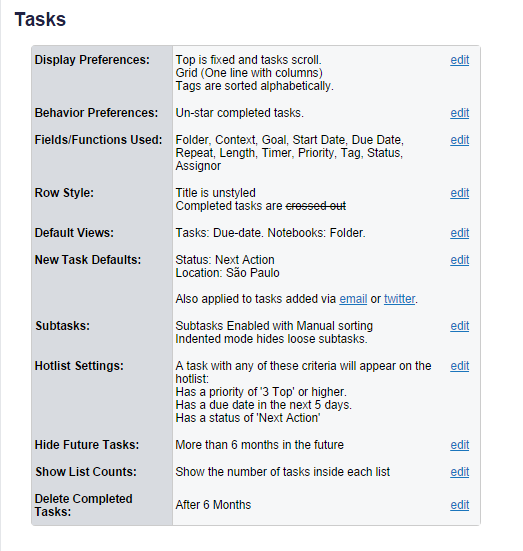
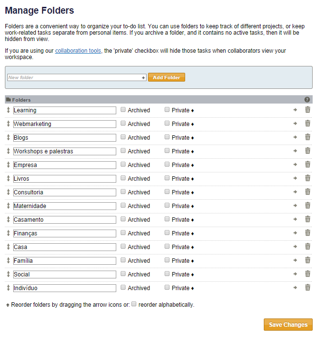
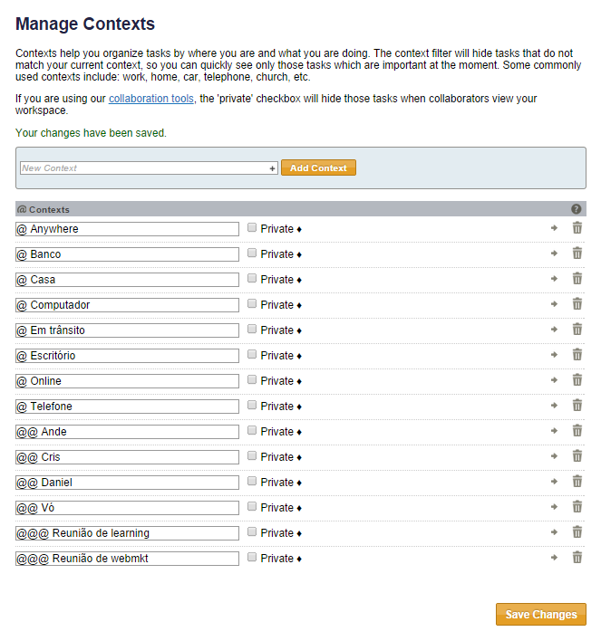
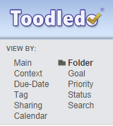
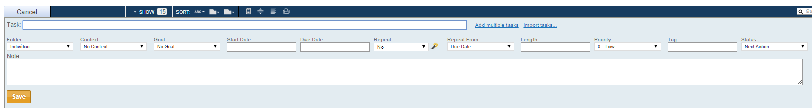
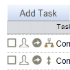
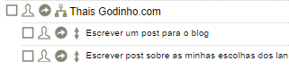
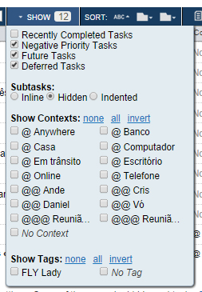
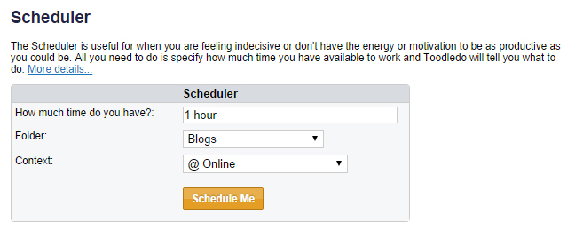
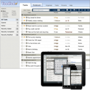

23 *Oct 2014*

## Guia para aplicar o GTD no Toodledo

[Toodledo](http://toodledo.com/) é uma ferramenta fantástica – a minha preferida para utilizar junto com o GTD. Não sei se é o visual retrô ou todas as features envolvidas, mas já utilizo a ferramenta há muitos anos e, mesmo testando outras, sempre volto para ela. Por isso, resolvi criar este guia sobre como aplicar o GTD no Toodledo.

1 – **Crie uma conta** na ferramenta. Sim, ela é toda em inglês, mas nada que um Google Tradutor não possa te ajudar. Quando você configurá-la, colocará tudo em português, então o inglês não deve ser impeditivo para utilizar.

2 – Você pode se perguntar sobre o **tipo de conta** que irá ter. O Toodledo tem [4 planos](http://www.toodledo.com/subscribe/index.php). Apesar de ter utilizado o gratuito durante muito tempo e ele atender bem, pela minha experiência, o plano Silver (15 dólares por ano) é o ideal. Se você pagar o dobro do preço, pode ter o plano Gold, que basicamente te permite anexar arquivos às tarefas. Eu assinei esse plano para testar e, sinceramente, não uso. Então, nesse momento, recomendo que você crie sua conta Silver (se realmente tiver interesse em implementar o GTD na ferramenta), porque ela te dá acesso a muitos recursos úteis para o GTD, que vou falar neste post.

3 – Depois de criar sua conta, clique em [“Settings”](http://www.toodledo.com/account_edit.php) para **configurá-la**. As primeiras configurações são as básicas de senha e outros mecanismos de segurança (como autenticação em duas etapas e criptografia). Não vou entrar neste assunto agora. Se você não entende nada sobre isso, deixe como está. Nós vamos mexer na terceira opção, que é a “Tasks”.

 

4 – Edite cada um dos campos e deixe configurados como na imagem acima. O que você precisa saber sobre essa configuração: estamos selecionando os campos que vão aparecer para cada tarefa, o que acontece quando completamos uma tarefa, qual será o nosso modo de visualização padrão inicial e alguns outros padrões.

5 – Feitas essas configurações, basta clicar lá em cima em “Tasks”.

6 – Desse menu, usaremos amplamente a aba “Tasks”, ou Tarefas. Em “Notes”, você pode inserir informações que quiser que auxiliem você em seus projetos. Quem utiliza outra ferramenta (como o Evernote, por exemplo) pode acabar não usando esse recurso. O mesmo vale para “Outlines” (referências) e “Lists” (checklists), mas você pode ficar à vontade para usá-los se estiver curioso. Se você não utiliza nenhuma outra ferramenta de suporte, pode ser interessante manter tudo aqui. O Toodledo fornece um amplo material de orientação para quem quiser utilizar qualquer recurso da ferramenta.

7 – Clique em “Organize” e em “Folders”. Em “Folders”, vamos colocar nossas **áreas de responsabilidade**. O David Allen diz que é comum termos de sete a quinze áreas de responsabilidade na nossa vida. Eu tenho 14.

8 – Não existe uma ordem correta (o Toodledo colocará automaticamente em ordem alfabética, mas você pode mudar através das setinhas ao lado esquerdo de cada área). Eu costumo deixar as áreas profissionais primeiro, para ficar mais fácil de acessar em um dia comum de trabalho, mas você pode organizar como quiser. Crie suas áreas, organize a ordem em que ficarão e clique em “Save changes”.

9. Depois, clique novamente em “Organize” e depois em “Contexts”. Aqui, você deverá inserir todos os **contextos** em que costuma realizar suas tarefas. Eu tenho um contexto chamado “@ Anywhere”, que acho muito útil, para coisas que posso resolver em qualquer lugar (refletir sobre uma decisão, por exemplo, ou ler um livro), e um outro chamado “@ Online”, para diferenciar do que preciso fazer offline, no computador. Procure inserir o mínimo possível de contextos, mas não deixe de ser atendido por eles. Se achar que está faltando um, coloque e depois tire, se achar que ficou demais. O David Allen utiliza o caractere “@” antes dos contextos, então mantenho a nomenclatura. Eu costumo ter três tipos de contextos: situações, pessoas com as quais sempre converso e reuniões periódicas. Para facilitar na hora de selecionar cada contexto, eu agrupo pelo número de arrobas, de acordo com o tipo de contexto. Assim:

10 – Depois, clique novamente em “Organize” e, agora, em “Goals”. Aqui, vamos inserir nossos **objetivos** de curto (short-terms goals), médio (long-term goals) e longo prazo (lifelong goals). Não precisa fazer isso com pressa, nem agora. Aqui, estou apenas ensinando como fazer. A ideia é a seguinte: criar primeiro os objetivos de longo prazo (o que o David Allen chama de “nível 50 mil pés”) porque os seguintes estarão relacionados aos objetivos maiores. Toda vez que você inserir um objetivo de curto ou de médio prazo, aparecerá uma caixinha chamada “Contributes”, para você selecionar que objetivo de longo ou médio prazo está relacionado a esse novo que você está inserindo. É bem legal até para o planejamento, para você ver se está construindo objetivos coerentes. Às vezes a gente tem um objetivo de curto prazo que não contribui para nenhum objetivo de longo prazo. Aí a gente escolhe entre deixar em branco mesmo ou se questionar se está investindo o tempo hoje corretamente (ou não) em algo que significa algo para o futuro. À medida que você for acrescentando tarefas e projetos no seu sistema, o Toodledo vai mostrando embaixo de cada objetivo se você está trabalhando neles. É bem fantástico. Amo o Toodledo. <3

11 – Depois, clique em “Organize” e em “Locations”. Este é um recurso que você deve utilizar somente se fizer sentido para você. Quando eu morava em Campinas, passava muitos dias da semana em São Paulo, realizando algumas atividades. Logo, eu tinha dois “locations” aí, que eram essas duas cidades. Não confunda com contextos! É para colocar o lugar mesmo, especialmente se você trabalha em uma empresa com filial em outras cidades, se viaja com uma frequência periódica para outras e por aí vai. Se você nunca viaja e realiza sempre suas atividades em um único lugar, não precisa utilizar este recurso.

12 – Acabamos as configurações! Agora é hora de clicar em “Tasks” e começar a brincadeira! Clique em “Tasks” e, quando a página abrir, selecione o link “Folder” no menu esquerdo.

13 – Perceba que, toda vez que você clica em um desses links, o menu abaixo dele muda completamente, de acordo com o que você clicou. “Main” é a configuração padrão, principal, que a gente configurou lá no começo. “Context” lista todas as suas tarefas por contextos. “Dua-date” lista as tarefas por prazos – ou seja, o que é para hoje, o que está atrasado, o que é para amanhã etc. “Tag” mostra as tarefas por tags. Falarei sobre isso adiante. “Sharing” mostra as tarefas compartilhadas. “Calendar” mostra as tarefas por prazo! “Folder” mostra as tarefas por áreas de responsabilidade. “Goal” mostra as tarefas relacionadas por objetivos. “Priority” mostra as tarefas por prioridade. “Status” lista as tarefas de acordo com cada status. ” “Search” é a busca do Toodledo. Todas essas definições são feitas quando criamos uma tarefa nova. Vamos fazer isso?

14 – Clique em “Add task” (embaixo de “Tasks”). Abrirá uma janela assim:

15 – Em “Task:”, a gente vai colocar a tarefa ou o nome do projeto. O que vai dizer se é tarefa ou projeto é se terá sub-taks. Por isso a inscrição Silver é importante, porque este não é um recurso disponível na conta gratuita. Na sequência explicarei como criar sub-tasks. Bem, em “Folder”, selecione que área de responsabilidade se refere a tarefa ou projeto em questão. Depois, o contexto. Depois, se há um objetivo relacionado – nem toda tarefa ou projeto terá um objetivo relacionado, então você pode deixar em branco. Em “Start date”, eu costumo colocar a data em que estou inserindo a tarefa no sistema, apenas para controle. Só preencho “Due date” se ela realmente tiver prazo, senão deixo em branco. Vale lembrar que, para o GTD, qualquer tarefa sem prazo é para ser feita “o mais rápido possível”, e não ser esquecida ali para sempre. Em “Repeat”, você pode colocar recorrência na tarefa. Ou seja, se for algo que você faz todo dia, uma tarefa de rotina, você pode selecionar a frequência “daily”. Deixe “Repeat from: Due date” como padrão. Em “Lenght”, você pode colocar a duração estimada da tarefa. Isso é muito útil para um recurso que o Toodledo tem e que explicarei mais para a frente, então pode valer o esforço. Em “Priority”, você seleciona a prioridade da tarefa. Em “Tag”, pode adicionar tags. Eu não costumo adicionar nenhuma, mas recomendo para gestores que coordenam muitas áreas diferentes. Em “Note”, você pode inserir informações que ajudem  concluir a tarefa. Pode clicar em “Save”. Pronto, você criou a sua primeira tarefa ou projeto!

16 – Se for um projeto, você pode colocar sub-tarefas da seguinte maneira: clique na flechinha para a direita que fica ao lado de cada tarefa/projeto:

17 – Ao clicar nela, abrirá uma janela com opções. Clique em “Add sub-task”. Ao clicar nessa opção, abrirá uma janela de tarefa semelhante a que mostrei ali em cima. Escreva a próxima ação do projeto e clique em “Save”. Se você seguiu os passos anteriores, provavelmente terá algo assim:

18 – Você pode inserir quantas sub-tarefas quiser e também pode inserir várias ao mesmo tempo – quando abrir a janela de nova tarefa, clique em “Multiple tasks” na frente do campo de tarefa.

19 – Agora eu gostaria de falar sobre os atributos de status e de prioridade das tarefas e dos projetos, para demonstrar como eu faço. As opções de **status** do Toodledo são as seguintes:

> **None -** Nunca uso  
> **Next action -** Próximas ações. Sempre que for uma tarefa e tiver um contexto atrelado a ela, uso este status.  
> **Active -** Uso para projetos ativos. Nunca tarefas (supôe-se que uma tarefa é uma ação pontual, então ou ela está resolvida ou é próxima ação).  
> **Planning -** Uso para projetos que estou destrinchando as próximas ações. Ou seja, eles estarão em andamento nos próximos dias.
>
> **Delegated -** Uso tanto para tarefas quanto para projetos tocados por outras pessoas. Neste caso, pode valer a pena usar tags com o nome das áreas ou das pessoas responsáveis.  
> **Waiting -** Uso para tarefas e projetos que não dependem de mim, mas de uma resposta de alguém.  
> **Hold -** Uso tanto para projetos quanto para tarefas que precisam que outra coisa aconteça para que elas possam prosseguir. Por exemplo: preciso escrever um relatório, mas dependo do fim de uma ação para fazer isso. Ele fica com status “hold” enquanto isso.  
> **Postponed -** Uso tanto para projetos quanto para tarefas que foram adiados.  
> **Someday -** É a tradicional atribuição de “Algum dia / Talvez” do GTD. Uso tanto para tarefas quanto projetos que eu gostaria de executar, mas não tenho tempo para investir neles agora.  
> **Canceled -** Quando um projeto ou uma tarefa é deletado, mudo o status para Canceled antes de tickar, porque o Toodledo registra para as estatísticas e eu posso ter um registro do que foi cancelado.  
> **Reference -** Se você gostar de utilizar o Toodledo para lembretes e informações rápidas, pode usar este status. Eu até uso, mas pode ser substituído pela agenda. Exemplo de como uso: “lembrar de nunca enviar os relatórios para o e-mail X do fulano” como referência dentro de um projeto. Como não tem data, não cabe na agenda então uso aqui. Acho prático!

20 – As opções de **prioridades** são as seguintes:

> **3 – Top -** Coisas urgentes.  
> **2 – High -** Coisas importantes, de preferência para esta semana (se não tiverem data).  
> **1 – Medium -** Coisas importantes, mas menos relevantes que a High, podendo ser feitas na semana que vem  (se não tiverem data) ou em outro dia (se tiverem prazo flexível).  
> **0 – Low -** Para fazer quando der tempo, depois de todas as outras.  
> **-1 – Negative -** Nem uso. Se for prioridade baixíssima desse jeito, sequer merece estar na minha lista.

21 – O Toodledo tem algumas opções de visualização que ajudam bastante com as tarefas e projetos. Por exemplo, se você clicar em “Show”, no menu azul que fica abaixo de “Tasks”, aparecerão algumas opções. Eis como eu deixo:

21 – Não deixo selecionada a caixinha de “Recently completed tasks” porque, se fizer isso, aparecerão as tarefas que já “tickei”. Acho que fica muito poluído visualmente, então prefiro tirar. Acho importante a configuração das sub-taks como “Hidden”, porque isso significa que eu só vejo as tarefas de cada projeto se eu clicar para desmembrá-lo. Você pode testar as outras duas configurações para ver o que te atende melhor. Eu prefiro assim, esteticamente falando.

22 – Vale lembrar que, clicando no nome das colunas, você filtra as tarefas e projetos de acordo com seu atributo. Então, por exemplo, se eu estou vendo todas as minhas tarefas e projetos na área de responsabilidade “Casa”, se eu clicar no título “Context” da coluna, o Toodledo vai separar todas as tarefas por contextos. Se eu clicar no título da coluna “Goals”, mostrará as tarefas separadas por objetivos, e por aí vai. Dá para ir brincando. Particularmente, gosto de clicar em “Due date” no menu lateral esquerdo e então filtrar por “Priority”. Ele me mostra todas as tarefas com prioridade top, high etc que devo fazer naquele dia, e isso me dá uma boa orientação de onde deve estar meu foco.

23 – Outro ponto que é importante destacar é que o Toodledo permite que você imprima as suas listas, caso sinta necessidade. Você pode selecionar a página que quiser, com os filtros que quiser, e clicar no ícone da impressora no menu azul. Ou então pode usar um recurso mais interessante, clicando em “Tools” > “More” > [“Printable Booklets”](http://www.toodledo.com/tools/booklet.php).

24 – Aproveitando que estou falando dos recursos do Toodledo, vou falar de um dos que eu mais gosto, que é o “Scheduler”. Você pode acessá-lo clicando em “Tools” > [“Scheduler”](http://www.toodledo.com/tools/scheduler.php) (outro recurso disponível somente a partir da versão Silver). Este recurso serve para o seguinte: se você estiver sem inspiração, pode selecionar quanto tempo tem disponível, a área de responsabilidade que quer trabalhar e o contexto em que se encontra. Basta clicar em “Schedule me” que o Toodledo te dará sugestões do que fazer primeiro, com base nos atributos que você especificou ao criar as tarefas. Não é incrível? Ele mostra inclusive tarefas dentro de projetos como resultados. Por isso é legal investir um tempinho colocando a duração estimada para cada tarefa, porque aí esta ferramenta fica mais precisa.

25 – Outro recurso do Toodledo que acho fascinante é o “Tools > [“Statistics”](http://www.toodledo.com/tools/stats.php). Com ele, você pode analisar como está investindo seu tempo – o sistema gera gráficos de acordo com as áreas de responsabilidade, os contextos, os objetivos e todos os outros atributos. Ou seja, você pode verificar que tem investido pouco em uma determinada área de sua vida, enquanto outra está tomando quase todo o gráfico. Também pode ver se está realizando mais tarefas urgentes ou importantes, se está cumprindo as tarefas no prazo ou sempre atrasando. Dá para fazer um balanço mensal da sua vida com este recurso.

26 – O Toodledo também tem um sistema de alarmes e lembretes, que eu não utilizo porque fico o dia inteiro trabalhando na ferramenta. Mas ele existe, caso você goste de ser avisado sempre que precisa trabalhar em alguma coisa. Você também pode sempre fazer backup das suas informações (em formato Excel, olha que maravilha), entre outras possibilidades. Todos esses recursos podem ser encontrados no menu “Tools”. Vale a pena navegar. Outros recursos interessantes: [enviar tarefas para o Toodledo direto do seu e-mail](http://www.toodledo.com/tools/connect_email.php), [usar receitas do IFTTT](http://www.toodledo.com/tools/ifttt.php), [linkar tarefas com o Google Calendar](http://www.toodledo.com/widget/google_gadget.php) e [todos os aplicativos disponíveis para dispositivos móveis](http://www.toodledo.com/tools/mobile.php).

27 – Em termos de material de referência, a [FAQ](http://www.toodledo.com/info/help.php) do Toodledo é fantástica e vale a pena o estudo quando começar a usar. Está em inglês mas, mais uma vez, basta jogar no Google Tradutor e dá tudo certo. Eles também gerenciam um [fórum](http://www.toodledo.com/forums/index.php) com usuários entusiastas que vivem falando sobre novidades, soluções e recursos. Há [diversos vídeos tutoriais](http://www.toodledo.com/info/videos.php) (em inglês), que são bastante explicativos e didáticos.

28 – Vale lembrar que o Toodledo foi uma ferramenta construída para ser utilizada com o GTD, então por isso ela é tão perfeita. Para mim, ela tem somente um defeito, que é estar disponível somente através do acesso online, mas isso é contornável através dos recursos de impressão. Não é o ideal, mas é contornável.

Por fim, este foi meu tutorial para aplicar o GTD no Toodledo e eu espero que tenha servido a seu fim. Qualquer dúvida, por gentileza, postem nos comentários. Vou adorar melhorar este tutorial respondendo as dúvidas de vocês.

Escrito por [Thais Godinho](http://vidaorganizada.com/sobre/ "Thais Godinho")

em [GTD](http://vidaorganizada.com/categoria/solucoes/produtividade/gtd/ "GTD"), [Toodledo](http://vidaorganizada.com/categoria/solucoes/aplicativos-e-ferramentas/toodledo/ "Toodledo")

- [0 comentários](http://vidaorganizada.com/solucoes/produtividade/gtd/guia-para-aplicar-o-gtd-no-toodledo/#comments)

### Textos relacionados:

- 
- 
- 
- 
- 
