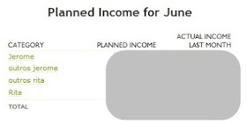
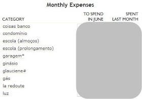
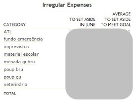
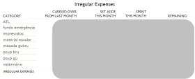
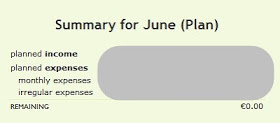
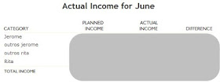
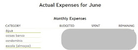
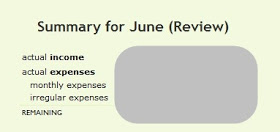

### PearBudget - fazer orçamentos e controlar despesas

  
  

Depois de muito tempo a fazer os meus orçamentos mensais no excel, descobri uma ferramenta online fantástica - o [PearBudget](http://www.pearbudget.com/).

O PearBudget é mesmo bom! É grátis durante 30 dias e depois paga-se 4.95 USD por mês (não chega a 4 euros). Mas vale mesmo a pena. O programa é super fácil de usar, tem um design simples e não tem distrações como publicidade (afinal, estamos a pagar pelo seu uso).

Para aderir, basta um endereço de email. O PearBudget não pede qualquer informação bancária, como outros softwares, e por isso é seguro. O default vem em dólares, mas dá para mudar para euros.

Antes de vos mostrar mais detalhadamente como trabalhar com o PearBudget, devo dizer que alterei o modo como giro o nosso dinheiro, em relação ao que escrevi [aqui](http://busywomanstripycat.blogspot.pt/2012/02/fazer-um-orcamento-mensal-e-um-plano.html). Já não temos a conta conjunta (porque não era no meu banco principal), mas agora giro todo o nosso dinheiro em conjunto, ou seja, já não há o meu dinheiro e o dinheiro do J. Na prática, sempre foi assim, mas no papel, eu fazia orçamentos em separado para cada um de nós e para as coisas comuns, o que me dava imenso trabalho.

Decidi fazer tudo em conjunto para simplificar e porque de qualquer modo quem faz toda a gestão financeira sou eu, o J. não liga nenhuma a estas coisas e confia em mim. A semana passada li um [livro](https://www.e-junkie.com/ecom/gb.php?cl=191502&c=ib&aff=148192) que veio reforçar esta decisão que tomei (tomámos) de juntar o dinheiro (e devo dizer que eu e o J. não somos casados):

*"It is common practice among married couples to keep separate checking/savings accounts and then separate out the bills in some agreed-upon manner and operate the household finances that way. This is dangerous and, if I may be so bold to say, stupid! When you have separate finances from your spouse, you are telling me you don’t trust your husband. When you keep separate accounts, you’re telling me you have something to hide from your wife. When you can’t combine your accounts when you get married but are willing to have children with that person, you’re telling me that you aren’t convinced this thing is going to last. Why not get a prenuptial agreement? I really cannot comprehend how you can successfully operate your household finances when the two of you do not fully share the income provided by any/all sources."*

In: [Barry Myers "From Debtor to Better"](https://www.e-junkie.com/ecom/gb.php?cl=191502&c=ib&aff=148192)

Então, os **passos para começar a trabalhar com o PearBudget** são os seguintes:

***1. Dinheiro que entra***

Primeiro, introduzimos o dinheiro que vai entrar (ordenados e outras coisas). O programa mostra os montantes do mês passado para podermos comparar.

***2. Despesas mensais fixas***

De seguida, introduzimos as despesas mensais fixas. Antes de introduzirmos valores, temos que criar as várias categorias, como é óbvio, mas isso faz-se só uma vez. Essas categorias aparecem sempre nos meses seguintes, mas podemos apagá-las, alterar os nomes, ou optar por esconder as categorias que estão a zero (por exemplo, contas que não se pagam todos os meses, como a minha da La Redoute, que foram umas roupitas que comprei o mês passado e me cobraram este mês).

Na imagem podem ver algumas das minhas categorias de despesas (elas aparecem por ordem alfabética) e os símbolos \* e # no nome de algumas das categorias referem-se, respectivamente, ao dinheiro que fica na conta do meu companheiro (coisas pagas por ele) e ao dinheiro que é levantado (é só a minha mesada, dinheiro para compras de supermercado e para pagar à empregada).

***3. Despesas irregulares***

Finalmente, a categoria de despesas irregulares engloba aquelas que não são pagas todos os meses ou poupanças que fazemos. O programa permite estabelecer objectivos anuais e mostra-nos o dinheiro que deve ser colocado de parte em cada categoria para atingir esse objectivo.

O dinheiro destas categorias que não é gasto no mês transita para o mês seguinte, e no balanço final das despesas irregulares podemos ver o dinheiro que transitou do mês passado para este mês, o dinheiro que foi posto de parte este mês, o dinheiro que foi gasto este mês e o dinheiro que sobrou, ou seja, o que vai transitar para o mês seguinte.

Uma das categorias que adicionei às despesas irregulares chama-se "imprevistos" e serve para isso mesmo: pequenas despesas que não foram previstas como um jantar fora para celebrar qualquer coisa, um vestido para uma ocasião especial, uns sapatos novos porque os velhinhos morreram de vez... O fundo de emergência não serve para estes pequenos imprevistos, mas sim para emergências a sério.

***4. Balanço***

Nós usamos um orçamento "zero-based budget" em que não sobra dinheiro nenhum, ou seja, todo o dinheiro que entra tem algum destino. No final do planeamento, dinheiro que entra menos dinheiro que sai deve ser igual a zero.   
  
  

  
  
  
  
***5. Introduzir despesas***  
  

Depois de termos o orçamento bem planeado, de preferência antes do início do mês a que se refere, podemos finalmente começar a introduzir as entradas de dinheiro e as despesas que realmente temos. Eu prefiro fazer isto diariamente, pois se for guardando recibos e papelinhos do multibanco para introduzir ao fim-de-semana, o mais provável é esquecer-me de alguma coisa...

Basta introduzir a data, o montante, escolher a categoria a que se refere essa despesa e ainda podemos adicionar etiquetas, se bem que eu uso esse campo como notas, se precisar de adicionar alguma informação para me lembrar do porquê dessa despesa.

***6. Planeado vs. real***

Por fim, podemos ver as diferenças entre o que foi orçamentado e o que realmente recebemos e gastamos. O programa permite visualizar esse balanço para as várias categorias de ganhos, despesas regulares e despesas irregulares, e o balanço geral. Portanto, podemos ver a qualquer momento se já gastámos mais que o suposto numa determinada categoria, e assim ajustar o orçamento de maneira a não gastarmos mais do que aquilo que temos.

  

  

Além do PearBudget, continuo a ter os movimentos das contas num [ficheiro excel](https://docs.google.com/file/d/0B3VxRL1TcY-cR3h1aVFjM1ZKVDA/edit?pli=1), pois como [já referi](http://busywomanstripycat.blogspot.pt/2012/04/simplificar-as-contas-bancarias.html), o dinheiro pode estar numa só conta, mas destinar-se a coisas diferentes, e eu gosto de saber exactamente quanto tenho em cada categoria.  
  
  
***E vocês, fazem or orçamentos em papel, no excel, ou usam um programa mais avançado? Se não estão contentes com o vosso sistema, aconselho mesmo o PearBudget - é muito simples e fácil de usar!***  
*[Não se esqueçam de participar no giveaway do livro 321 Stop - stop running and start living da Lorilee Lippincott](http://busywomanstripycat.blogspot.pt/2012/06/um-novo-livro-e-um-giveaway-321-stop.html)- até à próxima segunda-feira, dia 11 de Junho às 22h00.*

[Rita B. Domingues](http://www.blogger.com/profile/09486163012928388751 "author profile")

à(s)
[07:00](http://busywomanstripycat.blogspot.pt/2012/06/pearbudget-fazer-orcamentos-e-controlar.html?m=1 "permanent link")

[Partilhar](#)
