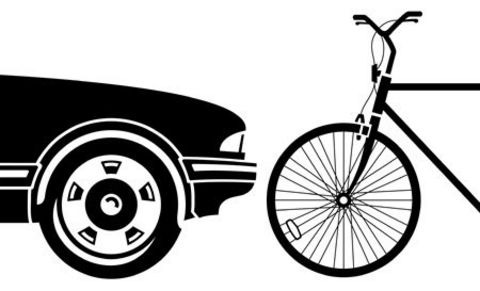
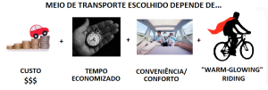

# POR QUE AS CICLOFAIXAS SÃO UMA MÁ IDEIA?

A cidade de São Paulo vem passando por uma drástica intervenção urbana. Desde que assumiu o cargo de prefeito, Fernando Haddad tem feito da construção de uma rede de vias cicláveis (ciclofaixas e ciclovias) uma dos principais projetos de sua administração.  O prefeito planeja construir 400 km dessas vias até o fim do seu mandato. Desses, cerca de 205 km já foram instalados.

**POR QUE TANTO ÓDIO?**

O projeto tem recebido várias críticas vindas de várias direções. A insatisfação tem em essência quatro causas.

Primeiro, o efeito que a diminuição do espaço das avenidas para tráfego de veículos teve nas condições já horrendas de trânsito na cidade. O trânsito ficou mais estrangulado em certos trechos da cidade, e, como resultado, se gasta mais tempo agora para ir do ponto A ao ponto B.

Segundo, o efeito no volume de comércio que a instalação das faixas em certas avenidas teve. Muitas ciclofaixas ocupam o espaço do acostamento, antes utilizado para estacionamento. Sem locais próximos para estacionar, muitos estabelecimentos comerciais têm reportado queda nas vendas – um efeito talvez pequeno, mas esperado. Pode-se incluir nessa conta também o ônus que o fim do acostamento criou para moradores do bairro que perderam espaço para estacionamento.

Terceiro, as suspeitas de que o programa vitrine do prefeito está eivado de corrupção. A revista Veja SP fez uma matéria na qual alega ter feitos contas mostrando que cada quilômetro de ciclovia até então criado custou ao contribuinte paulistano cerca de R$ 650 mil. A prefeitura desmentiu a reportagem (que parece ter feito uma conta descuidada, misturando projetos distintos) e diz que o custo de cada quilômetro de ciclovia é de R$ 180 mil, estando, portanto, mais ou menos “em linha” com o custo de ciclovias construídas em outras capitais ao redor do mundo. [Pelas estimativas da prefeitura](http://www1.folha.uol.com.br/cotidiano/2015/03/1605655-haddad-diz-que-ciclovias-melhoram-o-transito-em-sp.shtml), esse é um projeto de cerca de R$ 112 milhões – para fins de comparação, com esse valor a prefeitura poderia construir cerca de 25 creches (usei aqui a informação de que [a prefeitura liberou R$ 88.3 milhões para construir 19 creches](http://noticias.bol.uol.com.br/ultimas-noticias/educacao/2014/09/02/prefeitura-de-sp-libera-r-88-milhoes-para-construir-19-creches.htm)). Aliás, a vagas em creches é uma área que a prefeitura enfrenta problemas, tendo sido ameaçada recentemente de ter suas contas bloqueadas pelo Tribunal de Justiça caso não criasse mais de cem mil vagas como parte de suas obrigações constitucionais.

Quarto, a percepção de que muitos trechos das ciclofaixas criadas na cidade foram criados sem embasamento técnico (previsão de uso, avaliação de impacto, análise de custo-benefício), o que talvez explicasse a impressão de muitos de que não há tráfego de bicicletas em muitos trechos das ciclofaixas criadas na cidade. Percepção, aliás, que não estava infundada. Esta semana o prefeito admitiu que cerca de 90% das faixas foram implantadas sem estudos técnicos – sob o argumento (tosco, convenhamos), de que as ciclofaixas utilizaram espaço para estacionamento e não faixas de rolamento.

**OK, MAS QUAL O PROPÓSITO DAS CICLOFAIXAS?**

As críticas não parecem demover o prefeito de perseguir o objetivo de concluir a construção dos 400 km de ciclovias. É compreensível. Excetuando-se considerações de natureza eleitoral, a criação de ciclofaixas/ciclovias tem um objetivo nobre e desejável em uma cidade como São Paulo, qual seja: estimular o uso da bicicleta como meio *seguro* de transporte e, consequentemente, diminuir o número de veículos em circulação – o que significa aumentar a fluidez do tráfego (com consequente diminuição dos custos de transporte) e redução do nível de poluição (com consequente redução de gastos públicos com saúde).  Não se trata de forçar as pessoas a abandonarem o uso do carro: um corte na “margem intensiva” (frequência de uso) já geraria esse resultado.

Essa história de reduzir o número de veículos em circulação nunca foi dita muito explicitamente – não está no programa de governo do prefeito, e talvez até propositalmente, já que sem objetivo declarado, fica muito mais difícil mantê-lo “accountable” pelo projeto; pelo menos para além de fazer o que disse que faria, mesmo que sem propósito. Mas é difícil, no entanto, conceber que a criação de uma rede relativamente extensa e permanente de ciclovias tenha como objetivos *apenas* a provisão de opções recreativas (voltarei a este ponto mais adiante). Ser um meio de transporte alternativo ao veículo motorizado é o objetivo declarado de programas similares em muitas cidades europeias e americanas que serviram de inspiração para o projeto da gestão Haddad (ver, e.g., esse documento [aqui](http://www.bicyclinglife.com/Library/Autum-of-bike-Master-Plan.pdf) do Ministério dos Transportes da Holanda). Com um objetivo definido, sobretudo um que é mensurável, abre-se um leque de questões de desenho, avaliação (de impacto, num framework de equilíbrio geral) e comparação que podem ser feitas sobre o programa (custo-benefício) e sobre instrumentos alternativos de política.

**CICLOFAIXAS FUNCIONAM? PERGUNTAS**

Aceito este ponto, duas perguntas naturalmente surgem. Uma empírica e uma teórica.

A empírica é a seguinte: o que sabemos sobre o impacto dessas vias cicláveis (exclusivas ou não) em outros lugares do mundo onde elas foram implantadas? Por exemplo: em que medida elas aumentam o uso da bicicleta?  Em que medida elas reduzem o tráfego de veículos? Em que medida elas protegem os ciclistas?

A teórica é a seguinte: o que determina a decisão do indivíduo que usa veículo motorizado para se deslocar na cidade? É a decisão desse indivíduo que se pretender mudar. Logo, é preciso ter um modelo sobre essa escolha para que se possa entender a extensão necessária, e os limites, de um programa de criação de ciclovias.

**O QUE SABEMOS?**

As notícias nesse front não são animadoras.

Primeiro porque estudos de impacto econômico da criação dessas vias cicláveis são escassos, metodologicamente mancos (muitas dimensões são avaliadas com *survey data*, dado que a gente usa sabendo que tem a confiabilidade de uma nota de uma nota de R$ 3) e de limitadíssima validade externa. Um resumo da literatura existente pode ser visto [aqui](http://www.pdx.edu/ibpi/sites/www.pdx.edu.ibpi/files/Economic%20Benefits%20of%20Bicycling.pdf) e [aqui](http://www.lrrb.org/media/reports/TRS1309.pdf) (ambos são relatórios revisando a literatura no assunto, feitos em consórcio com universidades e departamentos de transportes dos EUA). Não há dúvida que a criação de uma infraestrutura de vias cicláveis tem benefícios econômicos (muitos dos quais indiretos, porque na forma de externalidades positivas); mas a conta de custo é muito mais complexa quando essas vias nascem da redivisão das faixas de rolamento para veículos.

Segundo porque vários estudos focados em segurança sugerem que as faixas exclusivas *aumentam* (ao invés de diminuírem) o número de acidentes com ciclistas – os acidentes acontecem não ao longo das ciclovias, mas em suas intersecções com as avenidas (ver resumo da literatura [aqui](http://vbn.aau.dk/files/14344951/agerholm_et_al._bicycle_paths.pdf)). O design de ciclovias da Holanda – com “esquinas” protegidas – já foi proposto como solução para muitos desses problemas de segurança (ver vídeo explicando [aqui](https://youtu.be/FlApbxLz6)). A questão ainda não parece bem definida: há estudos reportando evidência de que as ciclovias expõem os ciclistas a riscos menores de acidente (*vis a vis* pedalar em avenidas movimentadas. Ver, por exemplo, este estudo [aqui](http://www.ncbi.nlm.nih.gov/pmc/articles/PMC3519333/)).

Terceiro, e talvez mais importantemente, porque não é exatamente óbvio que a implantação de ciclovias vai reduzir o uso de veículos motorizados – que seria o objetivo primário desse tipo de intervenção urbana (esse é o objetivo declarado em muitas cidades europeias e americanas que serviram de inspiração para o projeto da gestão Haddad). As taxas de uso de bicicletas  não aumentaram, por exemplo, na Holanda durante o péríodo de mais de dez anos durante o qual quase um bilhão de dólares foram gastos na construção de uma rede de ciclovias (ver pág. 2, em particular, desse documento do governo Holandês [aqui](http://www.bicyclinglife.com/Library/Autum-of-bike-Master-Plan.pdf)). Um estudo mais rigoroso, feito na Inglaterra, sobre o efeito da criação dessas redes de ciclovias no uso da bicicleta como meio de transporte diário encontrou o seguinte: as ciclovias não produziram nenhuma mudança significativa na mudança de carro para bicicleta como meio diário de transporte. O paper pode ser visto [aqui](http://www.sciencedirect.com/science/article/pii/S0967070X12000157). A “foto” que emerge desse braço da literatura mais técnica sobre o efeito das ciclovias aponta duas coisas interelacionadas: primeiro, que a construção de ciclovias conquanto aumente o uso recreacional das bicicletas, não necessariamente aumenta seu uso para fins de transporte diário de casa para o trabalho – que é, em última instância, o objetivo primário desse tipo de intervenção. Segundo, que convencer as pessoas a usarem a bicileta como meio de transporte, com conseguinte redução/abandono do uso do carro para tanto, requer um conjunto de intervenções de escopo muito mais amplo e uma série de condições facilitadoras, como topografia, clima, “grandeza” da cidade.

À luz do que empiricamente é conhecido, a situação para os advogados desse tipo de intervenção não poderia ser mais desconfortável: as ciclovias têm seu custo-benefício raramente avaliado, não reduzem acidentes com ciclistas e não parecem ter impacto no uso de meios alternativos de transporte. É verdade que isso precisa ser visto com alguma cautela: como as respostas empíricas existentes a essas questões são produtos de experimentos em ambientes muito particulares, é *possível* que as ciclovias tenham um impacto distinto – embora haja poucas razões para acreditar que na direção que os justificasse. De qualquer forma, o juiz final dessas questões deve ser os dados, para o que a prefeitura de SP – e quem mais desejar copiá-la – precisa contratar estudos que procurem avaliar o impacto econômico local dessas vias (liga aqui pra sua velha faculdade Haddad; a gente te ajuda).

**BICICLETA OU AUTOMÓVEL? UM MODELO DE ESCOLHA**

Convenhamos. Não é de todo estranho na verdade que a força dessas redes de ciclovias em induzir mudanças nos hábitos de transporte (na direção de menos carro e mais bicicleta ou outro meio “sustentável”) seja diminuta. A decisão de qual meio de transporte usar – como quase qualquer outra decisão econômica —  é influenciada por uma multitude de variáveis, entre as quais apenas algumas, e talvez nem as mais importantes, se modificam com a presença de ciclofaixas.

Um modelo simples sobre como seria o problema de escolher qual meio de transporte usar diariamente em qualquer partição possível de um dado percurso (casa-trabalho-casa, digamos) diria que o meio de transporte escolhido (entre um número qualquer de alternativas — ônibus, carro, bicicleta e a pé, digamos) será aquele que maximiza a diferença entre custos e benefícios por unidade de distância. Custos e benefícios estariam divididos, essencialmente, em torno de quatro fatores:

**Custo monetário**: o quanto o sujeito gasta por quilômetro. Nesse aspecto, bicicleta teria custo virtualmente zero. Umas contas básicas me dizem que um veículo de R$ 25 mil com 100 litros de gasolina(ao preço de R$3/litro) por mês e que rode 10Km com um litro (fazendo, portanto, 33Km diários em média), produziria um custo por quilômetro diário de quase R$ 1.

**Tempo economizado**: o tempo gasto se deslocando entre um ponto e outro. Nesse quesito o carro deve ganhar da bicicleta mesmo em uma cidade com o trânsito travado como São Paulo (pelo menos para os percursoss acima de uma dada distância). É fácil ver que a economia de tempo do veículo sobre a bicicleta (na média, o veículo se desloca a 50km/h e a biciclet à 20km/h) é crescente na distância a ser percorrida. É verdade que esses parâmetros possuem números diferentes na cidade de São Paulo (os carros trafegam, em geral, com velocidades médias menores). Mas mesmo levando isso em consideração, é improvável que a economia de tempo obtida com o uso da bicicleta seja grande o suficiente para compensar a vantagem do carro sobre a bicicleta (e outros meios de transporte) no quesito que chamo abaixo de “conforto/conveniência”.

**Conveniência/conforto**: é o que rótulo do item diz: o conforto/conveniência do meio. Aqui entraria também a questão da (percepção de) segurança. É razoável supor que essa dimensão deteriora rapidamente na distância para o caso da bicicleta (vis à vis o carro).

**“Warm-glowing”**: fator subjetivo que captura o bem-estar psicológico que o usuário da bicicleta sente ao usar um meio “verde” e “sustentável” de transporte. Esse fator capturaria também os ganhos de bem-estar físico para o ciclista.

Com esse modelinho em mente fica relativamente fácil entender porque as ciclovias, per se, não são capazes de provocar a redução no uso do veículo, em favor da bicicleta, como meio de transporte: as ciclovias alteram o fator “tempo” (é menos time-consuming pedalar de um ponto A para um ponto B sobre uma ciclovia, livre de obstáculos, do que pela calçada ou nas ruas compartilhando espaço com veículos e motos) e o fator “conveniência/conforto” (melhoram a percepção de segurança), mas não em intensidade suficiente para dissolver a vantagem do veículo sobre a bicicleta na medida necessária para que uma parcela considerável da população migrasse do carro para a bicicleta em ao menos parte da sua “comutação” casa-trabalho-casa diária.

**PROJETO REGRESSIVO**

Considerando tudo isso, não me parece haver dúvida: o programa de construção de ciclovias da prefeitura de São Paulo será insuficiente para promover a mudança no uso de veículo que se deseja. Nesse sentido, se não for complementado por outras ações, será infelizmente um tremendo fracasso. Mesmo que lograsse algum tipo de êxito, marginal que fosse, o programa seria questionável pela simples razão que é uma baita política regressiva: beneficia usuários de bicicleta – um grupo relativmente pequeno mas com crescente poder de lobby, e que, na média, é composto de pessoas relativamente “well-off” – em detrimento de segmentos mais carentes que parecem em urgente necessidade da mãozinha visível da prefeitura (a finitude dos recursos exige que certas coisas sejam mais prioritárias que outras. A administração do prefeito revelou suas preferências…).

Talvez no futuro, muito mais do que agora, fique óbvio como essas ciclofaixas foram uma má ideia. Espero estar errado.

|  |
| --- |
| Avalie |

Colunista

Sergio Almeida

Professor de Economia da FEA-USP.

Posts Relacionados
