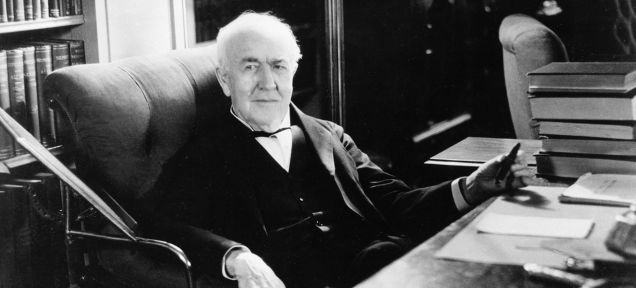
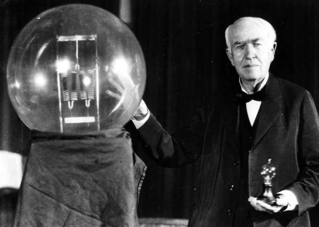

# [Take The Intelligence Test That Thomas Edison Gave to Job Seekers](http://paleofuture.gizmodo.com/take-the-intelligence-test-that-thomas-edison-gave-to-j-1689489019)

[1](http://paleofuture.gizmodo.com/would-be-lovely-to-hear-people-getting-hired-today-by-s-1691081662)[2](http://paleofuture.gizmodo.com/that-smug-smirk-i-hate-that-guy-1691519003)

Today tech companies are infamous for asking silly questions at job interviews. How would I move Mount Fuji? If I knew that I probably wouldn't be sitting here for this job interview, would I, [Microsoft](http://www.glassdoor.com/Interview/how-would-you-move-mount-fuji-QTN_13866.htm)?

But companies like Apple and Facebook don't put employees through anything quite as exhausting as Thomas Edison's test for potential employees. It was filled with trivia largely considered irrelevant to any job under Edison, but the quiz was all anyone could talk about when the questions leaked in the Spring of 1921. And if you're a trivia masochist you can take the test below.

Americans obsessed over the test following publication of many questions in the May 11, 1921 [*New York Times*](http://query.nytimes.com/mem/archive-free/pdf?res=9B05E1DA1E3FEE3ABC4952DFB366838A639EDE). From there the test was debated, [copied](http://www.newspapers.com/image/16391739), and parodied in newspapers and magazines around the country. By May 13, 1921 a full 146 test questions and answers, as remembered by two applicants with apparently fantastic memories, was published in the *Times*.

Everybody had an opinion on the test, and those who scored well weren't shy to tell you about it. However, those who did well were definitely in the minority.

The *Chicago Tribune* sent reporters down to the University of Chicago to see how students would fare. They asked them each [20 questions](http://archives.chicagotribune.com/1921/05/11/page/7/article/edison-right-chicago-falls-down-on-tests) and nobody did well. Male students averaged a score of just 35 percent. Female students? Just 28 percent. The newspaper warned that this was a sign that kids these days were getting dumber.

Reporters even quizzed Albert Einstein, who was said to have "[failed](http://alberteinstein.info/vufind1/Record/EAR000063385/Location)" Edison's quiz for not knowing the speed of sound off the top of his head. Edison's youngest son Theodore, a student at MIT, did poorly as well when questioned by a visiting reporter. But according to the [Edison biography](http://www.amazon.com/The-Wizard-Menlo-Park-Invented/dp/1400047633?tag=kinja-20&ascsubtag=[b|paleofuture[p|1689489019[a|1400047633[au|489539437) by Randall Stross, the elder Edison assured his son he had guaranteed employment anyway. Ironically, Edison was said to have created the test because he was frustrated with college-educated applicants looking for work who didn't have the proper knowledge.

As the [National Park Service](http://www.nps.gov/edis/learn/education/the-edison-test.htm) points out, the test was changed multiple times after it leaked [with the answers](http://www.newspapers.com/image/20322940/). But that didn't stop Americans from discussing the test as if it were the ultimate barometer of intelligence, and comparing notes on how well they did.

Want to take the test for yourself? Be my guest. But remember that you have to answer as if you're living in 1921. Which, even with Google, is a bit tough. If you want to cheat, go ahead and skip to the bottom, where we've supplied the answers as they appeared in the *New York Times*. Any odd spellings have been maintained.

## Questions

1. What countries bound France?

2. What city and country produce the finest china?

3. Where is the River Volga?

4. What is the finest cotton grown?

5. What country consumed the most tea before the war?

6. What city in the United States leads in making laundry machines?

7. What city is the fur centre of the United States?

8. What country is the greatest textile producer?

9. Is Australia greater than Greenland in area?

10. Where is Copenhagen?

11. Where is Spitzbergen?

12. In what country other than Australia are kangaroos found?

13. What telescope is the largest in the world?

14. Who was Bessemer and what did he do?

15. How many states in the Union?

16. Where do we get prunes from?

17. Who was Paul Revere?

18. Who was John Hancock?

19. Who was Plutarch?

20. Who was Hannibal?

21. Who was Danton?

22. Who was Solon?

23. Who was Francis Marion?

24. Who was Leonidas?

25. Where did we get Louisiana from?

26. Who was Pizarro?

27. Who was Bolivar?

28. What war material did Chile export to the Allies during the war?

29. Where does most of the coffee come from?

30. Where is Korea?

31. Where is Manchuria?

32. Where was Napoleon born?

33. What is the highest rise of tide on the North American Coast?

34. Who invented logarithms?

35. Who was the Emperor of Mexico when Cortez landed?

36. Where is the Imperial Valley and what is it noted for?

37. What and where is the Sargasso Sea?

38. What is the greatest known depth of the ocean?

39. What is the name of a large inland body of water that has no outlet?

40. What is the capital of Pennsylvania?

41. What state is the largest? Next?

42. Rhode Island is the smallest state. What is the next and the next?

43. How far is it from New York to Buffalo?

44. How far is it from New York to San Francisco?

45. How far is it from New York to Liverpool?

46. Of what state is Helena the capital?

47. Of what state is Tallahassee the capital?

48. What state has the largest copper mines?

49. What state has the largest amethyst mines?

50. What is the name of a famous violin maker?

51. Who invented the modern paper-making machine?

52. Who invented the typesetting machine?

53. Who invented printing?

54. How is leather tanned?

55. What is artificial silk made from?

56. What is a caisson?

57. What is shellac?

58. What is celluloid made from?

59. What causes the tides?

60. To what is the change of the seasons due?

61. What is coke?

62. From what part of the North Atlantic do we get codfish?

63. Who reached the South Pole?

64. What is a monsoon?

65. Where is the Magdalena Bay?

66. From where do we import figs?

67. From where do we get dates?

68. Where do we get our domestic sardines?

69. What is the longest railroad in the world?

The Trans-Siberian.

70. Where is Kenosha?

71. What is the speed of sound?

72. What is the speed of light?

73. Who was Cleopatra and how did she die?

74. Where are condors found?

75, Who discovered the law of gravitation?

76. What is the distance between the earth and sun?

77. Who invented photography?

78. What country produces the most wool?

79. What is felt?

80. What cereal is used in all parts of the world?

81. What states produce phosphates?

82. Why is cast iron called pig iron?

83. Name three principal acids?

84. Name three powerful poisons.

85. Who discovered radium?

86. Who discovered the X-ray?

87. Name three principal alkalis.

88. What part of Germany do toys come from?

89. What States bound West Virginia?

90. Where do we get peanuts from?

91. What is the capital of Alabama?

92. Who composed "Il Trovatore"?

93. What is the weight of air in a room 20 by 30 by 10?

94. Where is platinum found?

95. With what metal is platinum associated when found?

96. How is sulphuric acid made?

97. Where do we get sulphur from?

98. Who discovered how to vulcanize rubber?

99. Where do we import rubber from?

100. What is vulcanite and how is it made?

101. Who invented the cotton gin?

102. What is the price of 12 grains of gold?

103. What is the difference between anthracite and bituminous coal?

104. Where do we get benzol from?

105. Of what is glass made?

106. How is window glass made?

107. What is porcelain?

108. What country makes the best optical lenses and what city?

109. What kind of a machine is used to cut the facets of diamonds?

110. What is a foot pound?

111. Where do we get borax from?

112. Where is the Assuan Dam?

113. What star is it that has been recently measured and found to be of enormous size?

114. What large river in the United States flows from south to north?

115. What are the Straits of Messina?

116. What is the highest mountain in the world?

117. Where do we import cork from?

118. Where is the St. Gothard tunnel?

119. What is the Taj Mahal?

120. Where is Labrador?

121. Who wrote "The Star-Spangled Banner"?

122. Who wrote "Home, Sweet Home"?

123. Who was Martin Luther?

124. What is the chief acid in vinegar?

125. Who wrote "Don Quixote"?

126. Who wrote "Les Miserables"?

127. What place is the greatest distance below sea level?

128. What are axe handles made of?

129. Who made "The Thinker"?

130. Why is a Fahrenheit thermometer called Fahrenheit?

131. Who owned and ran the New York Herald for a long time?

132. What is copra?

133. What insect carries malaria?

134. Who discovered the Pacific Ocean?

135. What country has the largest output of nickel in the world?

136. What ingredients are in the best white paint?

137. What is glucose and how made?

138. In what part of the world does it never rain?

139. What was the approximate population of England, France, Germany and Russia before the war?

140. Where is the city of Mecca?

141. Where do we get quicksilver from?

142. Of what are violin strings made?

143. What city on the Atlantic seaboard is the greatest pottery centre?

144. Who is called the "father of railroads" in the United States?

145. What is the heaviest kind of wood?

146. What is the lightest wood?

---

## Questions with Answers

**1. What countries bound France?**

Spain, the tiny independent state of Andorra in the Pyrenees, Monaco, Italy, Switzerland, Germany, Luxemburg and Belgium.

**2. What city and country produce the finest china?**

Some say Limoges, France; some say Severes, France; some say Dresden, Germany; some say Copenhagen, Denmark.

**3. Where is the River Volga?**

In Russia.

**4. What is the finest cotton grown?**

Sea Island cotton or Egyptian cotton, according to different experts.

**5. What country consumed the most tea before the war?**

Russia.

**6. What city in the United States leads in making laundry machines?**

Chicago.

**7. What city is the fur centre of the United States?**

St. Louis has been the raw fur centre until the month of April of the present year, when New York apparently eclipsed it. It is nip and tuck between the two cities, with New York leading. New York is incontestably the centre of fur manufacturing and retail selling.

**8. What country is the greatest textile producer?**

Great Britain is so considered, but the United States is a close competitor in volume, and may even be slightly in the lead at present day.

**9. Is Australia greater than Greenland in area?**

This is a catch question. Greenland looks far bigger on the square, flat maps on Mercator's projection, which represents the world as a cylinder, exaggerating the size of areas as they approach the poles. Australia is in reality more than three times as large as Greenland.

**10. Where is Copenhagen?**

In Denmark.

**11. Where is Spitzbergen?**

In the Arctic, north of Norway.

**12. In what country other than Australia are kangaroos found?**

In New Guinea.

**13. What telescope is the largest in the world?**

That at the Mount Wilson Observatory in California.

**14. Who was Bessemer and what did he do?**

An English engineer. He invented a process for making steel by taking carbon out of molten iron by the air blast.

**15. How many states in the Union?**

Forty-eight.

**16. Where do we get prunes from?**

Prunes are grown in the Santa Clara Valley and elsewhere.

**17. Who was Paul Revere?**

The Minute Man who spread the alarm of the British march on Lexington.

**18. Who was John Hancock?**

The first signer of the Declaration of Independence.

**19. Who was Plutarch?**

A Greek of the first and second centuries A.D., who wrote the Lives" and miscellaneous works.

**20. Who was Hannibal?**

The Carthaginian General who conquered most of Italy in the third century B.C.

**21. Who was Danton?**

A French Revolutionary orator, who was sent to the guillotine by the Committee of Terror.

**22. Who was Solon?**

An Athenian lawgiver, famous for twenty-three centuries for the remark to Croesus (which modern historians say he did not make) to "Count no man happy until he is dead."

**23. Who was Francis Marion?**

General Marion was a principal leader of the Revolutionary forces in the Southern States.

**24. Who was Leonidas?**

The Spartan General who led the heroic defense of Thermopylae.

**25. Where did we get Louisiana from?**

By purchase from France.

**26. Who was Pizarro?**

The Spanish conqueror of Peru.

**27. Who was Bolivar?**

The hero of the South American wars of liberation from Spain.

**28. What war material did Chile export to the Allies during the war?**

Nitrates.

**29. Where does most of the coffee come from?**

From Brazil.

**30. Where is Korea?**

A peninsula on the northeast coast of Asia.

**31. Where is Manchuria?**

A northeastern province of China touching Korea.

**32. Where was Napoleon born?**

Ajaccio, Corsica.

**33. What is the highest rise of tide on the North American Coast?**

Seventy feet in the Bay of Fundy, between Nova Scotia and New Brunswick.

**34. Who invented logarithms?**

John Napier.

**35. Who was the Emperor of Mexico when Cortez landed?**

Montezuma.

**36. Where is the Imperial Valley and what is it noted for?**

In Southern California on the Mexican border, and noted for melons.

**37. What and where is the Sargasso Sea?**

A vast tract of seaweed floating in the North Atlantic Ocean.

**38. What is the greatest known depth of the ocean?**

Thirty-one thousand six hundred feet at Nero Deep, near Guam.

**39. What is the name of a large inland body of water that has no outlet?**

The Great Salt Lake.

**40. What is the capital of Pennsylvania?**

Harrisburg.

**41. What state is the largest? Next?**

Texas. California.

**42. Rhode Island is the smallest state. What is the next and the next?**

Delaware. Connecticut.

**43. How far is it from New York to Buffalo?**

Three hundred and ninety-six miles by the shortest route.

**44. How far is it from New York to San Francisco?**

Three thousand three hundred miles.

**45. How far is it from New York to Liverpool?**

Three thousand one hundred and sixty-seven and one-half nautical miles.

**46. Of what state is Helena the capital?**

Montana.

**47. Of what state is Tallahassee the capital?**

Florida.

**48. What state has the largest copper mines?**

Montana has the largest single mine in the Anaconda. The mines of Arizona have the greatest combined output.

**49. What state has the largest amethyst mines?**

Virginia

**50. What is the name of a famous violin maker?**

Stradivarius

**51. Who invented the modern paper-making machine?**

The major discovery was made by Robert, a Frenchman, though it is often attributed erroneously to Fourdrinier, who introduced it into England.

**52. Who invented the typesetting machine?**

Mergenthaler was the first to perfect a highly practical one.

**53. Who invented printing?**

Nobody knows. Somebody in China, Japan, or Korea. Probably first invented in Europe by Lourens Janzoon Coster of Haarlem.

**54. How is leather tanned?**

By immersion in an infusion of oak or hemlock bark or other material strong in tannic acid.

**55. What is artificial silk made from?**

From cotton or wood pulp treated with acids and drawn into threads.

**56. What is a caisson?**

An enclosure to keep water from seeping or flowing into a space where engineering operations are taking place.

**57. What is shellac?**

A base for varnish made from lac, which is resinous incrustation formed on certain trees in the East Indies by an insect resembling the cochineal.

**58. What is celluloid made from?**

Wood pulp primarily.

**59. What causes the tides?**

The gravitational pull of the moon exerted powerfully on the ocean because of its fluidity, and weakly on the earth because of its comparative rigidity.

**60. To what is the change of the seasons due?**

To the inclination of the earth to the plane of the ecliptic. In the earth's revolution around the sun, this causes the sun's rays to be received at varying inclinations, with consequent variations of temperature.

**61. What is coke?**

Coal after the more volatile components have been driven from it by heat.

**62. From what part of the North Atlantic do we get codfish?**

Off the Newfoundland Banks.

**63. Who reached the South Pole?**

Amundsen, and then Scott.

**64. What is a monsoon?**

A periodic alternating wind in the Indian Ocean.

**65. Where is the Magdalena Bay?**

There is a Magdalena Bay in Lower California, one in Spitzbergen and one in Colombia.

**66. From where do we import figs?**

Mainly from the Smyrna region in Asia Minor, which was formerly Turkish but which since the war has become part of Greece.

**67. From where do we get dates?**

Arabia, India, North Africa, California, Arizona and elsewhere.

**68. Where do we get our domestic sardines?**

From Maine and California.

**69. What is the longest railroad in the world?**

The Trans-Siberian.

**70. Where is Kenosha?**

In Wisconsin.

**71. What is the speed of sound?**

In dry air at freezing it travels about 1,091 feet a second. In water its speed is about 4,680 feet per second. It traveled at 11,463 feet four inches a second through an iron bar 3,000 feet long. Sound moves at a constantly diminishing rate of speed.

**72. What is the speed of light?**

Approximately 186,700 miles a second in a vacuum and slightly less through atmosphere.

**73. Who was Cleopatra and how did she die?**

She was a Queen of Egypt, a contemporary of Julius Caesar and Mark Antony and committed suicide by causing an asp to bite her.

**74. Where are condors found?**

In the Andes.

**75, Who discovered the law of gravitation?**

Sir Isaac Newton.

**76. What is the distance between the earth and sun?**

93,100,000 miles.

**77. Who invented photography?**

Scheele, a Swede, discovered the principles about 1780 and Wedgwood, English, first applied them in June, 1802. Daguerre and Neipce, in France, produced the daguerretype, but Dr. John William Draper of New York University, in 1840, first improved it so as to make it practicable for taking the pictures of human beings.

**78. What country produces the most wool?**

Australia.

**79. What is felt?**

A clothe made from matted wool, fur or hair, by pressure, as opposed to weaving.

**80. What cereal is used in all parts of the world?**

No cereal is used in all parts of the world. Wheat is used most extensively, with rice and corn next.

**81. What states produce phosphates?**

Arkansas, Tennessee and other Southern States.

**82. Why is cast iron called pig iron?**

Because of a fancied resemblance of the row of channels into which the molten flows to a litter of pigs.

**83. Name three principal acids?**

Hydrochloric, sulphuric and nitric.

**84. Name three powerful poisons.**

Cyanide of potassium, strychnine and arsenic.

**85. Who discovered radium?**

Mme Curie in Paris in 1902.

**86. Who discovered the X-ray?**

Roentgen, a German, in 1895.

**87. Name three principal alkalis.**

Soda, potash and ammonia.

**88. What part of Germany do toys come from?**

Nuremburg and the Nuremburg region.

**89. What States bound West Virginia?**

Maryland, Pennsylvania, Virginia, Kentucky and Ohio.

**90. Where do we get peanuts from?**

California, Georgia, Virginia and other Southern States and Southern Pennsylvania.

**91. What is the capital of Alabama?**

Montgomery.

**92. Who composed "Il Trovatore"?**

Verdi.

**93. What is the weight of air in a room 20 by 30 by 10?**

484 86-1,000 pounds.

**94. Where is platinum found?**

Ural Mountains region separating Europe from Asia.

**95. With what metal is platinum associated when found?**

Native platinum is found alloyed with copper, iron, gold, iridium and osmium.

**96. How is sulphuric acid made?**

There are three commercial processes. (a) Chamber process: iron pyrites of sulphur roasted in special furnaces yield sulphur dioxide, which is collected in a lead chamber in the presence of water, oxygen or air and nitrous anhydride. (b) Catalytic or contact process: The raw materials, sulphur dioxide from burning sulphur or roasted iron pyrites and oxygen from the air, produce sulphur trioxide, which, when absorbed by water, gives sulphuric acid. Combination of sulphur dioxide and oxygen is carried on in the presence of a catlyzer, usually spongy platinum or iron oxide from pyrite burners. (c) Much sulphuric acid is made from waste gases of copper and zinc furnaces from ores rich in sulphur by the chamber process.

**97. Where do we get sulphur from?**

Louisiana and Texas.

**98. Who discovered how to vulcanize rubber?**

Charles Goodyear.

**99. Where do we import rubber from?**

South and Central America, Malay Peninsula, Ceylon, Borneo, Java and equatorial Africa.

**100. What is vulcanite and how is it made?**

A black variety of hard rubber capable of being cut and polished, made from the cheaper grades of rubber from Borneo and Java vulcanized with much sulphur.

**101. Who invented the cotton gin?**

Eli Whitney.

**102. What is the price of 12 grains of gold?**

United States Assay Office price, May 12, 1921, was 56.693 cents.

**103. What is the difference between anthracite and bituminous coal?**

Hard coal is anthracite; soft coal is bituminous.

**104. Where do we get benzol from?**

The fractional distillation of coal tar.

**105. Of what is glass made?**

A fusion of silica, usually in the form of natural and, with two or more alkaline bases, such as soda, lime or potash.

**106. How is window glass made?**

By immersing a blowpipe in molten glass, introducing compressed air and gradually withdrawing the blowpipe from the molten glass. This produces a large cylinder which is cut open and heated in a flattening oven until flat and then transferred to an annealing oven and gradually withdrawn from the heat.

**107. What is porcelain?**

A fine earthenware differing from china in being harder, whiter, harder to fuse and more translucent than ordinary pottery. (a) Natural porcelain: A mixture of kaolin and feldspar. (b) Artificial porcelain: Gypsum and bone ash replace the silicious materials.

**108. What country makes the best optical lenses and what city?**

"A catch question. The city of Jena in Germany, formerly produced the best lenses, but recently the Bureau of Standards in Washington has turned out lenses excelled by none." — Dr. George F. Kunz of Tiffany & Co.

**109. What kind of a machine is used to cut the facets of diamonds?**

A diamond lathe where "diamond cuts diamond."

**110. What is a foot pound?**

A unit of energy equal to the work done in raising one pound of avoirdupois against the force of gravity the height of one foot.

**111. Where do we get borax from?**

California, Nevada, Texas and Oregon.

**112. Where is the Assuan Dam?**

Across the Nile in Upper Egypt.

**113. What star is it that has been recently measured and found to be of enormous size?**

Betelgeuse.

**114. What large river in the United States flows from south to north?**

The San Joaquin River in California. The Red River of the North.

**115. What are the Straits of Messina?**

They separate Sicily from Italy.

**116. What is the highest mountain in the world?**

Mount Everest in the Himalayas.

**117. Where do we import cork from?**

Southern Europe and Northern Africa.

**118. Where is the St. Gothard tunnel?**

Under the Alps.

**119. What is the Taj Mahal?**

A magnificent mausoleum built at Agra, India, by the Mogul Emperor Shah Jahan in memory of his favorite wife.

**120. Where is Labrador?**

A peninsula on the east coast of North America, running from St. Lawrence River to Hudson's Bay.

**121. Who wrote "The Star-Spangled Banner"?**

John Spofford Smith wrote the music for a drinking song for the Anacreonic Club in London about 1780. Francis Scott Key wrote the words.

**122. Who wrote "Home, Sweet Home"?**

John Howard Payne, an American, wrote the words. Sir Henry Bishop, an Englishman, wrote the music.

**123. Who was Martin Luther?**

The principal leader of the Reformation.

**124. What is the chief acid in vinegar?**

Acetic.

**125. Who wrote "Don Quixote"?**

Cervantes.

**126. Who wrote "Les Miserables"?**

Victor Hugo.

**127. What place is the greatest distance below sea level?**

The Dead Sea. It is 1,300 feet below sea level and is the most depressed accessible part of the earth's surface.

**128. What are axe handles made of?**

Ash is generally used in the East and hickory in the West.

**129. Who made "The Thinker"?**

Auguste Rodin.

**130. Why is a Fahrenheit thermometer called Fahrenheit?**

It is named after Gabriel Daniel Fahrenheit, the German physicist, who invented it.

**131. Who owned and ran the New York Herald for a long time?**

James Gordon Bennett.

**132. What is copra?**

The dried kernel of the cocoanut.

**133. What insect carries malaria?**

The mosquito of the genus Anopheles.

**134. Who discovered the Pacific Ocean?**

Balboa.

**135. What country has the largest output of nickel in the world?**

Canada.

**136. What ingredients are in the best white paint?**

Linseed oil, with a small percentage of turpentine and liquid dryer, together with a mixture of white lead and zinc oxide.

**137. What is glucose and how made?**

"It is remarkable how few of the apparently well-informed know what 'commercial glucose' really is. This is due to the confusion of terms which associate this misnamed starch product with grape sugar and dextrose. It is quite true that dextrose (glucose) is an ingredient of commercial glucose, but the dextrose in the commercial glucose of today is the least important ingredient." — Rogers's Manual of Industrial Chemistry. Commercial glucose is made from crude corn starch liquor that is first converted into a liquid by being hydrolized by an acid, then neutralized by a solution of sodium carbonate, and finally filtered and evaporated in vacuum pans.

**138. In what part of the world does it never rain?**

"People have not been in one place long enough to know for a certainty where it never rains. Some natives of the Sahara Desert, however, have expressed amazement when they heard that water came from the skies. Rain has been reported in regions close to the poles, but neither of the discoverers of the North and South Poles was there any length of time." — U.S. Weather Bureau.

**139. What was the approximate population of England, France, Germany and Russia before the war?**

England, 34,000,000 (United Kingdom, 45,000,000); France, 40,000,000; Germany, 65,000,000; Russia, 180,000,000.

**140. Where is the city of Mecca?**

In the Kingdom of Hedjaz, 65 miles east of the port of Jedda on the Red Sea.

**141. Where do we get quicksilver from?**

From cinnabar, the red sulphite of mercury, mined chiefly in California, Texas and Spain.

**142. Of what are violin strings made?**

From "catgut," now usually made from the intestines of sheep.

**143. What city on the Atlantic seaboard is the greatest pottery centre?**

Trenton, N.J.

**144. Who is called the "father of railroads" in the United States?**

John Stevens, 1749-1838, of Hoboken, N.J.

**145. What is the heaviest kind of wood?**

Lignum vitae.

**146. What is the lightest wood?**

Basswood, at thirty pounds a cubic foot, has been called the lightest, but it has been asserted recently that balsa, or corkwood, found in South America, is the lightest.

---

*Contact the author at [novak@gizmodo.com](http://paleofuture.gizmodo.com/take-the-intelligence-test-that-thomas-edison-gave-to-j-1689489019mailto:novak@gizmodo.com).*
