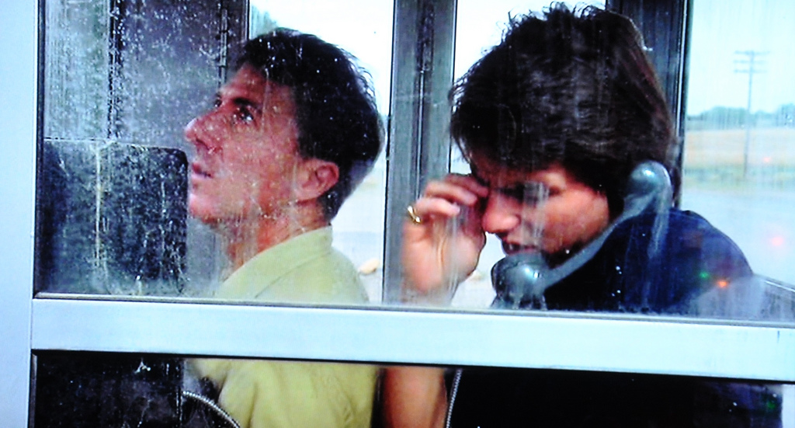
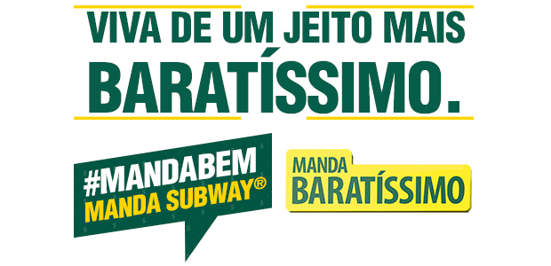

# O primeiro perrengue

Quando a grana falta e a coisa aperta. Um tipo de problema que vem desde os tempos do pobre Adão...

– Senhor?

– Pois não?

– Adão na linha sete.

– Pode passar.

– Sim, Senhor. Só um instante.

– Alô?

– Adão? Tudo bem? Estou tentando falar com você desde ontem. Liguei umas quatro vezes para você e ninguém atendeu.

– Ah, sim. Eu não estou atendendo ao telefone.

– Como assim?

– Eu deixo tocar até a que a pessoa do outro lado desist...

– Sim, Eu sei como se faz para não atender ao telefone. Quero saber por que você não está atendendo.

– Ah, por causa dos cobradores. Estou devendo uns cocos no Paraíso. Como ainda não posso pagar, não atendo o telefone.

– Mas para quem você está devendo?

– Eu estou devendo vinte e três cocos para as girafas.

– Só isso?

– E dezenove cocos para as capivaras. Trinta e sete para os hipopótamos... Não. Trinta e sete eu devo para as raposas, para os hipopótamos são vinte e cinco. Ou vinte e sete. Preciso olhar, tenho tudo anotado aqui.

– Você está devendo para todo mundo?

– Não, não. Por exemplo, eu não estou devendo nada para nenhum pássaro. Quer dizer... Avestruz não é ave, é?

– Ah. Achei que não fossem, porque só correm para cá e para lá. Achei que fossem cavalos feios.

– São aves. Então você está devendo cocos para todo mundo?

– Bem...

– Certo. Vou mudar a pergunta. Por que você está devendo cocos para o Paraíso inteiro?

– Bom... Sabe aquele restaurante que os macacos abriram perto da floresta? Eu queria levar a Eva para conhecer o lugar, mas é meio caro. Você paga um coco para entrar. Mais um para comer a entrada. Outro para o prato principal. Um coco para a sobremesa. E outro para as bebidas.

– Ou seja, cinco cocos.

– Por pessoa. Ou seja, para eu levar a Eva, precisaria de dez cocos. E eu tinha apenas cinco cocos. Precisava de mais cinco. Aí pedi emprestado para as girafas. E elas falaram que tudo bem, mas que cobrariam juros.

– Juros?

– Isso. Eu teria meus cinco cocos, desde que eu aceitasse pagar seis cocos.

– E você recusou.

– Bem, na verdade, eu...

– Não. Você aceitou. É claro que você aceitou. Não sei nem porque Eu me dei ao trabalho de perguntar. Continue.

– A Eva e eu fomos ao restaurante, mas no dia seguinte, eu precisava pagar seis cocos para as girafas e não tinha nenhum. Assim, fui pedir seis cocos emprestados aos leões. E eles me emprestaram desde que eu prometesse pagar sete cocos. Um era de juros.

– Certo.

– Peguei os cocos com os leões e paguei as girafas. Aí como eu precisava pagar os leões, falei com os avestruzes e peguei sete cocos com eles. Eles concordaram, mas apenas se eu pagasse juros. Ou seja, eu poderia pegar sete cocos, desde que eu devolvesse...

– Oito cocos.

– Não. Onze.

– Onze?

– Isso. Os avestruzes me explicaram que o mercado estava inflacionado, então os juros haviam aumentado. Eu não entendi nada, mas aceitei.

– Aceitou?

– Claro. Eu prefiro dever para os avestruzes que para os leões. Eu nem sei o que um avestruz come, mas eu sei o que um leão come.

– Certo. Aí você ficou devendo onze cocos.

– Isso. Aí eu juntei cocos para pagar essa dívida.

– Juntou como?

– Os ratos me emprestaram quatro, mas eu teria que pagar seis. As hienas me emprestaram dois, e eu teria que pagar cinco. Os sapos me emprestaram mais três, e eu teria que pagar quatro. E os castores me emprestaram mais dois. Disseram que eu não precisava pagar nada.

– Como assim?

– Eles falaram apenas que eu devia não esquecer que eles estavam me fazendo um favor, e que um dia poderiam aparecer na minha caverna fazendo uma proposta que eu não poderia recusar. Não entendi direito.

– Afinal, quanto você ficou devendo?

– Bom... Seis para os ratos, quatro para os sapos, cinco para as hienas. Quinze.

– Ou seja, você pagou sua dívida de onze cocos e ficou devendo quinze.

– Sim. Mas já paguei essa dívida também. Peguei quatro cocos novamente com as girafas. Eu concordei em pagar nove cocos, mas valeu a pena porque já paguei os sapos. Pagando os sapos, eu pude pegar outros quatro cocos ali mesmo com os sapos, aceitando pagar onze cocos. Ficou faltando apenas um para eu pagar as hienas, mas um cachorro me emprestou isso, desde que eu pagasse três cocos. Aí paguei os cinco cocos que devia para as hienas. Faltavam apenas os seis cocos dos ratos.

– E os nove cocos das girafas. E os onze cocos dos sapos. E os três cocos do cachorro.

– Sim. Mas paguei tudo.

– Como?

– Abri uma linha de crédito com os pinguins. Eles me ofereceram vinte cocos, desde que eu devolvesse trinta e cinco. Usei os vinte cocos para pagar os ratos, o cachorro e os sapos. Deu certinho.

– Mas faltaram as girafas.

– Sim. Falei com os elefantes e peguei nove cocos emprestados com eles, concordando em devolver treze. E paguei as girafas.

– Aí você ficou devendo para os pinguins e para os elefantes.

– Sim. Eu precisava de quarenta e oito cocos. Falei com um grupo de lontras, e elas concordaram em emprestar dez cocos, desde que eu pagasse vinte um. Peguei mais quatro cocos com os lagartos, que cobraram só dois cocos de juros. Eu já tinha catorze cocos, faltavam trinta e quatro.

– Fora os vinte e um das lontras. E os seis dos lagartos.

– Isso. Mas para pagar essas dívidas eu falei com os gatos e peguei oito cocos, prometendo pagar doze. Peguei mais cinco com os rinocerontes, desde que pagasse treze. E falei com as girafas. Elas podiam me emprestar mais cinco cocos, mas eu teria que pagar doze. E, com os cavalos, eu peguei...

– Adão, Eu estou ficando até tonto. Isso tudo aconteceu quando?

– Alguns dias atrás.

– E quantos cocos você está devendo hoje?

– É tudo dívida pequena.

– Quantos?

– Ah, uns vinte aqui, outros quinze ali... Não é muita coisa.

– Adão, ou você fala o número, ou Eu vou pedir para alguns anjos descerem aí e fazerem uma auditoria nas suas contas. E você sabe como eles fazem essa auditoria, certo?

– Acho que sim. Com espadas de fogo, certo?

– Certo. Então, Eu vou perguntar uma última vez. Quantos cocos você está devendo?

– Quinhentos e quarenta e sete. Mas, olhe, eu já tenho uma parte disso aqui comigo.

– Quantos cocos você tem?

– Doze.

– Faltam apenas quinhentos e trinta e cinco. Que ótimo.

– Isso.

– E você faz ideia de como vai pagar essa dívida?

– Eu pensei em dar meus doze cocos para o Senhor.

– Eu ouvi falar que quem dá ao Senhor ganha em dobro. Aí eu daria esses doze cocos para o Senhor, e ganharia vinte e quatro. Pegaria os vinte e quatro e daria para o Senhor, e seriam quarenta e oito. Aí eu daria os quarenta e oito para o Senhor mais uma vez e...

– Você está fazendo uma baita confusão. Quando você dá algo para alguma pessoa, ela pode desejar que “Deus devolva em dobro” apenas como agradecimento. Não é literal. Além disso, o correto não é “quem dá para Deus ganha em dobro”, e sim “quem dá aos pobres dá a Deus”. E isso nem existe ainda, é só um projeto.

– O que é pobre?

– Eu fico surpreso que você e sua dívida de mais de quinhentos cocos não saibam isso.

– Bem... O Senhor não precisa de uns cocos emprestados?

– Se o Senhor estiver precisando de cocos, eu tenho doze aqui comigo. Pode levar, mas aí o Senhor me paga vinte. Mas aí o Senhor precisa prometer que quando me devolver os vinte cocos vai pegar os vinte emprestados de volta e me pagar trinta e cinco. Que tal?

– Adão, chega. Essa dívida tem que acabar. Você não está pagando nada. Está apenas levando cocos de um lado para o outro do Paraíso e aumentando sua dívida.

– Bem...

– Eu vou mandar os anjos descerem aí para conversar com os animais sobre esse negócio de juros. Isso é coisa de agiota.

– Ei, também não precisa ofender!

– Eu disse agiota. E não estou falando de você. Olhe, Eu cuido dessa dívida.

– Mesmo?

– Sim. Não precisa mais se preocupar com isso. Mas quero que você Me prometa que nunca mais fará dívidas. Quando quiser sair para jantar, vá a algum lugar que você possa pagar.

– Mas o restaurante dos macacos tem música ao vivo, ambiente...

– Que tal comer em uma das praias?

– Nas praias? Mas não servem comida ali.

– Você leva um sanduíche ou algo mais leve, e come ao lado de Eva. Converse com ela, aproveite o momento. Você vai ter o barulho das ondas, é até mais bonito. Você não precisa gastar o dinheiro que não tem para comer bem e ter um momento bom.

– Mas a música ao vivo...

– Adão?

– O barulho das ondas é de graça.

– Tem razão. Não tinha pensado nisso.

– Então estamos conversados?

– Sim.

– Até logo, Adão.

Após desligar o telefone, Deus mandou três anjos resolverem o problema da dívida de Adão com os animais.  E, aproveitando que tinha alguns momentos livres, resolveu conferir seu extrato bancário. Criar o Paraíso havia saído mais caro que Ele imaginava – só os Oceanos acabaram custando quase três vezes mais que a cotação original – mas sim por causa das tarifas. Para cada transação, era obrigado a pagar uma fortuna em taxas e impostos.

Podia ligar para o gerente da sua conta, mas essa era uma das únicas coisas que Deus realmente não tinha paciência para fazer. Assim, pegou seu bloco de papel com linhas tortas – só usava blocos assim – e passou alguns instantes fazendo contas e tentando descobrir onde era possível enxugar gastos.

E Se lembrou do dia que a serpente apareceu em sua sala, se oferecendo para criar e administrar um sistema bancário, prometendo que a novidade iria facilitar a vida de todo mundo e tornaria as coisas mais ágeis. Devia ter percebido que era uma armadilha, mas agora era tarde.

E, para piorar as coisas, tinha certeza que a serpente estava apenas esperando uma chance para implantar o mesmo sistema no Paraíso.

### Mecenas: [SUBWAY® – Baratíssimo](http://pdh.co/subwaymecenas)

*Nos encantamos tanto com coisas caras e exóticas e acabamos nos esquecendo que algumas das melhores coisas da vida não custam nada, ou são bastante acessíveis.*

*[Os restaurantes da SUBWAY®](http://pdh.co/subwaymecenas) servem, todos os dias o Baratíssimo de Frango, fresquinho e gostoso pra você lembrar que as coisas boas da vida não precisam custar caro.*

---

*publicado em 30 de Março de 2015, 00:00*
