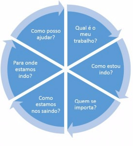

# Respondendo o que é importante! O modelo D’Aprix de Comunicação Interna

Todos sabemos que comunicação é a chave para a realização de um trabalho de alta qualidade. Certo? Entretanto, muitas vezes, temos dúvida do que é necessário comunicar. Não é mesmo?

Roger D’Aprix, consultor americano, criou, há mais de vinte anos, um modelo que busca facilitar a elaboração de planos para comunicação interna. São apenas seis etapas que, segundo o autor, fornecem respostas para que todos possam melhorar sua produtividade, engajamento e comprometimento.

Vejamos o que cada pergunta, em cada etapa, significa:

1. **Qual é o meu trabalho?** Quais são as responsabilidades e expectativas atribuídas a cada agente da organização. Se não há clareza sobre o que é esperado, não há definição do que é um satisfatório.
2. **Como estou indo?**Nem sempre há clareza sobre a qualidade do trabalho entregue. Diferentes critérios de avaliação podem gerar desencontro entre aquilo que o indivíduo pensa ser o esperado e o que a organização precisa. Por isso, feedback é importante, em qualquer formato.
3. **Quem se importa?**Com quem se pode conversar sobre expectativas? Quem pode avaliar o trabalho? Quem pode ajudar em um plano de desenvolvimento individual? Quem trata da remuneração e reconhecimento.
4. **Como estamos nos saindo?**Qual é a contribuição individual para o resultado do time? Qual é a relevância do time para os resultados da empresa?
5. **Para onde estamos indo?**Quais são as estratégias da empresa para o futuro? Qual é a visão e missão? Quais são os *valores que temos e que valorizamos*?
6. **Como posso ajudar?**Como cada um pode colaborar para a concretização da estratégia da empresa.

Interessante observar como cada questão é fundamento para que a próxima possa ser respondida. Percebe?

São questões bem simples. Não é mesmo? Mas, você saberia responder claramente, sem medo, cada uma dessas questões com relação a você e seu trabalho hoje? Seus colegas saberiam?

Gostei()Não gostei()

## Publicado por

### elemarjr

Programador, arquiteto de software, apaixonado por gestão, estratégia e inovação. [Ver todos posts por elemarjr](http://enquadrandoideias.com.br/author/elemarjr/)

Publicado em [13 de abril de 2015](http://enquadrandoideias.com.br/respondendo-o-que-e-importante-o-modelo-daprix-de-comunicacao-interna/)Autor [elemarjr](http://enquadrandoideias.com.br/author/elemarjr/)Categorias [Sem categoria](http://enquadrandoideias.com.br/category/sem-categoria/)[carreira](http://enquadrandoideias.com.br/tag/carreira/), [liderança](http://enquadrandoideias.com.br/tag/lideranca/)

### Deixe uma resposta [Cancelar resposta](http://enquadrandoideias.com.br/respondendo-o-que-e-importante-o-modelo-daprix-de-comunicacao-interna/#respond)

O seu endereço de email não será publicado Campos obrigatórios são marcados

Nome

Email

Site

Comentário

Você pode usar estas tags e atributos de HTML: `<a href="" title=""> <abbr title=""> <acronym title=""> <b> <blockquote cite=""> <cite> <code> <del datetime=""> <em> <i> <q cite=""> <strike> <strong>`

## Navegação de Post
