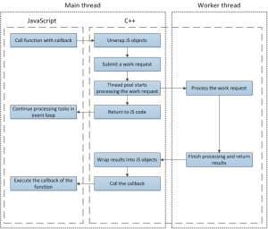
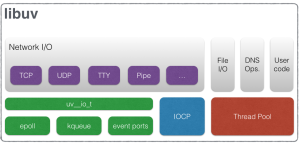

# On problems with threads in node.js

„Wait a moment!”, you might say, „Threads in node.js? That’s preposterous! Everyone knows node.js is single-threaded!”. And you would be right, to some extent. True, all the JavaScript code that you write will indeed run on a single thread. However, your JavaScript code is not everything node is dealing with. Without revealing too much just yet, let me show you an example.

The following code does very little. It reads the contents of the current directory three times, ignores the results and simply prints out how long, from the beginning of the program, it took to reach the callback for each particular iteration.

```
1. require
2. require'util'
3. start  processhrtime
4. function
5. readdirfunction
6. processhrtimestart
7. consoleformat'readdir %d finished in %ds'
```

Here’s a sample output from the execution of that code:  
readdir 1 finished in 1.005665125s  
readdir 2 finished in 1.036768961s  
readdir 0 finished in 1.040409237s  
  
Nothing out of the ordinary here. Each iteration took roughly the same amount of time to reach the callback. However, watch what happens if we double the number of iterations:  
readdir 1 finished in 1.003170344s  
readdir 0 finished in 1.052704191s  
readdir 2 finished in 1.058100525s  
readdir 3 finished in 1.060514229s  
readdir 4 finished in 2.003446385s  
readdir 5 finished in 2.007682862s

Surely, this cannot be right, can it? The last two calls took twice as much time to finish than the rest. But it is right and there is a very good reason for this behaviour. I hope I piqued your interest, the explanation will follow shortly.  
But first…

### I cheated

Not much, mind you, but cheated, nonetheless. You might have wondered why would, on any modern PC, reading the contents of a directory take more than a second. And herein lies the cheat. I made it so. I prepared a small shared library that would deliberately delay the operation by 1 second.

```
1. #define _GNU_SOURCE
2. #include<dlfcn.h>
3. #include<unistd.h>
4. #include<dirent.h>
5. scandir64const
6. struct dirent64 namelist
7. filterconststruct dirent64
8. comparconststruct dirent64 conststruct dirent64
9. real_scandirconst
10. struct dirent64 namelist
11. filterconststruct dirent64
12. comparconststruct dirent64 conststruct dirent64 **));
13. real_scandir  dlsymRTLD_NEXT"scandir64"
14. sleep
15. return real_scandir namelist filter compar
```

Nothing fancy here, the code simply sleeps for a second before calling the actual scandir() function. After compiling to a shared library, I just ran node through.

$> LD\_PRELOAD=./scandir.so node index.js

The only purpose of this modification was to prepare a minimal code showcasing the issue with consistent results. Without it, the original sample runs in fraction of a second and you cannot really spot the problem.

With that out of the way, we can move on to actually explaining what is going on.

### A look inside

Some types of operations, such as file system access or networking, are expected to take orders of magnitude more CPU cycles to complete than, say, RAM access, especially if we combine them into larger functions – an example of which could be node’s fs.readFile(), reading contents of an entire file. As you might imagine, had this function not been asynchronous, trying to read several gigabytes of data at once (which, in itself, doesn’t seem like the best idea but that’s not the point) would’ve left our application completely unresponsive for a noticeable period of time, which obviously would have been unacceptable.

But since it is asynchronous, everything is fine and dandy. We’re free to continue doing whatever it is that we’re doing while the file we wanted loads itself into memory. And once that’s done, we get a gentle reminder in the form of a callback. But how did that happen? To the best of my knowledge node.js, is not powered by magic and fairy dust and things don’t just get done on their own. The answer should hardly be a mystery at this point, as both the title and the introduction reveal it – it’s threads.

There are many parts that make node.js whole. The one we’re particularly interested in today is a library providing it with its asynchronous I/O – [libuv](https://github.com/libuv/libuv). Close to the bottom of the list of its features is the one thing we’re after – the thread pool. At this point, we’re moving away from JavaScript and into the mystical land of C++.

The libuv library maintains a pool of threads that is used by node.js to perform long-running operations in the background, without blocking its main thread. Effectively, deep under the hood, node.js is thread-based, whether you like it or not.

The thread pool is used through submitting a work request to a queue. The work request provides:

- a function to execute in the separate thread,
- a structure containing data for that function,
- a function collecting the results of processing done in the separate thread.

This is a bit of a simplification but it’s not a goal of this article to teach [libuv programming](http://nikhilm.github.io/uvbook/).

In general, before submitting the work request you’d convert V8 engine’s JavaScript objects (such as Numbers, Strings) that you received in the function call from JavaScript code to their C/C++ representations and pack them into a struct. V8 is not thread-safe so it’s a much better idea to do this here than in the function we’re going to run. After the function running on the separate thread finishes, libuv will call the second function from the work request with the results of the processing. As this function is being executed back in the main thread, it’s safe to use V8 again. Here we’d wrap the results back into V8 objects and call the JavaScript callback.

Now back to the work queue I mentioned briefly. When at least one thread in the thread pool is idle, the first work request from the queue is assigned to that thread. Otherwise, work requests await threads to finish their current tasks. This should start making it clear what was going on in our initial example.

[](http://www.future-processing.pl/wp-content/uploads/2015/04/threads-in-node.ja_.png)

Simplified diagram of execution flow for a function using the thread pool

The default size of libuv’s thread pool is 4. That is the reason why, out of our 6 calls to the fs.readdir() function, two of them finished after two seconds instead of one. Since all threads in the thread pool were busy for a whole second, waiting on that sleep() call, the remaining tasks in the work queue had to wait for one of those threads to finish, then get through their sleep(), to finally end after two seconds.

Under normal conditions, without that artificial slowdown, this wouldn’t be noticeable at all, of course. But, in some cases it might be very noticeable and it’s worth being aware that, first of all, it might happen at all and if it does, how to solve it.

At this moment, it should be noted that not all asynchronous operations are performed through thread pool. This particular mechanism is used mainly for:

- handling file system operations, which is, as explained by libuv’s docs, caused by significant disparities in asynchronous file system access APIs between OSes,
- most importantly for us, user code.

[](http://www.future-processing.pl/wp-content/uploads/2015/04/libuv.png)

Architecture of libuv – source: <http://docs.libuv.org/>

### So when does that all matter?

Imagine you’re writing an application that heavily utilizes a database. It’s Oracle, so you’ll use the brand new, [official Oracle database driver](https://github.com/oracle/node-oracledb). You expect to run a lot of queries so you decide to use a connection pool and let it create, at most, 20 connections. And you’d think „Fine, up to 20 queries running in parallel should be more than enough”. But you’ll never really get those 20 parallel queries, all because of [this](https://github.com/oracle/node-oracledb/blob/619e9a8fa6625a2c5ca3e1a2ba10dbdaab5ae900/src/njs/src/njsConnection.cpp#L353). As you can see, query execution submits a work request here. And since you’re running node with default number of threads in thread pool, you will never get past 4 queries running in parallel. Moreover, if your database suffers a slowdown, even parts of your application not making use of database access may become unresponsive as their asynchronous tasks are stuck in the work queue behind database queries.

There is, however, something we can do about it. For once, we could lower the size of database connection pool. But let’s say we don’t want to do that. Fortunately, there’s another solution. Enter UV\_THREADPOOL\_SIZE environmental variable. By changing its value we can influence the number of threads that will be available in the thread pool. You can choose any value between the hardcoded limits of [1](https://github.com/joyent/node/blob/v0.12.0-release/deps/uv/src/threadpool.c#L146) and [128](https://github.com/joyent/node/blob/v0.12.0-release/deps/uv/src/threadpool.c#L42). Let’s try that out on our sample code:

$> UV\_THREADPOOL\_SIZE=5 LD\_PRELOAD=./scandir.so node index.js  
readdir 2 finished in 1.005758445s  
readdir 0 finished in 1.046712749s  
readdir 3 finished in 1.056222923s  
readdir 1 finished in 1.057267272s  
readdir 4 finished in 1.05897112s  
readdir 5 finished in 2.007336631s

As you can see, it worked. Only one work request had to wait for a thread this time around. You can also change this programmatically, from your node application, by writing to process.env.UV\_THREADPOOL\_SIZE variable. Keep in mind that this is very limited, though. You cannot affect the size of the thread pool once it is created, which is once the first work request is submitted.

```
1. require
2. processUV_THREADPOOL_SIZE // This will work
3. // First time thread pool is required
4. readdirfunction
5. processUV_THREADPOOL_SIZE // This won't
6. readdirfunction
```

To finish off, just to give you an idea on what issues, stemming from the usage of the thread pool, may arise in actual applications, an example of a non-trivial problem I helped solve.

Our application required us to have a possibility of terminating currently executed queries on demand. The actual implementation was fairly simple and was an extension for an already existing module written mainly in C++. All initial tests indicated that everything works flawlessly and the issue was marked as resolved. Soon enough, however, we’ve received a report indicating that the feature, occasionally, did not work at all.

Sparing you the details of a long investigation, the explanation of the problem turned out to be painfully simple. Since we allowed multiple queries to run parallelly, there were situations where all four worker threads were busy, waiting for four queries to finish executing themselves. And since we’ve implemented the query termination functionality as an asynchronous function, the request to terminate a query was patiently waiting in work queue. The end result was that sometimes we couldn’t terminate a query because we had to wait for that specific query to finish.

This particular incident is, in fact, one of the key reasons this article exists at all, as the knowledge I gathered during its resolution was not readily available, and to this day doesn’t seem to be, and I felt it requires sharing.

I hope this article gave you enough insight to spot where such problems may occur in your applications making use of native code. If you feel I’ve left something amiss or would like to know more about some of the topics I mentioned, please let me know in the comments below.
