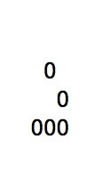

# [Profiling Elixir](http://learningelixir.joekain.com/profiling-elixir/ "Profiling Elixir")

It’s been a really long time since my last post on [Elixir Streams](http://learningelixir.joekain.com/streams-map/). Things in [my day job](http://www.linkedin.com/pub/joseph-kain/78/325/60a/) have changed a bit and I’ve had more responsibility and, sadly, less time for Elixir. But, over the last week I’ve had some time to play with an Elixir project.

It took me a little time to get used to the language again, remembering the matching syntax, the case and cond syntax. Elixir is such an elegant language and it was refreshing to come back to it after working in C++ for the last few months.

## Elixir Testing

The series of posts on Streams was unfinished but I decided to try something a little different as a diversion. I wrote up an implementation of Conway’s Game of Life in Elixir. I started out using this as a simple coding example and a way to practice some of the techniques from *Growing Object Oriented Software Guided by Tests*. I developed two levels of tests; end-to-end tests and unit tests. For the end-to-end tests I wrote a set of [bash functions to run tests and report results](https://github.com/joekain/elixir-life/blob/master/integration/integration.sh). The unit tests were written using ExUnit. I might extract this simple bash script into its own project in the future.

I followed the description of the rules of Life from the [wikipedia article](http://en.wikipedia.org/wiki/Conway's_Game_of_Life) and built an end-to-end test for each rule. Each test has a set of seed boards which I simply wrote down in data files. I added an end-to-end test for multiple iterations using the pulsar oscillator based on the image from the wikipedia article.


## Profiling Elixir

Once I had the basic implementation finished I setup another seed that leads to a perpetually moving spaceship. I used the glider pattern.



Everything was working (thanks to the test) but I was shocked to see how slowly it ran! Now, I didn’t do anything special to make it fast and I allocated a lot of space (100x83 cells) for the glider to fly. But, it was taking about 5-6 seconds per generation. I was hoping for something that looked animated with 0.5 - 1 second per generation.

I decided to use this as an opportunity to learn about and experiment with the available performance profiling tools available for Elixir. A quick search for “elixir profiler” turned up [export](https://github.com/parroty/exprof) so I started with it.

### ExProf - A simple code profiler for Elixir

ExProf is very simple to setup. I added the experf package as a dependency and then followed the README by importing the module and wrapping the code to profile in

```
profile 
    # profiled code goes here
```

I decided that I wanted to make it easy to run the profiler but not affect any of the tests I already had. To support this, I put together a quick `Profile` module:

```
defmodule Profile 
  import ExProfMacro

    
    profile 
      --iterations"  --seed" test_data/glider1.dat"
```

I ran the test with profiling and got the following results:

```
FUNCTION                                           CALLS      %     TIME  [uS / CALLS]
--------                                           -----    ---     ----  [----------]
...
'Elixir.Access.Map':'__impl__'/1                  410850   0.23    35443  [      0.09]
'Elixir.Enumerable':'impl_for!'/1                 164340   0.25    38850  [      0.24]
'Elixir.Life.Board':'-to_string/1-fun-0-'/2       318890   0.28    44133  [      0.14]
'Elixir.Life':'-count_live_neighbors/3-fun-0-'/1  328680   0.29    45414  [      0.14]
'Elixir.Access.Map':get/2                         410850   0.30    46461  [      0.11]
code:call/1                                       575203   0.35    55554  [      0.10]
'Elixir.Enum':'-map/2-lc$^0/1-0-'/2               410855   0.37    58790  [      0.14]
erlang:function_exported/3                        575203   0.40    62683  [      0.11]
'Elixir.Access':get/2                             410855   0.52    82282  [      0.20]
'Elixir.Enumerable.List':reduce/3                 657360   0.56    88299  [      0.13]
'Elixir.Life':'-list_of_neighbors/3-fun-0-'/6     369765   0.58    90508  [      0.24]
'Elixir.Access':'impl_for!'/1                     410855   0.58    91029  [      0.22]
'Elixir.Kernel':'function_exported?'/3            575200   0.63    99547  [      0.17]
'Elixir.Code':'ensure_compiled?'/1                575200   0.64   100346  [      0.17]
'Elixir.Code':ensure_compiled/1                   575200   0.67   105354  [      0.18]
code:ensure_loaded/1                              575203   0.67   106071  [      0.18]
code_server:call/2                                575203   2.11   331576  [      0.58]
maps:put/3                                         49302  12.15  1910097  [     38.74]
'Elixir.Access':impl_for/1                        410855  14.35  2255807  [      5.49]
maps:find/2                                       410850  62.03  9749918  [     23.73]
```

I was a little confused about the reports for `ensure_compiled/1`, `code_server:call/2` and `impl_for/1`. More time spent in `Life.list_of_neighbors/3` and `Life.count_live_neighbors/3` would have made more sense to me. These functions are the inner loop of the program. But the profile shows very little time spent in them.

At this point I was a little confused by the results and wanted to try another profiling tool.

### Using fprof with Elixir

Next I turned to [fprof](http://www.erlang.org/doc/man/fprof.html). fprof looked interesting, not just because it could provide more detail than ExProf but because it could provide call chains.

To add support for fprof I updated the `Profile` module:

```
defmodule Profile 
  import ExProfMacro

    
    :fprofapplyrun_test 
    :fprofprofile
    :fprofanalyse
   
  
   run_test  --animated" --iterations"  --seed" test_data/glider1.dat"
```

Also, note that I extracted the code for running the test into a new function `Profile.run_test/0`. This way, from the command line, I could run `Profile.go/0` to launch the profiler and `Profile.run_test/0` to run the test by itself. I run the test by itself to measure total time spent to check for any progress during an optimization effort.

fprof takes a long time to generate its profile. But it is quite detailed:

```
%                                               CNT       ACC       OWN        
[{ "<0.47.0>",                                 12269605,undefined,78850.927}].   %%
...
{[{ {'Elixir.Access',get,2},                   419067,13566.874, 2915.211}],     
 {  {'Elixir.Access.Map',get,2},               419067,13566.874, 2915.211},     %
 [{ {maps,find,2},                             419067,10651.663,10651.663}]}.    

{[{ {'Elixir.Code','ensure_compiled?',1},      583419,13508.697, 2736.668}],     
 {  {'Elixir.Code',ensure_compiled,1},         583419,13508.697, 2736.668},     %
 [{ {code,ensure_loaded,1},                    583419,10766.925, 1660.151},      
  {garbage_collect,                              83,    5.104,    5.104}]}.    

{[{ {'Elixir.Enumerable',reduce,3},            164340,12333.776, 1435.154}],     
 {  {'Elixir.Enumerable','impl_for!',1},       164340,12333.776, 1435.154},     %
 [{ {'Elixir.Enumerable',impl_for,1},          164340,10897.800, 2251.280},      
  {garbage_collect,                              14,    0.822,    0.822}]}.    

{[{ {'Elixir.Enumerable','impl_for!',1},       164340,10897.800, 2251.280}],     
 {  {'Elixir.Enumerable',impl_for,1},          164340,10897.800, 2251.280},     %
 [{ {'Elixir.Code','ensure_compiled?',1},      164340, 5790.109, 1208.826},      
  { {'Elixir.Kernel','function_exported?',3},  164340, 2081.641, 1356.149},      
  { {'Elixir.Enumerable.List','__impl__',1},   164340,  774.197,  774.197},      
  {garbage_collect,                              13,    0.573,    0.573}]}.    

{[{ {'Elixir.Code',ensure_compiled,1},         583419,10766.925, 1660.151},      
  { {error_handler,ensure_loaded,1},              4,    3.493,    0.010}],     
 {  {code,ensure_loaded,1},                    583423,10770.418, 1660.161},     %
 [{ {code,call,1},                             583423, 9107.479, 2468.435},      
  {garbage_collect,                              50,    2.778,    2.778}]}.    

{[{ {'Elixir.Access.Map',get,2},               419067,10651.663,10651.663}],     
 {  {maps,find,2},                             419067,10651.663,10651.663},     %
 [ ]}.
...
```

The entire output is about 900 lines and I found that the sorting wasn’t what I needed. It is sorted by the `ACC` or accumulated samples over the whole call-chain. But this doesn’t really tell me which functions are taking up a lot of time. I adjusted the Profile module to pass options to `:fprof.analyse()` to sort by `OWN` or the samples actually taken during the call itself.

```
defmodule Profile 
  import ExProfMacro

    
    :fprofapplyrun_test 
    :fprofprofile
    :fprofanalyse
      
        callers: 
        sort: 
        totals: 
        details: 
      
    
   
  
   run_test  --animated" --iterations"  --seed" test_data/glider1.dat"

   sorting
```

```
%                                               CNT       ACC       OWN        
[{ totals,                                     12269598,84879.507,81590.604}].  %%%

{[{ {'Elixir.Access.Map',get,2},                419067,10758.820,10758.820}],     
 { {maps,find,2},                              419067,10758.820,10758.820},     %
 [ ]}.

{[{ {'Elixir.Access','impl_for!',1},            419073,24908.864, 6739.702}],     
 { {'Elixir.Access',impl_for,1},               419073,24908.864, 6739.702},     %
 [{ {'Elixir.Kernel','function_exported?',3},   419073, 5398.386, 3524.110},      
  { {'Elixir.Access.Map','__impl__',1},         419067, 2049.423, 2049.423},      
  { {'Elixir.Code','ensure_compiled?',1},       419073,10719.379, 1982.565},      
  {garbage_collect,                              19,    1.952,    1.952},      
  { {'Elixir.Access.List','__impl__',1},           6,    0.016,    0.016},      
  {suspend,                                       1,    0.006,    0.000}]}.    

{[{ {'Elixir.Access',impl_for,1},               419073, 5398.386, 3524.110},      
  { {'Elixir.Enumerable',impl_for,1},           164340, 2124.427, 1392.240},      
  { {'Elixir.String.Chars',impl_for,1},            6,    0.018,    0.012}],     
 { {'Elixir.Kernel','function_exported?',3},   583419, 7522.831, 4916.362},     %
 [{ {erlang,function_exported,3},               583419, 2606.469, 2606.469}]}.    

{[{ {'Elixir.Enumerable.List',reduce,3},        493020,    0.000, 2876.517},      
  { {'Elixir.Enumerable',reduce,3},             164340,53584.723, 1130.122}],     
 { {'Elixir.Enumerable.List',reduce,3},        657360,53584.723, 4006.639},     %
 [{ {'Elixir.Enumerable.List',reduce,3},        493020,    0.000, 2876.517},      
  { {'Elixir.Life','-list_of_neighbors/3-fun-0-',6},369765,38159.783, 1763.985},      
  { {'Elixir.Life','-list_of_neighbors/3-fun-1-',5},123255,52518.744,  823.072}]}.    

{[{ {'Elixir.Enum',map,2},                      41090,70885.698, 2081.234},      
  { {'Elixir.Enum','-map/2-lc$^0/1-0-',2},      369765,    0.000, 1685.661}],     
 { {'Elixir.Enum','-map/2-lc$^0/1-0-',2},      410855,70885.698, 3766.895},     %
 [{ {'Elixir.Enum','-map/2-lc$^0/1-0-',2},      369765,    0.000, 1685.661},      
  { {'Elixir.Life','-count_live_neighbors/3-fun-0-',1},328680, 2503.039, 1264.582},      
  { {'Elixir.Life.Board','-map/2-fun-0-',3},    41085,68290.708,  165.513},      
  { {'Elixir.Life',count_live_neighbors,3},        0, 1592.181,  100.613},      
  {garbage_collect,                              14,    0.876,    0.876}]}.    
                         6,    0.273,    0.273}]}.
```

which was much easier for me to follow. The results were inline with what I saw with ExProf which was a good confirmation. I was hoping the call-chain information would give me a better understanding but I still found these results a bit confusing. It some sense it seemed like the reported call-chains didn’t go deep enough.

But I decided to look into `Elixir.Access.Map.get/2` a bit and found it in [Elixir’s access.ex](https://github.com/elixir-lang/elixir/blob/master/lib/elixir/lib/access.ex#L80)

```
defimpl Access   
     
     :maps  
       value -> value
      :error ->
```

This is the protocol implementation for `[]` on a `Map`. I believe this means that the bulk of the time in my program was spent doing lookups from the `Map` that holds my Life game board.

## Next Steps

I still feel like I don’t have all the information I need so I will continue looking at other tools.

---

**Profiling Elixir** was published on January 06, 2015.
