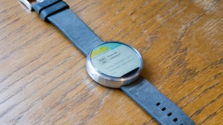
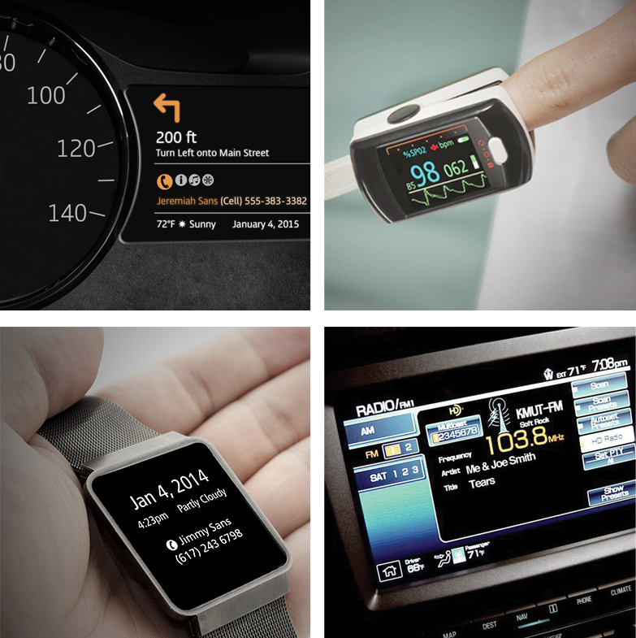
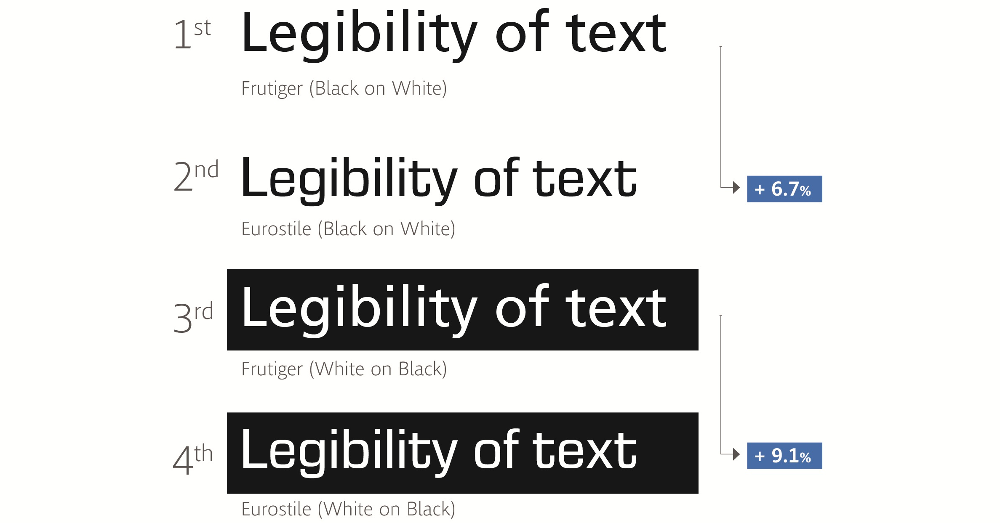
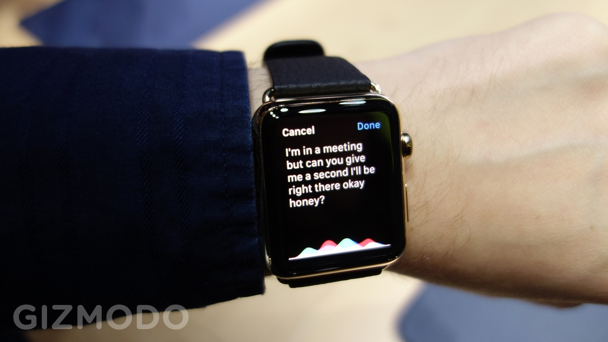

# [Gizmodo](http://m.gizmodo.uol.com.br/)

### fonte

# [Como a ciência está ajudando seu cérebro distraído a processar telas num relance](http://m.gizmodo.uol.com.br/design-telas-distracao/)

Por: [Kelsey Campbell-Dollaghan](http://m.gizmodo.uol.com.br/author/kelsey-campbell-dollaghan/ "Posts de Kelsey Campbell-Dollaghan")

9 de abril de 2015 às 13:19

COMPARTILHE 

 93 

 0

Quantas vezes por dia você dá uma olhada no smartphone? Seja honesto. Em média, este número [é 150 vezes por dia](http://www.kpcb.com/blog/2013-internet-trends). E a maioria dessas interações dura menos de um segundo.

Isso pode mudar à medida que os smartwatches se tornam mais difundidos. Devido ao tamanho, eles se comunicam com você através de pequenos flashes de texto. Por isso, o sucesso ou o fracasso desses dispositivos depende da facilidade em ler de relance. Isso precisa ser feito com perfeita clareza, brevidade e velocidade, o que não é uma tarefa fácil.

Felizmente, alguns cientistas estão estudando como o design afeta a legibilidade, e suas pesquisas estão moldando o futuro das interfaces, e criando a tecnologia para que as leituras de relance sejam tão úteis quanto possível.

## De olho na fonte

[Nadine Chahine](http://www.monotype.com/studio/nadine-chahine) é uma designer de fontes na empresa Monotype, e se concentra na ciência da legibilidade. Bryan Reimer é cientista, trabalha no [AgeLab do MIT](http://web.mit.edu/agelab), e pesquisa a distração causada por gadgets ao dirigir, e o impacto das interfaces para carro nos motoristas.

Juntos, eles estão descrevendo como nossos olhos leem quando estamos distraídos pelo mundo que nos rodeia. “Há, literalmente, a necessidade de desenvolver um guia sobre isso”, Reimer me disse, depois que ele e Chahine deram uma palestra em março intitulada *[De relance: como as fontes impactam sua vida diária?](http://schedule.sxsw.com/2015/events/event_IAP38138)*. “As empresas têm que se unir e apoiar um design com infusão de ciência.”

Chahine e Reimer estudam microdistrações constantes e irritantes, que são o ingrediente chave no modo como interagimos com a tecnologia atualmente. Mesmo que o smartphone exista há cerca de uma década, foram feitas poucas pesquisas sobre como essas microinterações acontecem, e como o design pode melhorá-las.

“Nós não estamos dispostos a dedicar mais do que uma fração de segundo para uma informação”, diz Reimer. “Então, como vamos redefinir as informações em torno do que nós podemos capturar em um relance?”

Isso é exatamente o que eles estão tentando testar, usando tecnologia – como rastreadores oculares e simuladores – que recria a distração que a maioria dos usuários sente ao ler uma mensagem no celular ou relógio.

## Quantificando as distrações

Em um estudo [publicado no periódico *Ergonomics*](http://www.tandfonline.com/doi/full/10.1080/00140139.2014.940000), Chahine e Reimer colocaram indivíduos em um simulador realista de carro, com uma tela de GPS no painel. Os motoristas tinham que selecionar um determinado endereço na tela enquanto mantinham o carro estável. Usando um rastreador de olhos, os pesquisadores mediram o tempo que o motorista levava para selecionar o endereço correto enquanto dirigia.

Mas eles não estavam apenas analisando a rapidez com que os motoristas podem ler: eles estavam estudando a importância do design do texto.

Eles exibiram os endereços em duas fontes diferentes. Uma delas é a Eurostile: é um tipo de letra que remete a um estilo digital, com letras que se encaixam em formas quadradas. A outra era a Frutiger, uma fonte redonda com letras mais abertas; ela foi projetada na década de 1970 para tornar a sinalização mais fácil de ler no aeroporto Charles de Gaulle, em Paris.

Você provavelmente esperaria que a fonte mais “digital” seria mais fácil de ler em uma tela. Mas eles descobriram algo surpreendente: para indivíduos do sexo masculino, foi necessário 10,6% menos tempo para um relance no texto em Frutiger – a outra fonte – o que significava quase meio segundo a menos de distração ao dirigir. Curiosamente, a fonte não parecia importar tanto para as mulheres, embora a Frutiger fosse mais útil ao dirigir em pouca luz.

Além de provar como a fonte afeta a rapidez com que lemos algo enquanto estamos distraídos, o estudo também provou como sabemos pouco sobre a ciência da tipografia. A diferença entre homens e mulheres foi totalmente inesperada, e ninguém nunca pensou em analisar diferenças no gênero.

Reimer e Chahine [publicaram um segundo estudo](http://agelab.mit.edu/files/Typeface/MT-MIT-Latin-Word_Recognition-White-Paper-2014-06-24.pdf): ele ensina a testar como a tipografia e o design gráfico afeta o tempo que o usuário leva para ler uma interface.

A ideia é permitir que estúdios de design e empresas avaliem a forma como o nosso cérebro processa informações, e usem a mesma metodologia de cientistas.

## Telas menores, problemas maiores

Dispositivos com telas menores são uma solução aparentemente simples para um problema que é mais complicado. Mesmo que seja em seu pulso, ainda se trata de ler palavras em uma tela – uma tela minúscula, durante milissegundos, enquanto você está andando, ou pedalando uma bicicleta, ou falando. De certa forma, é ainda mais preocupante do que olhar para o seu celular.

Smartwatches e HUDs – que colocam uma tela em seu rosto – são um território totalmente novo quando se trata de design. Neles, o dispositivo tem um milésimo de segundo para comunicar algumas palavras ou números – ou para fracassar completamente nessa tarefa.

“Eu acho que muitos designers ainda não entendem plenamente que, se eles não se comunicarem bem em um relance ou dois, o volume, velocidade e viscosidade da informação se desfaz”, diz Reimer. “A porta se abre uma vez para essa informação. Se eu não fizer isso bem, acabou.”

Chahine explica que o espaçamento entre as letras é extremamente importante, uma vez que nossos cérebros são sensíveis a letras reais e também a “letras fantasma”, criadas pelo espaço negativo – o espaço vazio (geralmente branco ou preto) dentro da imagem. Reimer diz que algo tão pequeno como um milímetro no tamanho da fonte pode ter um enorme impacto na legibilidade.

Até mesmo a linguagem que os designers usam é vital. Segundo Chahine, pesquisas mostra que quanto mais letras há em uma palavra, mais devagar o leitor entende. Se uma palavra aparece com frequência, o leitor vai entendê-la mais rápido. Isso terá um grande impacto na forma em que um smartwatch, por exemplo, se encaixa na sua vida.

Esta primeira geração de smartwatches pode ser o início para uma série de dispositivos que levam informações a você em relances que duram frações de segundo. É um sério desafio para o design, e requer ciência para ser bem-sucedido.

  
VOLTAR AO TOPO

[VISITE A VERSÃO COMPLETA](http://www.gizmodo.com.br/design-telas-distracao/?modeview=full "Versão completa")
