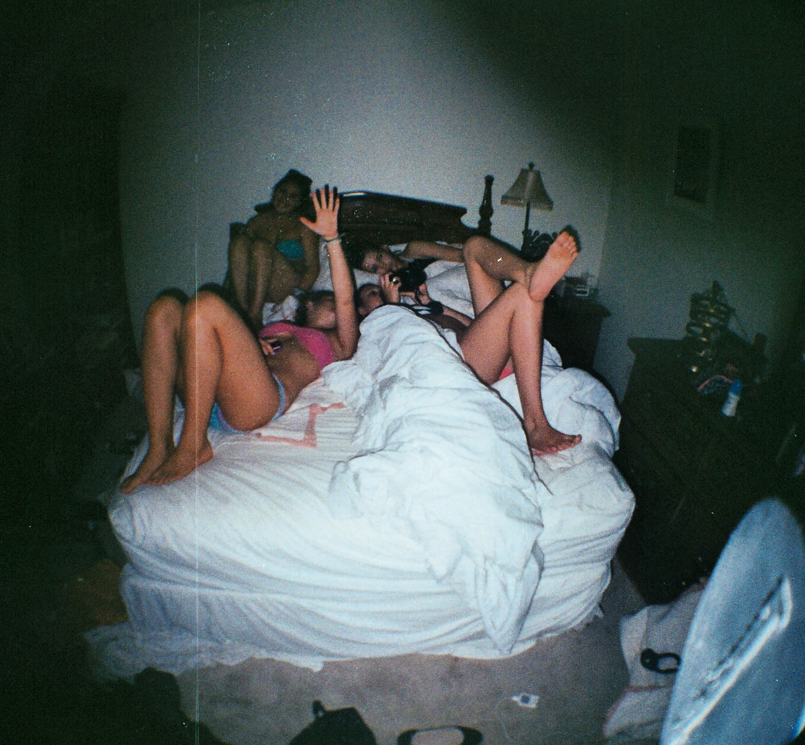

# Um lanche, uma peça ou umas putas? | Cotidiano #17

Quando a gente vai pra rua e as escolhas vão aparecendo diante dos nossos olhos

A noite cai e o tédio faz o cara querer bater uma punheta. Ele bota um vídeo, abre umas fotos das Playboys dos anos 90, mas nada acontece. É o enfado. Roça o indicador em uma poeira no encosto do sofá, vê pela janela os últimos tons de laranja desaparecendo pra dar espaço ao negro. Levantou-se para acender a luz da sala e acabou saindo de casa.

Nada iria passar na televisão, só aqueles jornais chatos de matar bandido e ficar gritando de dentro do estúdio com ar condicionado e terno feio. Deu embora todos os livros depois que ela foi embora e há meses não renovava sua leitura por nada. Achou que o asfalto e o trânsito iriam acalmá-lo e foi pra rua. Acendeu seu cigarro e pôs-se a caminhar. Cumprimentou os cachaceiros do bar Andorinha, em frente ao predinho onde mora, desceu a rua parada de carros cantarolando alguma canção não reconhecida pela própria memória.

No caminho, sentiu algo estranho, como se a fumaça do cigarro, em vez de lhe grudar nos pumões, descia para o estômago, um vazio, uma falta. bateu-lhe uma fome dos diabos. Continuou caminhando até avistar uma lanchonete na esquina, uma daquelas hamburguerias estilosas da cidade. Parou em frente, apertou a bituca do cigarro no cinzeiro do lado de fora e se atentou para o cardápio escrito com giz de louza na parede escura. Achou o preço uma barbárie, "onde já se viu cobrar essa coisa toda em dois pedaços de pão e uma carne?". Sentiu-se genuinamente ofendido, olhava as pessoas se divertindo lá dentro, travadas na fila, chupando refrigerantes pelo canudinho e apertando o katchup em cima da alface.

Desistiu de comer e seguiu caminho. "Vou é alimentar minha alma", pensou enquanto caminhava com as mãos enfiadas nos bolsos da calça jeans. Sabia que, caminhando umas quadras adiante, encontraria um velho teatro e, lá, assistiria a alguma peça. Mas as coisas não eram mais como ele imaginava. A antiga casa de comédia e drama se transformara em uma casa moderna de musicais, até nome de celular tinha. Lá dentro, um espetáculo que adaptava para uma trama dançante as aventuras de um super-herói conhecido. Lasers atravessavam a entrada, pessoas excitadas, ingressos a partor de duzentos reais.

"Meu deus, mas o que é isso?", ele gritou dentro da cabeça. Pensou que, com duzentos reais ele aproveitaria muito mais a noite, "com duzentos conto eu pago umas putas e faço uma festa de arromba, cacete!". Ele foi até o caixa eletrônico e sacou duas notas de cem. Imaginou-se sentado e envolto a uma morena, uma oriental e uma ruiva, ou duas gêmeas de cabelos platinados e cara familiar, como se já tivessem aparecido em algum programa de tevê.

Botou as duas notas no bolso e, a caminho da rua das putas, pensou que, melhor do que gastar duzentão com as garotas, poderia ir para casa e bater várias punhetas e ainda economizar duzentos reais.

Gozou três vezes em frente ao computador e foi formir.

---

*publicado em 10 de Abril de 2015, 00:00*
