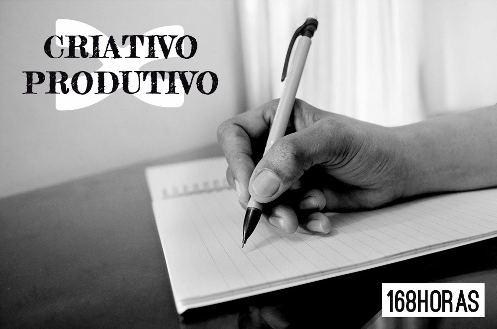

# Dá para ser produtivo e criativo?

Eu já ouvi muitas vezes essa comparação, como se criatividade e produtividade não pudessem caminhar juntas. Como se, para a gente conseguir dar conta de tantas demandas, tivesse qye deixar a criatividade de lado. Ou ainda, para conseguir criar, somente ficando no famoso ócio criativo.

Ser produtivo é aproveitar o tempo da melhor maneira possível. É executar com significado.

Se você sabe que no período da noite você costuma ter as suas melhores ideias, pode deixar reservado um tempinho às vezes nesse período para fazer um brainstorm para algum projeto, ou mesmo rabiscar ideias para outro projeto já em andamento. Se você trabalhar com artes, ser produtivo é descobrir o horário que você consegue exercer mais a sua criatividade e usá-lo sempre para produzir.

Faz parte do meu trabalho escrever muito – produzir conteúdo. Eu precisei identificar o momento (ou os vários momentos) do meu dia quando eu consigo ficar em um estado mental de foco e criatividade para sempre acioná-lo quando eu precisar escrever.

Você pode desenvolver alguns rituais para chegar a esse estado – ouvir determinado tipo de música, tomar um chá, ir a uma cafeteria ou livraria. Cada pessoa certamente tem os seus hacks pessoais que usa mesmo inconscientemente para conseguir chegar a esse estado de criação.

No GTD fala-se muito de trabalhar dentro de contextos, então esse momento de criatividade pode ser um contexto, o que na verdade é um estado mental – uma predisposição do seu nível de energia. E, se conhecendo, você pode programar esses momentos ao longo da sua semana e se dedicar a eles sem deixar de executar outras tarefas que também precisam ser feitas – mas não demandam tanta criatividade.

Se por acaso alguma ideia vier quando você não estiver em determinado contexto, não precisa parar tudo o que está fazendo e ir trabalhar. Anote em um bloquinho que levará sempre com você, ou mesmo no Evernote, que é fantástico para isso. Grave um áudio, tire foto das anotações que fez no guardanapo do restaurante – mas não perca sua ideias – nem o momento! Registrando suas ideias, você poderá trabalhar com elas mais tarde, com o foco necessário.

Dá para ser criativo e produtivo se você ajustar pequenas peças do seu dia a dia para fazer tudo isso acontecer. Produtividade é um trabalho de auto-conhecimento e de construção do nosso trabalho. Se envolve criatividade, envolve produtividade.

Boa sexta-feira.
