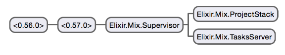

# [Elixir Application Design](http://learningelixir.joekain.com/elixir-application-design/ "Elixir Application Design")

My loyal readers, I apologize as it has been quite some time since my last post. My day job has become a bit more stressful which has led to me spending my free time working less on [Learning Elixr](http://learningelixir.joekain.com/) and more on [less mentally intense diversions](http://eternity.obsidian.net/).

But, coming back to Elixir, I’ve started looking into a topic I have been struggling to learn for some time - OTP application design. There is plenty of good material on the basics of OTP. But I had, until recently, be unable to find much information on the topic of how to design an overall OTP application. Now, last year, at ElixirConf I saw two great talks on OTP design: [Otp In Production: The Nitty-Gritty Details Of Game Servers](https://www.youtube.com/watch?v=5LRDICEETRE&list=PLE7tQUdRKcyakbmyFcmznq2iNtL80mCsT&index=9) by Martin Schurrer and [Thinking in a Highly Concurrent, Mostly-functional Language](https://www.youtube.com/watch?v=d5G3P2iosmA&index=11&list=PLE7tQUdRKcyakbmyFcmznq2iNtL80mCsT) by Francesco Cesarini. These talks taught me that process structure is the most important aspect of OTP application design. The talks were advanced beyond my current understand and I would like to find more introductory information on the topic.

I have found that http://learnyousomeerlang.com does have several great chapters on OTP application design which I am starting to read. But, at the same time I’ve decided to start reading some some Elixir and Erlang application code to look at the design of several well thought out applications. This post goes into the design of the Mix application, but first a short diversion…

## Cowboy

My first instinct was to look at the Cowboy web server since it is an Erlang project that has been around for several years - it’s design must be working well. To analyze the design I decided to run a very simple cowboy sample program, IdahoEv/cowboy-elixir-example, and examine it under the Erlang observer to look at the structure.

I cloned the repo and ran the commands from README.md:

```
mix deps.get
mix deps.compile
iex -S mix
```

which all worked without any problems. I was able to browse to http://localhost:8080 and see the example. Then, from within iex, I loaded the observer:

```
:observerstart
```

## There’s a lot here

I found that there were in fact many different applications running with their own process trees. They were

- cowboy
- cowboy\_elixir\_example
- elixr
- inets
- kernel
- ranch

I browsed over all the processes and decided to start with Mix. It has a smaller application structure that I hoped would be easy to get started with.



So here we have a simple process tree in which Mix has two leaf processes - Elixir.Mix.ProjectStack and Elixir.Mix.TaskServer. Both processes are supervised by Elixir.Mix.Supervisor. But there are two more unnamed processes leading back to the root of the tree - what are they?

Double clicking on the root process, <0.56.0>, the details view shows that it was started with a call to `proc_lib:init_p/5` and is now executing a a function called `application_master:main_loop/2`. So it seems the root process is responsible for starting the application.

Double clicking on the second process, <0.57.0>, the details view shows it is executing `application_master:loop_it/4`. So I think this process is responsible for running the application’s main loop. I am guessing that `application_master:main_loop/2`, in the root process, is a loop responsible for restarting the application if there is a failure and `application_master:loop_it/4` is the application event loop.

Double clicking on the Elixir.Mix.Supervisor process we see that it is executing `gen_server:loop/6`. That’s a little odd, it’s a `supervisor` not a `gen_server`. Is `supervisor` implemented on top of `gen_server`? Yes, in fact looking at [supervisor.erl](https://github.com/erlang/otp/blob/maint/lib/stdlib/src/supervisor.erl) it seems that it is. So, while the currently executing function took us on a little diversion, I think we can still be pretty confident that the Elixir.Mix.Supervisor process is a supervisor - it isn’t a leaf process after all. It supervises two children.

In terms of the `supervisor` configuration, we can learn more by looking at Mix’s mix.ex file to see how it defines the application structure:

```
defmodule  
   false
   start_type  
    import Supervisor

    children  
      workerTasksServer 
      workerProjectStack 
    

      strategy: :one_for_one name: Supervisor
      Supervisorstart_linkchildren 

       Systemget_envMIX_ENV" 
      Stringto_atom
```

We see in `opts` that Mix names its supervisor `Mix.Supervisor` which lines up with what we see in the process observer. (And recall that the Elixir compiler prepends “Elixir.” to all module names) We also see that `Mix.Supervisor` supervises two children with a one-for-one restart strategy. This means that if either of the child processes terminates it will be restarted.

Looking at tasks\_server.ex, I see that Mix.TasksServer is an `Agent` that maintains a `HashSet` of tasks. It’s simply a state and to know what it means I would have to look at the usage.

Mix.ProjectStack is another Agent that maintains a stack. It has push, pop, and peek operations as well as other functions for updating individual states. One way to understand what Mix.ProjectStack holds is to peek at the stack from within iex:

```
 ProjectStack
config:  :cowboy_elixir_example version: 0.0.1" elixir: ~> 1.0.0"
   deps: cowboy: 1.0.0" jsex: ~> 2.0.0" aliases: 
   build_per_environment:  default_task:  deps_path: deps"
   elixirc_paths:  erlc_paths:  erlc_include_path: include"
   erlc_options: :debug_info lockfile: mix.lock" preferred_cli_env: 
  file: /Users/jkain/Documents/Projects/other/cowboy-elixir-example/mix.exs"
  name: CowboyElixirExampleMixfile
```

This is the only element. I ran `Mix.ProjectStack.pop` from iex and then peeked again and there was nothing left. But this shows mostly the Mix application configuration for the cowboy elixir sample app. Of course after popping the stack I don’t think Mix will be in good working order so I better restart iex.

These two Agents, Mix.TasksServer and Mix.ProjectStack, maintain useful state for Mix so that it can look it up or update it as needed.

## Summary

In this post we learned our way around the Erlang process observer and looked at a the OTP design for Mix. In future posts we will continue looking at the the Cowboy design as an example of a larger process tree. In the coming weeks I hope to get back to a regular posting section and write many posts about what I learn in terms of OTP application design.

If there are any specific topics you would like to see in terms of OTP application design let me know and I will try to cover them.

---

**Elixir Application Design** was published on May 05, 2015.
