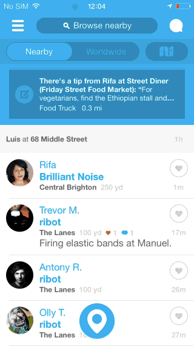
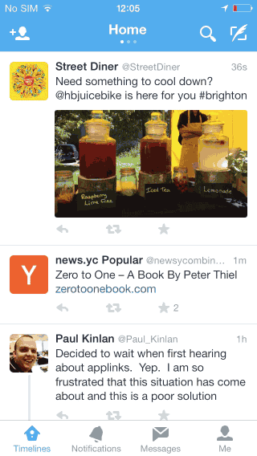
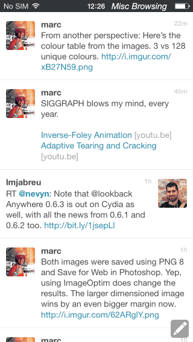
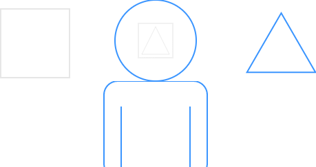
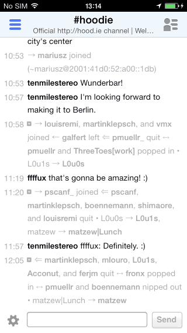
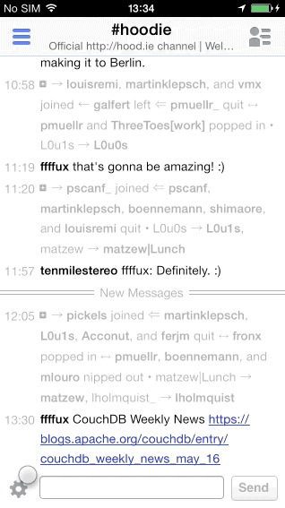
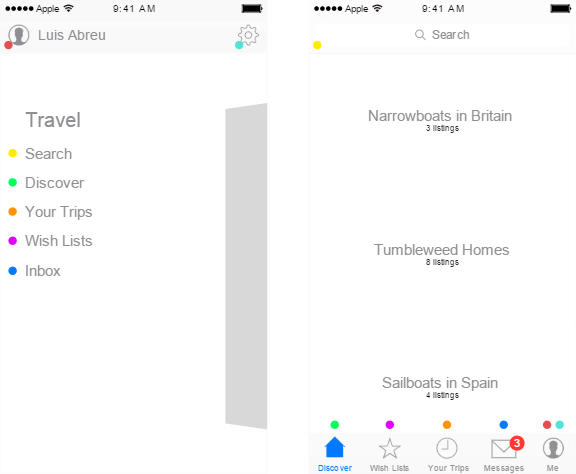
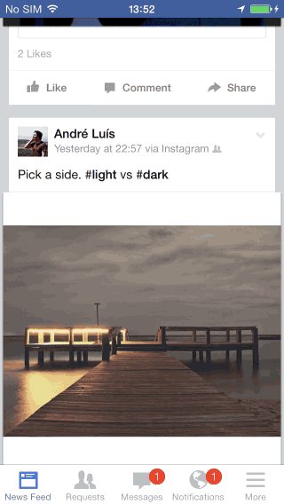
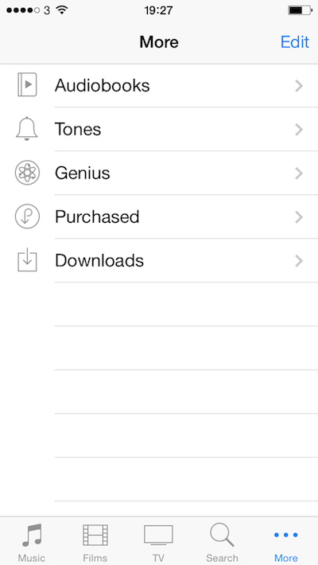

# Why and How to Avoid Hamburger Menus

The issues of this pattern are now widely recognized, but what’s the real solution?

May 14, 2014

We now have data that suggests Sidebar menus—sometimes called Hamburger Menus/Basements—might be causing more harm than good.

Here’s some public data:

One thing to have in mind is that this is a nuanced issue. I’ve observed these issues in user testing and others have also gone through the same realization.

I only ask you to read the problems, solutions and be aware of the consequences before committing to this pattern.

## The Problems

1. Lower Discoverability
2. Less Efficient
3. Clash with Platform Navigation Patterns
4. Not Glanceable

### Lower Discoverability

> “what’s out of sight, is out of mind.”

In its default state, the Sidebar Menu and all of its contents remain hidden.

People need to first be able to identify the Sidebar Menu button as actionable — companies are supplementing the menu icon with a ‘menu’ label or tooltip, and they also have to feel the need to do so — which might not be the case in applications where the main screen offers majority of the value.

### Less Efficient

Even if people are aware and value a feature, this pattern introduces navigation friction since it forces people to first open the menu and only then allowing them to see and reach their objective.

Below is a contrasting example of how instant navigation is when the navigation elements are always visible.

### Clash with Platform Navigation Patterns

On top of these issues, in platforms such as iOS, the burger menu simply cannot be implemented without clashing with the standard navigation patterns.

The left Navigation Bar Button would need to reserved for the menu button but we also need to allow the person to navigate back. Designers will either commit the mistake pictured above and overload the Navigation Bar - not even leaving space for the screen title, or force people to navigate several screens to get to the menu as seen below:

### Not Glanceable

It’s harder to surface information about specific items as they’re only visible when and if the person needs to navigate into other sections of the app.

You might do it like the Jawbone UP app does: display an icon representing the nature of the notification next to the Sidebar Menu button.

This doesn’t scale well though as it requires you to maintain more icons and as a designer you might be forced to display a generic notification icon instead reducing its meaning.

In contrast, the Tab Bar below—taken from Twitter, lets the user understand the context of the notification and navigate directly to the screen associated with it.

### Cognition

You might feel compelled to use it in order to save screen estate, but that’s really a misunderstanding of what people see in reality. While you might think people see everything that’s in front of them, we actually tend to have a focus area, even in screens of reduced size [1](https://lmjabreu.com/post/why-and-how-to-avoid-hamburger-menus/?utm_content=buffer8b219&utm_medium=social&utm_source=twitter.com&utm_campaign=buffer#fn:changeblindnesspaper).

So saving screen estate can be achieved in ways that don’t negatively impact navigation or go against basic [HCI](http://en.wikipedia.org/wiki/Human%E2%80%93computer_interaction) principles such as providing feedback and displaying state in your application.

On a side note: perhaps what we need is to refresh our understanding of HCI, I’m pretty sure that would avoid a lot of design mistakes being done by people who choose to take a visual approach to design.

## The Solution

A lot has been written about the problems but the solution still isn’t clear for everybody.

### When Should I Use It?

There might be some very rare occasions where this pattern actually makes sense, but the general rule is to avoid it altogether.

IRCCloud is an example where the application of this pattern makes sense in a way - it allows navigation between channels and channel members.

This is acceptable because the main screen has no child screens that require a hierarchical navigation stack; media can simply be presented in a modal.

But even in this scenario, it’s already visible how the UI is being overloaded and needs its IA to be rethought.

The channel members Sidebar Menu button (right) takes away the opportunity to display an Actions button instead to house all channel-related actions. Instead, the designers had no other choice but to mix actions from different contexts such as channel, network and account into one single Action Sheet:

This will lead us to the next section of this article.

### What Should I Use Instead?

The Sidebar Menu pattern welcomes bad IA because you can simply add one more thing to it without a direct consequence — that is until people actually use it.

> “The solution is reviewing your information architecture.”

Above is an example of how to move away from a Sidebar Menu. You can follow the color coded dots to understand how the elements transition between these two solutions.

#### Takeaways:

1. State can be directly presented in the Messages tab
2. Items are always visible and one instantly accessible
3. No Navigation Gesture Conflict

On top of fixing those big issues, we can still save some vertical space by hiding the Navigation Bar based on the scrolling direction — seen here in Facebook but also implemented in Safari. The persistent Tab Bar is used indicate the current screen, allowing us not to depend on the Navigation Bar to do so.

If you’re feeling minimal, perhaps a Tool Bar can be enough. The key is not to hide navigation, allow direct access, don’t conflict with navigation gestures, and present feedback on the icon it’s related to.

[**Update**] For websites, I believe it’s best to still review the IA but instead of using these iOS patterns, simply display the navigation in the website header as a list - [example](https://lmjabreu.com/media/images/posts/2014-05-14-how-and-why-not-to-use-hamburger-menus/burgerception_time.jpg). As long as it’s evident as website navigation, people will still scroll past it and will definitely be immediately exposed to the available options.

Also, still talking about websites on mobile: remember to remove the 300ms click delay by [following these tips](http://updates.html5rocks.com/2013/12/300ms-tap-delay-gone-away) or by using touch events.

#### How does it scale?

The examples I’m giving here are based around iOS, and in this situation you’ll want to use a Tab or Tool Bar.

But how does the Tab Bar scale beyond 5 items?

Such situation isn’t ideal and it might indicate again an issue with the IA of your app, but if you must expand beyond 5 tabs, a common pattern is to use the last Tab Bar to provide access to the remaining options, similar to a basement menu unfortunately.

You might also implement a scrollable Tool Bar as seen in [Rookie](https://itunes.apple.com/app/rookie-photo-editor/id799406905), this allows you to avoid the issues of the Sidebar Menu, and incur only a slightly higher navigation friction with possibly higher error rates due to need to distinguish between tap and scroll intentions.

Have in mind this second solution is more appropriate for actions rather than navigation.

Rookie’s implementation deals with the indeterminate state its Tool Bar is left in after scrolling, by hiding it after one of the tasks it offers is complete—such as crop, rotate, etc.

This prevents the indeterminate state to stick as the Tool Bar is hidden and reset the next time it’s displayed.

## Conclusion

So you’ve read about the problems with the Sidebar Menu pattern, and also the solution in the iOS context which has been there from its inception.

Hope this is useful and clear, if you have any comments feel free to ping me on Twitter over at [@lmjabreu](http://twitter.com/lmjabreu)

[**Update**] The feedback on this article has been amazing! Over 24k readers and more importantly good conversations on Twitter. [I’ve collated a selection of those tweets using Storify](https://storify.com/lmjabreu/why-and-how-to-avoid-hamburger-menus). It seems there’s more to say about Android and especially about coming up with a set of navigation patterns for the Web—as the purpose of this icon varies immensely.

### Other articles and tweets on this topic:
