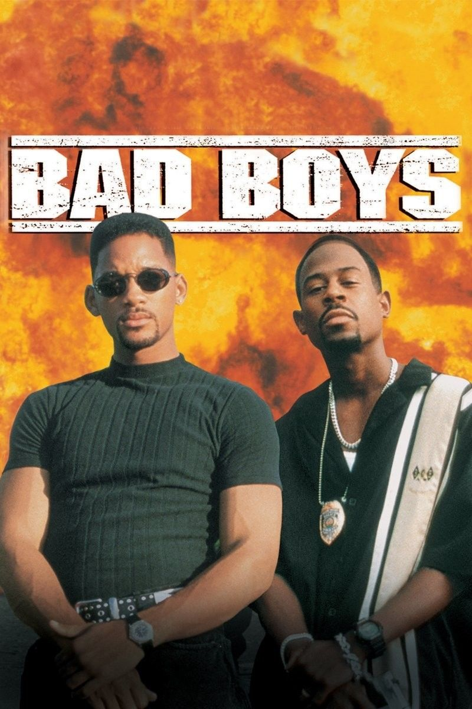
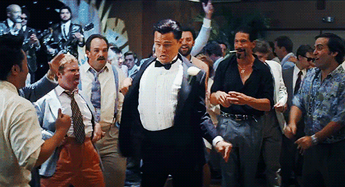
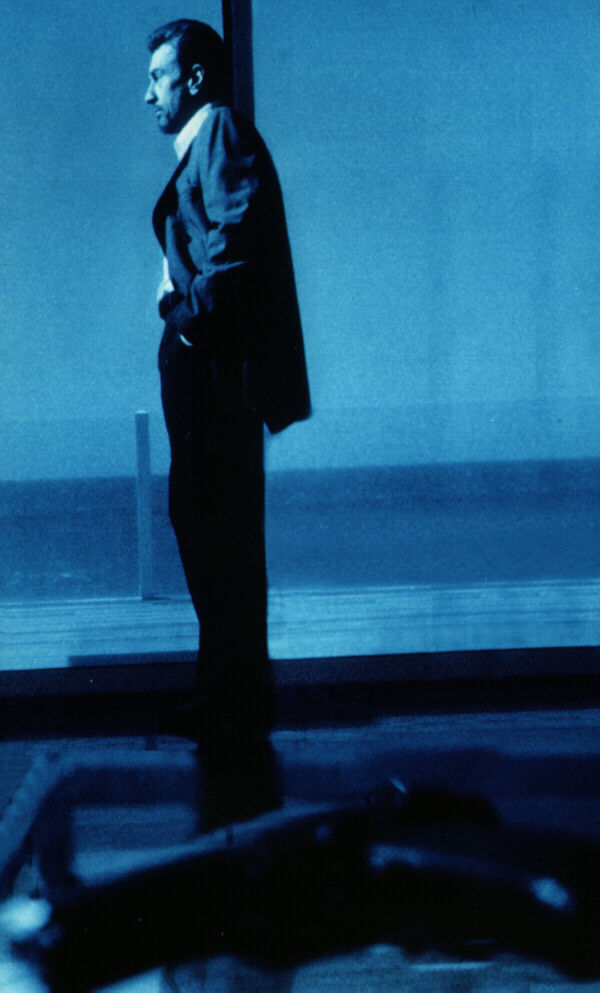
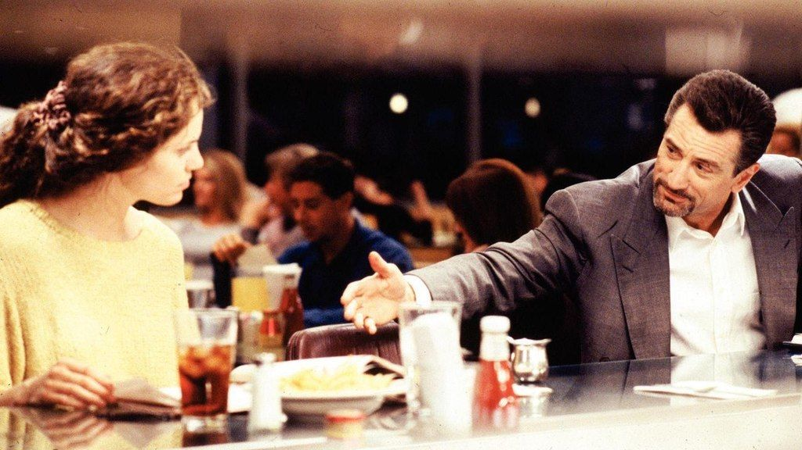
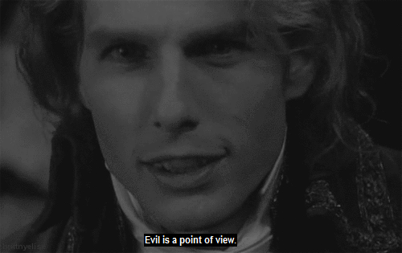
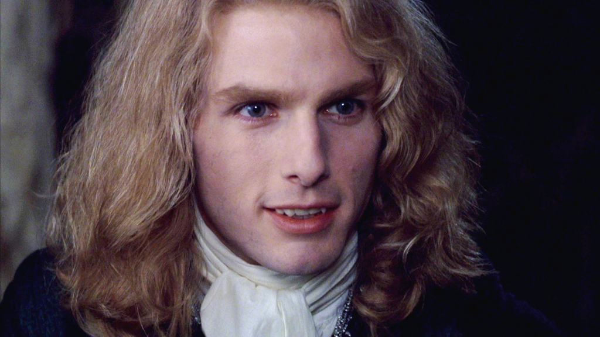
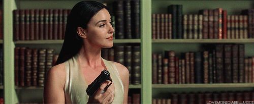
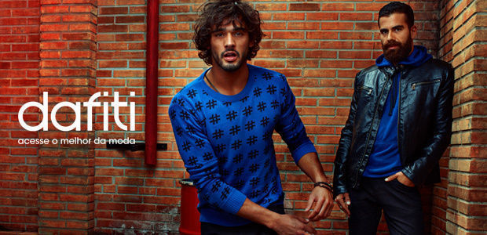

# Elas preferem os Bad Boys: 3 vilões do cinema que mostram como ser mais interessante

Mocinho apático é sempre ofuscado pela intensidade do vilão. O que você pode aprender com isso?

Novamente aqui, hasteando o bastião da sabedoria nas pilastras da galhofa, nossa querida coluna de imagem e estilo masculino de hoje analisará o que podemos aprender com três grandes vilões do cinema. Para tanto, começaremos com a pergunta de um milhão de dólares (vale mais que dinheiro):

Por que elas preferem os bad boys?

Não, fera. Não

Espero que vocês estejam preparados, pois lá vai: **elas não preferem os bad boys**. Na verdade, o problema todo não reside na pergunta, mas na comparação enganosa a que ela induz. Uma mulher – ou homem – sempre irá preferir ação à apatia. Emponderamento à omissão. Confiança à hesitação. Então, quando ouvimos uma pessoa falando que prefere os maus, não tenha dúvida, ela prefere os caras maus em comparação aos sonsos, não necessariamente aos mocinhos.

Mas não se engane, campeão, **elas nunca se apaixonam pelos capangas**. Parte do que torna os vilões tão sedutores é sua confiança em seguir com suas convicções, independente se os outros acham isso algo bom ou ruim. Tal qualidade não é observada em lacaios, que muitas vezes são uma versão ainda mais insossa do que os clássicos mocinhos, por se tratarem de pessoas subservientes, que escolhem o caminho, aparentemente, mais fácil para buscar algum tipo de sucesso.

Isso nos leva aos ensinamentos do vilão numero um!

### *[O Lobo de Wall Street](http://www.imdb.com/title/tt0993846/)*

Não se trata de ser o melhor dançarino, mas de ser o que se sente melhor dançando

#### A Qualidade

Se engana quem pensa que Jordan Belfort se destacava dos demais por conta de seus ternos clássicos bem cortados ou das gravatas chamativas. Tudo isso era bem comum no início dos noventa. O que tornava Jordan irresistível, tanto para mulheres quanto para os homens, era sua inabalável confiança, uma fé em si mesmo capaz de criar uma aura de otimismo ao redor das pessoas que o cercavam. Não à toa, os que estavam a sua volta a(s)cendiam com mais velocidade.

Ele poderia dançar como uma galinha, xingar como um cafetão, vestir-se como um almofadinha que sempre daria certo.

#### O Equívoco

Algumas pessoas acham que é necessário se impor para demonstrar confiança quando, na verdade, trata-se apenas de não enxergar nada a que se sobrepor. Pessoas que quebram limites podem ser interessantes, porém, costumam ser pesadas. Já pessoas que ignoram as limitações, estas, além de serem igualmente interessantes, tem o poder de nos contagiar de vitalidade e nos estimular a fazer coisas novas e fantásticas.

Quem não deseja estar com alguém assim?

#### A Dica Jedi

A verdadeira confiança é leve.

#### A Dica Prática

Seja honesto consigo. Sua confiança virá com suas crenças pessoais, não de sua capacidade de entender as crenças alheias.

É hora do segundo vilão nos ensinar uma lição: Neil McCauley

### *[Fogo Contra Fogo](http://www.imdb.com/title/tt0113277/?ref_=fn_al_tt_1)*

#### Qualidade

Vincent Hanna (Al Pacino), o “mocinho” presença do filme, tem praticamente  todas as qualidades que seu antagonista, Neil (de Niro), com exceção de uma importantíssima: **a capacidade de se bastar**.

Neil é honestamente zeloso com os seus, mas também sincero a ponto de informá-los que não hesitaria em deixá-los em menos de 30 segundos se julgasse o momento vital para sua segurança. Tal característica faz com que nosso vilão se torne quase irresistível.

Explico.

Enquanto o mocinho, Vin, mesmo não se adequando aos moldes tradicionais, criou laços familiares nitidamente porque é deste jeito que a vida é, Neil optou por esculpir seu próprio molde e, ainda assim, não vê problema em alterá-lo se encontrar alguém que ame. Seu grau de autossuficiência é tão grande que, no final, abandona sua fuga e também a amada em apenas 40 segundos para voltar para treta loca em busca de vingança, simplesmente porque é isso que ele realmente deseja fazer.

#### O Equívoco

Constantemente confundimos ser independentes com ser solitários. Lembre-se, não há virtude na solidão, pois virtude é o equilíbrio entre o excesso e a falta, e na solidão só existe a ausência (momento frase do biscoito chinês).

#### A Dica Jedi

Seu relacionamento mais duradouro será com você mesmo. Relacionamentos emocionais longos são perpendiculares entre si e não paralelos. Sim, você nem sequer sabia, mas é um polígamo.

#### A Dica Prática

O primeiro passo para se estar bem com alguém é não precisar estar com alguém.

E chegamos ao nosso derradeiro benfeitor vilanesco: Lestat.

### *[Entrevista com o Vampiro](http://www.imdb.com/title/tt0110148/?ref_=fn_al_tt_1)*

A Qualidade

Lestat é um desordeiro por vocação. Ele é, na maioria das vezes, a razão de sua vida e não a conseqüência dela. Enquanto nosso mocinho, Louis (Brad Pitt), passa pelos séculos chorando as pitangas da vida(?) e chupando ratos, Lestat se aceita completamente e é movido pelo desejo de aproveitar a existência.

Ainda que vilão, é quase um ser puro em sua amoralidade  nunca imoral e aí encontramos grande parte do charme do vampirão: sua imprevisibilidade. Parece que a todo instante poderemos ser surpreendidos por um beijo, uma facada ou por seu desdém. Um grau de surpresa fascinante que nos mantém constantemente conectados a ele, aguardando o inesperado.

#### O Equívoco

Ser imprevisível é magnético, mas ao exagerarmos na dose, corremos o risco de manter a outra pessoa em um estado de tensão tão constante que aquela sensação se tornará mais incômoda do que prazerosa, como uma espécie de Viagra psicológico.

#### A Dica Jedi

Se você for um filme, não seja o *[Pânico](http://www.imdb.com/title/tt0117571/)*, seja o *[Silêncio dos Inocentes](http://www.imdb.com/title/tt0102926/?ref_=fn_al_tt_4)*.

#### A Dica Prática

Seja imprevisível, não instável.

### Os Finalmentes

Talvez você esteja surpreso por não termos falado diretamente sobre Imagem e Estilo. Não se aflija, o tema ainda está aqui, pois o entendimento pessoal é o primeiro passo para uma [calça mostarda](http://www.dafiti.com.br/Calca-Cavalera-Cormar-Marrom-1525467.html), para um [dockside vermelho](http://www.dafiti.com.br/Sapato-Casual-Rafarillo-Dockside-Vermelho-1554798.html) ou para me mandar para o inferno junto com minha aversão à [sapatênis](http://www.dafiti.com.br/calcados-masculinos/sapato-casual/) e escolher o seu preferido para o encontro de hoje a noite.

E não se esqueça, você não precisa ser um vilão pra se tornar um exímio amante. Basta apenas não ser um bundão. Recorrendo aos mestres, eu poderia sugerir a você que aplicasse em sua imagem e vestuário a lição do grande Bruce Lee – [seja água, meu amigo](http://www.papodehomem.com.br/o-discurso-completo-do-be-water-my-friend-e-o-mais-importante-que-bruce-lee-disse/) – porém, preciso lhe dizer que a lógica que se aplica aqui é a de outro velho mestre, Wando, o godzilla da paixão, que disse com propriedade cirúrgica, "você é luz, é raio estrela e luar".

Por último, mas não menos importante, não existe lista sem Monica:

Ah. Bang. Bem no coração.

Como sempre, espero que tenha sido útil ou, ao menos, divertido!

Partiu sucesso

### Mecenas: [Dafiti](http://www.dafiti.com.br/dafiti-collection-brand-masculino/?os=HomeMasculina.lanc_dafiti_collection.944x500.Aspiracional&wt_cc4=HomeMasc_944x500_Full01_lanc_dafiti_collection_.jpg&wt_cc3=HomeMasc_944x500_Full01_lanc_dafiti_collection_.jpg&osb_abc=HomeMasc_944x500_Full01_lanc_dafiti_collection_.jpg?pdh=1wmc=sm.papodehomem.pdh11052015dftcollection620&utm_source=papodehomem&utm_medium=sm&utm_campaign=pdh11052015dftcollection620)

*Aprender a ser uma pessoa mais interessante é fundamental nos dias de hoje e**um guarda-roupas versátil te auxilia nesse papel. Para isso, [a](http://www.dafiti.com.br/dafiti-collection-brand-masculino/?os=HomeMasculina.lanc_dafiti_collection.944x500.Aspiracional&wt_cc4=HomeMasc_944x500_Full01_lanc_dafiti_collection_.jpg&wt_cc3=HomeMasc_944x500_Full01_lanc_dafiti_collection_.jpg&osb_abc=HomeMasc_944x500_Full01_lanc_dafiti_collection_.jpg?pdh=1wmc=sm.papodehomem.pdh22042015dftcollection620&utm_source=papodehomem&utm_medium=sm&utm_campaign=pdh22042015dftcollection620) [Dafiti pode te dar uma mãozinha](http://www.dafiti.com.br/dafiti-collection-brand-masculino/?os=HomeMasculina.lanc_dafiti_collection.944x500.Aspiracional&wt_cc4=HomeMasc_944x500_Full01_lanc_dafiti_collection_.jpg&wt_cc3=HomeMasc_944x500_Full01_lanc_dafiti_collection_.jpg&osb_abc=HomeMasc_944x500_Full01_lanc_dafiti_collection_.jpg?pdh=1wmc=sm.papodehomem.pdh11052015dftcollection620&utm_source=papodehomem&utm_medium=sm&utm_campaign=pdh11052015dftcollection620): são mais de 100.000 produtos a venda na loja deles, para o seu visual dialogar em qualquer meio, do mais quadrado ao mais descolado.*

*A cada quinze dias, pelos próximos seis meses, [Dafiti](http://www.dafiti.com.br/dafiti-collection-brand-masculino/?os=HomeMasculina.lanc_dafiti_collection.944x500.Aspiracional&wt_cc4=HomeMasc_944x500_Full01_lanc_dafiti_collection_.jpg&wt_cc3=HomeMasc_944x500_Full01_lanc_dafiti_collection_.jpg&osb_abc=HomeMasc_944x500_Full01_lanc_dafiti_collection_.jpg?pdh=1wmc=sm.papodehomem.pdh11052015dftcollection620&utm_source=papodehomem&utm_medium=sm&utm_campaign=pdh11052015dftcollection620)vai ser mecenas de conversas sobre estilo e moda sem frescuras. Com artigos práticos e conceituais vamos explorar a fundo esse território.*

---

*publicado em 26 de Maio de 2015, 11:17*
