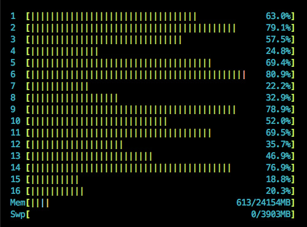

# Why Erlang?

The chance that you are reading this blog post on a device with a multicore cpu is increasing on a daily basis which is why everybody is talking about concurrency now. Concurrency for our web applications and API backends means that we’d like our htop to look like this:

I’ve recently been to a really awesome [ruby conference](http://railsberry.com/) and three or four talks out of 21 were about concurrency. The ruby community is quite open and so many possibilities were discussed: Using threads, using different ruby runtimes to circumvent the [GIL](https://en.wikipedia.org/wiki/Global_Interpreter_Lock), using more processes, using the [actor model](https://en.wikipedia.org/wiki/Actor_model) via libraries like [Celluloid](http://celluloid.io/) or even using [Akka](http://akka.io/) through JRuby.

While the actor model seems to be a good fit for building concurrent network applications it often suffers from problems if the runtime it is implemented in has no “native” support for it. There are implementations for Ruby, Python and Java but they all have to jump through several hoops to get the job done and are not necessarily yielding the best performance. This is one of many reasons why Erlang would be a much better choice but first, lets talk about this actor model for a bit to understand why it is such a good fit.

## The Actor Model

There is this nice quote from wikipedia which offers a first glimpse:

> »The Actor model adopts the philosophy that everything is an actor. This is similar to the everything is an object philosophy used by some object-oriented programming languages, but differs in that object-oriented software is typically executed sequentially, while the Actor model is inherently concurrent.«

While there are some resemblances between actors and objects, like modularity, encapsulation and message passing, the main feature of actors is that they are being run at the same time.

Strictly using message passing for sharing state with other actors which run in parallel enables asynchronous communication, meaning that the sender does not have to wait for a response from the receiver.

Another big difference to the OOP world is that in the actor model there is no global state and therefore also no shared memory between actors. In languages like Java, Ruby and Python there is always global state and threads have access to shared memory. This is often a cause for trouble in the form of deadlocks or race conditions and is maybe the biggest pain of using threads.

In the actor model each actor has its own internal state and is only sharing it via messages. Thereby it is acting as a serializer for access to its state and effectively preventing deadlocks and race conditions.

It might be also worth noting that the actor model especially makes sense for functional languages as they embrace the concept of immutable data.

There is a lot more to read about actors but I would say these are the most important bits to know. In general the actor model makes designing and implementing concurrent applications a lot easier. Compared to threads there is no need of managing the access to information with mutexes, locks or semaphores or other complex abstractions.

## Ok, so what about Erlang?

First let me tell you that for years I have been a passionate Ruby developer. I really like the language and community a lot. From time to time though I felt I was hitting some invisible walls when it came to network applications like web apps, web servers, proxies etc. Basically everything that had to handle a lot of requests and/or did non trivial tasks.

I had Erlang on my radar for quite some time but coming from my ivory tower with a ruby rooftop it took several attempts to convince me that it was worth a try. Conceptually it already made a lot of sense to me and I’m sure that most people who read about Erlang will agree. I have to admit that I was mostly appalled by the weird syntax so much that it stopped me from trying. This was a big mistake though and a large part of my motivation to write this blog post is about telling you that you should try out Erlang as soon as possible.

Anyway, first lets describe Erlang in one line:

> »Erlang is a functional language, implementing the actor model for concurrency.«

Its a language which was developed by Ericsson for their carrier grade telecom switches and the design goals were to create a language that would allow to design fault tolerant, highly available and concurrently running systems.

You can read all about it on [wikipedia](http://en.wikipedia.org/wiki/Erlang_(programming_language)) or this awesome website: <http://learnyousomeerlang.com/> – They do a much better job describing the language.

## Case study for Erlang at Wooga

This post is about getting you to try it and I will do that by telling a story about Erlang at [Wooga](http://www.wooga.com/).

Wooga makes social games with millions of daily active users. The games constantly talk to the servers to transform and persist the users game state. Some of our game backends are developed in Ruby and that worked really well so far. Ruby, like I said, is a really nice programming language and although it is certainly not the fastest, you can squeeze a lot of performance out of it when you know what you are doing.

Our biggest game in terms of users, revenue and backend complexity runs on about 80 to 200 application servers though. It handles about 5000-7000 requests per second and almost all of them are changing the game state of the user. I’d say the amount of application servers is still reasonable for the amount of load but its certainly not the most impressive number.

Then some day a new backend had to be built for a game with similar complexity and my colleague [Paolo](http://twitter.com/#!/hungryblank) suggested to use Erlang this time as he thought it would be a really great fit for us. We hired an experienced Erlang developer ([Knut](http://twitter.com/#!/knutin)) and together they implemented the backend. By now this game has approximately 50% of the users of the other game and the number of application servers they need is: 1!

They run the backend on two or three servers for redundancy purposes but it could perfectly run on one. Even if it would actually need four it would still be drastically more efficient and performant that the other backend(s).

Now of course they also knew about all the mistakes we have made in previous games and its not Erlang alone that gave them so much better performance but rather they could implement the backend in a unique way which is really easy with the actor model and rather hard everywhere else.

Basically they’ve build a stateful web server which means that each user who is playing the game is represented by an actor inside of the Erlang VM. The user starts playing and an actor with the users game state is spawned. All subsequent requests for the time the user is playing are going directly to this actor. Since the game state is held in the actors own memory all requests, which would otherwise hit the database, can be processed and answered extremely quickly.

If the actor crashes, all the other actors are not being harmed since there is no shared / global state. When the user stops playing, the actor will save the game state to a persistent data store and terminate making it easy for the garbage collection. Since the data is immutable it is always possible to revert to the game state before the transformation started in case something goes wrong.

It is really awesome and there is a lot more to tell about it. Fortunately Knut and Paolo have spoken on a couple of conferences about it and shared their slides so you can get some more insights:

\* <http://www.slideshare.net/wooga/erlang-factory-sanfran>  
 \* <http://www.slideshare.net/hungryblank/getting-real-with-erlang>

## More Erlang at Wooga

After Paolo’s and Knut’s success the Erlang virus spread inside of the company. We have started new game backends in Erlang and built smaller additional services with it. Personally I can confirm that the more you learn about Erlang the more it makes sense and feels right. It made me even feel a little bit sorry for those at the Ruby conference who were struggling with different runtimes and libraries to introduce the level of concurrency and ease of development that Erlang delivers in one package. A package that has been in production use for more than 20 years.

The hard part of learning new languages is to find a reasonably sized project to start with. Learning just by reading books is always slow as you forget most of what you read when you don’t play around with it. Apart from the weird syntax which I don’t find that weird anymore, not having an actual project to try Erlang was the biggest show stopper for me. So I encourage you to pick a small little project and play around with Erlang. I think you will not regret it.

I hope I will find the time for a follow up blog post about how I learned Erlang and about getting started in it soon. In the meantime go to [learnyousomeerlang.com](http://learnyousomeerlang.com/) and get started on your own. Trust me – this site is better than any book about Erlang which you can buy right now.

PS: Thanks to [Elise Huard](http://twitter.com/#!/elise_huard) for proof reading! If you have feedback, drawings of an ivory tower with a ruby rooftop to make this blog post more colorful or any other contributions send it right away!
