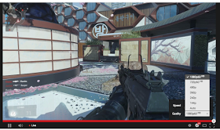

# 60fps Live Streaming on YouTube in HTML5

We launched 60fps video playback on YouTube a few months ago, and from [game walkthroughs](https://www.youtube.com/watch?v=NjOiKLTdUHA)[superbike racing](https://www.youtube.com/watch?v=-IEPzExjWzI)u’ve found all sorts of awesome ways to make use of higher frame rates.

Now we want to help you take it even further with something new: 60fps live streaming, launching today as an early preview on [HTML5-compatible browsers](https://www.youtube.com/html5). When you start a live stream on YouTube at 60fps, we’ll transcode your stream into 720p60 and 1080p60, which means silky smooth playback for gaming and other fast-action videos. We’ll also make your stream available in 30fps on devices where high frame rate viewing is not yet available, while we work to expand support in the coming weeks.

We know high frame rates are especially important for gaming streams, so we’ve worked with Elgato and XSplit on new versions of [Elgato Game Capture](https://www.elgato.com/gaming/download)[XSplit Broadcaster](https://www.xsplit.com/blog/xsplit-broadcaster-and-xsplit-gamecaster-v2-3-are-now-available)[XSplit Gamecaster](https://www.xsplit.com/blog/xsplit-broadcaster-and-xsplit-gamecaster-v2-3-are-now-available) that support 60fps live streaming to YouTube, available for download starting today. In addition, any app using our live streaming API can add a[new high frame rate flag](https://developers.google.com/youtube/v3/live/docs/liveStreams#cdn.format)to enable 60fps streaming.

But wait, there’s more! We’ve also added another long-requested feature for live streaming: HTML5 playback. As of this week, YouTube live streams will use an HTML5 player in supported browsers. And because our HTML5 player supports variable speed playback, you can skip backward in a stream while it’s live and watch at 1.5x or 2x speed to catch back up.

These are the latest in a series of improvements we’ve been making to live streaming on YouTube and there are plenty left to come, so stay tuned for more very soon. In the meantime, [check out some live streams](https://www.youtube.com/live)[create your own](https://www.youtube.com/my_live_events)

Alan Joyce, Product Manager, recently uploaded [a 60fps playthrough of a terrible NES game](https://www.youtube.com/watch?v=Nbdttsgd1hc)
