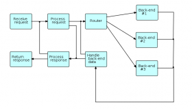
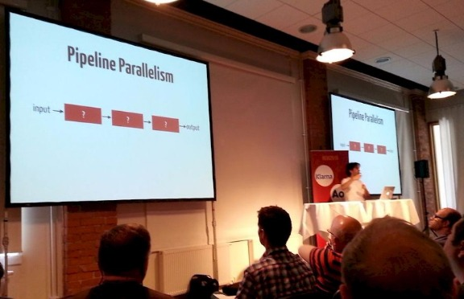

# Flow-based programming and Erlang style message passing - A Biology-inspired idea of how they fit together

Posted on: 13 Jun '15

**I think Erlang/Elixir fits great as control plane or service-to-service messaging layer for distributing services built with flow-based programming, and in this post, I'll tell you why.**

[**Note V**: The slowness of Erlang/Elixir that I mention, is disputed! See discussion on [this meetup page](http://www.meetup.com/stockholm-elixir/events/203279212/), and in particular Johan Lind's [improvements on the code example here](https://gist.github.com/samuell/dbea9f759dced60a7d0b#comment-1311551)]
[**Edit IV**: FYI: ElixirFBP creator Peter C Marks [blogged a comment](http://www.elixirfbp.org/2015/06/a-couple-of-things.html) of this post and the discussion it triggered [Check it out elixirfbp.org](http://www.elixirfbp.org/2015/06/a-couple-of-things.html)! - Let the discussion and exploration continue! :) ]
[**Edit III**: Typo corrections]  
[**Edit II:** FYI: Interesting discussions on the post is happening on [HackerNews](https://news.ycombinator.com/item?id=9718868), and the [Flow-based programming mailing list](https://groups.google.com/d/msg/flow-based-programming/6LMw6JukILY/C9SmQdlMKm8J)]  
[**Edit I:** Fixed misleading heading: FBP at all suitable for distributed computing? -> Further differences between the paradigms] (June 15, 17:07 CET)

### Erlang VM very interesting - so is Flow-based programming

I just landed in my home office after a one day visit to [Erlang User Conference 2015](http://www.erlang-factory.com/euc2015) (EUC2015). Not that it was a very long travel though, some 10 subway stations away at most, Munchenbryggeriet here in Stockholm :).

The [Erlang](http://www.erlang.org/) virtual machine, and what people do with it, is kind of fascinating. And with the new [Elixir language](http://elixir-lang.org/) built on top of it to fix some of the pain points some people experience with Erlang the language, the eco-system has got even more interesting.

What is so exciting about Erlang/Elixir, and in particular the Erlang virtual machine, that they both build upon, is its outstanding ability to utilize multiple CPU:s on computers, and what's more, doing this across multiple computers, in what is commonly referred to as "distributed computing".

I have myself had a great interest for [Flow-based programming](http://www.jpaulmorrison.com/fbp/) (FBP) for basically the same purposes (good at running things in parallel in general), and even brought it up as a question in one of the talks at the conference ([José's talk on Elixir](http://www.erlang-factory.com/euc2015/jose-valim)).

### Flow-based programming and Erlang/Elixir seems like a great fit - is it?

It is hard not to think the though that the flow-based programming paradigm with multiple "black box" processes talking to each other over channels, and the Erlang message-passing model of highly isolated processes sending messages to the mail boxes of other processes, would have a lot of overlap in functionality, and that the architecture of one of the systems should be easy enough to implement in the other system. There is actually at least one such project, trying to implement FBP in Elixir, by [Peter C Marks](http://twitter.com/petercmarks). (Check it out at [elixirfbp.org](http://www.elixirfbp.org/) if you haven't already!).

Looking closer, it turns out there are a number of challenges though (although I'm very very eagerly following the progress of ElixirFBP). E.g. back-pressure is a thing that is not easily supported implicitly in Erlang/Elixir in the same way as in FBP languages where the bounded-buffer channels provide implicit back-pressure by blocking the sends on the out-port they are connected to when the buffer is full. And (which came up in my short chat with José yesterday), implementing something like the channels with bounded buffers of FBP in Elixir would require another process for the channel, which would mean another copying step, which is bad for performance.

Then there is also a bit of different behavior in how processes are connected. While in FBP processes are explicitly connected with channels between the named in-/out-ports of the processes, in Erlang/Elixir on the other hand processes send messages to a single mailbox in each recipient process, and any filtering for multiple further routing is happening in code, applied on this single mailbox. Thus, to implement in a general way something like in-ports and out-ports of FBP processes would probably require creating even further specialized Erlang/Elixir processes (such as one for each in-port/out-port), which would mean even more copying.

***These architectural differences were by the way something that was touched upon in a [talk by Paul Butcher at EUC2014](http://www.erlang-factory.com/euc2014/paul-butcher) last year - Highly recommended! (Direct links: [Slides](http://www.erlang-factory.com/static/upload/media/1403178373396314paulbutchereuc2014.pdf) and [Video](https://vimeo.com/102707745))***

One thing I'm still wondering about though, is whether the overhead of this copying might not be such a big problem since you now will have pipeline parallelism in Elixir, as José [presented](http://www.erlang-factory.com/euc2015/jose-valim):

(See original [tweet](https://twitter.com/smllmp/status/609306287516610560), and the [info page for the talk](http://www.erlang-factory.com/euc2015/jose-valim) where slides and video will show up)

### Further differences between the paradigms

Anyways, there is a whole other set of aspects that make FBP and the Erlang VM quite different though.

For example, despite the great work on the [HiPE VM](https://www.it.uu.se/research/group/hipe/) for compiled Erlang code, and the work going on with JIT-compilation for Erlang (Mentioned in the ["News from the OTP team" session](http://www.erlang-factory.com/euc2015/kenneth-lundin) at the EUC2015), Erlang is in it's current state kind of slow for many types of computations. It is scalable yes, but slow. For example I tried some simple string processing algorithm in Elixir recently, which I've used to [benchmark a bunch of other languages before](http://saml.rilspace.org/moar-languagez-gc-content-in-python-d-fpc-c-and-c), and found that Elixir was something like 3 times slower than un-optimized, vanilla python for the same task, which is itself around 2-3 times slower than most compiled languages for the same task (I sincerely hope I did some serious mistake to make it this slow).

On the other hand, the Erlang VM is truly outstanding when it comes to other aspects that are crucial for distributed (as in multi-compute nodes) computing, such as process isolation, fault-tolerance, inspectability, hot code-reloading, and much more.

### Erlang great as control plane

The above means that you will typically want to use Erlang for things like the control plane of your distributed system, while the actual computation part will be optimally implemented in something faster, such as C, if you computation demands are large while cost/energy efficiency is also of importance.

Combining Erlang with a faster language for the actual processing, is actually exactly what is done at the company where Erlang was born in the first place, Ericsson! At the ["Embedded Erlang" talk on EUC2015](http://www.erlang-factory.com/euc2015/anders-danne), Anders Danne of Ericsson revealed details about a very interesting project that just resulted in a new product (base station), where Erlang was the control plane, while the real crunching code was implemented in/with C and FPGA (cool stuff!).

### What can we learn from the most advanced information system we know of - the human cell?

This leads up to my idea for how I think these two paradigms best fit together. And well, I think you already see where I'm going :) But just to even further strengthen the case, let me also take an example from the amazing information systems implemented in the human body!

Biology is full of information systems at different scales, but two of these that strike me as excellent examples of the items at play in this post are **a)** the DNA-to-RNA-to-Protein information processing chain commonly known as "the central dogma", and **b)**, cell-to-cell signalling.

#### The DNA->RNA->Protein processing chain

The DNA->RNA->Protein processing chain is a very low-level and intricate chain of information processing that happens partly in the cell nucleus, and partly in the space outside the nucleus (but still within he cell wall). It requires exceptional performance since there is large amounts of information that need to be poured out in a very short time, since this process might kick in when the concentration of certain molecular machines known as enzymes need to quickly increase, for example when you have just eaten and enzymes for breaking down a certain food product need to be processed by specialized enzymes.

**So, how is this implemented in the human cell?**

Well, I think my words will fall short of describing this amazing process, so let's watch a little 3 minute animation instead:

Do you see how the molecular machines are producing long "streams" of information (e.g. an mRNA strand), while continuously reading another "stream" of information (e.g. a DNA strand), or the same thing for Protein-"strands" and mRNA-strands.

I don't know about you, but to me, this looks a lot like flow-based programming! :) - a highly optimized process where the physical proximity of the molecular letters stitched together into a "strand" or "stream" of information, that is processed in "streaming mode" by a molecular machine into another stream of information.

#### Cell-to-cell signalling for robust signalling outside the safe and predictable nature within the cell walls

Cell-to-cell signalling, in contrast to the DNA->RNA->Protein processing chain, does involve less amount of information (but could still be as significant or even more so), since as a very high-level form of communication, it is heavily dependent on shared context between cells. That is, both the sending and receiving cell share so much common knowledge, that they will immediately be able to interpret the received message correctly, even if the actual message contains very little amount of ("shannon") information.

(Compare this to e.g. a group of SWAT soldiers who have made up detailed plan for an attack, and then just are positioning themselves, and awaits a simple "Go!" message via their radios. The "Go!" message will contain hardly more than one or a few bits of information, measured in shannon information metrics, but due to the high amount of shared context information among the soldiers, it will be a highly significant message, that will trigger a very detailed plan, at precisely the right time).

Thus, the "computational" requirements here are less demanding. On the other hand there are other requirements, such as robustness to failure, since when these signalling molecules leave the cellular walls, the environment will be all the less reliable and predictable.

**So, how is this implemented in the biological systems?**

Here again, let's look at an animation of an example of the process rather than me trying to explain the steps in detail:

The video shows one specific cell signaling "pathway" as they are called, but the same basic principles hold for many other "pathways": A signaling molecule is excreted from one cell, and then interacts with a receptor on the surface of another cell, that actually spans the cell wall, and triggers a chain of reaction on the inside of the "recipient" cell.

Things like robustness is here handled especially, by executing an excess of signaling molecules, more than will probably reach receptors of other cells.

### What can we learn from this?

So what can we learn from the two biological information processing examples above?

Well, my idea with including these examples is that they are two very different solutions to information processing problems at very different scales in the cell: The DNA->RNA->Protein processing chain does the heavy lifting of translating high amounts of structural information about the structure of molecular machines to be produced. while various cell-to-cell signaling pathways are more a kind of "alerting" systems for cells to alert each other of various state changes in behavior needed for nearby cells, due to e.g. something happening in the close-by area.

Personally, I think there is an interesting match between these two information systems, and the two information processing paradigms discussed in this article: Erlang style message passing and Flow-based processing. I see the match like this:

- DNA->RNA->Protein processing chain <--> Flow-based programming.
- Cell-to-cell signaling <--> Erlang style message passing.

One of these - the cell-to-cell signaling, is aimed at synchronizing state ***between*** nearby cells, while the other, DNA->RNA->Protein chain, is for the heavy lifting of processing large amounts of data ***inside*** each cell.

The first one is a very "loose" process, in that signaling molecules are released in excess, but on "chance", and will eventually reach receptors on the surfaces of nearby cells, and initiate some kind of response. This I would compare with the situation in TCP/IP networks, where predictability is not really the same as within the safe "walls" of the CPU. This would be where the robustness-increasing features of Erlang really shines.

The DNA->RNA->Protein processing chain on the other hand, with its very strict requirements on performance, has a very tight (even physical) coupling between the input data, the processing machinery, and the output data, and the placement of data into a "stream" ("strand" in biological terms), means that while pulling an information item / nucleotide through the processing machinery, the next item to process will automatically be pulled in. This would be where the stream-processing nature of Flow-based programming really shines.

### Conclusion

Based on this study of biological information systems, I would suggest that:

- **Flow-based programming** is very well suited for high performance heavy lifting within one micro-service (or some other similar unit comparable to a biological cell), while:
- **Erlang-style message passing** is the perfect paradigm for communication between such services.

So, maybe, just like Ericsson is using Erlang as a control plane for C and FPGA code, maybe Erlang/Elixir should be used as control plane between micro-services built with highly optimized Flow-based programming principles?

Maybe this would even simultaneously solve Erlang's performance problem, while solving Flow-based programming's problem with [robustness of] large distributed systems? Well, one can speculate at least. And yeah, why not also test this out in practice! :)

*(Agree or disagree? Please ventilate your thoughts in the comments below!)*
