# [How to Enable and Secure Remote Desktop on Windows](http://www.howtogeek.com/175087/how-to-enable-and-secure-remote-desktop-on-windows/ "How to Enable and Secure Remote Desktop on Windows")

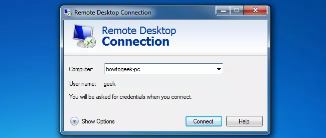

While there are many alternatives, Microsoft’s Remote Desktop is a perfectly viable option for accessing other computers, but it has to be properly secured.  After recommended security measures are in place, Remote Desktop is a powerful tool for geeks to use and lets you avoid installing third party apps for this type of functionality.

This guide and the screenshots that accompany it are made for Windows 8.1.  However, you should be able to follow this guide as long as you’re using one of these editions of Windows:

- Windows 8.1 Pro
- Windows 8.1 Enterprise
- Windows 8 Enterprise
- Windows 8 Pro
- Windows 7 Professional
- Windows 7 Enterprise
- Windows 7 Ultimate
- Windows Vista Business
- Windows Vista Ultimate
- Windows Vista Enterprise
- Windows XP Professional

### Enabling Remote Desktop

First, we need to enable Remote Desktop and select which users have remote access to the computer.  Hit Windows key + R to bring up a Run prompt, and type “sysdm.cpl.”

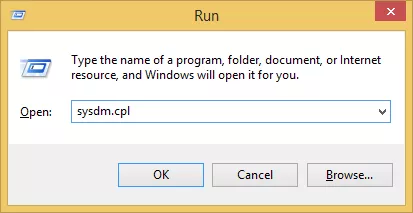

Another way to get to the same menu is to type “This PC” in your Start menu, right click “This PC” and go to Properties:

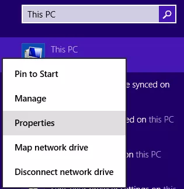

Either way will bring up this menu, where you need to click on the Remote tab:

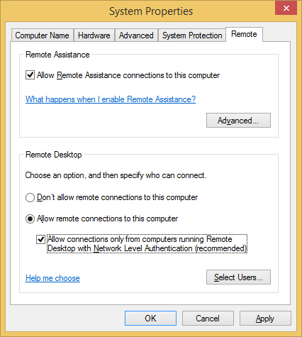

Select “Allow remote connections to this computer” and the option below it, “Allow connections only from computers running Remote Desktop with Network Level Authentication.”

It’s not a necessity to require Network Level Authentication, but doing so makes your computer more secure by protecting you from [Man in the Middle attacks](http://www.howtogeek.com/glossary/man-in-the-middle-attack/).  Systems even as old as Windows XP can connect to hosts with Network Level Authentication, so there’s no reason not to use it.

You may get a warning about your power options when you enable Remote Desktop:

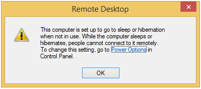

If so, make sure you click the link to Power Options and configure your computer so it doesn’t fall asleep or hibernate.  See our article on [managing power settings](http://www.howtogeek.com/howto/9090/learning-windows-7-manage-power-settings/) if you need help.

Next, click “Select Users.”

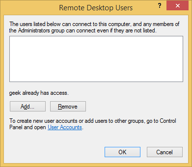

Any accounts in the Administrators group will already have access.  If you need to grant Remote Desktop access to any other users, just click “Add” and type in the usernames.

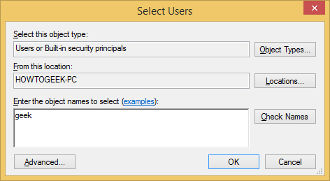

Click “Check Names” to verify the username is typed correctly and then click OK.  Click OK on the System Properties window as well.

### Securing Remote Desktop

Your computer is currently connectable via Remote Desktop (only on your local network if you’re behind a router), but there are some more settings we need to configure in order to achieve maximum security.

First, let’s address the obvious one.  All of the users that you gave Remote Desktop access need to have strong passwords.  There are a lot of bots constantly scanning the internet for vulnerable PCs running Remote Desktop, so don’t underestimate the importance of a strong password.  Use more than eight characters (12+ is recommended) with numbers, lowercase and uppercase letters, and special characters.

Go to the Start menu or open a Run prompt (Windows Key + R) and type “secpol.msc” to open the Local Security Policy menu.

Once there, expand “Local Policies” and click on “User Rights Assignment.”

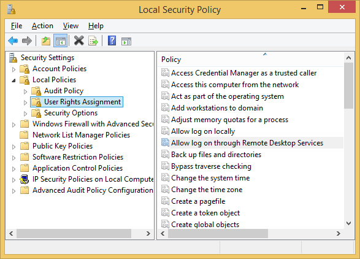

Double-click on the “Allow log on through Remote Desktop Services” policy listed on the right.

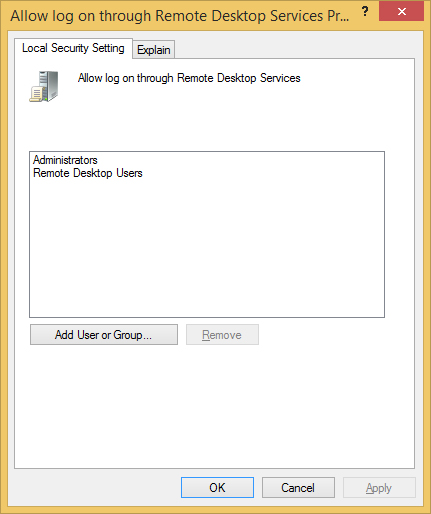

It’s our recommendation to remove both of the groups already listed in this window, Administrators and Remote Desktop Users.  After that, click “Add User or Group” and manually add the users you’d like to grant Remote Desktop access to.  This isn’t an essential step, but it gives you more power over which accounts get to use Remote Desktop.  If, in the future, you make a new Administrator account for some reason and forget to put a strong password on it, you’re opening your computer up to hackers around the world if you never bothered removing the “Administrators” group from this screen.

Close the Local Security Policy window and open the Local Group Policy Editor by typing “gpedit.msc” into either a Run prompt or the Start menu.

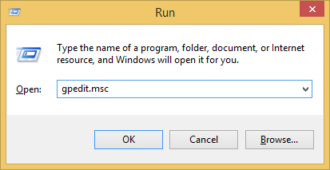

When the Local Group Policy Editor opens, expand Computer Policy > Administrative Templates > Windows Components > Remote Desktop Services > Remote Desktop Session Host, and then click on Security.

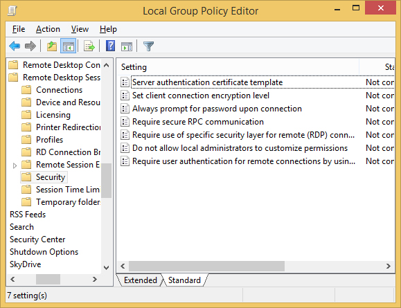

Double-click on any settings in this menu to change their values.  The ones we recommend changing are:

Set client connection encryption level – Set this to High Level so your Remote Desktop sessions are secured with 128-bit encryption.

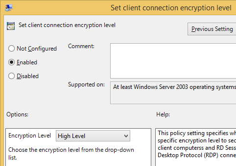

Require secure RPC communication – Set this to Enabled.

Require use of specific security layer for remote (RDP) connections – Set this to SSL (TLS 1.0).

Require user authentication for remote connections by using Network Level Authentication – Set this to Enabled.

Once those changes have been made, you can close the Local Group Policy Editor.  The last security recommendation we have is to change the default port that Remote Desktop listens on.  This is an optional step and is considered a security through obscurity practice, but the fact is that changing the default port number greatly decreases the amount of malicious connection attempts that your computer will receive.  Your password and security settings need to make Remote Desktop invulnerable no matter what port it is listening on, but we might as well decrease the amount of connection attempts if we can.

### Security through Obscurity: Changing the Default RDP Port

By default, Remote Desktop listens on port 3389.  Pick a five digit number less than 65535 that you’d like to use for your custom Remote Desktop port number.  With that number in mind, open up the Registry Editor by typing “regedit” into a Run prompt or the Start menu.

When the Registry Editor opens up, expand HKEY\_LOCAL\_MACHINE > SYSTEM > CurrentControlSet > Control > Terminal Server > WinStations > RDP-Tcp > then double-click on “PortNumber” in the window on the right.

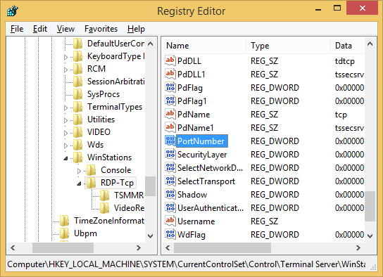

With the PortNumber registry key open, select “Decimal” on the right side of the window and then type your five digit number under “Value data” on the left.

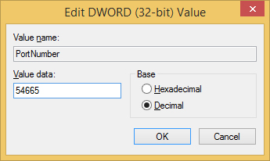

Click OK and then close the Registry Editor.

Since we’ve changed the default port that Remote Desktop uses, we’ll need to configure Windows Firewall to accept incoming connections on that port.  Go to the Start screen, search for “Windows Firewall” and click on it.

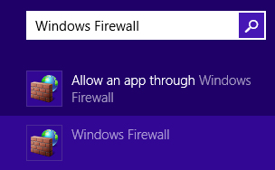

When Windows Firewall opens, click “Advanced Settings” on the left side of the window.  Then right-click on “Inbound Rules” and choose “New Rule.”

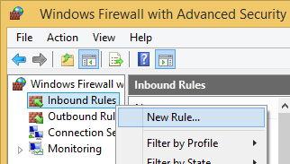

The “New Inbound Rule Wizard” will pop up, select Port and click next.  On the next screen, make sure TCP is selected and then enter the port number you chose earlier, and then click next.  Click next two more times because the default values on the next couple pages will be fine.  On the last page, select a name for this new rule, such as “Custom RDP port,” and then click finish.

### Last Steps

Your computer should now be accessible on your local network, just specify either the IP address of the machine or the name of it, followed by a colon and the port number in both cases, like so:

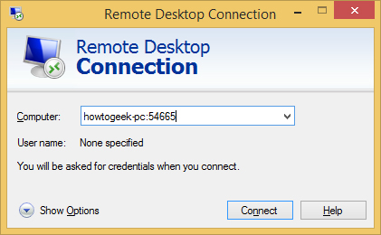

To access your computer from outside your network, you’ll more than likely need to [forward the port on your router](http://www.howtogeek.com/66214/).  After that, your PC should be remotely accessible from any device that has a Remote Desktop client.

If you’re wondering how you can keep track of who is logging into your PC (and from where), you can open up Event Viewer to see.

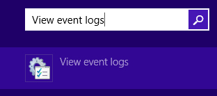

Once you have Event Viewer opened, expand Applications and Services Logs > Microsoft > Windows > TerminalServices-LocalSessionManger and then click Operational.

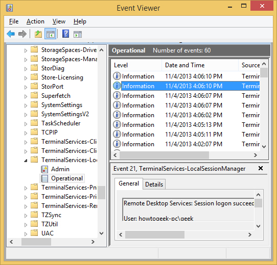

Click on any of the events in the right pane to see login information.
