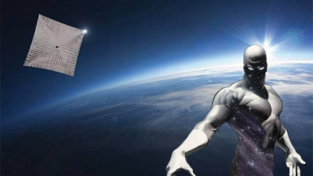
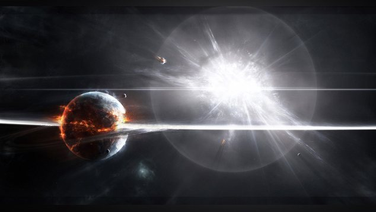
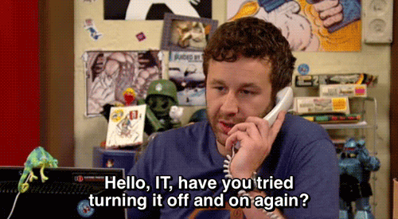
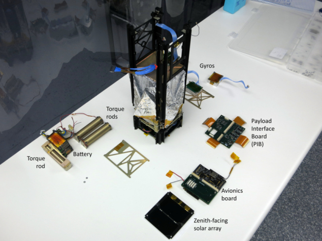
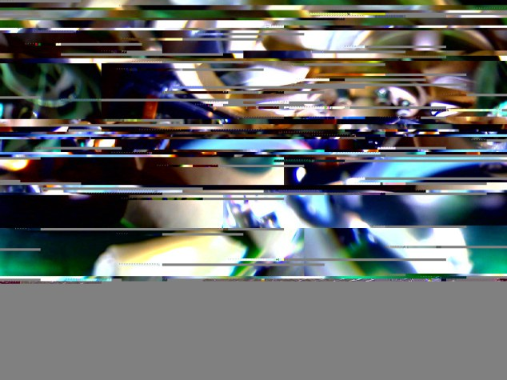
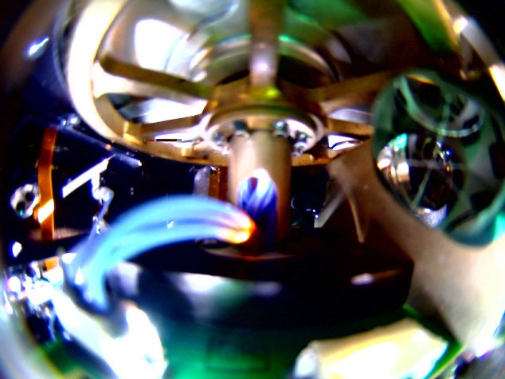
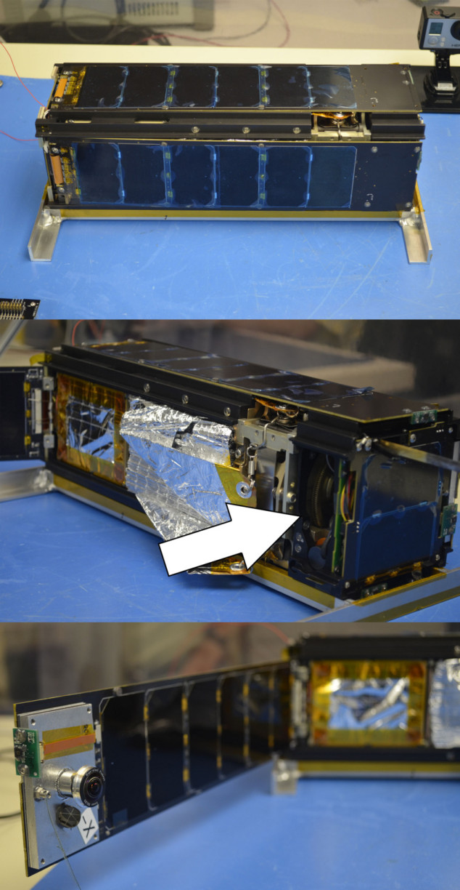
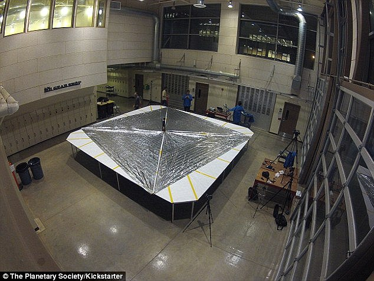

**Sonda do Bill Nye salva pelo Poder Cósmico**

Por [Carlos Cardoso](http://meiobit.com/author/carlos-cardoso/ "Posts de Carlos Cardoso") em 4 de junho de 2015 - [19 comentários](http://meiobit.com/319010/lightsail-sonda-da-planetary-society-foi-salva-por-uma-supernova/#disqus_thread)

Milhares, talvez milhões de anos atrás uma estrela muito velha esgotou sua capacidade de fundir elementos. Sem hidrogênio no núcleo, ela já estava apelando para fusão de hélio, lítio, chegando no carbono. Incapaz de atingir as temperaturas e pressões necessárias para fusão de carbono, a produção de energia caiu. A única coisa que mantinha sua estrutura inteira, deixou de existir.

As camadas externas, sem as infernais chamas nucleares se contrapondo, caíram em direção ao núcleo, puxadas pela gravidade. Esse afluxo de teratoneladas de matéria, essa sim composta de hidrogênio, hélio e elementos leves, acompanhados de energia cinética em níveis titânicos reacendeu o núcleo, gerando uma explosão gigantesca. Sem as camadas superiores para conter o renovado núcleo, a estrela explodiu consumindo de uma vez matéria que duraria milhões de anos.

Por alguns momentos ela emite mais energia do que todas as estrelas da galáxia combinadas. É uma Supernova.

Essa energia, na forma de radiação eletromagnéticas e partículas subatômicas se movendo próximas da velocidade da Luz se espalha em uma concha crescente, por toda a eternidade.

Uma dessas partículas, talvez um próton, viajou incontáveis quilômetros, na direção correta, no ângulo exato para se encontrar com um componente da CPU de uma sonda em órbita da Terra. Valores de memória foram alterados, gerando instruções inválidas. Como último recurso a CPU resetou, forçando um reboot. Isso salvou a LightSail 1.

Foi mal galera, mas é por uma boa causa.

Construída via [crowfunding](https://www.kickstarter.com/projects/theplanetarysociety/lightsail-a-revolutionary-solar-sailing-spacecraft) pela Planetary Society, a LightSail é uma sonda experimental criada para testar tecnologia de velas solares. Bill Nye, o ~~Nice~~ Science Guy é a figura mais conhecida da Organização, fundada por Carl Sagan. São entusiastas, cientistas, fãs, gente como a gente. Ela se envolve em projetos de divulgação científica E pesquisa no mundo inteiro, e — a sério — [tem um programa espacial melhor que o nosso](http://www.planetary.org/explore/projects/).

A LightSail foi lançada no mesmo foguete que levou o X37-B para sua missão secreta, e inicialmente tudo funcionou mas logo após o lançamento alguém descobriu que um dos componentes tinha um bug sério: a cada pacote de telemetria transmitido, um a cada 15 segundos uma cópia do pacote era adicionada ao arquivo beacon.csv. O arquivo cresceria até ocupar todos os 32 MB de memória disponível, e por mais que Linux seja legal não é um sistema operacional RealTime com zilhões de proteções projetadas pela [Margaret Hamilton](http://meiobit.com/304884/margaret-hamilton-a-mulher-que-salvou-a-apollo-11/).

O Controle da Missão tentou transmitir uma atualização de software para evitar o bug, mas a LightSail não respondia a comandos. Ela estava viva, mas congelada. Mais de 25 tentativas de reboot remoto foram feitas, mas nada. havia duas possibilidades de salvar a missão: alguém ir até a LightSail e apertar um botão de reset, ou um raio cósmico atingir a CPU e forçar um reboot.

Felizmente a CPU da LightSail, padrão de Cubesats não é blindada contra radiação como componentes de satélites de verdade. O nosso amigo Próton cumpriu seu papel e resetou a sonda. Claro, é possível que no processo de seu nascimento um sistema solar com uma civilização bela e pacífica, iniciando a exploração de seus muitos mundos tenha sido dizimada, mas não se faz um omelete sem quebrar alguns ovos.

O sistema reiniciou, depois de 10 longos dias de silêncio. As rotinas de garbage collection apagaram os arquivos temporários e a sonda voltou a responder comandos. Upgrade enviado, na forma de um bacalhau que força um reboot a cada 24 h, e foi dado prosseguimento à missão. logo depois receberam isto:

Receber sinais do espaço é complicado, mesmo com algoritmos de correção de erro não há milagre: imagens são enviadas várias vezes e reconstruídas. A imagem acima, depois de tratada se tornou esta:

É uma das duas câmeras de 2 Mp da LightSail. Ela é presa em um dos painéis solares, na parte de dentro. Exatamente assim:

Hoje os painéis solares foram abertos, mas ainda não há imagens. Tudo bem, a telemetria indica que os painéis estão a – 48 ºC, o que significa que não estão em contato com o interior da sonda, e abriram corretamente.

[Jason Davis — LightSail’s dual cameras are attached to the deployable solar panels. They face inward until the panels hinge outward for sail deployment.](http://vine.co/v/ehd7vnAFXZi/)

Rádioamadores do mundo todo estão acompanhando a LightSail e enviando pacotes de dados capturados. A Planetary Society divulgou [o formato da estrutura de dados](https://docs.google.com/document/d/1aChZLX6QvUTm48sxuEqI7XZzAFLJRVv-vWdiVgJto04/edit), para facilitar a vida de quem queira decodificar as transmissões.

As baterias estão meio esquisitas mas não deve ser problema, com os painéis solares acionados. Amanhã testarão a parte mais complexa da missão: a abertura da vela solar de 5,6 m de lado.

A posição da LightSail e todas as informações mais atuais podem ser consultadas direto [no site do Controle da Missão](http://sail.planetary.org/missioncontrol). Os dados estão sendo transmitidos na frequência de 437,435 MHz; com protocolo AX.25, Encoding FSK e velocidade de 9.600 b/s. Para uma descrição detalhada do hardware e software das estações de terra, [clique aqui](http://polysat.calpoly.edu/ground-station/).

- [Facebook19](http://meiobit.com/319010/lightsail-sonda-da-planetary-society-foi-salva-por-uma-supernova/?share=facebook&amp;nb=1 "Compartilhar no Facebook")
- [Twitter14](http://meiobit.com/319010/lightsail-sonda-da-planetary-society-foi-salva-por-uma-supernova/?share=twitter&amp;nb=1 "Clique para compartilhar no Twitter")
- [Google](http://meiobit.com/319010/lightsail-sonda-da-planetary-society-foi-salva-por-uma-supernova/?share=google-plus-1&amp;nb=1 "Compartilhe no Google+")
- [Email](http://meiobit.com/319010/lightsail-sonda-da-planetary-society-foi-salva-por-uma-supernova/?share=email&amp;nb=1 "Clique para enviar por email a um amigo")

em[Destaque](http://meiobit.com/arquivo/ciencia/destaque-ciencia/) [Engenharia](http://meiobit.com/arquivo/ciencia/engenharia/) [Espaço](http://meiobit.com/arquivo/ciencia/espaco-ciencia/) [Hardware](http://meiobit.com/arquivo/meio-bit/hardware/) relacionados[bill nye](http://meiobit.com/tag/bill-nye/) [BSOD](http://meiobit.com/tag/bsod/) [Houston](http://meiobit.com/tag/houston/) [kernel panic](http://meiobit.com/tag/kernel-panic/) [lightsail](http://meiobit.com/tag/lightsail/) [Planetary Society](http://meiobit.com/tag/planetary-society/) [reboot](http://meiobit.com/tag/reboot/)

 Mais textos de:  
[Carlos Cardoso](http://meiobit.com/author/carlos-cardoso/ "Posts de Carlos Cardoso")  
[Site](http://www.contraditorium.com/) | [Twitter](http://www.twitter.com/cardoso)
