# Como criar uma central de videogames retrô usando um Raspberry Pi

Rodar todos os jogos de sua infância num Mini-PC? Não só é possível como ensinamos como fazer.

[Thiago Pereira](http://www.papodehomem.com.br/autores/thiago-pereira2#artigos)

[Deixa que eu faço](http://www.papodehomem.com.br/colecoes/deixa-que-eu-faco), [Como fazer](http://www.papodehomem.com.br/colecoes/como-fazer)

- [**3**

  likes](http://www.papodehomem.com.br/como-criar-uma-central-de-videogames-retro-usando-um-raspberry-pi#)
- [**0**

  tweets](http://www.papodehomem.com.br/como-criar-uma-central-de-videogames-retro-usando-um-raspberry-pi#)
- [**1**

  comentários](http://www.papodehomem.com.br/como-criar-uma-central-de-videogames-retro-usando-um-raspberry-pi#disqus_thread)

- Nossos atuais Mecenas:
- [[anexo ausente]

  ](http://www.papodehomem.com.br/colecoes/consul)
- 

Eu vivi minha infância na década de 80 e 90. Era a época dourada das locadoras de vídeo game, do fliperama no bar do seu Joaquim, dos colegas mentirosos que diziam que dava pra dar Hadouken de fogo com o Ryu, e do início de um dilema na vida de todo gamer. 

A gente tinha tempo, tínhamos vendedores de lojas esfregando novidades na nossa cara como se limpadores de janela utilizassem cartuchos de mega drive ao invés de panos, a gente tinha quase tudo, só não tínhamos grana e poder de escolha. 

Essa dádiva estava nas mãos, felizmente, de nossos sensatos pais.

O tempo passa, e você começa a trabalhar, ganhar seu próprio dinheiro, recebe seu primeiro pagamento e pensa “Agora sim eu vou ter dinheiro pra poder comprar tudo o que eu quero”.

Ha-Ha-Ha (com pausas dramáticas e palmas sincronizadas).

PUBLICIDADE

Você tem o dinheiro, o poder da escolha, seu gosto até ficou mais refinado, mas agora você não tem mais tanto tempo.

E aí, chegamos ao dia de hoje. Você pode ter esbarrado sem querer neste tutorial, ter feito uma busca e caído aqui porque já sabia da possibilidade de se fazer isso ou você é um sortudo e vai ter um dilema resolvido e, na cama, pouco antes de dormir vai pensar “hoje foi um bom dia".

Talvez você não tenha mais tempo, espaço na sua sala, talvez sua TV nem tenha a entrada para os seus videogames antigos que estão… sei lá onde eles estão, e cadê a fonte ? O outro controle ? O gato roeu o cabo da tomada! Calma, vamos resolver isso tudo, vem comigo.

Nos próximos **20 minutos** vamos montar um emulador de consoles que roda de Atari (1977 ), passando por Adventure Games da LucasArts (SCUMM) chegando até ao primeiro Playstation (clique [aqui](https://github.com/petrockblog/RetroPie-Setup/wiki/Supported-Systems-Emulators) para saber se seu console favorito se encontra na lista). Para isso vamos usar um [Raspberry Pi 2](http://pt.wikipedia.org/wiki/Raspberry_Pi) e o [projeto RetroPie](http://blog.petrockblock.com/retropie/) que é uma versão do sistema operacional Raspbian configurada para exibir uma interface de escolha dos emuladores, jogos e computadores antigos.

Parece complexo, mas não é.

### Como conseguir o seu

Pra começar vamos precisar de um Raspberry Pi modelo 2. Comprei o meu no mercadolivre por R$200. Por importação você consegue por $35 neste [link](http://www.element14.com/community/community/raspberry-pi) direto do site do fabricante.

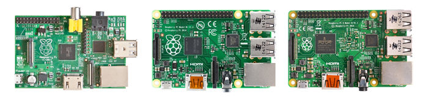

Cuidado pra não comprar o modelo anterior. O correto é o da direita, na imagem acima. O modelo está escrito acima do processador ligeiramente à direita em branco - “Raspberry Pi 2 Model B v1.1".

Vamos precisar também de:

- **[Cartão memória MicroSDHC de 8Gb](http://www.extra.com.br/CineFoto/CartoesdeMemoria/Cartao-de-Memoria-SanDisk-8GB-Ultra-microSDHC-UHS-I-Classe-10-1-adaptador-SD-SDSDQUA-008G-U46A-2171484.html?utm_medium=cpc&utm_source=gp_pla&adtype=pla&utm_campaign=PROD_Shopping&gclid=Cj0KEQjw4LaqBRD60pfSn43ZwLQBEiQAJv5FLP2NtOO_49rnvmDTbRhu7KBSRi5Dq6figdp5ZglbFQ8aAtpj8P8HAQ) (Classe 10):**o sistema operacional ocupa 1,3Gb. O restante serão jogos, calcule sua saudade e compre o cartão adequado para caber tudo.
- **[Fonte com 5volts e 2Amp com USB fêmea](http://www.amazon.com/igloon-Charger-Design-iPhone-Galaxy/dp/B00K7AZUDA/ref=sr_1_3?ie=UTF8&qid=1431223114&sr=8-3&keywords=5v+2+amp+charger):**se você tem um tablet ou algum aparelho que demande um pouco mais de energia, é bem capaz que o carregador já tenha 2 Amp de saída. Caso contrário, um desses genéricos resolve. Eu paguei R$10,00 na minha no Xing Ling.
- **Um cabo [Micro USB - USB](http://www.amazon.com/Mediabridge-USB-2-0-Micro-USB-High-Speed/dp/B004GF8TIK/ref=sr_1_2?s=electronics&ie=UTF8&qid=1431224491&sr=1-2&keywords=micro+usb+a-b) para ligar na fonte:**é o mesmo cabo usado por Androids, controle do PS4, Motorola, etc.
- [**Um cabo HDMI qualquer**](http://www.extra.com.br/Informatica/AcessoriosePerifericos/Cabos/Cabo-Hdmi-M-x-Hdmi-M-1.5-metros-2778712.html)
- **Teclado e mouse USB:** necessários somente para a configuração inicial ou para a emulação de computadores antigos e Adventure games. Pegue emprestado do seu desktop e devolva depois.
- **Pendrive:**de preferencia limpo e USB 2.0. Vamos usar somente para enviar os jogos.
- **Um** [leitor de cartão MicroSD](http://www.amazon.com/Compact-Memory-Reader-Adapter-MicroSD/dp/B00P740UW2/ref=sr_1_8?s=electronics&ie=UTF8&qid=1431233663&sr=1-8&keywords=micro+sd+card+reader+3.0)**ou um laptop com entrada para cart****ão:** Não use aqueles que são pendrive com entrada para cartão. São ridiculamente lentos e geralmente podem dar problema. Prefira algo tipo [isso](http://www.amazon.com/Compact-Memory-Reader-Adapter-MicroSD/dp/B00P740UW2/ref=sr_1_8?s=electronics&ie=UTF8&qid=1431233663&sr=1-8&keywords=micro+sd+card+reader+3.0) ou seu laptop.
- **Joystick** **à** **escolha com sa****í****da USB:**Até agora tudo o que eu pluguei nele funcionou. Posso confirmar os de PS2, PS3, Xbox com fio e com transmissor Wireless e um Logitech desses genéricos.

Para esse tutorial vamos usar o [Joystick Wireless do Xbox 360](http://www.amazon.com/Xbox-360-Wireless-Controller-Glossy-Black/dp/B003ZSP0WW/ref=sr_1_1?s=electronics&ie=UTF8&qid=1431224344&sr=1-1&keywords=joystick+xbox+360+wireless) com um [transmissor](http://www.amazon.com/gp/product/B000HZFCT2/ref=s9_simh_gw_p63_d0_i3?pf_rd_m=ATVPDKIKX0DER&pf_rd_s=desktop-1&pf_rd_r=0X009AXN9MRET2X4SE09&pf_rd_t=36701&pf_rd_p=2079475242&pf_rd_i=desktop).

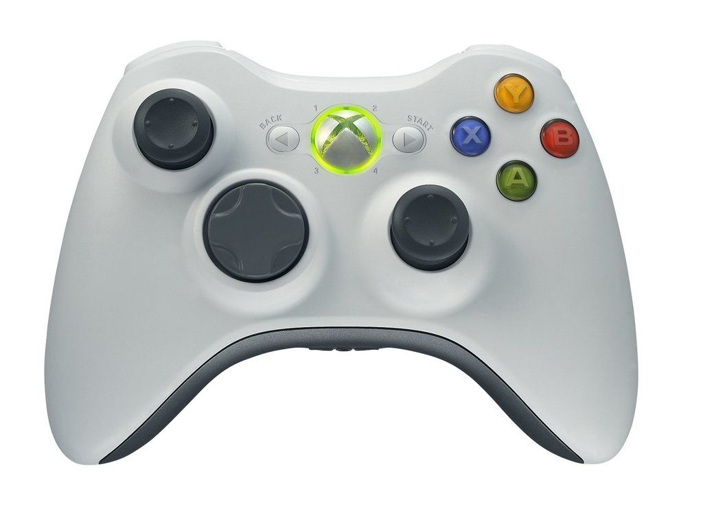

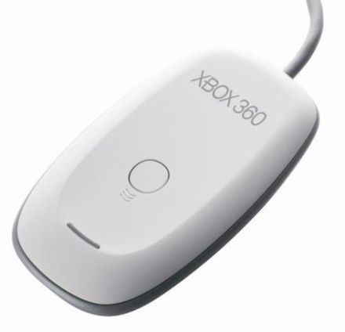

*O transmissor possibilita ligar at**é* *4 controles ao mesmo tempo. R$38,00 no MercadoLivre*

**Atenção:** Os controles de PS3 usam bluetooth. Você pode comprar um "[dongle USB](https://www.google.com.br/search?q=usb+bluetooth+dongle&espv=2&biw=1309&bih=692&tbm=isch&tbo=u&source=univ&sa=X&ei=ElJNVdC8DI_bsATol4HgCw&ved=0CDMQsAQ)" e configura-los seguindo [esse](https://www.youtube.com/watch?v=CouHTixaz94&feature=youtu.be) tutorial em vídeo (inglês). Ou simplesmente plugar na USB e sair usando. Nunca tentei por bluetooth.

### Primeiros passos

Agora o que vamos fazer é baixar o arquivo do projeto RetroPie e gravar no cartão. Clique no link abaixo e procure a versão correta. A última até o final desse tutorial era a 3.0 BETA 2.

- [RetroPie SD-card Image for Raspberry Pi 2 Version 3.0 BETA 2](http://blog.petrockblock.com/retropie/retropie-downloads/);

Baixe também esse programa, que serve para gravar o arquivo no cartão:

- [Win32DiskManager](http://sourceforge.net/projects/win32diskimager/files/latest/download)

Descompacte tudo em uma pasta e execute o instalador do Win32DiskManager. No final da instalação desmarque a opção “Launch Win32DiskManager” já que vamos roda-lo como administrador manualmente.

Plugue seu cartão de memória no laptop ou leitor de cartões.

Agora, vá até “C:/Arquivo de programas/ImageWriter”, botão direito do mouse em cima de Win23DiskManager.exe > Executar como administrador > Sim.

Clique no ícone de pasta ao lado de “Device”, ache o arquivo do RetroPie baixado com a extensão .img e clique em WRITE.

Enquanto aguarda a gravação, pegue seu RPi2 e vamos liga-lo na TV.

### Ligando o Raspberry Pi 2

Plugue o teclado, mouse e os joysticks. Não plugue o pendrive nem a fonte ainda. Ligue o cabo HDMI na TV e volte pro PC porque o cartão já deve ter terminado de gravar.

Plugue o cartão de memória na traseira do RPi2 e finalmente ligue a fonte na tomada. Isso é o bastante pra ligar (espero). Não existe botão “ON/OFF”, então, cuidado para não esquecê-lo ligado.

A essa hora você deve estar vendo letras frenéticas subindo até ele parar nessa tela:

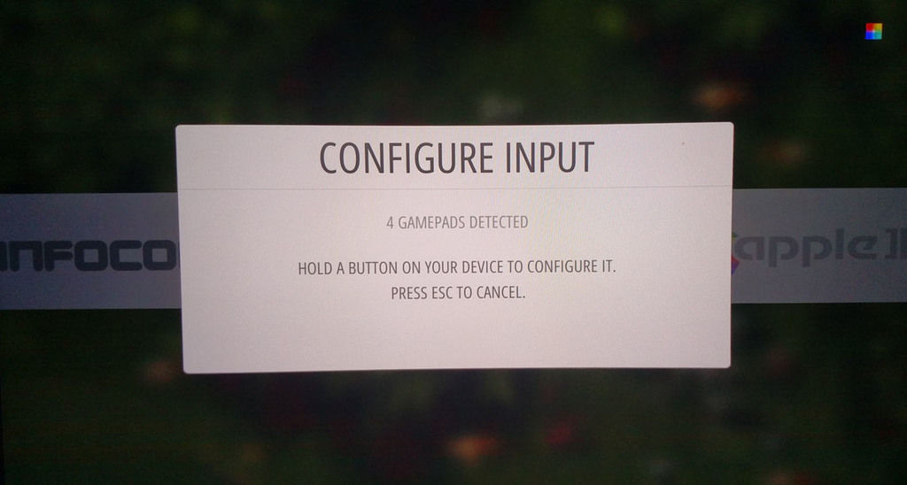

*Isso significa que ele encontrou o seu Joystick e est**á* *pronto para configurá-lo.*

Segure um botão qualquer e siga as instruções. O botão A confirma as seleções e o B cancela.

Se você se apressou e foi bisbilhotar o que tem dentro de cada sessão já deve ter achado alguns joguinhos pré instalados na aba PORTS (Quake, Duke Nuken, Doom e Quake Arena). Não recomendo roda-los agora antes de configurarmos os controles e teclado.

Vá até a sessão “Retropie" e aperte o botão que você escolheu como A.

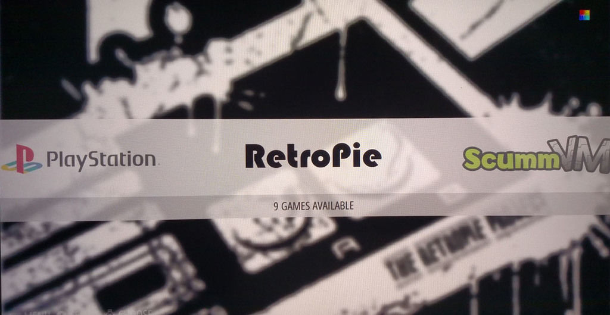

Achou estranho que só configuramos dois botões ? É porque aquilo só serviu para a interface de escolha de jogos. 

Clique em CONFIGURE RETROARCH KEYBOARD/JOYSTICK e vamos especificar todos os botões para usarmos nos nossos jogos.

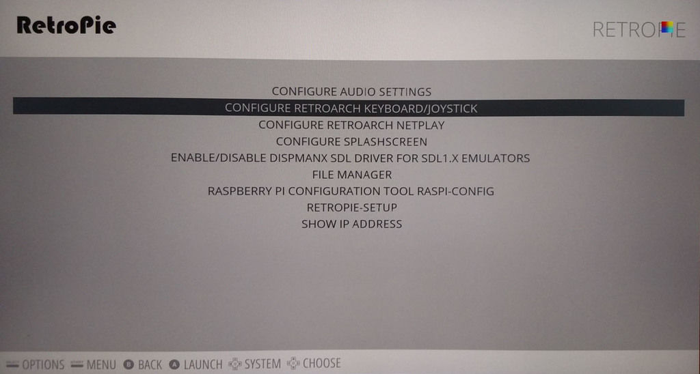

Uma tela com fundo azul amedrontadora aparecerá. Fique tranquilo, é agora que a brincadeira começa. Aperte ENTER na opção 1 e configure o Joystick de acordo com o esquema abaixo:

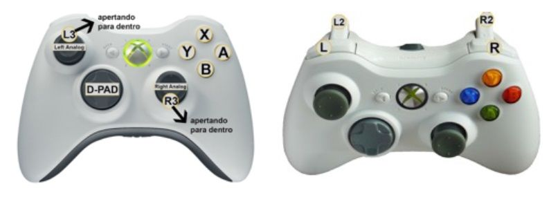

Os outros controles seguem a mesma lógica de posicionamento. Você pode repetir quantas vezes quiser até acertar.

Pressione ESC no teclado para retornar ao menu principal do Retropie.

Agora selecione RASPBERRY PI CONFIGURATION TOOL, para continuarmos com os detalhes técnicos.

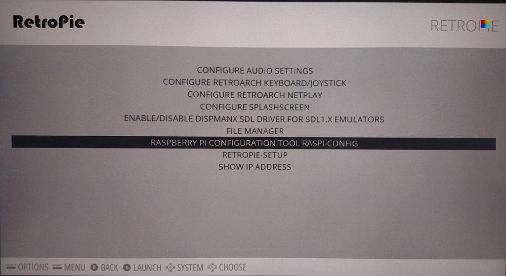

*Selecione com o A*

Primeiro devemos expandir o espaço no cartão de memória para conseguirmos gravar nossos jogos no espaço restante. Aperte ENTER e espere retornar para essa tela.

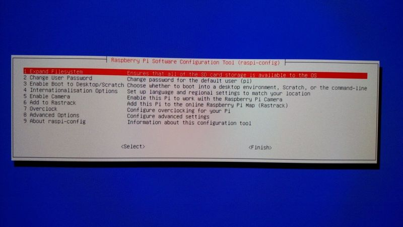

Agora vamos deixar as coisas mais rápidas fazendo um *overclock* (aumentar a velocidade do processador). 

Fiquem tranquilos, o Raspberry Pi é feito para aguentar todas essas configurações sem problemas. Vá na opção 7 (overclock) e selecione a última opção, “Pi2", como abaixo.

Ficou preocupado? Tudo bem, clique [aqui](https://www.raspberrypi.org/forums/viewtopic.php?f=63&t=13080), [aqui](http://www.michaeldornisch.com/2012/06/diy-raspberry-pi-heat-sink.html) ou [aqui](http://www.amazon.com/s/ref=nb_sb_noss_2?url=search-alias%3Delectronics&field-keywords=raspberry%20pi%202%20cooler).

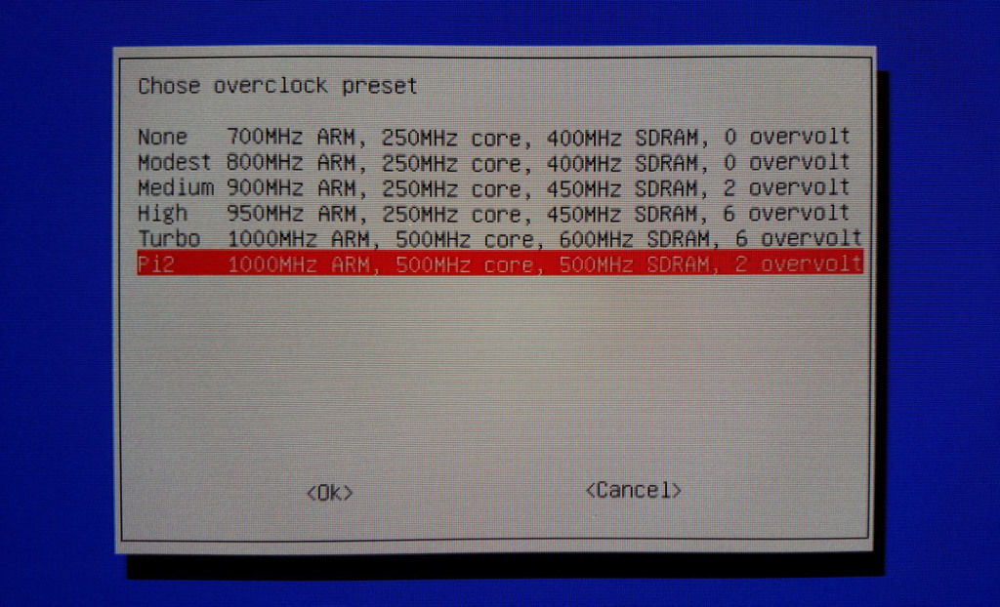

Agora vá em ADVANCED OPTIONS e depois em A3 MEMORY SPLIT. Como abaixo, preencha com 128 e aperte OK. Isso vai alocar mais memória no processamento de vídeo para rodar coisas mais pesadas como Playstation e Nintendo 64 com mais suavidade.

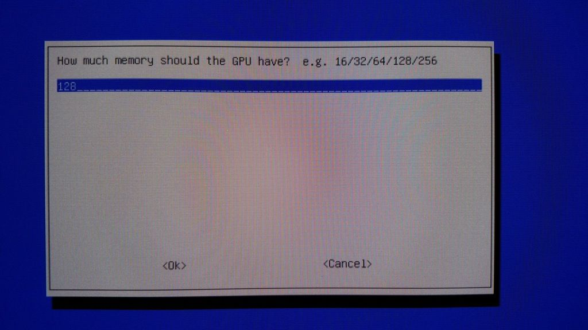

Agora vá em FINISH e retorne para o menu principal.

### Passando as ROM's para dentro pelo pendrive

Pegue seu pendrive (de preferência, limpo) e plugue no RPi2. Aguarde uns 15 segundos, remova do RPi2 e retorne-o para o PC. Ao abrí-lo você perceberá uma pasta ROMS e várias subpastas com o nome de cada console.

Simplesmente arraste as rom's para a pasta correspondente e plugue de volta no Raspberry Pi. De primeira, faça somente com um emulador, um jogo, para testar como funciona. Um quadrado colorido no canto superior direito indica que os arquivos estão sendo copiados. Quando ele parar de piscar, já pode tirar o pendrive. Um jogo de Mega Drive leva em média 5 segundos para ser copiado.

Depois de copiar, aperte START no controle, QUIT e depois RESTART SYSTEM.

***Obs:** Jogos "Adventure Game" da Lucas Arts como Full Throttle e Monkey Island, tem um passo a mais para funcionar. Se você veio aqui para isso, eu explico no final do tutorial na parte de “PENDÊNCIAS" como fazer.*

*Os jogos de MAME (Arcades) também tem uma particularidade explicada na sessão “PENDÊNCIAS".*

### Começando a Jogatina

Depois de reiniciado, o emulador correspondente vai aparecer na lista horizontal na tela principal. 

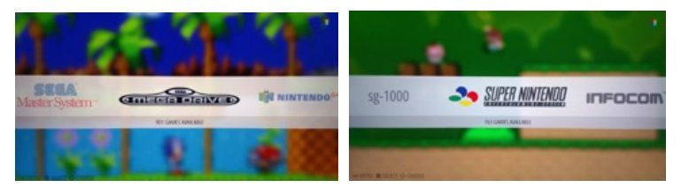

Bonito, né?

Agora selecione o emulador com A e a lista de jogos deve aparecer na próxima tela. 

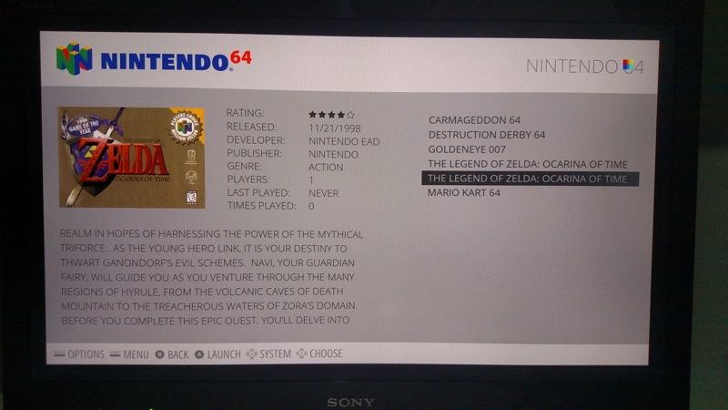

Peraí! Sua tela não tá arrumada assim com foto, descrição e tudo mais? Vamos resolver isso!

### Scraper

Scraper é o processo onde através da internet o sistema baixa informações sobre os jogos para catalogar melhor suas ROM’s através de bibliotecas de jogos online. A forma mais fácil de se conectar à internet é plugar um cabo de rede até seu roteador.

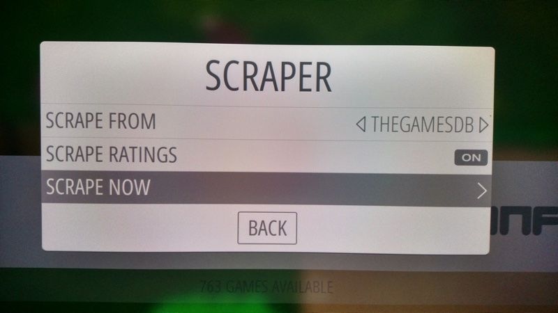

“Perai! eu prefiro Wifi, meu roteador fica longe!”. Então, compre um receptor wifi usb [desses](http://www.amazon.com/Edimax-EW-7811Un-150Mbps-Raspberry-Supports/dp/B003MTTJOY/ref=sr_1_1?ie=UTF8&qid=1431230262&sr=8-1&keywords=usb+wifi+dongle). Quanto mais simples, melhor e menos energia vai drenar do seu RPi2. E siga [essas](http://raspberrypihq.com/how-to-add-wifi-to-the-raspberry-pi/) instruções.

Esse processo não é necessário para começar a jogar e pode demorar, literalmente, horas, dependendo da quantidade de jogos que você copiou.

Recomendo iniciar a varredura antes de ir dormir ou ignorar esse passo, se estiver com pressa.

Calma que falta pouco.

Se for fazer agora aperte START no seu controle. Vá até Scraper, selecione SCRAPE NOW. Existe a opção de quando ele ficar em dúvida de que jogo é aquele, você decidir (USER DECIDES ON CONFLICTS). Eu tive pouquíssimos erros e desmarquei essa opção. START.

### Comandos especiais

Antes de começar é bom sabermos de alguns comandos que não estão explícitos.

- **SELECT + START** - Sai do jogo de volta para tela inicial
- **SELECT + B** - Reset
- **SELECT + X** - Menu de opções do Emulador
- **SELECT + L2** - Load State
- **SELECT + R2** - Save State

### Load state e Save State

A maioria dos emuladores dispõem dessa função.

Lembra daquele jogo que você ficou anos morrendo no mesmo chefe e nunca conseguiu passar? Agora você pode criar um SAVE GAME como em um jogo de computador moderno antes de ir para a batalha e repetir a jogada a partir daquele ponto quantas vezes quiser.

Trapaça? Lógico! Mas eu aproveitei bem mais alguns jogos conhecendo fases que nunca tinha jogado que me tomariam mais tempo do que tenho para chegar finalmente lá.

- **SELECT + L2** - Load State
- **SELECT + R2** - Save State

### Bônus round

#### Ligando na TV

Se você tem uma Smart TV, é bem capaz dela ter entrada USB. Essa USB é suficiente para alimentar o Raspberry Pi mais o transmissor do Xbox. Não testei ainda com o Wifi e o bluetooth USB. Além disso, eu parafusei o meu na montagem VESA da TV (onde fica o suporte de parede). Bem mais prático e desliga junto com a TV.

#### Cases

Já que estamos botando a mão na massa desde o começo, vamos fazer o mesmo com nosso case. Tem alguns tutoriais incríveis pela internet para várias situações e gostos:

- [Se você tem umas peças de Lego sobrando em casa](https://www.youtube.com/watch?v=18dhY0WNpMM);
- [Se você tem fitas antigas VHS-C na gaveta dos vídeos de viagem](https://www.youtube.com/watch?v=afdQHSfLqxw);
- [Se é bom com madeira](https://www.youtube.com/watch?v=o9H8p3Qbpig);
- [Tem acesso a uma impressora 3D?](http://www.thingiverse.com/glitchpudding/collections/pi-2-cases/page:1)
- "Muito bacana, mas eu não quero ter trabalho", clique [aqui](http://www.adafruit.com/category/289). 
  Ou;
- busque no [MercadoLivre](http://lista.mercadolivre.com.br/raspberry-pi-2-cases#D%5BA:raspberry-pi-2-cases%5D).

**Dica:** Eu percebi que ele cabe inteiro dentro de um cartucho de N64 ou Atari. Uns cortes aqui, lixadas acolá, uma arte impressa no lugar da capa do jogo e você tem um [belo case](http://makezine.com/2013/04/03/raspberry-pi-in-an-n64-case/).

### Observações pessoais

Nintendo 64 não se emula direito nem num PC parrudo. Aqui não é diferente. A maioria não roda fluído e tem alguns problemas de Textura. 

Para os curiosos, sim, Zelda Ocarina of Time é um desses que funciona bem, apesar de pequenos problemas na imagem em alguns cenários, ele é perfeitamente jogável.

Playstation 1, apesar de ser um sistema mais novo, é mais fácil de emular que o N64. Até agora tudo o que eu joguei nele funcionou bem, mas foram apenas 5 jogos.

De resto, pequenos defeitos em alguns jogos mais obscuros principalmente de SNES, já que o emulador não é dos mais eficientes. Existe a possibilidade de se [trocar o emulador](https://www.raspberrypi.org/forums/viewtopic.php?f=78&t=76563) se você achar que algo não está do jeito que você se lembra na infância.

### Pendências

#### COMO CONFIGURAR SCUMM (Adventure Games)

No computador, espete o pendrive. Copie a pasta do jogo que você quer jogar para dentro da subpasta SCUMM dentro de ROMS no Pendrive e plugue no Rpi2.

Vai lá e pega o teclado e mouse de volta.

Agora vá na aba SCCUMMVM e abra o emulador (+Start SCUMMVM ). Usando um Mouse vá em ADD GAME, ache a pasta correspondente e clique em CHOOSE. Na próxima tela dê um nome para o jogo ( é o que o vai aparecer no menu de escolha de jogos ) e deixe o resto como está.

Agora é só selecionar o jogo e clicar em START.

Dentro do jogo, para acessar o menu do emulador para salvar jogos, colocar legendas, etc, aperte F5 no teclado.

#### EMULADOR MAME

Multiple Arcade Machine Emulator é o emulador dos jogos de ARCADE que você jogava nas rodoviárias da vida por aí e, nas melhores hipóteses, nos shoppings enquanto seus pais faziam compras.

A única observação que faço é que ele necessita de um tipo específico de ROM na versão 0.37b5. É a mesma versão que é usada para emuladores em Android. É o único emulador que tem essa peculiaridade.

### Finalizando

Eu montei o meu Retropie assim. Existem outras formas, por linha de código, remotamente e até comprando de empresas que fazem todo o trabalho por você (mas cobram por isso, e bem).

Quer dicas do que jogar? O Luciano Ribeiro já fez [um guia animal pro SNES aqui mesmo](http://www.papodehomem.com.br/os-53-melhores-jogos-de-snes-para-ser-tao-feliz-quanto-na-infancia).

Agora, tá fazendo o que lendo isso aqui?

Vai lá, zera aquele jogo que você nunca conseguiu, faz uma festa com a galera das antigas, joga aquele jogo que você sempre quis jogar mas seu vizinho não te emprestava nunca, mostra pros filhos como é que se jogava na sua época, sei lá, divirta-se!

Bom jogo a todos!

### Você gostaria de ensinar algo?

“[Deixa que eu faço](http://www.papodehomem.com.br/colecoes/deixa-que-eu-faco)” é a nova série colaborativa de textos mão na massa do PapodeHomem. A ideia é reunirmos pessoas dispostas a contribuírem com guias e tutoriais, ensinando a fazer as mais diversas tarefas, das rotineiras às inusitadas. Com o tempo, queremos ter um compilado com todo tipo de passo-a-passo, para tornar o PapodeHomem um espaço cada vez mais útil.

Pode se programar: toda sexta, um texto com um guia ensinando a fazer algo prático. Tem alguma ideia? Manda pra gente no e-mail [deixaqueeufaco@papodehomem.com.br](http://www.papodehomem.com.br/como-criar-uma-central-de-videogames-retro-usando-um-raspberry-pimailto:deixaqueeufaco@papodehomem.com.br).

E, caso faça um dos tutoriais já publicados, põe a hashtag #deixaqueeufacopdh pra compartilhar com a gente. As mais legais a gente solta no [Instagram do PapodeHomem](http://instagram.com/papodehomem).

---

*publicado em 05 de Junho de 2015, 11:56*
