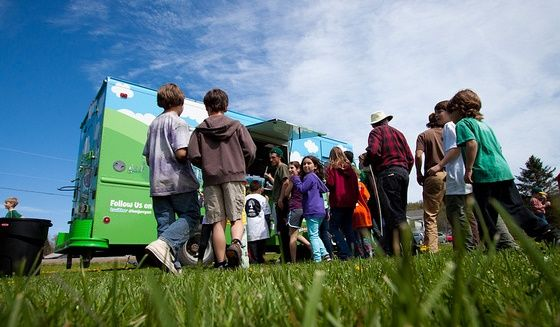
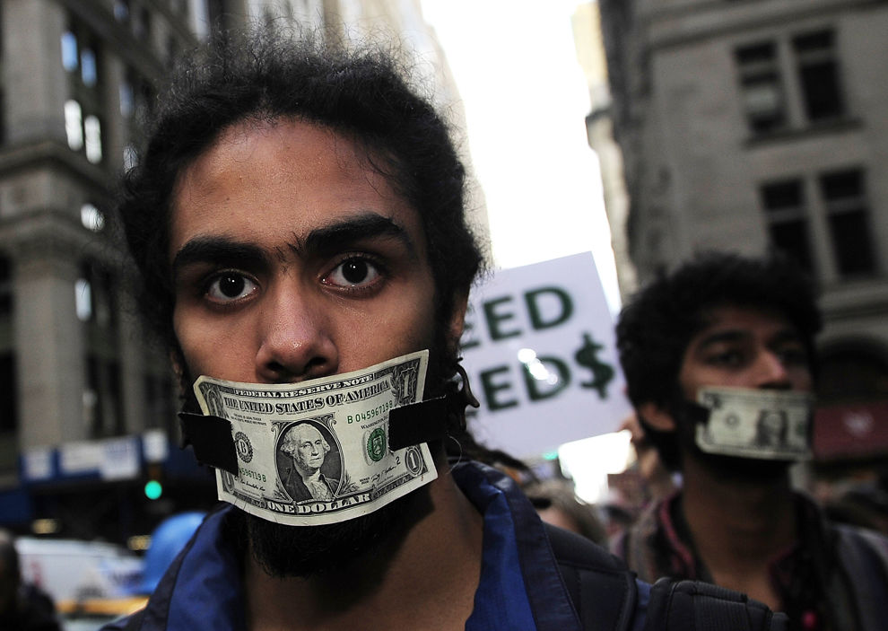

# Como nasce uma “Empresa B”

Cada vez mais e mais casos de empresas menos nocivas mostram que é possível termos uma outra relação com o consumo e o trabalho

Dizem que todo grande processo de autoconhecimento começa com uma perda. O de Ricardo Glass, fundador e CEO da Okena, uma empresa de tratamento de efluentes industriais e resíduos líquidos contaminados, sem dúvida começou assim. Um primo quase da sua idade morreu de câncer, aos 27 anos. “A gente desperta pela dor ou pelo amor”, afirma Ricardo.

A primeira ficha que caiu foi a dos limites para o poder do dinheiro. Seu primo era um rapaz de família muito rica, cuja fortuna se revelou impotente diante da doença. A segunda foi o questionamento da vida que se passa semeando para um dia colher alguma coisa que não se sabe bem o que é. Esse foco no futuro perde o sentido quando se toma contato com a ideia de finitude. “A gente quando jovem não lida com essa realidade”, nota Ricardo. Ele passou a lidar.

Sua jornada começa com quatro sessões semanais de terapia com uma analista freudiana. Por cinco anos. Quase ao mesmo tempo, depois de pouco mais de um ano de terapia, Ricardo começou a estudar a Cabala e seguiu se aprofundando por três anos, reunindo-se mais de uma vez por semana com um grupo de estudo e um professor particular. Com a análise descobriu que sofre de angústia existencial. Com a Cabala passou a questionar a sua relação com o mundo.

Sua família tinha, então, uma empresa média, a rede de lavanderias Tilimpa, onde Ricardo trabalhava. Justamente naquela época, a companhia foi vendida a um fundo de *private equity*, que a fundiu com a rede Acqualimp e criou a Atmosfera. Ricardo tornou-se diretor comercial. No dia seguinte à venda da empresa, passou a conviver com um controlador que tinha interesse apenas em maximizar o valor econômico da companhia e remunerar seu capital. “Isso começou a ficar incompatível com minha forma de pensar, mas não percebi claramente enquanto também estava querendo maximizar o meu valor”, diz Ricardo.

A Tilimpa tinha pouco menos de 500 funcionários. Ricardo se lembra de uma das reuniões de negociação de que participou, na qual tentou proteger os interesses das pessoas que, até então, recebiam cerca de 30% mais do que o piso salarial da categoria. “A gente tinha essa política porque achava que fazia sentido e porque o negócio permitia. Cabia no bolso”, nota Ricardo. Àquela altura, porém, já estava definido que a lavanderia mudaria de endereço.

Uma unidade mais moderna seria instalada em outra cidade, e, na mudança, boa parte das pessoas seria demitida. Talvez 50%, já que a operação seria automatizada. Isso deveria demorar dois anos e Ricardo impôs como condição para o negócio que não se escolhessem os funcionários a dispensar com base só em salários. Já nos primeiros dias sob a nova gestão, porém, surgiram pressões para reduzir custos trocando pessoas. “Aquilo me machucava. Entendi claramente o peso do capital em uma organização com outras premissas”, observa ele. “É por isso que eu acho que o *private equity* é o câncer do sistema.”

Ricardo ficou menos de dois anos na Atmosfera. O fechamento do ciclo veio de modo trágico. “Estava num jogo do São Paulo, tive um AVC e quase morri”, diz. Era a histórica semifinal da Libertadores de 2005, contra o argentino River Plate. Ricardo estava no Morumbi com dez amigos. “O São Paulo estava sobrando nesse jogo. Eu ia muito ao estádio, mas naquele dia estava emocionado”, lembra. Quando Danilo marcou o primeiro dos dois gols do tricolor, aos 31 minutos e meio do segundo tempo, Ricardo começou a passar mal. “A cada minuto, novos sintomas surgiam”, diz ele. “Nunca imaginei que fosse AVC.”

O jogo seguia emocionante, e Ricardo já tinha dificuldades para falar. “Tive uma percepção, sabe-se lá por que, de que eu poderia ficar inválido”, afirma ele. “Não conseguia andar, e não tinha maca no estádio. Meus amigos me carregaram até o ambulatório do estádio, onde um médico me deu só Plasil.”

Depois de duas horas, Ricardo foi transferido para o Hospital Albert Einstein, onde passou pelo protocolo de avaliação de emergências. Diagnóstico? Crise vertiginosa aguda. “Teoricamente, era para eu ter morrido, porque perdi 40% do cerebelo além de um pedaço do tálamo. Tem gente que perde 10% do cerebelo e não consegue mais ficar em pé”, diz ele.

Ricardo não teve sequelas, mas, ao sair do Einstein, não conseguia andar em linha reta. Tinha dormência no rosto e forte dor no pescoço. Seu AVC estancou espontaneamente.

Quem percebeu o tamanho da encrenca foi um otorrino, médico da família, que o encaminhou para um neurologista do hospital “rival”, o Sírio-Libanês, em pleno domingo. “O cara atendeu na hora, olhou para mim e disse: ‘Já sei o diagnóstico, você vai fazer uma ressonância só para confirmar’”, conta Ricardo. Era uma bola preta no cérebro.

Ricardo tinha 31 anos à época. Aos 40, diz que o AVC foi o melhor presente que ganhou até hoje. “Consegui entender o valor real da vida”, afirma. Depois de ter alta do Sírio, ele ainda voltou para a empresa, ficou menos de três meses e saiu. “A decisão de sair foi um rompimento com o que tinha recebido como planejamento do mundo para mim”, avalia.

Ricardo iniciou, então, um processo de coaching de carreira, que não era tão comum naquela época. O que ele avaliou que seria uma parada para trocar pneu acabou se revelando uma revisão completa de seu plano de voo. Com escalas inusitadas, como uma viagem à China, onde passou dez dias visitando uma única feira de negócios. “Naquele modelo que eu estava vivendo, fazer negócios com a China era sinônimo de sucesso”, diz Ricardo. “Seria até simples criar uma nova Chilli Beans. Tinha muitos fornecedores de óculos lá. Bati na porta de um ou dois que fazem o que você quiser.” Um par de óculos de boa qualidade saía por um dólar e meio. Qualidade média? US$ 1,25. O item de melhor qualidade não passava de US$ 3,20 e poderia tranquilamente ser vendido em um quiosque de shopping center no Brasil por R$ 150. Tal matemática não mostra, porém, o custo humano de se fabricar óculos a dois dólares o par.

Trabalho em condições análogas à escravidão, gigantesco êxodo rural, relações trabalhistas comparáveis às da Revolução Industrial. “Vou participar disso? Contribuir com esse desequilíbrio?”, questionava-se Ricardo. De dinheiro, ele não precisava. Por que, então, mobilizar a sua energia para montar um negócio em parceria com empresários desse tipo?

Do início de 2006, quando foi para a China, até 2009, Ricardo praticamente parou de trabalhar. Mais que isso, passou a questionar a lógica por trás do trabalho. “Por que as pessoas se sujeitam a isso? Em troca do quê?”, perguntava-se. “Eu estava tentando entender em profundidade as relações de trabalho.” Nesse processo, houve espaço para inúmeros cursos de filosofia, para a descoberta do budismo e da ioga. “Percebi que a ioga não é simplesmente um exercício. Que ela envolve uma relação com o mundo completamente diferente”, diz Ricardo. “Minha primeira aula de ioga, eu nunca vou esquecer. Foi um negócio mágico, e aí eu comecei a me dedicar a essa busca, com muita intensidade, o que talvez não seja recomendável.”

Ele flertou com a depressão durante todo o processo. Testou a máxima de Nietzsche segundo a qual se você observa demasiadamente o abismo, o abismo acaba por olhar para dentro de você. “O buraco é cada vez maior. Quanto mais você se aprofundar nesse caminho, maior será a sua necessidade de lidar com o incontrolável, com o desconhecido”, afirma ele.

Os três anos de autoconhecimento radical trouxeram-no de volta à inquietação original: “Em que lugar usufruirei do meu potencial como ser humano?” No mundo dos negócios? Sim, mas como lidar com os conflitos inerentes a esse universo sem aceitá-los? Foi aí que se apresentaram a Ricardo conceitos como o do triplo *bottom line*, em alegorias por vezes heterodoxas. “Para a Cabala, o Messias é um desejo infinito de compartilhar se manifestando na Terra”, diz ele. Se esse desejo não frutifica, é porque o Messias não chegou, mas a consciência crescente da interdependência entre interesses individuais e coletivos lhe sugere que há algo importante prestes a acontecer – e que o mundo dos negócios, talvez, represente um espaço de convergência dessas duas esferas.

Para que represente, será preciso redefinir, por exemplo, o que é sucesso – um processo ao qual Ricardo se dedicou intensamente naquele triênio. “É ser o presidente da porra da Atmosfera? Ferrando a vida de metade daquelas pessoas? Tratando mal o cliente? É isso que é ter sucesso, se você tiver sua conta bancária cheia?”, questionava-se ele. Aos poucos, Ricardo se deu conta de que não estava sozinho nessa encruzilhada. Havia movimentos tomando corpo à sua volta. Um deles era o das “Empresas B”.

### O Sistema B

Em termos conceituais, Empresa B é a que usa o poder do seu negócio para enfrentar um problema social ou ambiental. Por trás do conceito há um movimento mundial de identificação, certificação e fomento de firmas assim, lançado pelo B Lab, uma ONG americana. As organizações precisam se enquadrar em duas características para receber o selo de B Corp. A primeira é ter um plano de desenvolvimento contínuo que considere cinco perspectivas: governança, modelo de negócio, impacto ambiental, relações com comunidades e colaboradores. É por essas dimensões que uma Empresa B tem seu desempenho avaliado.

A segunda característica tem relação com sua estrutura jurídica. Ela deve se definir legalmente como empresa responsável ambiental e socialmente. Para isso, tem de incluir duas cláusulas no contrato social. A primeira atesta seu compromisso não só com os investidores e acionistas, mas com todos os *stakeholders*, ou partes interessadas. Na segunda cláusula, a empresa se compromete a considerar as “externalidades” no seu modelo de negócio. Ou seja, o impacto ambiental e social das suas atividades.

O movimento começou há sete anos nos Estados Unidos, com a criação de uma metodologia de avaliação de empresas que não leva em conta só aspectos financeiros. A Avaliação B (*B Impact Assessment*), que é o questionário para certificação de empresas, abrange as cinco perspectivas citadas. “Companhias que têm uma preocupação genuína com as cinco áreas estão um passo à frente em sua capacidade de gerar transformação para o mundo e para a sociedade”, nota Julia Maggion, CEO da ONG Sistema B no Brasil.

Naturalmente, durante essa avaliação, a entidade certificadora também lança um olhar sobre possíveis impactos negativos, que, se existirem, diminuem a pontuação da companhia. “Nosso mecanismo de certificação é bem complicado, então, acho difícil uma empresa que não tenha esse *drive* [a motivação de causar impactos positivos na sociedade] conseguir se certificar”, afirma Julia. Além do complexo questionário, são realizadas entrevistas e requeridos documentos para comprovar as práticas reportadas.

A marca fabricante de sorvetes americana Ben & Jerry’s é uma espécie de empresa-símbolo do movimento. “É uma companhia com práticas muito desenvolvidas”, observa Julia.

Em [reportagem publicada pela revista *Exame* em junho de 2014](http://planetasustentavel.abril.com.br/noticia/desenvolvimento/um-plano-b-para-empresas-798031.shtml), Ana Luiza Herzog descreve as práticas da empresa criada em 1978 por Ben Cohen e Jerry Greenfield:

> A Ben & Jerry’s “compra grande parte de suas matérias-primas de pequenos produtores de países pobres e em desenvolvimento – e paga por elas um preço pouco acima ao do mercado.   
> Todas as bananas, por exemplo, são fornecidas pela El Guabo, cooperativa de cerca de 300 pequenos produtores rurais localizada no Equador, onde o dinheiro extra pago pela Ben & Jerry’s permitiu à comunidade carente investir em educação básica para as crianças.   
> A empresa também é conhecida por pagar a seus funcionários menos qualificados o dobro do salário mínimo estabelecido nos Estados Unidos. E apoia publicamente – de maneira barulhenta – as causas sociais que defende.   
> Em 2011, durante o movimento Ocupe Wall Street, a companhia endossou a iniciativa em um comunicado oficial e chegou a distribuir sorvete para os milhares de pessoas que ocuparam o Zuccotti Park, em Manhattan, para protestar contra o sistema financeiro e a desigualdade social no país”.

“É simbólico que a Ben & Jerry’s tenha conseguido manter uma boa dose de idealismo mesmo depois de ser engolida por uma corporação gigantesca como a Unilever”, afirma a [matéria da *Exame*](http://planetasustentavel.abril.com.br/noticia/desenvolvimento/um-plano-b-para-empresas-798031.shtml). A revista defende uma tese ainda carente de comprovação: “Movimentos como o Sistema B só ganham relevância no mundo porque conquistaram o patrocínio de grandes corporações”.

Movimento Ocupe Wall Street

Em junho de 2014, o movimento das Empresas B já contava com 1.020 companhias certificadas em mais de 60 setores econômicos de 34 países. “Ele se espalhou muito nos últimos dois anos. Até então, estava restrito a Estados Unidos e Canadá”, diz Julia.

O movimento chegou à América Latina em 2012 por iniciativa de dois empreendedores chilenos, um argentino e uma colombiana. Eles buscavam um jeito diferente de avaliar empresas quando descobriram o modelo de B Corps. Foram, então, aos Estados Unidos, tornaram-se parceiros do B Lab e fundaram o Sistema B, para a promoção do movimento na América Latina. Já existem mais de 60 empresas certificadas no Chile. Na Argentina, são 20. Na Colômbia, 15. O movimento foi lançado no Brasil em outubro de 2013.

Àquela altura, já havia quatro empresas brasileiras certificadas nos Estados Unidos. A pioneira é a Ouro Verde Amazônia, uma companhia 100% dedicada à coleta e ao processamento de castanhas do Pará em Alta Floresta, no Mato Grosso. A segunda é o CDI, à qual voltaremos no Capítulo 11, responsável pela vinda do Sistema B para o país. Assim como os outros quatro empreendedores latino-americanos citados, Rodrigo Baggio e Marcel Fukayama, líderes do CDI, também foram até o B Lab propor uma parceria.

Além de apoiar o movimento das Empresas B com o processo de certificação e a identificação das companhias com potencial para receber o selo, o Sistema B trabalha de modo a desenvolver um ecossistema para essas empresas.

O trabalho segue cinco eixos estratégicos.

O primeiro concerne legislação e políticas públicas. A entidade está estudando o panorama legislativo de países da América Latina em busca de possíveis oportunidades de atuação. Nunca, segundo Julia, com o objetivo principal de obter subsídios – embora benefícios fiscais às vezes sejam oferecidos. “Nos Estados Unidos, acabou acontecendo em dois estados, por iniciativa dos governos”, conta ela.

O segundo eixo é o acadêmico. O objetivo é aproximar empresas B de universidades, por meio de cases.

O terceiro eixo é o dos grandes compradores, incentivados a incluir entre os seus fornecedores empresas que geram impacto socioambiental positivo.

O quarto é o dos formadores de opinião.

Por fim, há o trabalho junto a investidores.

O foco do Sistema B hoje está na construção de uma comunidade de empresas B para que elas se conectem, se conheçam e se tornem parceiras. São companhias diversas, de setores diferentes, com tamanhos distintos, que atingem o consumidor de formas distintas, mas que têm conexão direta com o propósito.

A visão de mudança do Sistema B é de longo prazo e sistêmica – daí a palavra “sistema”. Sua missão é promover uma ruptura com o sistema econômico atual. Naturalmente que não com a intenção de combater o capitalismo – que os líderes do movimento reconhecem como o mecanismo mais bem-sucedido da história para criar e distribuir riqueza.

A proposta é lançar as bases para um capitalismo diferente. Protagonizado por um novo tipo de organização: as Empresas B. “Basicamente são negócios que, além de ter uma atividade econômica, de usar a lógica de mercado e de ter lucro, têm um propósito por trás”, afirma Julia. Segundo ela, as Empresas B mais inovadoras do mercado partem sempre de propósitos bem claros e criam produtos e serviços para atendê-los.

Julia cita o exemplo da Guayaki, uma empresa argentino-americana cujo propósito é regenerar a Mata Atlântica, o ecossistema com a maior biodiversidade do mundo, em pleno processo de destruição. Alex Pryor, o fundador da companhia, é argentino e cresceu num país onde há toda uma cultura em torno da erva mate, uma planta que, se cultivada no ecossistema da Mata Atlântica de forma sustentável, tem ganhos de produtividade expressivos e excelente qualidade. “Basicamente, o modelo de negócios dele é produzir erva mate, processá-la e vendê-la na forma de diversos produtos. Hoje eles fazem *soft drinks* e bebidas energéticas”, afirma Julia.

Tais bebidas são todas produzidas com erva mate plantada numa região de Mata Atlântica na tríplice fronteira entre Brasil, Argentina e Paraguai e vendidas no mercado americano. Quanto mais a fábrica produz, mais erva os agricultores da região são levados a plantar, regenerando aquele trecho de Mata Atlântica.

Até meados de 2014, cerca de 120 organizações brasileiras já haviam acessado a Avaliação B, 30 estavam em processo de certificação e 14 já tinham o selo de Empresa B.

Há casos de sucesso como os da Casa e Café, uma agência de serviços domésticos, da Recicladora Urbana, pioneira no tratamento de resíduos tecnológicos, e da Aoka, uma agência de viagens que desenvolve projetos dentro de empresas para trabalhar questões como propósito e engajamento. “Muito além do turismo, eles estão trabalhando muito bem com desenvolvimento humano”, afirma Julia.

### Parâmetros toleráveis

E há a Okena, resultado, nas palavras de Ricardo Glass, da percepção de que os negócios são, ao mesmo tempo, o grande problema e a grande força de transformação do mundo contemporâneo. A Okena, segundo ele, nasceu da convicção pessoal de que existe um espaço para tratar as empresas como agentes de transformação (para melhor) da realidade. Para intervir nas questões socioambientais de nosso tempo.

Ao tomar contato com o receituário do Sistema B, Ricardo encontrou parâmetros dentro dos quais toleraria fazer negócios. “Com essa proposta de mudar o mundo, porque eu realmente quero mudar o mundo”, enfatiza. “Mudar o mundo, para mim, significa mudar o *meu* mundo, e depois o mundo que me cerca.”

Ele diz conviver com inúmeros donos e presidentes de empresas. “Sei como esses caras vivem”, nota. Uma parte deles não é feliz como aparenta ser. Por isso mesmo, Ricardo acredita que são pessoas potencialmente abertas ao que hoje é sua pregação: “Se você mudar a sua organização já, você muda o mundo”.

Quando a família Glass vendeu a Tilimpa, ficou com o imóvel que abrigava a lavanderia e não interessava aos novos donos. O fato desse imóvel já ter uma estação de tratamento de efluentes tornou-se relevante no momento em que Ricardo começou a procurar negócios relacionados a sustentabilidade.

A ideia de usá-la para receber efluentes de terceiros pareceu-lhe absurda, de início. “Alguém manda água suja de caminhão?”, estranhou. Manda. Havia um negócio ali, e ele decidiu que era isso que ia fazer.

O projeto que resultaria na Okena começou no fim de 2008. O ano seguinte foi dedicado à obtenção de licenças necessárias para essa atividade. A operação deveria ter começado em 2010, mas um problema com a Cetesb atrasou o cronograma em quase um ano.

Depois da batalha para conseguir as licenças ambientais necessárias, a Okena começou a funcionar em 2011. Logo no ano seguinte, uma gigante entrou no setor.

Era a P2Brasil, a *joint venture* entre a Promon, que detém 40% de seu capital, e a Pátria Investimentos, megagestora de fundos de *private equity*, dona dos 60% restantes. “Eles já compraram meus dois principais concorrentes”, diz Ricardo, que reclama do que chama de “golpes abaixo da linha da cintura”. Mesmo assim, conseguiu “blindar” os seus clientes, manter a maioria e estabilizar a Okena.

O nome da empresa tem dois significados. “Em tupi-guarani, quer dizer via de acesso e, na língua dos índios Sioux, americanos, significa *water chief”,* traduz Ricardo. “Isso é bonito para mim, porque tenho uma relação com o povo indígena, uma apreciação pela sua visão de mundo, pela sua relação com a natureza, com a verdade, com a pureza”, diz ele.

A Okena tem agora pouco menos de 50 funcionários diretos e dez indiretos. Sua atividade não é intensiva em mão de obra. Há operadores na estação de tratamento, uma frota própria e outra terceirizada, além dos departamentos administrativo e comercial.

Questionado sobre que tipo de transformação está causando na vida das pessoas que hoje constituem a empresa, Ricardo saca algumas folhas de papel com depoimentos colhidos de funcionários de todos os níveis hierárquicos durante uma pesquisa interna e lê frases como: “Trabalhar aqui mudou minha vida.

Vendedor fica muito sozinho, aqui tem possibilidade de desenvolvimento”; “Apesar da pouca convivência, vejo impacto no jeito de fazer as coisas e tenho uma relação aberta com Ricardo”; “Trabalhar aqui é gratificante. É o único lugar onde eu pude ter liberdade de expressão e seguir uma trajetória na qual acredito, na qual valorizam nosso trabalho, [têm] preocupação com as pessoas envolvidas, sabendo da importância de cada um”.

Para Ricardo, a Okena seria um mosaico formado pelas visões de todas as pessoas que se relacionam com ela. “Não a minha visão e nem a que eu projetei para o mundo”, diz.

Seu desafio, ele diz, é construir uma empresa na qual exista uma busca autêntica pela realização. Que espalhe os benefícios e reduza os impactos ambientais. “Não é uma causa só minha. Evitar a poluição ambiental é uma causa de todos”, diz Ricardo. “Nós temos uma relação muito forte com a intenção. É uma coisa que, sem dúvida, nos abastece a alma.”

Viajandão? Talvez, mas pragmático. “Tenho absoluta convicção de que fazer negócios deste jeito gera mais resultado econômico. Esta é a minha premissa básica”, diz Ricardo. “Tenho certeza absoluta de que fazer assim, tratando bem as pessoas, dá mais dinheiro.” Até 2006 e 2007, isso não estava tão claro. Não havia mensurações para sustentar o que parecia *wishful thinking.* Hoje não faltam estudos. Faltam apenas mais e melhores histórias de sucesso.

**Nota do editor:** Esse é um trecho do livro "[De dentro pra fora](http://www.felicidadesa.com/os-livros/de-dentro-para-fora)" e foi publicado sob autorização do autor. Se quiser conhecer mais, é só [vir por aqui](http://www.felicidadesa.com/os-livros/de-dentro-para-fora).

---

*publicado em 04 de Junho de 2015, 19:56*
