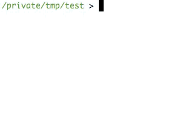

# Input fields in rake task

Rake is an awesome tool to automate workflows during development or for some other stuff.

But lets say we have a task called `customer:add` where we want to assign name
and email to the new customer. In this case we must be able to interact with
our task.

So we have this rake file as you can se below which just adds an new customer to
an YAML file but they all will have the same name and email until we manually
changes the file. Lets take a look how we could assign then while running the
taks in next section.

```
# Rakefile
require "yaml"

namespace :customer 
    
      "Example name"
    email  "Example email"

    # TODO: Here we need to customize the attributes

    storage  'customers.yml'
      load_yaml_storagestorage
    "customers"   # Make sure the key customer is defined
    "customers" <<  # Adds the new customer
       
      email email
    
    writestorage to_yaml # Saves the file with new data
  

 load_yaml_storagestorage
    load_filestorage # Loads the yaml file
    
rescue ErrnoENOENT # If the file doesn't exists we return an empty hash
```

## Add input fields to our task

The example above is an working one so you can copy it and paste it into your
favorite editor and play along. To interact with the data before it's written to
the file we can use `STDIN` from ruby.

Lets try it by starting `irb` from the terminal and test the code below

```
value  STDIN
# Ruby will now wait for you to write something and press enter, try with Hello, World!

valueinspect
# => "Hello, World!\n"
```

As you can se the value will also include an `\n` which we don't want. This can
be removed with

```
valuechomp
# => "Hello, World!"
```

So if we take our new experience from this and add it to the Rakefile it could
look something like

```
# Rakefile
require "yaml"

namespace :customer 
    
     "What's the customer name?"
      STDINchomp

     "And email?"
    email  STDINchomp

    storage  'customers.yml'
      load_yaml_storagestorage
    "customers"   # Make sure the key customer is defined
    "customers" <<  # Adds the new customer
       
      email email
    
    writestorage to_yaml # Saves the file with new data
  

 load_yaml_storagestorage
    load_filestorage # Loads the yaml file
    
rescue ErrnoENOENT # If the file doesn't exists we return an empty hash
```

It should now be working. Lets try it out by running `rake customer:add` from
your terminal.



Remember, you can add as many customers as you want. `STDIN` is pure ruby so
this example could be applied to other ruby scripts as well.
