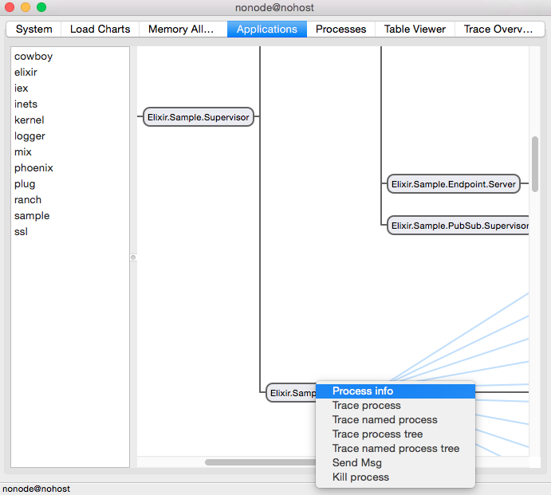
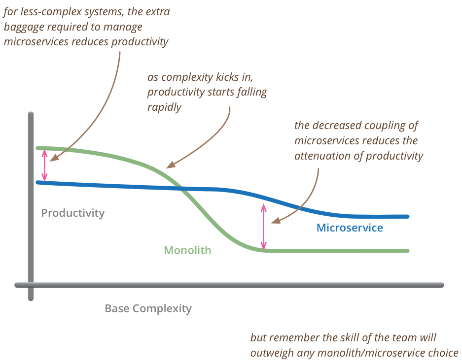

# Elixir in times of microservices

Since microservices have been a common topic lately, there are a lot of questions about how Elixir fits in microservice architectures.

On this post, I won’t focus on the merits of microservices, as many have already discussed that to exhaustion. In particular, [Martin Fowler’s entry on the topic](http://martinfowler.com/bliki/MicroservicePremium.html) aligns well with my thoughts and is definitely worth reading.

It is also worth mentioning that I have seen many companies pursuing microservices because they fail to organize large applications as their tooling (languages and frameworks) do not provide good abstractions to manage those. So microservices are often seen as a solution for structuring code by imposing the separation of concerns from top to bottom. Unfortunately, prematurely adopting microservices often negatively impacts the team’s productivity. Therefore, it is also important for languages and frameworks to provide proper abstractions for handling code complexity as the codebase grows.

## Background

[Elixir](http://elixir-lang.org/) is a concurrent and distributed programming language that runs on the Erlang Virtual Machine (Erlang VM) focusing on productivity and maintainability. Before we go into microservices, I would like first to argue why Elixir/Erlang may be the best platform out there for developing distributed systems (regardless if you have a microservices architecture or not).

The Erlang VM and its standard library were designed by Ericsson in the 80’s for building distributed telecommunication systems. The decisions they have done in the past continue to be relevant to this day and we will explore why. As far as I know, Erlang is the only runtime and Virtual Machine used widely in production designed upfront for distributed systems.

## Applications

The Elixir runtime has the notion of **applications**. In Elixir, code is packaged inside applications which:

1. are started and stopped as a unit. Any Elixir node (Virtual Machine instance) runs a series of applications, with Elixir itself being one of them and starting (and stopping) your system is a matter of starting all applications in it
2. provide a unified directory structure and configuration API. If you have worked with one application, you know the structure and how to configure any other one
3. contains your application supervision tree, with all **processes** and their state

Throughout this post, **processes** mean a lightweight thread of execution managed by the Erlang VM. They are cheap to create, isolated and exchange information via messages.

The impact of applications in a project is highly beneficial. It means that Elixir developers, when writing applications, are given a more explicit approach to:

1. how their code is started and stopped, as it is contained and isolated inside each application
2. what are the processes that make part of an application and therefore what is the application state. If you can introspect your application tree, you can introspect any process and, therefore, all the components that make up your application
3. how the application processes will react and be affected in case of crashes or when something goes wrong

Not only that, the tooling around applications is great. If you have Elixir installed, open up “iex” and type: `:observer.start()`. Besides showing information and graphs about your live node, you can kill random processes, see their memory usage, state and more. Here is an example of running this in a [Phoenix](http://phoenixframework.org/) application:



You can see all applications that are part of this node on the left side. Clicking an application shows the processes tree of that application. Double-clicking any process opens up a window with information about the process, which function it is executing, its particular state and more. Furthermore, you can kill any process and see the impact it will have on your system.

When compared to other languages, the difference here is that Applications and Processes give you an abstraction to reason about your system in production. Many languages provide packages, objects and modules mostly for code organization with no reflection on the runtime system. If you have a class attribute or a singleton object: how can you reason about the code that manipulates it? If you have a memory leak or a bottleneck, how can you find the entity responsible for it?

This visibility is one of the major benefits of building systems in Elixir. If you ask anyone running a distributed system, that’s the kind of insight they want, and with Elixir you have that as the building block.

## Communication

When building a distributed system, you need to choose a communication protocol and how the data will be serialized. Although there are many options out there, unfortunately a lot of developers choose HTTP and JSON, which is a very verbose and expensive combination for performing what ends up becoming RPC calls.

With Elixir, you already have a communication protocol and a serialization mechanism out of the box via Distributed Erlang. If you want to have two nodes communicating with each other, you only need to give them names, ensure they share the same secret cookie, and you are done.

Not only that, because all Elixir processes communicate with each other via message passing, the runtime provides a feature called **location transparency**. This means it doesn’t really matter if two processes are in the same node or in different ones, they are still able to exchange messages.

I wrote a quick introduction to Elixir that covers how to get started with Elixir from creating a brand new project up to node communication on [How I Start](http://howistart.org/posts/elixir/1). Check it out for more information.

The Distributed Erlang protocol and serialization mechanism are also documented and therefore it can be used to communicate with other languages. The Erlang VM ships with a binding for Java and others can be found for Python, Go and more.

## Breaking monolithic applications

Earlier I mentioned I have seen many companies pursuing microservices because they fail to organize code at the project level. So often they prematurely split their architecture in microservices which affects productivity in the short and long run. From Martin Fowler’s article:



In Elixir, breaking a large application into smaller ones is simpler than anywhere else, as the process tree already outlines dependencies and the communication between those dependencies always happen explicitly via message passing. For example, imagine you have an application called `abc` that has grown larger with time, you can break it apart into applications `a`, `b` and `c` by extracting its supervision tree to different applications.

This is such a common aspect of working with Elixir projects that its build tool, called Mix, provides a feature called **umbrella projects** where you have a project composed of many applications that may depend on each other on any fashion.

Umbrella projects allows you to compile, test and run each application as a unit but also perform all the tasks at once if required. Here is quick example:

```
mix new abc --umbrella
cd abc/apps
mix new a
mix new b --sup
mix new c --sup
```

The snippet above creates a new umbrella project, enters its `apps` directory and create three applications: `a`, `b` and `c`, where the last two contain a supervision tree. If you run `mix test` at the `abc` project root, it will compile and test all projects, but you can still go inside each application and work with it in isolation.

Once the main application `abc` is broken apart, you may also move each part to a separate repository if desired, or you may not. The benefit is that developers are able to handle growing code complexity in small, granular steps, without making large decisions upfront. We cover this with more details in [our Mix and OTP guide](http://elixir-lang.org/getting-started/mix-otp/introduction-to-mix.html).

## Microservices

So far I haven’t talked about microservices. That’s because, up to this point, they don’t really matter. You are already designing your system around tiny processes that are isolated and distributed. Call them nanoservices if you’d like to!

Not only that, those processes are packaged into applications, which group them as entities that can be started and stopped as unit. Combined with Distributed Erlang, if you want to deploy your `a`, `b` and `c` applications as `[a, b]` + `[c]` or `[a]` + `[b]` + `[c]`, you will have very little trouble in doing so due to their inherent design and built-in communication.

In other words, you can focus on how to deploy your applications based on what is driving you to break them apart. Is it code complexity? You can work on them separately but still deploy them as a unit. Is it for scability or multi-tenancy reasons? If `c` requires more instances or the application with user specific concern, then it is reasonable to isolate it and deploy multiple instances of `c`.

## Is Elixir good only for building distributed systems?

If you are not familiar with Elixir, after reading this far, you may be wondering: is Elixir good only for building distributed systems?

Elixir is excellent for building any kind of long running system exactly because of all the insights you have on your application, even if it is deployed to a single node. The language is also expressive and pleasant to learn and work with (I am certainly biased though), with a [getting started guide](http://elixir-lang.org/getting-started/introduction.html) and [many learning resources](http://elixir-lang.org/learning.html) already available.

While there is a learning curve, the abstractions outlined here are elegant and simple, and the tooling does an excellent job on guiding you to build your first application. The command `mix new my_app --sup` we have executed above will generate an application, with its own process tree, which you can directly use and explore to learn more.

## Wrapping up

I hope I have illustrated how the design decisions done by Elixir and the Erlang VM provide a great foundation for building distributed systems.

It is also very exciting to see companies starting to enjoy and explore those characteristics through the Elixir programming language. In particular, it is worth watching [Jamie Windsor talk at Erlang Factory 2015 and how they were able to leverage this to build a game platform](https://www.youtube.com/watch?v=_i6n-eWiVn4).

Finally, a lot of this post focuses on building systems through Distributed Erlang. Although Distributed Erlang will definitely be the most productive approach, there is no reason why you can’t leverage the benefits outlined here by using Elixir with another protocol like Apache Thrift.

And, if at the end of the day, all you want is to use HTTP and JSON, that is fine too and libraries like [Plug](https://github.com/elixir-lang/plug) and frameworks like [Phoenix](http://phoenixframework.org/) will guarantee you are as productive as anywhere else while enjoying the performance characteristics and robustness of the abstractions outlined here.

Happy coding!

*Note I have not covered techniques like blue/green and canary deployments because they depend on the system and communication protocol you are running. Elixir provides conveniences for process grouping and global processes (shared between nodes) but you can still use external libraries like Consul or Zookeeper for service discovery or rely on HAProxy for load balancing for the HTTP based frontends.*

[](http://plataformatec.com.br/elixir-radar)
