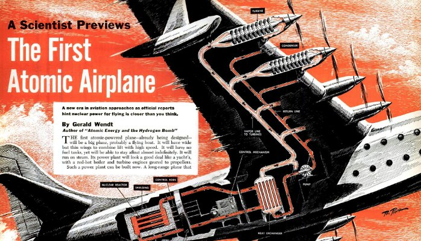

# Work In Progress (Por que eu ainda tento escrever códigos incríveis?!)

Olá pessoal. Tudo certo?!

Essa publicação é uma releitura de um [post](http://elemarjr.net/2012/06/17/work-in-progress-por-que-eu-ainda-tento-escrever-cdigos-incrveis/) que escrevi, em 2012, no [meu blog](http://elemarjr.net/). Aqui, gostaria de falar um pouco sobre os “trabalhos nossos de cada dia”.

Essa publicação reflete a forma como eu percebo meu trabalho. Por isso, não estou (nem desejo estar) condenando ninguém que veja as coisas de uma forma diferente.

Se tiver vontade, leia! Se puder, comente!

### Um motivo …

Você gosta de Pink Floyd? Eu adoro! Tempos atrás, escrevi um [relato pessoal – um tanto emocionado –  sobre o show do Roger Waters em POA](http://elemarjr.net/2012/04/04/reconstruindo-e-derrubando-o-muro-meu-resumo-para-o-show-do-roger-waters/).

Outro dia, em um desses “acessos de fã”, comprei uma [“Deluxe Experience Edition” do álbum The Wall](http://itunes.apple.com/br/album/wall-deluxe-experience-edition/id465654743). Para meu deleite, encontrei ali:

1. o álbum na íntegra (óbvio);
2. algumas execuções live (da turnê Is There Anybody out There?);
3. Documentário, fotos e vídeos;
4. ***quase todas as músicas do álbum com status “Work in progress”.***

Esse último item, em especial, me emocionou e me fez pensar um bocado na vida. São versões prévias, ainda sendo trabalhadas (dahn!) das músicas que iriam formar um dos maiores clássicos da história do rock.

### O que há no caminho …

O que era diferente nas versões ***work in progress***?! Bem, quase tudo. Arranjos, letras e intenções. Eu, pessoalmente, arrisco dizer que algumas versões “work in progress” ([como esta](https://www.youtube.com/watch?v=27zIyOnFRsw)) funcionam melhor, para mim, que as versões finais. Embora aceite que as versões finais funcionam melhor no álbum quando analisado como um todo.

O que eu aprendi?! Mesmo obras de arte não “nascem prontas”. Você tem uma ideia e a coloca em prática. Então, sente o resultado. Revisa! Ajusta! De certa forma, você passa a “conversar” com sua obra. Incrível que esse é, exatamente, o relato chave do excelente "Criatividade S/A" que narra a história da Pixar sob a perspectiva de um dos seus fundadores.

Criação, para mim, é um processo iterativo. Criação verdadeira, para mim, é buscar melhorar o que já está bom (já disse que odeio a expressão “[O ótimo é inimigo do bom](http://elemarjr.net/2012/02/26/e-o-bom-inimigo-do-timo/)”).

### Nosso trabalho, nossa expressão, nossa identidade

Temos a necessidade de expressar nossas aspirações e nossos sentimentos. De certa forma, nosso trabalho é a nosso canal de comunicação. É por ele que nos expressamos.

Meu código é minha forma de expressão! Meus posts e publicações são minha expressão. Minhas palestras são minha expressão. Meus diagramas são minha expressão. Óbvio que quero aprovação dos outros. Mas, acima de tudo, persigo, insistentemente, a minha aprovação.

Tempos atrás, estive na Europa. Lá tive a honra e oportunidade de conhecer algumas das mais belas obras da humanidade. Vi edificações que demoraram séculos para ficarem prontas. Você consegue conceber alguém trabalhar a vida inteira em algo sabendo que não verá a conclusão?! Pois bem, eu não conseguia. O que eu conclui?! Percebi que quando as pessoas não conseguem concluir o todo, realmente cuidam dos detalhes. Aliás, vi que obras gigantescas e incríveis são formadas de partes minúsculas ainda mais incríveis.

Entendo que o meu trabalho é o meu legado. Eu persigo o grandioso. Acredito que fazer algo grande me faz maior. Entendo que o grande incrível é uma composição de pequenas partes ainda mais incríveis.

### Paradoxos aparentes – quando toda escolha é uma renúncia

Outro dia, um amigo me disse:

> Elemar, ninguém escreve no ritmo que você escreve. Aliás, ninguém lê no ritmo que você escreve.

Em outras palavras, a mensagem era: “Para ser mais lido, você precisa escrever menos.”. Entendi, mas, por agora, não estou pronto para mudar. Há muito para dizer e não vou deixar de fazer isso. Mesmo que, em última instância, o que eu diga faça eco apenas em mim mesmo.

*(NOTA: Estou escrevendo muito menos do que no período em que o texto original foi escrito.)*

Posso dizer o mesmo com relação a minhas reflexões. Não quero e nem aceito limitantes. Odeio e repudio o imposto. Não quero e não vou aceitar ser/viver nada menos do que posso.

Sou obstinado em pensar que minha maior obra será sempre a próxima. Meu melhor código será aquele que ainda não escrevi. Busco sempre ser melhor amanhã do que sou hoje.

Se toda escolha é uma renúncia, então, renuncio tudo aquilo que me limita. Renuncio a acomodação. Renuncio a busca da aprovação dos outros.

### Sometimes it’s better let it go

Outro grande amigo disse, outro dia:

> Nossos projetos devem ser nossos impulsionadores. Eles nos puxam/empurram e isso é muito bom! Entretanto, as vezes, ultrapassamos nossos projetos. Passamos literalmente a ser maiores que eles. No lugar de nos impulsionarem, eles nos prendem. Nesses momentos, o melhor a fazer é “let it go”.

Em algum momento, temos que aceitar a conclusão de um projeto/fase em nossas vidas para abraçar novos desafios. Penso que foi exatamente isso que aconteceu com o Pink Floyd e o The Wall. Acredito que, em dado momento, alguém disse “Enough! It's good and we have to move on".

Acho que isso ocorre com qualquer projeto/obra. É preciso saber quando parar. Se não achar esse momento, talvez seja o caso de se impor uma parada. Para mim, o momento para parar é quando aquilo que outrora nos impulsionava, nos limita. Nem um pouco antes.

Temos que celebrar nossas vitórias. Comemorar nossas conquistas. Mas, no fim de tudo, levar memórias, aprendizados e cicatrizes.

### Por que tento escrever códigos incríveis

Como disse Einstein:

> A mente que se abre a uma nova idéia jamais voltará ao seu tamanho original.

Não sei, nem tenho a pretensão de afirmar, se o código que escrevo hoje é bom. Também não sei afirmar isso com relação a meus posts, publicações ou palestras. Não sei se sou um bom amigo. Nem mesmo, sei dizer se sou uma boa pessoa. Mas, posso dizer com total certeza de que me empenho muito para tudo.

Posso dizer – afirmar até – que estou em “Work In Progress”. Estou tentando fazer melhor hoje o que fiz ontem.

Não sei se há vida após a morte. Então, não quero renunciar muitas vezes a escolha de fazer o melhor que posso hoje.

Tento escrever códigos incríveis porque, de muitas maneiras, isso me leva a ser uma pessoa melhor. Talvez nunca consiga algo "incrível", mas, ...

### Concluindo

Li e reli esse texto. Sei que talvez ele pareça um pouco sem nexo. Entretanto, ele é expressão de como percebo as coisas hoje (e como percebia em 2012).

Por que eu tento escrever códigos incríveis?! Porque, para mim, não há outro espírito de escrita de código que compense. Simples assim!

Não terceirizo a gestão de minha carreira. Não terceirizo a gestão de minha vida. Afinal, ainda não sou versão final. Sou “work in progress”.

Era isso. E você?

James Vaughan/Flickr

# Why 40-Year-Old Technology Can Sometimes Beat the Cutting Edge

Technology changes far slower than we usually think it does.

In fact, a pretty-good technology that achieves widespread acceptance has a way of sticking around for years, even decades. Just look at how many people still listen to AM radio, buy CDs at concerts, or drive cars with internal combustion engines and four wheels.

Or, as Twilio co-founder and CEO [Jeff Lawson told me in last week’s “What to Think” podcast](http://venturebeat.com/2015/07/22/how-twilio-is-building-a-software-platform-to-refresh-a-150-year-technology-podcast/), look at the way telephone technology has evolved over the past century and a half. Yes, we’ve added some pretty snazzy new features, like cellular data and VoIP calling. But the underlying infrastructure is, in some ways, much the same. Your fancy iPhone still has a touch-pad dialer for connecting you to the telephone network, and that dialer is basically a digital representation of something that has existed since the 1960s.

The persistence of old-but-acceptable technology has some big implications for the future of the Web. After all, the Web is hardly cutting-edge tech. The basic protocol on which the Internet is based, TCP/IP, is over 40 years old. HTTP, the hypertext transfer protocol used to move Web data from server to browser, is about 25 years old. (Yes, both of these protocols have been revised since their early days, but their basic principles are intact.) JavaScript and Adobe Flash, God help us, are both about 20 years old.

So if you’re waiting for a transformative change in how we consume information online, you could be waiting a long time. The Web may be a rickety stack of outdated protocols and standards, but it works, mostly, and it’s free and open to all comers. That, for the past few decades, has proven to be a pretty winning combination.

But will it change as we shift to a mobile-centric era? There are a lot of observers who say that apps are winning out over the mobile Web, and that Web-based standards like HTML5 will become less relevant as we move to proprietary systems for delivering information and communication: Facebook, WhatsApp, Snapchat, WeChat, Vine.

I’m not so sure. I think there are signs that people are becoming frustrated with the limits imposed by these “walled garden” apps. Yes, [Facebook’s Instant Articles might be much faster](http://venturebeat.com/2015/05/12/facebook-introduces-instant-articles-bringing-content-from-select-publishers-directly-into-the-news-feed/) and allow more elegant presentations than a Web page. But how many publishers have actually published on the Facebook platform since its ballyhooed debut two months ago?

I was thinking about this while reading a post by [Maciej Cegłowski](http://idlewords.com/about.htm) called [Web Design: The First 100 Years](http://idlewords.com/talks/web_design_first_100_years.htm), in which he talks about how air travel looked in 1965. That decade was an era of exponential growth in air travel: Humans had only been flying airplanes for about sixty years, and the U.S. and Soviet Union were rapidly expanding their space travel capabilities. If you plotted a line of human transportation speed from 1750 to 1950, it would form an exponential curve. In the near future — a 1960s futurist might think — we would soon be flying on huge, comfortable supersonic jets. And shortly after that, we’d be riding on incredibly fast rockets, then nuclear rockets, and perhaps enjoying near-light speed interstellar travel by the early 2000s.

But it didn’t turn out that way. Supersonic jets turned out to be way too expensive and way too damaging to the ozone layer. Ordinary, high-capacity jets like the Boeing 747 turned out to be good enough, and economical enough, that they became the de facto standard. The models Boeing created in the 1970s form the backbone of the company’s lines today, with very slight differences and enhancements that are mostly invisible to non-experts. In fact, Cegłowski writes, some of today’s planes are actually slower than their 1970s predecessors: The Boeing 787 is slower than the 707.

We might be at a similar inflection point with Internet technologies today. In the past twenty years, we’ve seen enormous changes in the way people access and create information. The wide dispersion of Internet access has brought the world’s knowledge to every corner of the Earth; the shift to mobile devices has put that knowledge literally into the hands of everyone who can afford a cellphone and a monthly contract. Social networks make it easier than ever to connect with like-minded people around the world, and digital maps are shining a clear light into every corner of the Earth, simplifying navigation and enabling armchair travel to [the most interesting, remote locations](http://thenextweb.com/insider/2015/07/23/how-do-i-get-this-job/).

So you might think that the Web is advancing at the same, exponential rate that it has for the past 20 years. You’d be wrong: The Web is advancing only slowly, and in some ways, it’s getting worse.

Nilay Patel, writing this week in The Verge, pointed this out: [The mobile Web sucks](http://www.theverge.com/2015/7/20/9002721/the-mobile-web-sucks), the mobile browsers we use today are, in fact, slower and less capable than desktop browsers of five years ago. Our mobile browsers are more like 787s than Concordes.

Is the answer to app-ify everything, throw out the 20-to-40-year-old technology stack powering the mobile Web, and start over with something much faster, whizzier, and more modern?

I think not, for the simple reason that the mobile stack, flawed as it is, is the best platform we’ve got that isn’t [totally controlled by Facebook, Google, or Apple](http://dylan.tweney.com/2015/05/15/welcome-to-our-beautifully-designed-corporate-controlled-future-internet/). What we need, as Patel argues, are better browsers for our smartphones. We need, as Cegłowski argues, more widespread access and some decent fonts.

What we need is to stop thinking of the Web as a platform for transformative, exponential innovation. That kind of innovation is still happening in other spheres — like transportation and health care — but not in the Web. Stop expecting media companies, or encyclopedias, to behave like startups. Keep the open standards open, get a few billion more people onto the Web, and see what they come up with.

I bet that will lead to far more profound transformations than any new chat app or publishing platform could.

---

*This story [originally appeared on VentureBeat.](http://venturebeat.com/2015/07/24/sometimes-40-year-old-technology-actually-is-the-best-tool-for-the-job/)*

*If you liked this post, please consider [subscribing to my weekly newsletter](http://tinyletter.com/dylan20). It's useful, free, and 100% spam-free.*
