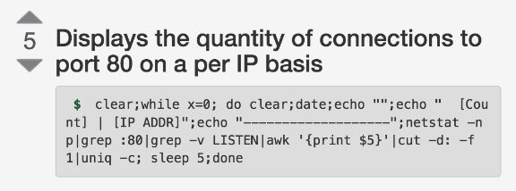
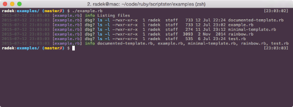

# Bringing the best of Bash scripting to Ruby

Bash scripts are efficient and incredibly powerful, until things get out
of hand. Then, you may find yourself piping the output of `ifconfig` though
grep, two seds and awk while pulling your hair out in clumps. It’s often hard
to justify using a more advanced scripting language for what seems like a small
task when they’re nowhere near as efficient as bash in the beginning.

Small tasks, as they do, grow bigger and at some point a major rewrite of your
original bash script will be in order. But could it be avoided? This post
explores bringing the initial simplicity of bash into Ruby scripts while
keeping them flexible enough that you won’t go mad when things get more
complicated.

[](http://radek.io/assets/images/posts/ruby-scripting/bashoneliners.png)

The most popular one from [bashoneliners.com](http://www.bashoneliners.com/oneliners/oneliner/192/).

Speed is absolutely crucial when it comes to scripting. Writing a script
shouldn’t feel like it’s taking longer than it would if you’d just kept
clicking for a few hours and done it manually. Bash is excellent at that for
small tasks.

Unfortunately, speed goes against the other desirable qualities, which are
reusability and extensibility. The more carefully you make the script from the
start, the more time you might save, reusing it on a similar problem in the
future. That, of course, takes time and using Ruby can help you save a great
deal of it.

Below are the two gems that I use to make my Ruby scripts as simple as bash.
And much easier to read and extend.

## Docopt for CLI arguments

Being able to quickly modify the interface of the script without having to jump
through the hoops of
[OptionParser](http://ruby-doc.org/stdlib-2.2.2/libdoc/optparse/rdoc/OptionParser.html)
is really useful. Options, arguments, subcommands, both mandatory and optional
are incredibly easy to add using docopt. You’ll know how to use docopt right
when you first try it. Here’s an example:

```
  <<DOCOPT
Print images in the terminal.

Usage:
  catpix --help | --version
  catpix [options] <path>
Options:
  -w=<width>, --limit-width     Limit width of the image (factor of the size
                                of the terminal window) [default: 1].
  -h=<height>, --limit-height   Limit height of the image (factor of the size
                                of the terminal window) [default: 0],
  -c=<pos>, --center            Set x, y or xy centering in the window.
  -b=<colour>, --bg             Set background colour.
  -f, --bg-fill                 Draw background around the image as well.
  -r=<res>, --resolution        Either 'high' or 'low' [default: auto].
  --help                        Show this message.
  --version                     Print the version.
DOCOPT

begin
    Docoptdocopt 
   
rescue Docopt => 
  $stderr message
```

It’s a simple domain-specific language which mimics the typical usage strings
of applications. You write the help message and the library will take care of
the rest. It really is that simple: find out more about it in one of my
[previous posts](http://radek.io/2015/01/19/docopt/).

## scriptster

The other part of my setup is
[Scriptster](https://github.com/pazdera/scriptster), a small gem that only has
two functions:

1. Launch shell commands.
2. Log what happened.

It’s based on the lazy assumption that for scripting purposes, it’s worth
sacrificing some performance for convenience. Scripter’s `cmd` method lets you
interface with shell commands easily and in controlled manner. The `log` method
gives you a basic logger to record the progress of your script with timestamps
and also colours.

The idea is to hide as much boilerplate as possible behind a minimalistic
interface that is focused what you need for scripting: run a command, see how
it went and maybe process the output. Check out this simple example:

```
 :info "Listing files"
   "ls -l | grep -v '^total'"
  show_out 
  out_level :info
   'ls -l'

files  
lines  
  files split

 :info files
```

[](http://radek.io/assets/images/posts/ruby-scripting/scriptster-example.png)

**scriptster**: The output of the example above.

To learn more about [scriptster](https://github.com/pazdera/scriptster), see
one of my [previous posts](http://radek.io/2014/11/01/scriptster/).

## Putting them together

Combining these two gems together gives you a good basic setup. Scripter
conveniently provides a wrapper for docopt, so using them both will amount to
the following boilerplate:

```
#!/usr/bin/env ruby

require 'scriptster'
include Scriptster

  parse_args <<DOCOPT
Usage:
  #{File.basename __FILE__} [-h]

Options:
  -h, --help          Show this message.
DOCOPT

 :info "Args received: 
    show_out  out_level :info
```

While 10 lines of code aren’t many, it’s still annoying having to remember even
that. To save some of your memory, try using a function similar to this:

```
new-ruby-script

    local "https://raw.githubusercontent.com/pazdera/scriptster/master"
    curl "$url/examples/minimal-template.rb" >
    #curl "$url/examples/documented-template.rb" >"$1"

    chmod +x 
    $EDITOR
```

This will download the [minimal
template](https://github.com/pazdera/scriptster/blob/master/examples/minimal-template.rb)
from scripster’s git repo and start editing it (also check out the [documented
version](https://github.com/pazdera/scriptster/blob/master/examples/documented-template.rb)
which includes an overview of the functionality, in case you’re as forgetful as
I am). Just drop it at the end of your `~/.bashrc` or `~/.zshrc` file and
you’ll be able to start a script in a matter of seconds with the following
command:

```
new-ruby-script <file-path>
```

## Summary

Using the setup above, you’ll be able to get things done with roughly the same
speed you’d do when using just shell. But in case your program exceeds the
initial expectations, you’ll have all the power of Ruby at your disposal.

Can the template be improved or made even simpler? Leave a comment below or
submit a pull request
[here](https://github.com/pazdera/scriptster/blob/master/examples/documented-template.rb).
