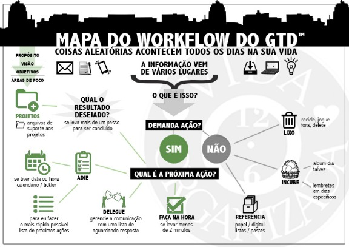

# Aprenda GTD – Parte 7: Como fazer o processamento

Nós estamos aprendendo a implementar o GTD passo a passo. Atualmente, nossa série está abordando os 5 passos do GTD com detalhes. No [último post](http://vidaorganizada.com/gtd/aprenda-gtd/aprenda-gtd-como-fazer-a-coleta/), falamos sobre a captura e sobre como coletar. Hoje, vamos ao passo 2: esclarecer, que é quando processamos nossas caixas de entrada (física, e-mails e outras).

### O que é e para que serve o processamento?

Processar é pegar o primeiro item da sua caixa de entrada e tomar uma decisão com relação a ele. Você vai se perguntar: O que é isto? Demanda algum tipo de ação? E, a partir daí, encaminhar a informação para o lugar certo.

Este passo é muito importante porque, se ele for feito com pressa ou sem foco, isso certamente vai te prejudicar na execução. Não deixe que suas listas de próximas ações seja uma lista de coisas incompletas, que ainda não foram pensadas. Elas têm que ser pensadas no processamento.

### Por que o David mudou o nome do passo de “processar” para “esclarecer”?

O David mudou o nome dos cinco passos porque achou que todos estavam muito mecânicos e menos relacionados aos processos da mente. Agora eles estão mais ligados ao intelectual. No caso específico do processar, acredito que a mudança seja importante porque “processar” parece algo mecânico mesmo. Quando falamos em “esclarecer”, fica mais claro mesmo do que se trata esse processo. Nós analisamos item a item para esclarecer o que é cada um deles.

### Como processar?

O David oferece um fluxograma para facilitar a nossa vida ao processar.

Basicamente, ao pegar um item da sua caixa de entrada, você tem SEIS, e apenas seis, opções sobre o que fazer com ele.

Você vai perguntar:

> **O que é isto?**
>
> **Demanda algum tipo de ação?**
>
> **Se NÃO**
>
> **Lixo –** Delete, recicle, jogue fora  
> **Incube –** Não demanda ação agora, mas você gostaria de rever isso em outra ocasião, pois pode demandar futuramente  
> **Arquive –** Guarde em seu arquivo de referência
>
> **Se SIM**
>
> **Faça na hora –** Se levar menos de 2 minutos  
> **Delegue –** Se você não for a melhor pessoa para fazer isso (e tiver para quem delegar)  
> **Adie –** Para fazer o mais breve possível

Confira o mapa do fluxograma abaixo:

O mapa acima mostra todo o fluxo do processamento e para que lugar deve ir cada informação.

Perceba que qualquer item do fluxo pode desencadear um projeto. Você pode descobrir, ao pensar sobre a próxima ação, que a ação faz parte de algo maior ou leva mais de um passo para ser concluída. Logo, para o GTD, isso é um projeto. Nós vamos usar muito o fluxograma acima durante toda a nossa série. Eu inclusive recomendo que você imprima para consultar sempre que quiser.

### Vamos examinar os itens que NÃO demandam ação

### O que vai para o lixo?

David é bem catedrático nesta questão: na dúvida, guarde; na dúvida, jogue fora. Nao existem regras ou padrões e o que você descarta é muito pessoal. Para ajudar, faça a si mesmo(a) a seguinte pergunta: “Isto aqui é realmente necessário ou útil para que eu mantenha, ou eu posso confiar que essa informação pode ser encontrada facilmente na Internet ou em outra fonte depois, caso eu precise?”. Muitas coisas vão para o lixo, se você pensar dessa forma.

### O que será incubado?

Provavelmente você encontrará alguns itens na sua caixa de entrada que te levarão a pensar: “Puxa, isto não demanda ação agora, mas eu gostaria de voltar nisto futuramente, só não quero perder a ideia!”. Alguns exemplos:

- Acontecerá um café-da-manhã em um cliente, mas será apenas daqui a três semanas, e você não tem certeza se poderá confirmar até uma semana antes, pois terá mais noção das suas prioridades a seguir.
- Você recebeu um material para ser usado em um treinamento que acontecerá apenas daqui a um mês e precisa guardá-lo em algum lugar.
- Você comprou ingressos para um show que acontecerá apenas daqui a seis meses e precisa guardá-lo em algum lugar.
- Na próxima semana acontecerá uma reunião importante e você recebeu a pauta.
- Enquanto você assistia a um filme no cinema, teve a ideia de viajar para um lugar. Você não tem como viajar agora, mas não gostaria de esquecer dessa vontade para planejar futuramente.

O que você faz com esse tipo de informações? Existem duas alternativas:

1. Inserir em uma lista chamada “Algum dia / Talvez”, que você revisará semanalmente
2. Colocar um lembrete em seu calendário em datas específicas ou em um tickler

É ok você não decidir sobre algo neste momento, contanto que você esteja tranquilo(a) sobre isso.

### O que vira referência?

Existem informações que não demandam qualquer tipo de ação, mas você acha importante guardar pois podem servir como referência futura para seus projetos, atividades ou mesmo lembrança pessoal. Documentos, referências bibliográficas de trabalhos, contas pagas e uma sorte de outras informações. Criar um arquivo de referência que seja fácil de arquivar e acessar é passo fundamental no GTD.

### E agora vamos conhecer os itens que SIM, demandam ação

### Faça na hora… se levar menos de 2 minutos

A regra de ouro do GTD é fazer na hora tudo o que leva menos de 2 minutos, para que nada vire um gargalo em você. Essa regra é mágica e muda a vida de muitas pessoas. Fazer em menos de 2 minutos significa desde responder um e-mail a lavar o copo que você deixaria na pia. Você ficará surpreso(a) com a quantidade de coisas que você pode fazer em menos de 2 minutos.

### Delegue

Se você não for a pessoa mais adequada para fazer, delegue a ação. Você pode acompanhar o que está aguardando resposta de outras pessoas através de uma lista com todas essas ações que foram delegadas. Uma boa prática é inserir a data desde quando você delegou, para ter controle do tempo. Por exemplo, na sua lista de “Aguardando resposta”, pode ter um item assim:

“Nome da pessoa – Fazer tal ação – desde 12/04/15″

Se uma ação não pode ser feita em menos de dois minutos nem pode ser delegada, ela fica para depois, mas é importante frisar que é para ser feita assim que puder, o mais rápido possível, para não parecer que se trata de procrastinação. E aqui nós temos duas opções, que dizem respeito às ações que têm prazo e às ações que não têm prazo. Fica assim:

1. Se tiverem prazo, você insere a data na ação. Todos os programas de tarefas têm a possibilidade de atrelar uma data à ação. Algumas pessoas gostam de colocar a ação com prazo na agenda. Fica a seu critério. O que facilita mais para você?
2. Se não tiverem prazo, você organiza sua lista de próximas ações como achar conveniente. O David Allen recomenda organizar por contexto.

### E projetos?

Qualquer item do seu fluxograma pode servir como um gatilho para desencadear projetos.

Projeto no GTD é tudo aquilo que leva mais de um passo para ser concluído e pode ser feito no período de até um ano.

Se você identificar um projeto, insira-o em sua lista de projetos. Veremos mais no próximo post, sobre organização do sistema.

### Existe uma hora específica do dia em que devemos processar?

Não existem regras. Você pode querer dedicar um tempo exclusivo e com foco para essa atividade. Algumas pessoas gostam de processar aos poucos ao longo do dia, enquanto outras gostam de reservar um tempo uma vez por dia para o processamento. Eu já fiz das duas formas e, atualmente, eu gosto de reservar um tempo, no começo ou no final de cada dia, para esclarecer essas informações.

### Boas práticas do processamento

- Não pode devolver nenhum item para a caixa de entrada.
- Não fique escolhendo o que vai processar. Pegue o primeiro e mande ver.
- Dedique energia e concentração a esse processo.
- Não “processe direto” em seu sistema. As informações precisam desse tempo de maturação na caixa de entrada para que você possa tomar as decisões corretas ao processar.

### A relação entre o processar e o organizar

Muitos usuários iniciantes têm dúvidas sobre o processar e o organizar, pois eles parecem ser muito parecidos. Processar é esse processo de pensar e tomar decisões. Organizar é quando você coloca as informações nos lugares certos, configura o seu sistema etc. Essa é a diferença.

Dúvidas? Poste nos comentários.
