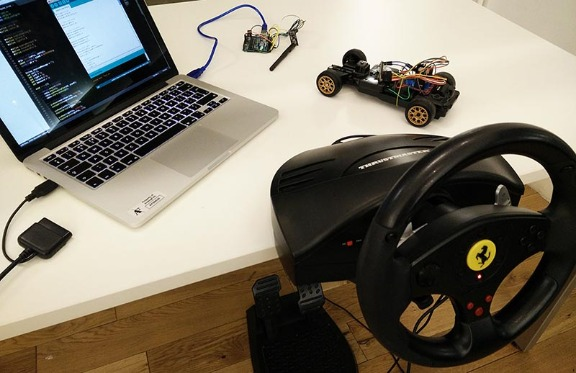
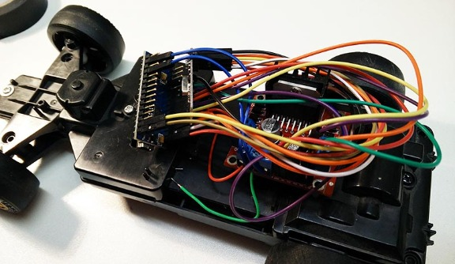
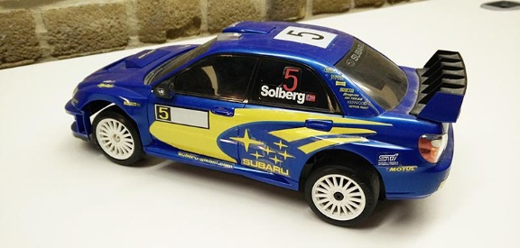

# Arduino Node.js RC Car Driven with the HTML5 Gamepad API

Published last month by [Mate Marschalko](http://www.webondevices.com/about)

We constantly see developers pushing the limits of JavaScript; mobile and desktop applications, 3D games and so much more … but it’s a different story to connect a USB racing wheel to the browser and read it with the HTML5 Gamepad API and drive a Radio Controlled toy car through WebSockets and a Node.js server.

### The JavaScript code

I started the project off by experimenting with reading raw data from USB joysticks, gamepads and racing wheels from the browser. This is a relatively easy task in browsers supporting the **HTML5 Gamepad API**:

```
 rawGamepads =
    (navigator.getGamepads && navigator.getGamepads()) ||
    (navigator.webkitGetGamepads && navigator.webkitGetGamepads());
```

USB gamepad data retrieved from the navigator object

I got the [original code](https://github.com/html5rocks/www.html5rocks.com/blob/master/content/tutorials/doodles/gamepad/static/gamepad-tester/gamepad.js#L187) from Marcin Wichary who built it for the [London Olympics Google doodle hurdles game](https://www.google.com/doodles/hurdles-2012). Yes, this doodle game supports any USB gamepad.

You might wonder why we need so much code in that gamepad.js file if all the joystick raw sensor data is available in `navigator.getGamepads`. Well, it handles feature detection, event listening for connection/disconnection and a fix for Chrome which doesn’t fire gamepad events.



Steering wheel and pedals connected to Chrome

After gamepad.js is loaded and initialised the gamepad object is filled with the sensor data:

```
myGamepad = gamepadSupport.gamepads[];
// Steering:
myGamepad.axes[];
// Acceleration:
myGamepad.axes[];
// Breaking:
myGamepad.axes[];
// Buttons from 0 - 12:
myGamepad.buttons[]
```

USB gamepad data retrieved from the navigator object

Once the steering wheel and pedal control data is filtered and compiled into a JSON object it’s ready to be sent to the car. In the background we are running a Node.js server which connects everything together.

```
 app = require('express')(),           
    server = require('http').createServer(app).listen();

// respond to web GET requests with the index.html page:
app.get(, function (request, response) {
    response.sendfile(__dirname + '/index.html');
});
```

USB gamepad data retrieved from the navigator object

Running this javascript file from the terminal with `node index.js` will start the server up and serve index.html at the localhost:8080 url. After that we initialise the **Web Socket which creates a real-time connection** between the browser and the server. With web sockets you could actually connect multiple users and browsers together to create multiplayer games for example.

Setting up the web socket and sending a message from the browser and receiving it from the server is really easy:

```
 io = require('socket.io').listen(server);

// listen for new socket.io connections
// we don't start reading anyting until the browser has connected
io.sockets.on('connection', function (socket) {
    socket.on('message', function (data) {
        // data sent from the browser
        console.log(data);
    });
});
```

Node.js server code to start the web socket

```
// dataString  the JSON  the wheel  pedal control data
socket.emit('message', dataString);
```

Front-end code to send web socket message

After this magic happens in Node.js. We establish connection with the Arduino microcontroller board that is connected to the USB port. This is something you would never be able to do from the browser without a third-party plugin due to security reasons.

```
//  the USB serial port
var myPort = new SerialPort("/dev/tty.usbmodem1421", { 
     look  return  newline at the end of  data packet
    parser: serialport.parsers.readline("\r\n")
});

myPort.write(messageReceivedFromTheBrowser);
```

Node.js code to send serial message to the USB port

The write function needs to go inside the socket on connect and socket on message functions so our message to the Arduino is the JSON object we received from the browser through the web socket.

### The RC car

The work has started off by taking out the original radio and motor drive modules and the antenna from the car. I was left with two motors, one for steering and one for acceleration, and the plan was to rebuild the whole architecture using Arduinos. I succeeded and the motors are now driven with a powerful H-bridge module (L298n) and the wireless connection is handled by two nRF24l01 antennas. The Arduino and the motors are both powered from the original 6V battery pack (4xAA).



The guts of the car: Arduino Nano, antenna, motor control unit

The onboard Arduino Nano receives wireless messages from the Arduino UNO connected to the my Macbook Pro which is the one communicating with the Node.js server and the browser.

### Future plans

There are so many parts of this projects that are really exciting and interesting and parts that are a little bit more difficult to fully implement. **So please let me know and leave a comment if you want me to create and extended tutorial on this project!**



The radio controlled car

I’m also planning to improve the car by installing an onboard wireless camera, a more powerful RC battery pack and maybe a few more sensors or lights.

## 8 thoughts on “Arduino Node.js RC Car Driven with the HTML5 Gamepad API”

1. Pingback: [Node.js: The New Swiss Army Chainsaw | Unknotted](https://unknotted.ucsd.edu/?p=207)
2. Pingback: [Arduino Node.js RC Car Driven with HTML5 Gamepa...](http://www.scoop.it/t/raspberry-pi/p/4047115067/2015/07/07/arduino-node-js-rc-car-driven-with-html5-gamepad-api-web-on-devices)
3. Pingback: [Arduino NodeJS RC Car Driven with the HTML5 Gamepad API | Dinesh Ram Kali.](https://dineshramitc.wordpress.com/2015/07/09/arduino-nodejs-rc-car-driven-with-the-html5-gamepad-api/)
4. Pingback: [Arduino Node.js RC Car Driven with the HTML5 Ga...](http://www.scoop.it/t/open-hardware-news/p/4048137876/2015/07/23/arduino-node-js-rc-car-driven-with-the-html5-gamepad-api-web-on-devices)
5. [anexo ausente] Martin says:

   [July 23, 2015 at 6:00 pm](http://www.webondevices.com/arduino-nodejs-rc-car-driven-with-html5-gamepad-api/#comment-27)

   I’d love to see a complete tutorial of how to make that work. I am an absolute beginner and to be honest I have no idea which components are really needed to achive this amazing result.
6. [anexo ausente] Steve says:

   [July 23, 2015 at 9:13 pm](http://www.webondevices.com/arduino-nodejs-rc-car-driven-with-html5-gamepad-api/#comment-28)

   Please give us more information on how you did this project. For instance, how was the controller card determined? It looks extremely complicated – a multi-part tutorial.
7. [anexo ausente] [Mate Marschalko](http://www.webondevices.com/) says:

   [July 24, 2015 at 4:19 am](http://www.webondevices.com/arduino-nodejs-rc-car-driven-with-html5-gamepad-api/#comment-29)

   Martin,  
   thanks for the comment and interest. The Ebook I’m currently writing is going to be a lot of help for complete beginners. It will get you started with all the basics in a couple of hours and you will straight away understand all the projects on my website. The same time a complete tutorial would also help, just to see every single line of code, with a lot more photos, so I will work on that too!
8. [anexo ausente] [Mate Marschalko](http://www.webondevices.com/) says:

   [July 24, 2015 at 4:26 am](http://www.webondevices.com/arduino-nodejs-rc-car-driven-with-html5-gamepad-api/#comment-31)

   Steve,  
   Believe me, it’s not that complicated once you understand the basics. By controller card, did you mean the Arduino? If yes, then I’m communicating with it through the USB port so just have to select it by it’s name in Node.js: var myPort = new SerialPort(“/dev/tty.usbmodem1421″, {}); after that it’s just a question of sending messages through the port.

### Leave a Reply [Cancel reply](http://www.webondevices.com/arduino-nodejs-rc-car-driven-with-html5-gamepad-api/#respond)
