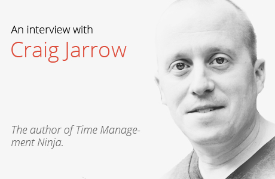

# Uma entrevista com Craig Jarrow, o ninja de gerenciamento de tempo

Lá em setembro do ano passado, em nosso blog em inglês, nós anunciamos uma compilação dos [“30 Gurus de produtividade e organização que você deveria seguir no Twitter”](http://blog.todoist.com/2014/09/30/30-organization-and-productivity-gurus-you-should-follow-on-twitter/) (o link está em inglês) e lá, ocupando o quinto lugar está o ninja do gerenciamento do tempo (o próprio), Craig Jarrow ([@TMNinja](https://twitter.com/TMNinja "Time management ninja twitter")). Craig é o cara, digamos assim: uma adição bem-vinda e indiscutível no rol dos gurus de produtividade de hoje, e graças ao blog que desenvolve, cheio de dicas fantásticas, e aos seus anos de experiência trabalhando com pessoas e empresas, ajudando-as a gerenciar melhor o seu tempo. E a quem interessar possa, ele também é o autor do livro 31 dias, 31 maneiras: dicas diárias para dominar o gerenciamento de tempo” – tradução livre de *[31 Days, 31 Ways: Daily Tips for Time Management Mastery](http://timemanagementninja.com/31-days-31-ways/),* ainda sem edição em português.

Todos os extensos elogios destinados aqui ao Craig… bem, ele merece. Porque sabe do que está falando. E por isso que estamos super felizes em trazer uma entrevista exclusiva com ele, onde o ninja compartilha conosco suas sacadas mais importantes de produtividade sobre emails, motivação, sobre como evitar reuniões intermináveis… e muito mais!

Vamos lá?

**Craig, uma das suas [“10 perguntas de produtividade que você deveria fazer a você mesmo todos os dias”](http://timemanagementninja.com/2015/01/10-productivity-questions-to-ask-yourself-every-day/) é: O que você precisa trazer com você? Então, na sua opinião, quais são os melhores gadgets/aplicativos/serviços para te ajudar a gerenciar o seu tempo?**

Eu não saio de casa sem meu iPhone. É o meu sistema de comunicação pessoal e o meu principal dispositivo para organização. Eu uso para manter minha lista de tarefas, de contatos, calendários, e todas as minhas anotações. Ainda assim, um smartphone por si só pode não ser a melhor escolha para todos. O meu conselho é que você sempre deve escolher as *ferramentas que você usa.* Você estará mais inclinado a usar e permanecer com as ferramentas que você se sente mais confortável em manusear e com as quais se sente mais produtivo. Para alguns, essa ferramenta pode ser um iPhone, e para outros pode ser um calendário de papel. Alguns dos aplicativos que mais me ajudam a continuar produtivo são o Evernote, o Trello e o Slack. Evernote finalmente substituiu meu caderno Moleskine como bloquinho de anotações. E também, é onde todas as minhas informações e materiais de referência estão disponíveis, não importa onde eu esteja. Trello é onde eu mantenho os projetos para o Time Management Ninja. E o Slack é meu app favorito de comunicação, que substitui quase todas as minhas ferramentas de uso diário, menos email.

**É difícil ser produtivo e eficiente 100% do dia. O que você sugere para combater e contornar as crises de produtividade?**

Ninguém pode estar “ligado” 100% do tempo. Quando você está em uma crise de produtividade, seja pela falta de energia ou motivação, há algumas formas de tentar trazer elas de volta. Uma forma de contornar isso é fazer uma tarefa da sua lista que seja simples e que não exija tanto, quando você está nestes momentos. Podem ser tarefas simples e repetitivas que você pode fazer mesmo que não esteja totalmente engajado com elas (como arquivar, escanear documentos ou pôr a leitura em dia). Entretanto, esse movimento requer a disciplina de passar um pente na sua lista de tarefas e executar o que precisa ser feito, e não recorrer imediatamente ao Facebook e Instagram pela vigésima vez no dia. Outras horas, o que você precisa, mesmo, é uma pausa. E nessas horas, o melhor a fazer é abraçar esse momento e tirar uma pausa de verdade. Vá fazer uma caminhada. Vá tirar um cochilo, inclusive. Mesmo um pequeno período de descanso pode ser o suficiente para você voltar reenergizado e de volta ao jogo.

**Há vários métodos de produtividade, como “Engolir o sapo” ou agrupar tarefas semelhantes. Qual delas você acha que é a melhor opção de otimização de tempo?**

Minha melhor tática de listas de tarefas é criar todos os dias o que eu chamo de “Lista de hoje”. Muitas pessoas se sentem assoberbadas pela quantidade de tarefas da sua lista. A “Lista de hoje” faz com que você foque apenas nas suas tarefas mais importantes, além de fazer com que aquelas tarefas de prioridade baixa fiquem fora de vista, fazendo com que você se distraia fazendo um trabalho de baixo impacto. Sua “Lista de hoje” é uma seleção da sua lista de tarefas tradicional. É importante que você primeiro ordene suas tarefas por ordem de prioridade e, em seguida, designar o set de tarefas que você precisa completar hoje… não importa o que aconteça. Sua “Lista de hoje” deve conter as tarefas mais importantes e permite com que você possa focar toda a sua energia nestes itens. A maioria dos apps de listas de tarefas permitem com que você faça essa seleção. E se você estiver usando um caderno como lista de tarefas, simplesmente desenhe uma linha dividindo suas tarefas para hoje e as demais.

**Você acredita que “quem acorda cedo é quem pega o café da manhã”. Qual é a rotina ideal de manhã para um começo de dia produtivo?**

O principal para mim é acordar cedo. Eu levanto às 4 da manhã todos os dias e faço a parte mais importante do meu trabalho antes do resto do mundo acordar. É nessa hora que escrevo os posts do Time Management Ninja e os meus projetos. Além disso, eu acredito bastante em começar o dia na academia. Então, eu faço meus exercícios antes mesmo da vida começar a entrar naquele ritmo que possa me interromper em qualquer coisa. Eu sempre escuto as desculpas das pessoas como “eu não sou uma pessoa matinal”. Você pode acordar cedo e ser uma pessoa ativa se colocar isso entre as prioridades da sua vida. Você precisa ficar acordado até tarde assistindo televisão, ou você precisa acordar cedo para colocar em dia o seu trabalho ou ir para a academia? Ou estudar para o curso que você quer fazer? Se você faz as suas primeiras tarefas antes, o resto do dia vai fluir naturalmente produtivo depois disso.

**Reuniões são uma das maiores perdas de tempo, mas que muitas pessoas são obrigadas a participar. Como você sugere lidar com o tempo perdido das reuniões?**

Reuniões são os maiores ralos de tempo em todas as empresas. Aqui há algumas das minhas sugestões para tentar otimizá-las:

- **Dividir o tempo das reuniões pela metade:** As reuniões tendem a se expandir até ocupar o tempo destinado a elas – e se a gente pensar dessa forma, a maioria das reuniões poderiam perfeitamente serem concluídas com a metade do tempo. Reduza o tempo das suas reuniões para 1 hora ou 30 minutos.
- **Acabe com as reuniões repetitivas**: Exceto para projetos que requerem reuniões periódicas específicas, não permita que reuniões repetitivas lotem o seu calendário. Elas são uma porta de entrada para uma “preguiça” crônica na comunicação do projeto e um obstáculo desnecessário no seu cronograma.
- **Cancele reuniões desnecessárias:** Sempre me impressiono como as pessoas ficam com medo de cancelar reuniões uma vez que elas estejam marcadas. Se o tópico já foi resolvido ou pode ser concluído com uma rápida ligação telefônica, então cancele a reunião, por favor!
- **Converse com as pessoas:** muitas reuniões deveriam ser transformadas em ligações telefônicas ou conversas pessoas entre indivíduos, e não uma forma de arrastar várias pessoas para uma mesma sala a um mesmo horário. Antes de agendarem uma reunião com você, pergunte: “Isso poderia ser resolvido em uma conversa rápida?”

**Assim como as reuniões, os emails também são um mal necessário. Quais são as suas dicas para tornar a gestão dos emails mais fluida e eficiente?**

Minha maior dica para tornar a gestão da sua caixa de entrada mais eficiente é se lembrar de que os emails não são o seu emprego. A menos que você trabalhe como suporte ao cliente, passar boa parte do tempo do seu trabalho na sua caixa de entrada provavelmente não é a melhor forma de fazer uso do seu tempo. Aqui vão algumas das minhas dicas:

- **Saia da sua caixa de entrada:** Você não pode ser produtivo se você está “surfando” na sua caixa de entrada o dia todo. Entre, responda seus mensagens, e caia fora. Mova as tarefas dos seus emails para sua lista de tarefas. Se você vive sua vida profissional através das demandas da sua caixa de mensagens, você provavelmente não está concluindo suas prioridades.
- Apenas verifique sua caixa de mensagens de 2 a 3 vezes ao dia: cheque seu email periodicamente. Eu recomendo de 2 a 3 vezes ao dia (se você quiser, de manhã, após o almoço e antes de sair do trabalho. Feche sua caixa de emails quando você não estiver trabalhando com eles.
- **Desligue as notificações:** não deixe os emails interromperem o seu dia. Desligue os alertas, as notificações de email e os pop-ups na tela. Você não precisa saber o segundo em que um email chegou. Crie listas VIPs de remetentes, se você está preocupado em perder um email importante. Mas para a maioria das coisas, o email não deve ser usado como um método de comunicação instantâneo.
- **Experimente outras ferramentas:** Assim como as máquinas de fax, o email talvez nunca entre em extinção. Porém, cada vez mais estão se criando novas formas de comunicação. Minha equipe, por exemplo, mudou toda sua comunicação interna para o Slack. Slack talvez seja uma opção híbrida entre mensagens e chat, e tem sido um divisor de águas na comunicação de várias empresas.

O melhor truque para acabar com a procrastinação é começar agora. Começar uma tarefa é sempre a parte mais difícil, seja uma tarefa simples, seja um projeto complicado. Mas comece – não precisa ser por um passo grande; concluir uma etapa pequena já é o suficiente. Por exemplo, pesquisar como você vai começar a executar uma tarefa pode já te ajudar a preparar sua mente a entrar no ritmo de trabalho e levá-la adiante. Ou ainda, comece reunindo tudo o que você precisa: informação, ferramentas, materiais. Até mesmo estes pequenos ajustes podem te ajudar a colocar sua mente na posição de começar a trabalhar e aí sim, ultrapassar a procrastinação.

Lembre-se: “não dá para acabar o que não foi começado”.

Para saber mais sobre as dicas de produtividade e gerenciamento do tempo do Craig, dê uma conferida no [blog](http://timemanagementninja.com/ "Time Management Ninja") dele. E se você gostaria de aproveitar a oportunidade e mandar perguntas para ele, sinta-se à vontade para postá-las aqui!
