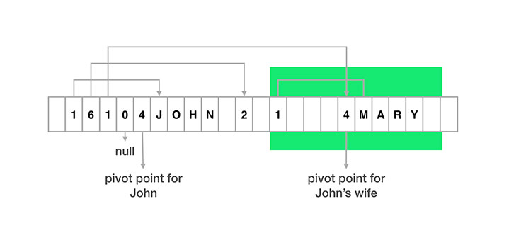
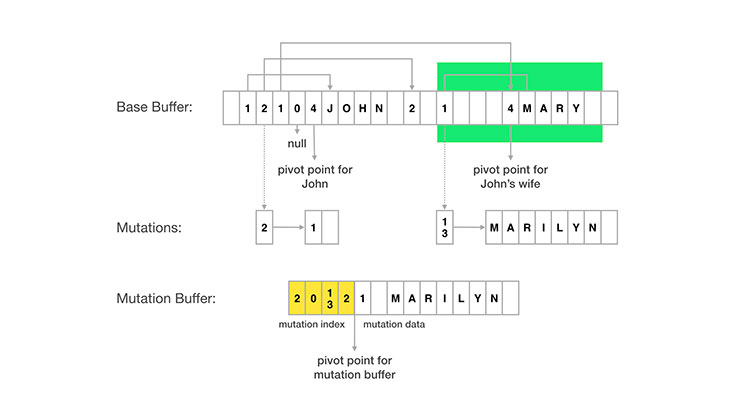

# Improving Facebook's performance on Android with FlatBuffers

On Facebook, people can keep up with their family and friends through reading status updates and viewing photos. In our backend, we store all the data that makes up the social graph of these connections. On mobile clients, we can't download the entire graph, so we download a node and some of its connections as a local tree structure.

The image below illustrates how this works for a story with picture attachments. In this example, John creates the story, and then his friends like it and comment on it. On the left-hand side of the image is the social graph, to describe relations in the Facebook backend. When the Android app queries for the story, we get a tree structure starting with the story, including information about actor, feedback, and attachments (shown on the right-hand side of the image).

[anexo ausente]

One of the key issues we address is how to represent and store the data in the app. It is not realistic to normalize all this data into separate tables inside an SQLite database because there are many different ways we query nodes and the associated tree structure from the backend. As a result, we directly store the tree structure. One option would be to store the tree structure in JSON, but that would require us to parse the JSON and transform it into a Java object before it could be used by the UI. Also, JSON parsing takes time. We used to use the Jackson JSON parser on Android but found issues with:

- **Parsing speed.** It took 35 ms to parse a JSON stream of 20 KB (a typical response size for Facebook), which exceeds the UI frame refresh interval of 16.6 ms. With this approach, we were unable to load stories on demand from our disk cache without observing frame drops (visual stutters) while scrolling.
- **Parser initialization.** A JSON parser needs to build a field mappings before it can start parsing, which can take 100 ms to 200 ms, substantially slowing down the application start time.
- **Garbage collection.** A lot of small objects are created during JSON parsing, and in our explorations, around 100 KB of transient memory was allocated when parsing a JSON stream of 20 KB, which placed significant pressure on Java's garbage collector.

We wanted to find a better storage format to increase the performance of our Android app.

## FlatBuffers

In our exploration of alternate formats, we came across [FlatBuffers](https://www.facebook.com/l.php?u=https%3A%2F%2Fgoogle.github.io%2Fflatbuffers%2F&h=hAQFEyP4W&s=1), an open source project from Google. FlatBuffers is an evolution of protocol buffers that includes object metadata, allowing direct access to individual subcomponents of the data without having to deserialize the entire object (in this case, a tree) up front.

Imagine that we had a simple person class object with four fields: name, friendship status, spouse, and list of friends. The spouse and friends fields also include person objects, and so this forms a tree structure. Here is a simplified illustration of how such an object would be laid out in a FlatBuffer for a person, John, and his wife, Mary.

```
classPersonString friendshipStatusPerson spousePersonfriends
```



In the layout above, you'll notice that:

- Each object is separated into two parts: the metadata part (or vtable) on the left of the pivot point and the real data part to the right.
- Each field corresponds to a slot in vtable, which stores the offset of the real data for that field. For example, the first slot of John's vtable has a value of 1, indicating that John's name is stored one byte to the right of John's pivot point.
- For object fields, the offset in vtable would be pointing to the pivot point of the child object. For example, the third slot in John's vtable points to the pivot point of Mary.
- To indicate that no data is present, we can use an offset of 0 in a vtable slot.

The following code snippet shows how we could then look up the name of John's wife in the structure shown above.

```
// Root object position is normally stored at beginning of flatbuffer. johnPosition FlatBufferHelpergetRootObjectPositionflatBuffer maryPosition FlatBufferHelpergetChildObjectPosition
   flatBuffer
   johnPosition// parent object position/* field number for spouse field */String maryName FlatBufferHelpergetString
   flatBuffer
   johnPosition// parent object position/* field number for name field */
```

Note that there is no intermediate object creation involved, saving transient memory allocations. We can optimize this even further by storing the FlatBuffer data directly in a file and mmap-ing it into memory. This means that we only ever load the parts of the file that we need to read, which further reduces the overall memory footprint.

Moreover, there is no need to deserialize the object tree before reading the fields. This reduces the latency between the storage layer and the UI, and it increases overall performance.

## Mutation on FlatBuffers

From time to time, we need to modify the values inside the FlatBuffers. Since FlatBuffers are immutable by design, there wasn't a direct way to do this. The solution that we came up with was to track mutations side by side with the original FlatBuffer.

Each piece of data in a FlatBuffer can be uniquely identified by its absolute position with the FlatBuffer. We support mutation so that we don't have to redownload an entire story to reflect small updates — like a change in friendship status. For the sake of example, here is a conceptual visualization of how to use that to track two mutations:

- John's friendship status is pointed to by a vtable slot at absolute index 2 of the FlatBuffer. To change John's status, we just need to record that data corresponding to absolute index 2 is now 1 (meaning a friend) instead of 2 (meaning not a friend, but friendship request is sent).
- Mary's name (“Mary”) is pointed by a vtable slot at absolute index 13. Similarly, to change Mary's name, we just need to record the new String value corresponding to absolute index 13.

At the end, we could pack all mutations into mutation buffer. Mutation buffer is made up of two parts: mutation index and mutation data. Mutation index records mapping from absolute index in base buffer to position of new data. Mutation data stores the new data in FlatBuffer format.



When querying a piece of data in FlatBuffers, we can then figure out absolute position of the data, consult the mutation buffer to see whether any mutation happened and return it, and otherwise return the data in the base buffer.

## Flat Models

FlatBuffers can be used not only for storage but also for networking, and as the in-memory format in the app. This eliminates any transformation of the data from server response up to UI display. This has allowed us to drive toward a cleaner **Flat Models** architecture, which eliminated additional complexity between the UI and storage layers.

When JSON is used as the storage format, we need to add a memory cache to work around performance issues in deserialization. We also end up adding application and networking logic between UI and storage layers.

[anexo ausente]

Even though this three-layer architecture has been pretty popular on iOS and the desktop, it has some significant issues on Android:

- A memory cache normally means that we would keep much more in memory than what is needed for displaying the UI. Many Android devices on the market still have a per-app memory limit of 48 MB or less. When you add in the overhead of the Java garbage collector, this can have implications for performance.
- Application logic needs to deal with the memory cache, UI, and storage, but typically code related to the UI and to storage takes place on different threads. Keeping the threading model simple in a large application can be difficult.
- The UI typically receives data from multiple sources, such as cached data in storage, new data from the network, local data mutations from application logic, and more. This requires the UI to have to deal with different kinds of data change scenarios and can result in UI overdraw.

With the Flat Models approach, the UI and storage layers can be integrated much more easily, as shown in the diagram below.

[anexo ausente]

- The UI is built directly on top of storage using standard Android cursors, and since storage-to-UI is the hottest execution path in most Android apps, this can help keep the UI responsive.
- The application logic and networking components have been moved beneath the storage layer, allowing all logic there to take place on a background thread and ensure that results are reflected in storage first. Then UI can then be notified to redraw through the use of standard Android content provider notifications.
- This architecture allows a clean separation between the UI and application logic layers — and we could simplify the logic for each. The UI components only need to reflect the state of the storage, and the application logic only needs to write the final (correct) information to the storage layer. The UI and application logic layers live on different threads, and they never have to communicate with each other directly.

## Conclusion

FlatBuffers is a data format that removes the need for data transformation between storage and the UI. In adopting it, we have also driven additional architectural improvements in our app like Flat Models. The mutation extensions that we built on top of FlatBuffers allow us to track server data, mutations, and local state all in a single structure, which has allowed us to simplify our data model and expose a unified API to our UI components.

In last six months, we have transitioned most of Facebook on Android to use FlatBuffers as the storage format. Some performance improvement numbers include:

- Story load time from disk cache is reduced from 35 ms to 4 ms per story.
- Transient memory allocations are reduced by 75 percent.
- Cold start time is improved by 10-15 percent.
- We have reduced storage size by 15 percent.

It's exciting to see a choice in data format allow people to spend just a little more time reading their friends' updates and seeing photos of their families. Thanks, FlatBuffers!

## More to Read
