# The Hamburger Menu Doesn't Work

It's a beautiful, elegant solution that gets it all wrong, and it's time to move on

This is a hamburger menu:

[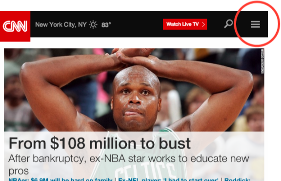](http://deep.design/wp-content/uploads/2015/07/hamburger.png)

It’s called a “hamburger” because it it looks roughly like a bun-meat-bun sandwich.

(Others have insisted that it looks much more like a triple hot-dog, but they’ve thus far been unsuccessful in winning the public’s hearts and minds.)

The idea behind the hamburger menu is that you can use it to hide site navigation on smaller screens, showing it only when the user clicks the icon instead of always showing it (which was the previous norm).

This design pattern accomplishes a major goal by preserving precious real estate on mobile, tablet, or other small screens, and it’s consistent with the logic of the [progressive disclosure](http://uxpatterns.org/affordances/progressive-disclosure/) design pattern.

Brilliant solution, right?

The hamburger menu was so rapidly adopted and remains so beloved by digital designers that it may be too late to change course anytime soon. It’s built into every major front-end framework, every new WordPress theme, and pretty much every new site that’s been designed in the last couple of years.

And that’s a really bad thing.

Other designers often look at me like I’m crazy when I try to explain why the hamburger menu is often a bad idea. They take for granted that it’s the “One True Way” to handle navigation on small screens.

I won’t be able to convince everyone, of course, but I’m hoping I can at least convince *you*.

## This hamburger is made of mystery meat

The term “[mystery meat navigation](https://en.wikipedia.org/wiki/Mystery_meat_navigation)” was used by Vincent Flanders of [Web Pages that Suck](http://www.webpagesthatsuck.com/) seventeen years ago to describe a recurring problem he was seeing in the fledgling web design industry of the late 90s: website navigation that didn’t make any sense to the user.

Here’s a quick example:

As an industry, we had somehow gotten “confusing and difficult navigation” mixed up with “fun and engaging user interface,” and convinced ourselves that people would put up with frustratingly vague navigation because it was cool and animated. It took a long time for the industry to finally break that habit.

The core principles of web navigation are similar to those of wayfinding and signage in the physical world: clarity, visibility, and obviousness matter. If you’re driving down the freeway, for example, you’ll generally see lots of highly-visible signs giving you updates on distances, reminders about upcoming offramps, speed limit signs, turns, possible dangers, etc.

These all help you to know exactly what your options are, so you’re much less likely to make mistakes, even when you’re in “auto pilot” mode.

Maybe you’re headed to the airport. Even if you’re distracted while you’re driving, it would be hard to miss all the signs and references to the airport. Some part of your brain notices the many airport signs along the way and consciously or subconsciously follows the arrows until you find yourself there.

Now imagine if all those signs were hidden by default, and that you had to push a button in your car to see them.

The chances are now significantly higher for you to completely miss the turns to the airport because you were distracted by something that happened at work earlier that day. You never realize what you’re missing because the signs are hidden by default.

Hamburger menus navigation operate under a simple principle. On the surface, it seems self-evident that if the user wants the navigation menu, they can just click on it. However, if you dig deeper, you’ll realize that users often don’t know quite what they want, and they rely on site navigation to nudge them in the right direction by telling them what their options are and what content they should be looking at.

## This hamburger smells like…nothing

When you’re intimately aware of the underlying architecture of a website, it’s easy to forget that the user has no idea about it. This comes out in seemingly harmless conversations like this one:

> **Client:** “What if the user wants to see the pricing?”  
> **Designer:** “Oh, they can just click the menu icon and then click ‘Pricing.’ Easy!”

Sounds totally reasonable, but the designer here is (erroneously) assuming that the user knows what’s in the menu and that he or she will actively pursue it.

But that’s not how users think.

Most people navigation based on what’s called “information scent.” When faced with a set of options, they’ll choose the option that gives the strongest indication that it’ll bring them closer to what they want, like an animal sniffing around for food.

When a user is looking for pricing on a website, they’ll look for words like “cost,” “price,” “rates,” “fees,” etc. They’ll scroll down the page looking for these words, then scroll back up. If they can’t find anything, they revert to plan B: look for words that might be a superset of pricing, like “sign up,” “product details,” “learn more,” etc. They’ll continue to expand the concepts they’re searching for until they either find something that looks promising, or they give up entirely.

You know what never looks anything even *close* to what the user actually wants? **A small three-bar icon tucked in the corner of a website.** It has no information scent. Even after the user has exhausted every other option, it still might not occur to them that the answers they seek are hiding behind those three bars. Users generally aren’t inclined to click it.

In this regard, the hamburger menu icon is basically a moth ladder:

## This hamburger is consistently disappointing

The Facebook mobile app is the archetypal example of hamburger menu icon usage, and it tends to come up often in conversations about this navigation option. (“Well, Facebook uses it, so…”).

However, Facebook doesn’t use it as primary navigation anymore. They tried it, but it sucked. They switched to a tab bar instead:

[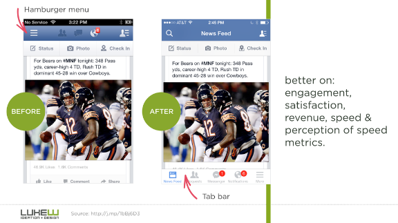](http://deep.design/wp-content/uploads/2015/07/B82vXQ2CcAAUOnH.png)

(They still use a hamburger-style “More” icon in the bottom right, but the most important parts have obviously been pulled out and made readily visible, which is really the point of all this.)

In his article “[Obvious Always Wins](http://www.lukew.com/ff/entry.asp?1945),” Luke Wroblewski, Product Director at Google, gives various before-and-after examples of the failures of apps that switched to hamburger-style navigation and the successes of those that switched away from it. *(all images from [LukeW](http://www.lukew.com/))*.

[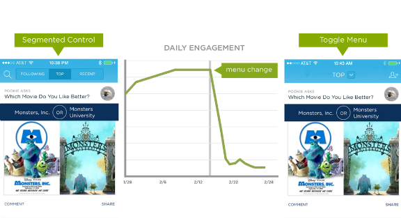](http://deep.design/wp-content/uploads/2015/07/Bk8y16lCYAEGORy.png)

[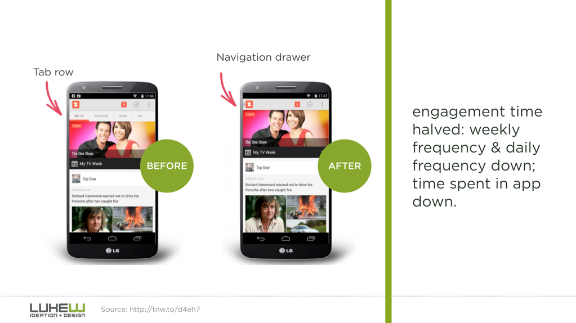](http://deep.design/wp-content/uploads/2015/07/B82rmd_CMAAm4Iz.png)

[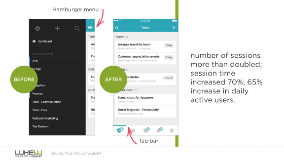](http://deep.design/wp-content/uploads/2015/07/B82uUMQCcAE4Eoh.png)

Probably the highest-profile case of hamburger failure came from NBC News, who got so excited about this hot (in 2014, anyway) navigation style that they used it on their desktop site as well, billing it as a triumph of “mobile first” design:

[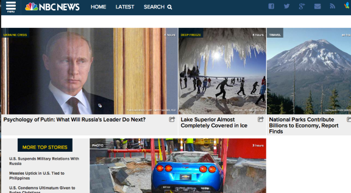](http://deep.design/wp-content/uploads/2015/07/Screen-Shot-2014-03-03-at-8.03.18-PM.png)

This kicked off a wave of thoughtful articles about how this was the [future of news design](http://www.mediaite.com/online/nbc-news-site-redesign-and-the-change-in-how-were-reading-news-online/), and how other sites would inevitably follow suit.

But, as so often happens, the hamburger menu didn’t work.

So they added an instructional overlay, to help users understand how to use their simple menu:

[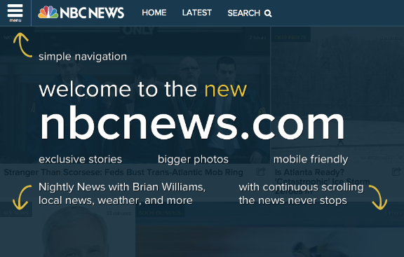](http://deep.design/wp-content/uploads/2015/07/screen-shot-2014-02-12-at-10-18-05-am.png)

But people still weren’t clicking the hamburger menu icon.

As a last-ditch attempt to solve the problem, they made it yellow:

[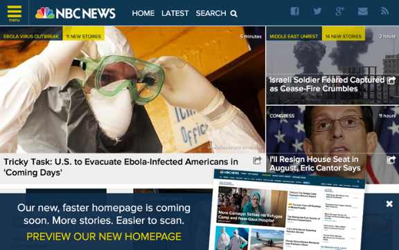](http://deep.design/wp-content/uploads/2015/07/nbcnewshomepage.png)

Then, finally (as you can see on the promo at the bottom of the image above), they gave up and redesigned the navigation to a more traditional horizontal menu style, which has worked well for them and remains the same basic design they use today.

[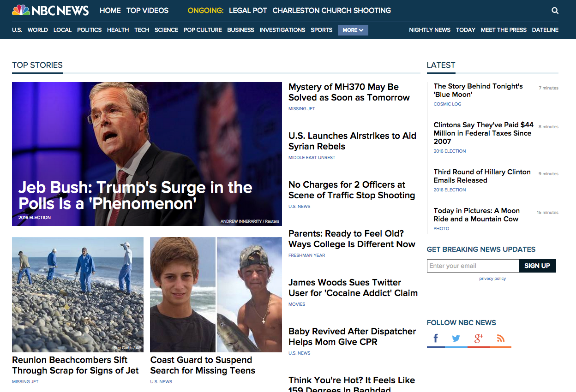](http://deep.design/wp-content/uploads/2015/07/Screen-Shot-2015-07-31-at-3.36.30-PM.png)

It’s not cool. It’s not sexy. It’s not high-tech. But it *works* because it provides a proper information scent. Users can scan the page, and if they’re attracted to any of those words (e.g., “Science”), they’ll click them.

That’s how navigation works in the real world.

## What about variations on the hamburger?

With people starting to realize that the hamburger menu has some significant performance issues, many started testing alternatives, including other icons (e.g., a “Back” arrow), the word “Menu” instead of the hamburger icon, the word “Menu” *in addition* to the icon, etc.

The results are interesting to read through, and they do point to some incremental performance differences. However, all of them seem to have generally poor performance because all of them suffer from the same problem: lack of information scent.

The word “Menu” obviously makes more sense to the average user than the three-bar hamburger icon, but it still does a terrible job of showing the user what else they could be seeing on the site. People tend not to click it because they don’t see a reason to click it. They skim what’s in front of them, and if something looks interesting or relevant, they click it. The word “Menu” doesn’t look interesting or relevant. It might as well be the privacy policy link.

Some people argue that “we just have to wait for users to learn the new navigation convention,” but hopefully you can see how the principle of information scent invalidates that argument. Good design doesn’t require years of waiting for the general public to understand and start using a interface convention. That’s insane, right? But designers are so attached to the hamburger menu that they still claim it’s the right answer even if “the public hasn’t caught up yet.”

The problem wasn’t that users were confused by the hamburger menu, but rather that there was never a compelling reason to click it in the first place.

## Why is it so hard to shake the hamburger menu?

Here are a few reasons why the design industry is having trouble giving up the hamburger menu:

- **It’s a designer’s dream.** What if we could take that awkward horizontal navigation and just make it *disappear* so we don’t have to deal with it on mobile devices? If it actually worked, it’d be heavenly.
- **Designers can sometimes more focused on trends than logic.** In 2014, all the sexy responsive sites jumped on the hamburger menu bandwagon, and it was proclaimed the next big thing. Anyone who was a cool designer started using it, because that’s what other cool designers used. They even started developing [slick animations](http://codepen.io/designcouch/pen/Atyop) when perhaps they really should have been asking about the interaction logic and doing user testing.
- **It’s built into everything now.** The emergence of the hamburger menu icon coincided with the heavy adoption of front-end frameworks like [Bootstrap](http://getbootstrap.com/) and [Foundation](http://foundation.zurb.com/), both of which come with robust horizontal navigation solutions that default to a hamburger menu on mobile and even tablet form factors. To avoid using the hamburger menu when using these frameworks’ menu options, you’d actually have to hack the code to remove it, or custom code a new navigation setup from scratch.
- **Unsexy news travels slowly.** The news that we’d conquered the problem of converting navigation for mobile devices ripped through the industry like a zombie virus. It seemed like everyone started using it almost overnight. Unfortunately, interaction design theory, A/B testing, and metrics that challenge the mirage aren’t nearly as viral.

## Would anyone ever want this hamburger?

It’s important to remember that there aren’t any universal rules in design. There are always exceptions.

For example, a repetitive-use application with trained users (e.g., a medical application used by nurses throughout the course of the day) may be a valid scenario for using such an interface. “Power user” systems don’t always need to make things intuitive for new users, and sacrifices can and should sometimes be made in order to give additional benefits—such as information density—to experienced users.

Another example might be (as seen in the Facebook example above) truly secondary navigation items. Once the most important elements have been explicitly listed for the user, you can scoop up all the miscellaneous additional stuff that nobody’s going to look for anyway and throw it under a low-priority hamburger menu.

Universally declaring hamburger menus to be totally terrible is as bad as declaring them to be always awesome. Rules are no replacement for thinking. Consider the user, do the math, and figure out what actually makes the most sense.

## Okay, so what do we do instead?

Mobile navigation is difficult by its nature: it has to be small enough to fit on a 3-inch screen, large enough to deal with fat thumbs, and robust enough to handle multiple destinations. That’s a complicated order.

The best solution so far seems to be a tab bar, either at the top or bottom of the screen (probably top for responsive websites), with 4-5 icon+text buttons for the primary navigation options. This is the approach Facebook settled on as their new navigation structure, and you can see another example on the GameStop mobile site here:

The benefit of the icon+text structure is that it allows you to condense the text while still keeping the button size large enough to deal with big thumbs (like mine).

If you can get the essential navigation down to just a few items, you might be able to pull off a text-only menu (3×1 or 2×2). You’ll have to use the real estate carefully, but it could work. This solution obviously isn’t appropriate for every circumstance, but for many sites it’s likely to be a much stronger option than the current “bury it in a hamburger” approach.

Alternatively, you could (and perhaps even should) design the site such that the main menu isn’t even needed. This is often a good way to design anyway since many users don’t look to the menu as their primary navigation device, even on desktop screens, so applying the principle to responsive design is probably a good idea either way. You can accomplish this by ensuring that all the logical next steps are covered in the content, and that there are obvious escape paths (“Up,” “Back,” “Home,” etc). This usually works best for smaller and simpler sites, but it’s an option worth considering as well.

## [Update] “But I have too many menu items!”

Probably the most common complain I’ve heard since publishing this article is, “Yeah, tab bars are fine if you have only 3 or 4 menu items, but it’s not realistic for sites with more navigation than that.”

Let’s check out one of the world’s biggest brands, a company that *specializes in hamburgers:*

[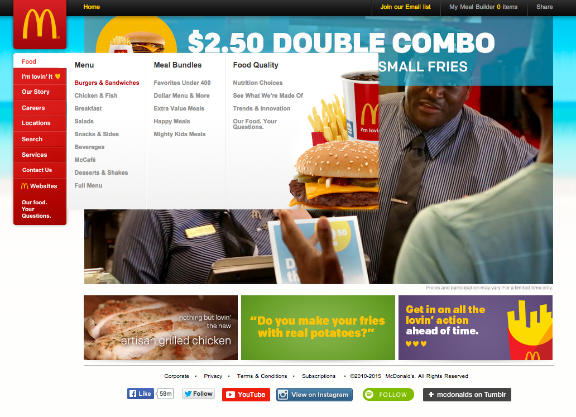](http://deep.design/wp-content/uploads/2015/08/Screen-Shot-2015-08-11-at-11.21.11-AM.png)

I believe that qualifies as a pretty robust navigation system.

However, when you visit McDonald’s on a mobile device, this is what you’ll see:

[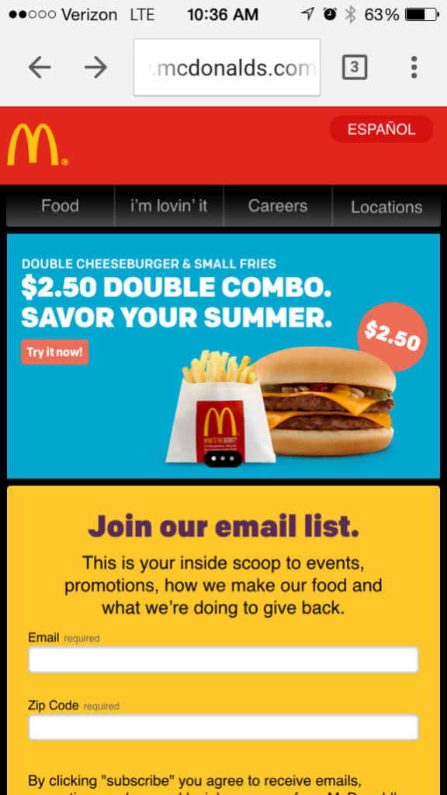](http://deep.design/wp-content/uploads/2015/08/IMG_4145.png)

They’ve taken the most important elements of their navigation and converted them into a tab bar. (The other elements are available through links in the content lower on the page.)

It’s just like moving into a small apartment. You prioritize. You decide what you need to have within reach, and what you can put in storage. There’ll be some soul-searching and hard conversations, sure, but that’s all part of an appropriate design process.

Even if you have seemingly equal items (e.g., sections on a newspaper site), it’s still possible to prioritize them. You could do something like “U.S. |  World | Politics | More…” that brings the most sought-after sections into visibility, while giving the user a clear sense that other sections lie behind the “More…” link. The stronger information scent would work far better than a hamburger menu, and probably a fair bit better than a plain “Sections” menu as well.

It’s totally possible to consolidate navigation. Yes, it’s difficult, but if you weren’t up for difficult challenges you wouldn’t have gotten into UX design in the first place.

*(Thanks to [@dancow](https://twitter.com/dancow) for the tip about the McDonald’s website.)*

## Let’s end the hamburger menu era

The hamburger menu is one of the more embarrassing design conventions of recent years, and it’s time to stop thinking of it as a default, unquestioned solution for mobile navigation.

Our team fell for it, too. We had reservations, of course, and talked through possible alternatives, but for about a year and a half it was the established industry convention for dealing with mobile navigation. Our clients were asking for it, everyone was talking about how great it was, and there wasn’t yet enough data to have clear answers one way or another. We launched a lot of sites that use hamburger menus. We did the best we could with what our industry knew at time.

However, the data’s in now. The hamburger menu doesn’t work well, and it’s time for everyone to move on. At this point, there aren’t many good excuses for using them in new site designs, and it very well may be worth revisiting older sites to see if they might perform better with an updated navigation structure.

Change is difficult, but that’s the business we’re in, and I hope the change never stops. We’re constantly getting better, and I have no doubt that the websites of today are significantly better designed than those of 5, 10, or 20 years ago. This is just another step down that path.

---

*[James Archer](http://jamesarcher.me/) is the Chief Creative Officer at [Crowd Favorite](http://crowdfavorite.com/) and [Forty](http://forty.co/), and he's a frequent author and speaker on the subject of design. Over the years he's worked for clients like Microsoft, Motorola, Walmart, and Yahoo, and on projects that have appeared in U.S. News & World Report, Fast Company, Businessweek, Entrepreneur, New York Times, AdAge, NPR, and others.*

---

## Enjoying Deep Design?

Join the Deep Design community for access to new articles, podcasts, and more.
