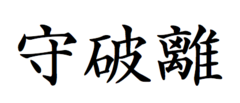

# Shuhari

From Wikipedia, the free encyclopedia

Jump to: [navigation](https://en.wikipedia.org/wiki/Shuhari#mw-head), [search](https://en.wikipedia.org/wiki/Shuhari#p-search)

*Shuhari* written in [kanji](https://en.wikipedia.org/wiki/Kanji "Kanji")

**Shuhari** ([Kanji](https://en.wikipedia.org/wiki/Kanji "Kanji"): 守破離 [Hiragana](https://en.wikipedia.org/wiki/Hiragana "Hiragana"): しゅはり) is a [Japanese martial art](https://en.wikipedia.org/wiki/Japanese_martial_art "Japanese martial art") concept, and describes the stages of learning to [mastery](https://en.wikipedia.org/wiki/Mastery "Mastery"). It is sometimes applied to other Japanese disciplines, such as [Go](https://en.wikipedia.org/wiki/Go_(board_game) "Go (board game)").

## Contents

 [[hide](https://en.wikipedia.org/wiki/Shuhari#)]

- [1 Etymology](https://en.wikipedia.org/wiki/Shuhari#Etymology)
- [2 Definition](https://en.wikipedia.org/wiki/Shuhari#Definition)
- [3 History](https://en.wikipedia.org/wiki/Shuhari#History)
- [4 Related concept](https://en.wikipedia.org/wiki/Shuhari#Related_concept)
- [5 See also](https://en.wikipedia.org/wiki/Shuhari#See_also)
- [6 References](https://en.wikipedia.org/wiki/Shuhari#References)
- [7 External links](https://en.wikipedia.org/wiki/Shuhari#External_links)

## Etymology[[edit](https://en.wikipedia.org/w/index.php?title=Shuhari&action=edit&section=1 "Edit section: Etymology")]

*Shuhari* roughly translates to "first learn, then detach, and finally transcend."

- *shu* (守[?](https://en.wikipedia.org/wiki/Help:Installing_Japanese_character_sets "Help:Installing Japanese character sets")) "protect", "obey" — traditional wisdom — learning fundamentals, techniques, [heuristics](https://en.wikipedia.org/wiki/Heuristic "Heuristic"), proverbs
- *ha* (破[?](https://en.wikipedia.org/wiki/Help:Installing_Japanese_character_sets "Help:Installing Japanese character sets")) "detach", "digress" — breaking with tradition — detachment from the illusions of self
- *ri* (離[?](https://en.wikipedia.org/wiki/Help:Installing_Japanese_character_sets "Help:Installing Japanese character sets")) "leave", "separate" — [transcendence](https://en.wikipedia.org/wiki/Transcendence_(philosophy) "Transcendence (philosophy)") — there are no techniques or proverbs, all moves are natural, becoming one with spirit alone without clinging to forms; transcending the physical

## Definition[[edit](https://en.wikipedia.org/w/index.php?title=Shuhari&action=edit&section=2 "Edit section: Definition")]

[Aikido](https://en.wikipedia.org/wiki/Aikido "Aikido") master [Endō Seishirō](https://en.wikipedia.org/wiki/Seishiro_Endo "Seishiro Endo") *[shihan](https://en.wikipedia.org/wiki/Shihan "Shihan")* stated:

> "It is known that, when we learn or train in something, we pass through the stages of *shu*, *ha*, and *ri*. These stages are explained as follows. In *shu*, we repeat the forms and discipline ourselves so that our bodies absorb the forms that our forebears created. We remain faithful to these forms with no deviation. Next, in the stage of *ha*, once we have disciplined ourselves to acquire the forms and movements, we make innovations. In this process the forms may be broken and discarded. Finally, in *ri*, we completely depart from the forms, open the door to creative technique, and arrive in a place where we act in accordance with what our heart/mind desires, unhindered while not overstepping laws."[[1]](https://en.wikipedia.org/wiki/Shuhari#cite_note-1)

## History[[edit](https://en.wikipedia.org/w/index.php?title=Shuhari&action=edit&section=3 "Edit section: History")]

The *Shuhari* concept was first presented by Fuhaku Kawakami as [Jo-ha-kyū](https://en.wikipedia.org/wiki/Jo-ha-ky%C5%AB "Jo-ha-kyū") in Tao of Tea. Then, [Zeami Motokiyo](https://en.wikipedia.org/wiki/Zeami_Motokiyo "Zeami Motokiyo"), the master of [Noh](https://en.wikipedia.org/wiki/Noh "Noh"), extended this concept to his dance as *Shuhari*, which then became a part of the philosophy of [Aikido](https://en.wikipedia.org/wiki/Aikido "Aikido").[*[citation needed](https://en.wikipedia.org/wiki/Wikipedia:Citation_needed "Wikipedia:Citation needed")*] *Shuhari* is part of the philosophy of [Shorinji Kempo](https://en.wikipedia.org/wiki/Shorinji_Kempo "Shorinji Kempo").

*Shuhari* can be considered as concentric circles, with Shu within Ha, and both Shu and Ha within Ri. The fundamental techniques and knowledge do not change.[[2]](https://en.wikipedia.org/wiki/Shuhari#cite_note-2)

During the Shu phase the student should loyally follow the instruction of a single teacher; the student is not yet ready to explore and compare different paths.[[3]](https://en.wikipedia.org/wiki/Shuhari#cite_note-3)

## Related concept[[edit](https://en.wikipedia.org/w/index.php?title=Shuhari&action=edit&section=4 "Edit section: Related concept")]

Some [Chinese martial arts](https://en.wikipedia.org/wiki/Chinese_martial_art "Chinese martial art"), popularly known as [Wushu](https://en.wikipedia.org/wiki/Wushu_(term) "Wushu (term)"), have a similar three stage concept to Mastery:

- 地 *di* (earth) Basics. To experience movements at the fundamental levels.
- 人 *ren* (human) Ready to learn. (Some Chinese martial grandmasters equates the entry to this level as the Japanese belt system level of [black belt](https://en.wikipedia.org/wiki/Black_belt_(martial_arts) "Black belt (martial arts)") 1st [Dan (rank)](https://en.wikipedia.org/wiki/Dan_(rank) "Dan (rank)")
- 天 *tian* (sky/heaven) No conscious thought, flows/moves like the elements. This stage takes years of training and coaching from other [Grandmasters](https://en.wikipedia.org/wiki/Grandmaster_(martial_arts) "Grandmaster (martial arts)").

## See also[[edit](https://en.wikipedia.org/w/index.php?title=Shuhari&action=edit&section=5 "Edit section: See also")]

- [Dreyfus model of skill acquisition](https://en.wikipedia.org/wiki/Dreyfus_model_of_skill_acquisition "Dreyfus model of skill acquisition")

## References[[edit](https://en.wikipedia.org/w/index.php?title=Shuhari&action=edit&section=6 "Edit section: References")]

1. **[Jump up ^](https://en.wikipedia.org/wiki/Shuhari#cite_ref-1)** [An Interview with Endô Seishirô Shihan](http://homepage3.nifty.com/aikido_sakudojo/Shihan_Interview_Dou144-e.html) Aiki News, Dou, No. 144 (2005). translated by Daniel Nishina and Akiya Hideo
2. **[Jump up ^](https://en.wikipedia.org/wiki/Shuhari#cite_ref-2)** ["The Meaning of Shuhari"](http://web.archive.org/web/20081119122929/http://www.shuhari.com/site/view/ShuharisMeaning.pml). Archived from [the original](http://www.shuhari.com/site/view/ShuharisMeaning.pml) on 19 November 2008. Retrieved 1 June 2006.
3. **[Jump up ^](https://en.wikipedia.org/wiki/Shuhari#cite_ref-3)** McCarthy, Patrick, "The World within Karate & Kinjo Hiroshi" in Journal of Asian Martial Arts, V. 3 No. 2, 1994.

## External links[[edit](https://en.wikipedia.org/w/index.php?title=Shuhari&action=edit&section=7 "Edit section: External links")]

- [Sensei's Library: ShuHaRi](http://senseis.xmp.net/?ShuHaRi)
- [ShuHaRi in software development by Martin Fowler](http://martinfowler.com/bliki/ShuHaRi.html)
- (Japanese) [「守」「破」「離」　とは](http://www.nishina.com/lookup/2001124-2.htm)
