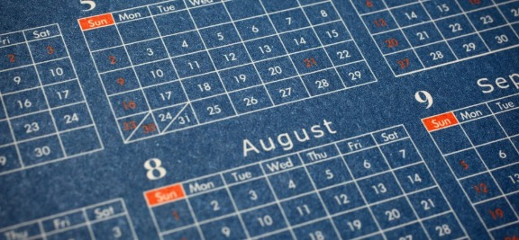

# 7 Simple Techniques to Cut Your Workday in Half

Learn how to thrive with a demanding schedule and make time for yourself by being well organized.

[By Lolly Daskal](http://www.inc.com/author/lolly-daskal)

[Lolly Daskal](http://www.lollydaskal.com/) is the president and CEO of [Lead From Within](http://www.lollydaskal.com/), a global consultancy firm that specializes in leadership and entrepreneurial development. Daskal's programs galvanize clients into… [Full bio](http://www.inc.com/author/lolly-daskal)

[LollyDaskal](http://www.twitter.com/LollyDaskal)

[LollyDaskal](http://www.twitter.com/LollyDaskal)

6.4k SHARES

4 COMMENTS

IMAGE: Getty Images

We all want to know that we're doing our best to be successful, but too often we feel ourselves becoming [less productive even while we're working longer hours](http://www.inc.com/lolly-daskal/7-time-management-mistakes-that-are-a-complete-waste-of-time.html).

Good news!

A new study finds that being productive really is more about [working smarter, not harder.](http://www.inc.com/lolly-daskal/10-mistakes-unhappy-people-make-daily.html) The study looked at musicians' practice habits and discovered that a violinist who practices extremely intensely for four focused hours actually gets more done than those who practice for seven hours but less efficiently.

So what does that mean for you?

At the top of the list: to stop checking your phone every five minutes and your email every 10 minutes. If you can [focus intently](http://www.inc.com/young-entrepreneur-council/14-ways-to-improve-your-focus-while-working-remotely.html) in the hours you put in at work, you're likely to need to put in fewer of those hours. That, in turn, means leaving work early and having more time for yourself.

Here are seven strategies that can help you create more time for yourself and leave work early.

**1. Come a little early, leave a lot early.** Early morning, when everything is quiet and your energy is high, is a great time for productivity. Many people report they can leave two hours early if they add an hour at the beginning of the day.

**2. Stay focused and deliberate.** Remember the old adage that 20 percent of your work produces 80 percent of the results you want? Learn to ignore what is distracting; there is no need to respond to everything. Don't check your email, don't check your phone, tune out the news--nothing is as important as the task at hand. Treat your focused time like money and be frugal with that resource.

**3. Look at your priorities.** We all tend to gravitate to tasks that are enjoyable and easy, but efficiency says to start with the most important. Make it urgent and get it out of the way--then you can do the more pleasant work.

**4. Say no to multitasking.** When you try to do 10 things at once, you end up doing none of them well. Multitasking slows you down and prevents you from processing and retaining information. Often, you'll have to go back and reread or redo something. Instead, do one task at a time, stay present, and do it well.

**5. Manage interruptions.** Every interruption, however brief, means you have to spend time regaining focus. If you can, limit your accessibility. Schedule open-door office hours when people can come to you with questions and issues, and protect your focus for the rest of your time.

**6. Tame your email.** Most of us spend an enormous amount of time checking and answering email. But there are things you can do to make it far less time-consuming and distracting:

- Schedule specific times to check and respond to email, ideally during your less productive time. Let people know your schedule and when to expect a response.
- Create "urgent" and "read later" folders to process email.  
  Turn off notifications.
- Delete or archive things you won't need.
- Keep your email program closed to eliminate the temptation to check in throughout the day

**7. Get organized.** Organization is a powerful way to find more time in your day, and plays an important role in how much you accomplish. Even if you have to invest a few hours in getting organized, it will pay off quickly.

The most productive people create systems to help them stay on top of everything. Any system that works for you can get the job done. Here's an example for organizing any environment and keeping it organized--the 5S System, based on five Japanese words:

- ***Seiri--***"Sort." Go through your space and eliminate anything you don't need--clutter, paperwork, emails, books, processes--anything that's unnecessary and that keeps you from your work.
- ***Seiton--***"Set in order." Once you have only items that you need and use, put them in an order that makes them accessible and easy to find.
- ***Seiso--***"Systematic cleaning." Keep your space clean and free of clutter to make it easier and more peaceful for you to work there.
- ***Seiketsu--***"Standardized cleanup." Do a daily cleanup so you can always find what you need.
- ***Shitsuke--***"Sustain." This can be the hardest part--keep everything up until it has become absolute habit for you.

Being organized, creating systems, and avoiding multitasking to have a more productive and manageable day allows you not only to leave early but it gives you more time for yourself and those you love. It's not about having more time, but about making what time you do have count.

Like this column? Sign up to [subscribe to email alerts](http://marketing.wordstream.com/lolly-tips-subscribe.html) and you'll never miss a post.

The opinions expressed here by Inc.com columnists are their own, not those of Inc.com.

Published on: Jul 22, 2015
