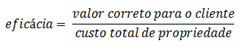
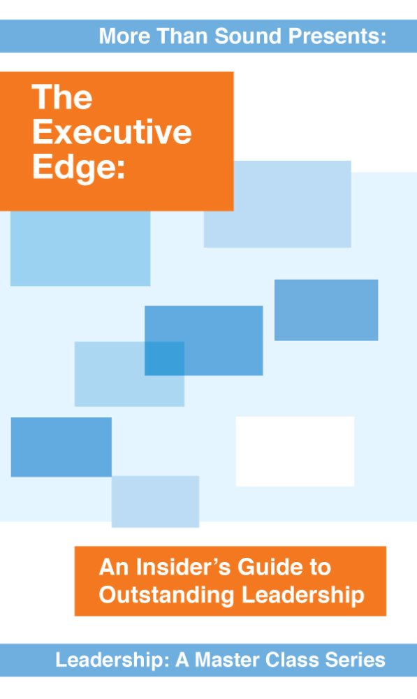

# Afinal, o que são boas práticas

Original publicado em [meu blog, em agosto de 2011](http://elemarjr.net/2011/08/23/afinal-o-que-so-boas-prticas/).

A publicação de hoje é uma espécie de provocação. Muitas vezes vejo discussões acaloradas sobre o que são boas práticas. Aqui, apresento minha visão sobre esse tema.

# Relação entre boas práticas e eficácia

Para mim, boas práticas são aquelas que garantem a entrega do valor certo para o cliente com o menor custo para a empresa. Chamo essa relação de eficácia.

Logo,

> Boas práticas sempre maximizam a eficácia.

Um desdobramento lógico é:

> Boas práticas sempre colaboram para a entrega do valor adequado ao cliente e/ou para a redução do custo total de propriedade.

Vamos entender um pouco melhor o que quero dizer.

### Valor correto para o cliente

Muitas vezes, quando desenvolvemos software, temos por hábito querer “superar” as expectativas do cliente. Isso gera encantamento. Na medida certa, isso não é errado.

O problema é que, muitas vezes (quase sempre), o cliente não vai estar disposto a pagar mais por esse encantamento. Quando incluímos *features* que não são percebidas estamos incluindo, na verdade, apenas custo direto de desenvolvimento.

> Toda ***feature*** não percebida pelo cliente é ***apenas custo***.

O melhor software é aquele que atende o cliente e entrega um pouco mais do que o necessário (suficiente para fidelizar).

> Se o software (qualquer produto, na verdade) entregar muito mais do que o esperado, precisará reverter esse incremento também no seu preço. O problema é que nem sempre isso é possível. Seja porque o cliente não valoriza, seja porque ele não tem condições de pagar.

Por favor, perceba que

> o valor correto nunca será nada abaixo de um software fazendo aquilo que se dedica, sem erros nem inconsistências.

### Menor custo total propriedade

Software deveria ser projetado para reduzir seu custo total de propriedade. No caso de software, podemos assumir que o custo pode ser dividido entre o investimento inicial (custo para desenvolver) e o custo para manter (manutenção).

Não é raro que o custo de manutenção seja bem maior do que o custo de desenvolvimento. O motivo mais comum para isso é a dificuldade para entender o código existente. Depois, temos também que computar os custos da modificação em si, além dos testes necessários para garantir que esta alteração esteja conforme. Por fim, há os custos de atualizar a base instalada.

Vamos, por um momento, entender a composição do custo para manutenção.

Uma abordagem antiga, porém infeliz para reduzir o custo de manutenção é tentar investir mais no custo inicial de desenvolvimento tentando eliminar ou reduzir a necessidade de manutenção. Considere que:

> Tentativas de antecipar “necessidades” futuras geralmente aumentam ainda mais a complexidade de implantar modificações que não foram planejadas.

Temos que considerar, além de tudo, que investir em demasia no desenvolvimento inicial contraria um importante princípio econômico: Dinheiro disponível hoje vale mais que o dinheiro disponível amanhã;

> Antecipar um investimento implica em desperdício de dinheiro

Por outro lado, em projetos com certeza de manutenção futura, qualquer esforço para reduzir os custos para compreensão, modificação, teste e distribuição representam em um aumento de eficácia.

## Questionando as boas práticas

Como desenvolvedores, temos pouca ou nenhuma condição de aumentar o “valor correto para o cliente”. Isso nasce de uma necessidade de negócio dele, não de nossas inspirações! São raros os casos onde conseguimos delinear claramente necessidades que um cliente nem sabia que possui e, além disso, está disposto a pagar para que sejam resolvidas. **Esse é um tema de marketing e P&D, não de desenvolvimento**.

> Para colaborar com a eficácia, nosso foco, enquanto desenvolvedores, deve estar na certeza de que estamos entregando **pouco mais que aquilo que o cliente espera**.

Além disso, quanto antes entregarmos aquilo que ele mais valoriza, mais cedo poderá computar o ROI. Logo, maior será a eficácia. Assim,

> Se possível, devemos entregar o mais importante antes.

Quanto ao custo total de propriedade, temos que considerar o cenário em que estamos desenvolvendo. Considere, por exemplo, que estejamos fazendo um software que não terá manutenção futura. Considere um hot-site, ou um aplicativo para computar dados de uma pesquisa, por exemplo. Nesses casos, qualquer investimento em melhorar a manutenabilidade representam apenas incremento no custo. Logo, não são boas práticas para aquele projeto.

> Uma prática só pode ser considerada boa quando analisada no contexto do projeto em que está sendo aplicada.

Por isso que:

> Otimização prematura é raiz de todo mal (Donald Knuth)

## Concluíndo e respondendo a pergunta do título

Para uma prática ser considerada boa, precisa colaborar com a eficácia. Seja através da maior assertividade nas entregas (entregar aquilo que resolve o problema que o cliente gostaria de resolver). Seja através da redução do custo total da propriedade – reduzindo o custo de manutenção (quando existir) ou reduzindo o custo de desenvolvimento (quando não inviabilizar manutenção futura necessária).

Você, concorda com isso?

Image: Google Image

# What it Takes to Become a Socially Intelligent Leader

### **The Enraged Employee**

When a workshop organized by an HR department drew an unexpected standing-room-only turnout, they acted quickly to move the meeting to a larger space. The trouble with the new space was that it wasn’t well equipped for easy viewing and clear acoustics. Some had trouble seeing and hearing the speaker, in particular a woman who spoke up during a break. She approached the head of HR in a rage, explained how she hadn’t heard or seen a thing, and declared the workshop a total failure.

The head of HR quickly realized that her best option was to listen, acknowledge the woman’s frustrations, and express empathy. Then she spoke with the audiovisual staff—thoroughly tempering these complaints—and tried her best to at least elevate the screen for better visibility.

At the end of the workshop, the woman approached the head of HR again to say that she saw her working on adjustments at the A/V table and really appreciated it. The woman still pointed out that her viewing experience was subpar, but she felt more relaxed after seeing the HR director advocate on her behalf.

### **The Right Approach at the Right Time**

Socially intelligent leaders have the ability to [respond deftly](http://playbook.amanet.org/the-6-styles-of-leadership-you-need-to-know/) in these types of situations. When colleagues [express frustration](https://www.linkedin.com/pulse/can-you-pass-stress-test-daniel-goleman?trk=mp-reader-card), a socially intelligent leader—like this head of HR—knows how to listen carefully, empathize, and take measures to help improve conditions.

***[Watch my conversation with Bill George about authentic empathy.]***

Even when these measures fail, they can provide emotional support to the person in distress. Paying attention to someone’s concerns actually allows that person to process them faster, shortening the time spent ruminating. But by ignoring these demonstrations of anger and frustration, a leader will only encourage the person to seethe… and then seethe some *more* about being ignored!

Keep in mind: As a socially intelligent leader, you can do this even when a person’s complaints seem truly unfounded. You don’t need to condone a reaction; but you should acknowledge the emotions behind that reaction, and suggest a couple of solutions. This will at least decrease the magnitude of any harmful emotions.

Studies show that socially intelligent leaders do more than just make people happier at work. In a survey of employees at seven hundred companies, the majority said that a supportive boss mattered more than how much money they earned. This study also showed that caring bosses drive increased productivity and encouraged employees to stay with their companies. It seems that [most people don’t want to work for hostile bosses, regardless of the pay.](https://www.linkedin.com/pulse/want-loyal-team-choose-kindness-over-toughness-daniel-goleman?trk=mp-reader-card)

### **How Do I Become Socially Intelligent?**

You probably already are. If you don’t agree, know that you can cultivate social intelligence. First, [learn how to focus.](http://morethansound.net/shop/cultivating-focus-techniques-for-excellence/#.VbuQIkWR84U) Socially intelligent leadership begins with being engaged and focused on your work. If you’re disengaged from your role, you won’t be able to put others at ease. An engaged leader can tap into her innate social intelligence - discerning how people feel and why, expressing appropriate concern, and interacting skillfully to encourage positive states of thinking.

***[Gauge your emotional intelligence on [SlideShare](http://www.slideshare.net/DanielGoleman).]***

There isn’t a fool-proof formula for doing this right in every situation. You can get better at it over time, especially by staying in synch with your team. This is imperative to being a socially intelligent leader.

Now, more than ever, organizations are in a key position to [promote socially intelligent leaders.](http://morethansound.net/shop/thriving-on-change/#.VbuREkWR84U) As people work longer hours—connecting nights and weekends via mobile technology—businesses start feel like a substitute family. But many of us can be ejected from this substitute family at any moment. That uncertainty means that hope and fear run rampant. That’s why social intelligence matters.

To manage people effectively, a socially intelligent leader pays attention to these undercurrents of ambivalence because they affect people’s abilities to perform at their best. And because emotions have a ripple effect, leaders at all levels must uphold their responsibility to maintain a productive environment.

***The Executive Edge: An Insider's Guide to Outstanding Leadership*** is now available on [Kindle](http://www.amazon.com/The-Executive-Edge-Outstanding-Leadership-ebook/dp/B0134PH7LW), [iTunes](https://itunes.apple.com/us/book/id1024747824), and [nook](http://www.barnesandnoble.com/w/the-executive-edge-daniel-goleman/1122432200). Pre-order your print copy from [More Than Sound](http://morethansound.net/shop/the-executive-edge/). (Available Friday, August 7, 2015.)

Every leader needs threshold abilities to get by at work. But in today's complex business landscape, getting by isn't enough.

It’s the distinguishing competencies that are crucial for success: elements that you find only in the [star performers](https://www.linkedin.com/pulse/self-regulation-star-leaders-secret-weapon-daniel-goleman?trk=mp-reader-card).

[***The Executive Edge***](http://www.amazon.com/dp/B0134PH7LW) examines the best practices of top-performing executives, and offers practical guidance for developing the distinguishing competencies that make a leader outstanding. As a collection of Daniel Goleman's in-depth interviews with respected leaders in executive management, organizational research, workplace psychology, negotiation, and senior hiring; it contains the necessary research findings, case studies, and shared industry expertise every motivated leader needs.  
  
Daniel Goleman in conversation with Teresa Amabile; Erica Ariel Fox; Warren Bennis; Claudio Fernández-Aráoz; Howard Gardner; Bill George; George Kohlrieser; Peter Senge, and Daniel J. Siegel.

### Additional resources:

**[The HR and EI Collection](http://morethansound.net/the-hr-and-ei-collection/)**

[**Thriving on Change: The Evolving Leader's Toolkit**](http://morethansound.net/shop/thriving-on-change/#.Vb0847czzow)

[**Leadership: A Master Class Training Guide**](http://morethansound.net/shop/leadership-master-class-training-guide/#.Vb09ELczzow)
