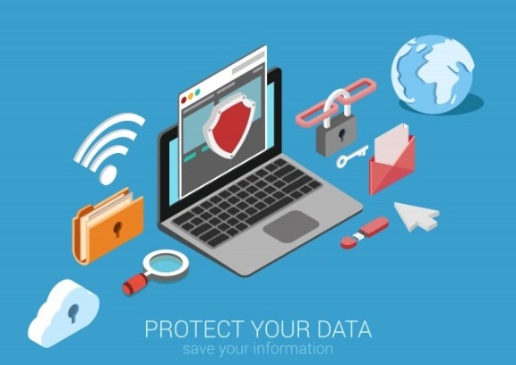
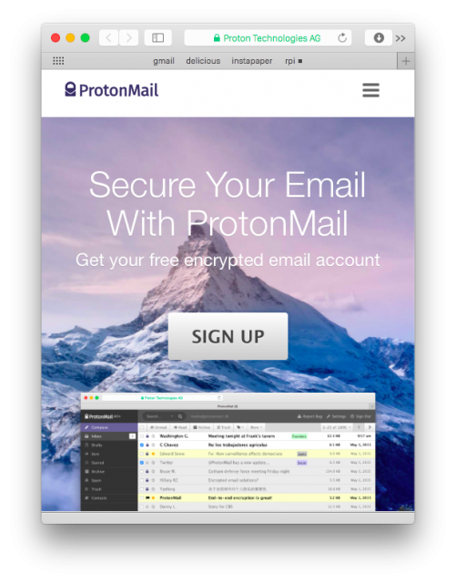
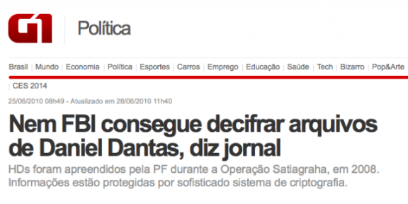
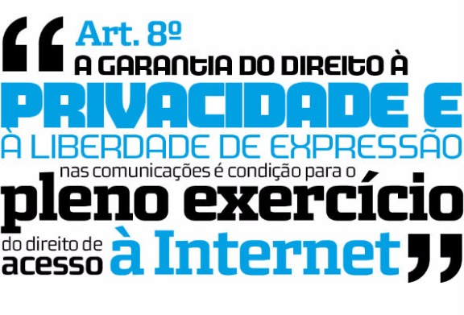

# Dicas de segurança da informação para homens e mulheres de negócios

Publicado em 2015-06-24

|  |
| --- |
| [Share](#) |

Proteger seus dados e comunicações é tão importante quanto analisar relatórios e fazer vendas. Veja dicas para melhorar a segurança das suas informações.

Os últimos acontecimentos na imprensa brasileira me evidenciaram o quanto os executivos não sabem proteger suas informações e dados que deveriam ser confidenciais e sigilosos. Tenho a impressão que a maior parte dos executivos e profissionais de alto-escalão das empresas brasileiras deixa a segurança da informação em segundo plano e provavelmente usa serviços de email mantidos por publicidade e sem criptografia, como Gmail e Outlook; e provavelmente deixa seus documentos importantes, como planilhas e contratos, na área de trabalho do laptop, que normalmente é protegido por uma senha fraca como a data de aniversário da filha.

Em minha opinião, proteger as informações sigilosas de seu dia-a-dia no trabalho é tão importante quanto saber lidar com elas, fechar contratos e fazer vendas. As informações sobre negociações, preços, contratações e movimentos de mercado são cruciais para a boa gestão de uma carreira profissional e deixar essas informações vazar pode trazer sérios prejuízos e até consequências pessoais para os envolvidos.

Meu objetivo com este manual não é ajudar a proteger negociações ilegais ou anti-éticas, o que estou publicando aqui é informação, o que cada um faz com ela é problema individual de cada um, ou como diria um amigo meu: *cada cada cada cada*. A sociedade brasileira deve se preparar para lidar com casos de informações criptografadas que eventualmente precisem ser acessadas pela justiça, e isso é um problema que, inclusive, eu espero ajudar a enfrentar ao tratar publicamente do assunto.

*(não me responsabilizo pelas consequências do uso de nenhum dos apps, sites ou serviços indicados)*

### E-mail

Se você quer realmente ter boa segurança sobre os e-mails que envia e recebe, não pode usar serviços gratuitos ou mantidos com publicidade, como Gmail e Outlook. O ideal é usar email rodando em um servidor próprio, ou então pagar por um serviço que tenha forte foco na segurança e criptografia, como o [ProtonMail](https://protonmail.ch/), [Kolab Now](https://kolabnow.com/) ou o [Hushmail](https://www.hushmail.com/).

Ao usar um serviço mantido por publicidade (Gmail, Outlook), você está admitindo a possibilidade de máquinas analisarem seu e-mail para segmentar anúncios, e mais que isso, não há nenhuma garantia técnica que um humano não está bisbilhotando suas mensagens do lado de lá.

Mesmo assim, a segurança de qualquer mensagem está diretamente ligada a quem envia e também a quem recebe. Não adianta nada você ter todos os cuidados de segurança se a pessoa com quem você troca e-mails usa senha 12345678 no Gmail, ou se a pessoa quer ler as mensagens em papel no caminho casa-trabalho e encaminha tudo para o(a) secretário(a) imprimir. Basta que o agente mal-intencionado quebre a segurança do destinatário das suas mensagens para que você seja exposto e suas negociações sejam comprometidas.

Para melhorar a segurança mesmo em serviços mantidos por publicidade, você pode usar o [Mailvelope](https://www.mailvelope.com/); ele proporciona criptografia de primeira qualidade com um plugin de Chrome ou Firefox; mas todas as pessoas da conversa precisam usar para que ele faça a proteção das informações.

Resumindo: no geral, e-mail gratuito não é um meio de comunicação seguro; e-mail pago pode ser mais seguro, mas a maior segurança está em garantir que o destinatário das suas mensagens toma tanto cuidado quanto você.

### WhatsApp, Facebook, SMS e outros apps de mensagens instantâneas

Qualquer app de código fechado é, por princípio, digno de desconfiança. Você não sabe o que ele faz com as mensagens, não sabe onde estão os backups e não controla os protocolos de comunicação. WhatsApp, Facebook Messenger, SMS, DMs no Twitter, seja lá o que for, estão sempre disponíveis para que os provedores dos serviços leiam seus conteúdos, mesmo problema dos serviços de e-mail que falamos acima.

Existem alguns messengers que prometem maior segurança, como [Telegram](https://telegram.org/) e [Crypto.cat](https://crypto.cat/); você pode testar, mas o problema deles é que pouca gente usa, então é como se só você tivesse uma máquina de Fax (pra quem você vai enviar mensagens?).

Resumindo: no geral, instant messengers não são seguros. Evite tratar de informações sigilosas através deles.

### Senhas e autenticação em 2 passos

É muito frequente que hackers consigam acesso à bancos de dados de serviços online com milhares, às vezes milhões, de usuários e senhas. Caso você use a mesma senha em mais de um serviço (e a maior parte das pessoas usa), um hacker que consiga acesso ao banco de dados daquele sitezinho pornô que você se cadastrou na madrugada poderá ter acesso ao seu email, Dropbox, Facebook etc. É daí que vem a maior parte dos ataques da atualidade, grandes empresas já passaram por vazamentos de senhas, como Sony com a PSN, Google com o Gmail, Adobe, Facebook e outros.

Recomendo seguir estas regras para lidar com senhas:

- Não use a mesma senha em mais de um serviço.
- Faça senhas longas, com mais de 18 caracteres.
- Senhas não podem “significar algo”, não podem conter palavras, datas, nem serem fáceis de lembrar, devem ser uma massa de caracteres ininteligível, como *mak1i0glaz8cy0wrusk7*.
- Use um software para gerar senhas únicas e complexas para cada serviço, e para lembrar das delas depois.
- Use autenticação em 2 passos sempre que disponível.

Softwares como o [1Password](https://agilebits.com/onepassword) e o [LastPass](https://lastpass.com/) podem gerar uma senha para cada novo serviço web que você se cadastra, eles salvam estas informações em bancos de dados criptografados que podem ser sincronizados em todos os seus dispositivos, eu uso nos meus smartphones e desktops há anos. Estes bancos de dados são protegidos por uma senha, esta senha você pode ter anotada em um papel na sua carteira ou memorizada (esta senha pode ser memorizável, explicarei o motivo).

Os softwares de gerenciamento de senhas se integram ao seu sistema operacional e navegador, preenchem as senhas (únicas e aleatórias) automaticamente quando você entra nos sites, reconhecem quando você vai se cadastrar num novo site e oferecem uma senha aleatória única para você usar e já guardam a senha para você no banco de dados, entre outras funcionalidades.

O ecossistema Apple agora tem o [Keychain com iCloud](https://support.apple.com/pt-br/HT204085), que funciona de maneira parecida, também sugere senhas únicas automaticamente, salva elas na nuvem e mantém tudo em sincronia entre seus dispositivos. Se você usa ecossistema Apple e não quer usar um software adicional, o Keychain é uma boa opção.

#### Banco de dados de senhas

Usar um banco de dados de senhas (como o 1Password ou LastPass) é um ponto para falhas, sim, claro, todas as suas senhas estão ali, afinal; mas é um ponto muito menos sujeito à problemas do que usar a mesma senha em vários serviços (ou variações da mesma senha). Como o banco de dados é criptografado, mesmo que um agente mal intencionado pegue o banco de dados, terá um arquivo inútil em mãos, ele ainda precisará da sua senha para abrir o arquivo. Se ele conseguir sua senha do banco de dados, ele com certeza iria conseguir a senha do seu email e do seu Facebook de qualquer maneira.

#### Sobre o anotar a senha em um papel

Anotar a senha em um papel pode parecer uma idéia idiota inicialmente, mas ainda é melhor do que usar a mesma senha em vários serviços. Para ter acesso ao seu papel com a senha (na sua carteira, por exemplo), a pessoa vai precisar de acesso físico a você, e atualmente a maior parte dos ataques à segurança da informação acontece à distância. Se tiver dúvidas, anote a senha num papel, mas não use a mesma senha 2 vezes.

#### Autenticação em 2 passos

Autenticação em 2 passos é quando você precisa de 2 “dispositivos” para acessar algum serviço. Seu internet banking provavelmente usa algo deste tipo, como um chaveiro que gera senhas numéricas periódicas, ou um cartão com várias senhas anotadas, ou um código que é enviado por SMS para seu celular. O “dois passos” significa que você faz o primeiro passo em um dispositivo (como o desktop) e o segundo passo em outro dispositivo (como o smartphone). Isso aumenta imensamente a segurança, pois um agente mal intencionado precisaria ter acesso físico a você para conseguir o 2º passo, ou no mínimo interceptar seus SMSs antes deles chegarem a você, o que não é tarefa simples.

Os principais serviços online oferecem autenticação em 2 passos, como Google, Amazon, Twitter, Facebook entre outros, você deveria ativar esta opção de segurança em todos, imediatamente.

### Computador, planilhas, documentos e outros arquivos

Proteja o seu usuário no seu computador com uma bela senha, longa e com números e letras. Neste caso você pode usar 4 palavras que não signifiquem nada mas que sejam fáceis de lembrar.

#### Criptografe o drive de armazenamento de arquivos (HD, SSD, pendrives)

Caso um agente mal intencionado tenha acesso aos seus arquivos ou mesmo acesso físico ao seu computador, ele só poderá abrir os documentos se tiver a sua senha.

“os HDs foram criptografados a partir de dois programas disponíveis na internet. O primeiro, líder de mercado, chamado PGP, pode ser encontrado na página www.pgp.com. O outro, Truecrypt, gratuito, está hospedado no endereço www.truecrypt.org”

O “sofisticado sistema de criptografia” mencionado na matéria era o TrueCrypt, um programa de código aberto que foi mantido pela comunidade até meados de 2014. Atualmente os sistemas operacionais têm métodos nativos de criptografia de arquivos. No Windows é o [BitLocker](https://en.wikipedia.org/wiki/BitLocker), no Mac é o [FileVault](https://en.wikipedia.org/wiki/FileVault).

### Acesso à internet

Como diria o Jornal Hoje, ***acessar a rede mundial de computadores é um perigo!*** Uma VPN é essencial para manter suas comunicações seguras. A [VPN é uma rede privada](http://lifehacker.com/5940565/why-you-should-start-using-a-vpn-and-how-to-choose-the-best-one-for-your-needs), onde toda a comunicação é criptografada. E você usa o servidor da VPN como sua porta de saída para a internet.

Resumindo muito, a (boa) VPN funciona assim:

1. Seu computador fala com a VPN em protocolo seguro;
2. a VPN fala com a Internet em protocolo aberto;
3. a Internet manda a informação de volta p/ sua VPN em protocolo aberto;
4. a VPN analisa o conteúdo e manda para seu computador em protocolo seguro.

Se um agente mal intencionado quiser chegar até você, ele vai precisar passar pela VPN, e isso normalmente não é fácil. Se ele interceptar os pacotes entre você e o servidor VPN, eles estarão criptografados, ou seja, inúteis para o agente mal intencionado.

[Clique aqui para ver uma lista com vários VPNs a partir de US$4,16/mês.](http://www.top10bestvpn.com/)

### Ligações telefônicas com celular

Com as linhas digitais atuais, interceptar ligações telefônicas não é tarefa trivial, normalmente a conexão entre seu celular e os sistemas da operadora de telecom são bem protegidos e dificilmente um agente mal intencionado terá acesso ao conteúdo de suas conversas. Se você quiser ser ainda mais cauteloso, o Skype (por incrível que pareça) é uma boa opção para conversas privadas, pois ele usa criptografia para que sua voz não possa ser ouvida por um agente mal intencionado. Você pode testar também serviços de VOIP seguro, como o [Ostel](https://ostel.co/).

### Controle da neurose

Segurança é importante, como eu disse, considero tão importante quanto a capacidade de fechar negócios ou vender; mas, ao mesmo tempo, não pode se tornar uma neurose nem impactar significativamente sua produtividade. Salvo exceções, toda medida de segurança vai impactar um pouco na sua produtividade (trancar a porta de casa demora mais que sair e deixá-la aberta, né?) mas você precisa achar o equilíbrio entre produtividade e segurança.

**Você tem alguma outra dica de segurança que eu esqueci de listar? Alguma recomendação de app? Deixe sua resposta nos comentários!**

*Imagem: [Cortesia de Shutterstock](http://www.shutterstock.com/pic-230782489/stock-vector-flat-d-web-isometric-online-safety-data-protection-secure-connection-cryptography-antivirus.html?src=TjS2_WnzV3OmZw7bGzFOlA-1-0).*

### Divulgue este post para seus amigos!

### Textos relacionados:
