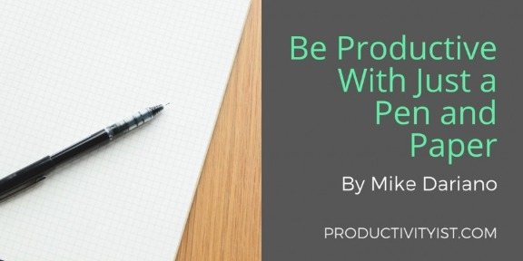
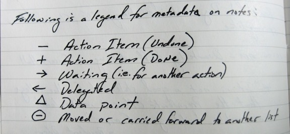
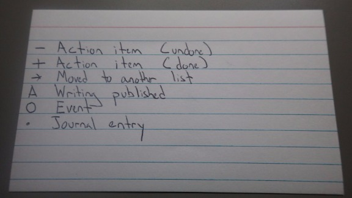
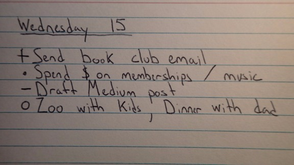

# Be More Productive With JUST A Pen And Paper

After I wrote this post about how [notecards helped me write a book](http://productivityist.com/productivity-experimention-case-study-writing/), I began to wonder what other tactile tools I have missed. Was there something else that might work better than the many–and I do mean many–different apps I have used?

After I looked around the productivity sites for a good pen and paper system, I settled on the [dash plus system](http://patrickrhone.com/dashplus/) created by Patrick Rhone. Rhone is a [past Productivityist podcast guest](https://productivityist.simplecast.fm/23)  and has a system that looks like this:

Based on simple symbols, the foundation for this system looked good to me–for the most part. I made a few small tweaks to it as follows.

## **The Steps I Took**

Each Sunday night, I began by planning out the week in advance. During this time I made sure to note:

- Events scheduled for each day.
- Tasks due on certain days.
- What I hoped to work on during the week.

This worked for the overall structure of the week, but because things pop up or get delayed I needed some flexibility as well.

How much structure should I include? I found the answer sitting on my desk.

My daughter loves to color and her coloring book presented the answers. My ideal schedule would be to have structure with some flexibility; just like a coloring book. Our summer schedule is less rigid than the school year one, but I need some kind of [summer plan](http://productivityist.com/planning-productive-summer/)

The balance I found was three tasks for each day. Some I would plan at the start of the week, others I would do the night before.

One other thing I did was write down an overarching statement for the week was. For example, from August 17 – Ausust 23 my statement was, “ Write down ten ideas each day, push hard on drafting my better mornings book, invite five guests to [27GoodThings.com](http://27goodthings.com/), and get to inbox zero by week’s end.”

This big ideas statement was something I could work at once my daily tasks were completed. As someone who works from home, there are many surprises – good and bad – on my time.  These were things I wanted to and could move forward when a good chance arose.

After a month of using the modified dash-plus system, I have three conclusions:

**1. Non-automatic carryover is important.** One aspect of digital systems is that tasks automatically carryover. If you didn’t get something done Monday, it’s still there on Tuesday.  This can be good for some people, but not me.

When I had to write down the what and when I made active choices. It was up to me whether an email was sent out, a blog post was written, or a task was done. The act of writing it down made me feel differently about the choices, as if each was something I *chose* to do, rather than to do.

This reminds me of this brief story from an employee at SpaceX.

> “He (Elon Musk) doesn’t say, ‘You have to do this by Friday at two P.M.’ He says, ‘I need the impossible done by Friday at two P.M. Can you do it?’

Then, when you say yes, you are not working hard because he told you to. You’re working hard for yourself. It’s a distinction you can feel. You have signed up to do your own work.”

**2. It’s not another screen.** Some days I get tired of staring at a screen. My laptop screen dominates my view in the morning, my phone when I’m away from home, my Kindle app to read. I look at screens enough that breaks from it are appreciated.

I wouldn’t want to live without screens, but there’s something different when you look at and write on paper. It’s a difference that I didn’t appreciate until going through this process.

**3. I can got a lot done.** At first I was concerned that because I didn’t have a long task list that maybe I wouldn’t get as much done, but I did. Limiting myself to three things each day forced me to choose the most important things.

It also made me think of the big things I wanted to work on. A book about better mornings for examples. Even though it was only a primary task one or two days during the month, I made a lot of progress on it because it was written as part of the big picture of what I would work towards.

This approach also felt manageable. I’ve used apps where you can assign things to future dates and where past tasks get swept up so not to be lost. What happens next Thursday, boom, everything crashes on you and you can’t get out from under it.

It’s all malleable, sure, but the feeling mattered. Because I felt like I got more done, I was getting more done.

That said, my system still isn’t perfect. It is still a bit of a work-in-progress.

If you have any ideas for my pen and paper notebook, I’d love to hear about it in the comments. And thanks to Patrick Rhone for the inspiration.
