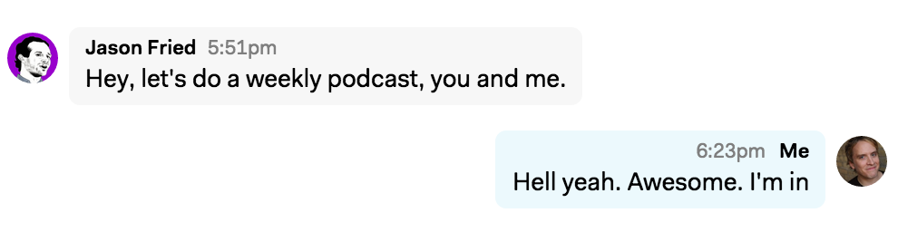

# Less than perfect

> I want to create something out of nothing but nothing isn’t a great place to draw from.  
>   
> **Mitch Hedberg**

On February 21, 2006 a guy launches a video blog. The results, even by 2006 standards, were far less than perfect. The lighting is terrible. The camera unsteady. There’s a use of zoom and text effects that remind me of my mom’s videos of my sister and I figure skating in 1990.

Later episodes have funny text effects where the title of the blog swims into view like a novice PowerPoint presentation. There’s a glass picture frame behind him reflecting whatever light fixture is in the room, and that’s all your eyes want to look at.

The first episode has 14 comments made in its entire first year. This definitely didn’t take off like a rocket ship.

---

People who’ve been [fans of my blog](http://ninjasandrobots.com/) and the writing I’ve done on places like SvN have messaged me that they’ve missed my writing. I haven’t done as much lately. Why? The answer is pretty simple. As Jason Fried might say, [I just don’t have the attention](https://signalvnoise.com/posts/3919-the-difference-between-time-and-attention). It’s easy for me to spend an entire day writing and researching an article. But, running [**Highrise**](http://highrisehq.com/) is a big job. There’s so much to do. Building a brand new team, managing the current product and its support, and reinvigorating product development on an old product, takes all of my attention.

And there’s a hesitation now in publishing my work.

Success breeds hesitation. Even the modicum of success I’ve had writing has created a hesitation to publish something that isn’t perfect. I want each article to be even better than the last one. But that just makes it impossible to publish thoughts and ideas and observations when I don’t have the attention to make them perfect.

Hesitation becomes this empty void where we stop producing good ideas, because we no longer have that bucket of just fair ideas to draw from.

How do I fix it?

---

That video blogger kept at it. In episode 1000 the intro graphics are now this fancy professional animation that reminds me of the quality of the Mad Men intro. And he’s definitely found an audience.

Today you know him as Gary Vaynerchuk and this was his [Wine Library TV video blog](http://tv.winelibrary.com/2006/02/21/episode-1-verite/). Today, with over a million Twitter followers, he hosts another video podcast called the [#AskGaryVee show](https://www.youtube.com/playlist?list=PLfA33-E9P7FC0AoARnMLvgFgESJe4_Ngs). The production quality is light years past that first episode of Wine Library TV. There’s perfect lighting, multiple cameras, fancy editing and effects that all come off as interesting and professional. And there’s thousands and thousands of people watching. He’s clearly made something many of us aspire to after publishing and publishing and publishing stuff that was less than perfect.

---

One thing that’s helped recently reinvigorate my writing was to give myself channels where I don’t feel the pressure for perfect. Comments on forums are great for this. Most people have very low expectations of the quality of “comments” online.

I use Reddit to practice. I’ll find someone asking something I think I could riff on, and I’ll just go. I’ll try to work in some personal anecdotes or something I’ve observed and see if I can make it interesting. If I like the result I might polish it a little and put it in more places. Here’s an example of a [question on Reddit that I answered.](https://www.reddit.com/r/startups/comments/3ejz57/is_it_to_early_for_me_to_start_a_ppc/ctfpw36). Seemed like it got some folks interested, so I polished it some, and [posted a different version to this blog which sparked a great conversation](https://signalvnoise.com/posts/3899-is-it-too-early-for-me-to-start-a-pay-per-click-campaign).

If I didn’t have that first mediocre attempt at an answer, I wouldn’t have ever gotten to publishing the better one. I needed a far less than perfect place to start.

---

A few weeks ago Jason Fried pinged me with:

We got together to hammer out a few details of what it would look like. Soon after, we filmed a pilot episode that we recorded but didn’t tell anyone about. We wanted to see if it had any kinks. It had kinks.

It took us 15 minutes just to figure out places with good internet connectivity and lighting – so you could actually see my face. After that, we finally got to chatting. The results were still terrible. We had a fun time talking, but it was unlistenable. There’s an echo of my voice in the video. We later figured out from chatting with people who’ve already done this a ton like [Chase Clemons](https://twitter.com/chaseclemons) and [Shaun Hildner](https://twitter.com/shildner), it’s probably from Jason’s laptop mic picking up the audio from his speakers – problem would be resolved if we both used headsets.

Ok, let’s do another. So we discuss, how often can we sustain doing this? What’s the name? Do we need better cameras and mics? What about lighting? Maybe we can get Shaun to help us? Should we use Hangouts or a different app or technology. So many unanswered questions and so much room to keep making low quality attempts at this podcast.

This Monday came and we didn’t have answers to any of our outstanding questions. I debated if we should do another “off air” episode, just so we can practice more. I hesitated. Jason’s reply? “Let’s do it live”

And so we did. Our second “pilot” episode went live yesterday, August 24 at 3pm. And it was as you’d expect, less than perfect. I somehow accidentally turned off the voice detection Google Hangouts uses to automatically decide which face to show in the video, so you see Jason’s face throughout the beginning until Shaun comes in and tries to fix our setup. Then you can see I’m distracted by the monitor and manually switching who is seen in the video.

People still enjoyed it.

This is how life works. This is how most things we enjoy and call successful start. They aren’t as good as we want them. They need a ton of practice. And even when we get something to the place where it is good, now we have a new challenge: our hesitation at being bad again.

Just keep publishing. Keep putting out the stuff that’s not perfect. When you find yourself in a spot where the expectations are too high, just find another spot. We need that place to draw from.

---

Jason and I are going to keep publishing these “imperfect” chats of ours. You should follow us on Twitter: [@jasonfried](https://twitter.com/jasonfried) and [@natekontny](https://twitter.com/natekontny). We’ll talk about not just the things we see other folks struggling with and asking questions about, but the things still bugging us. Life is far less than perfect for us, and we keep leaning on each other to help us through our current challenges. Hopefully recordings of us hashing them out will prove useful to others going through the same.

If there’s anything you’d like us to ever cover, please hit us up on Twitter or ask in the comments of our SvN posts. We’d love to hear from you.
