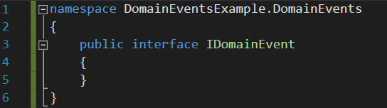
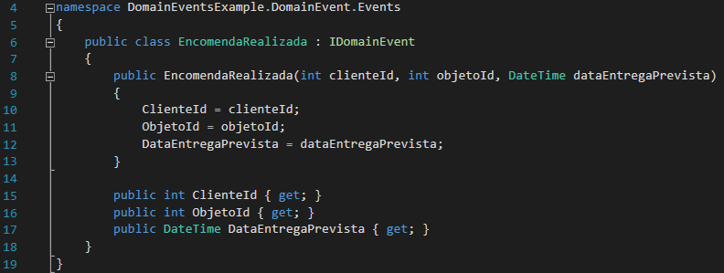
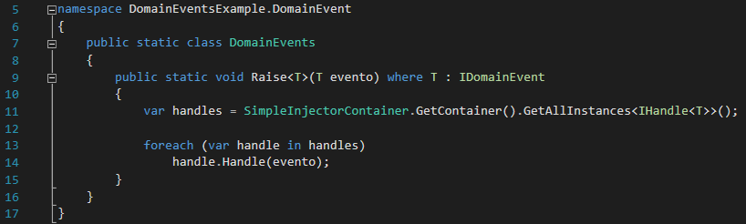
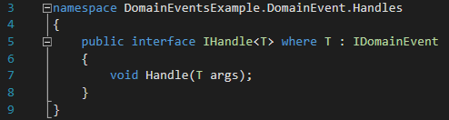
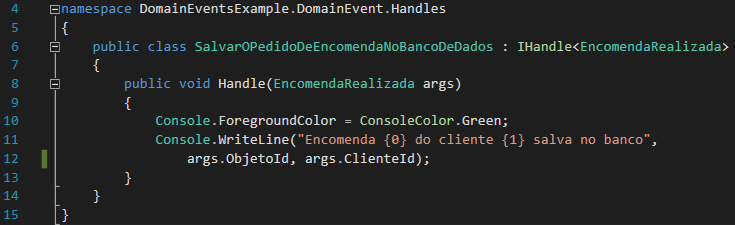
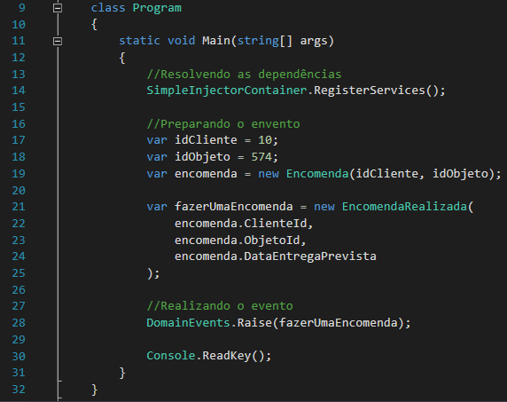
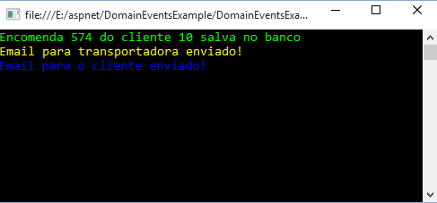

# Vinícius Mussak

## Software Development

Fala galera! Tudo certo?

Hoje vou falar um pouco sobre Domain Events, que pra quem não sabe, ele faz parte do gigante mundo que é o [DDD](http://martinfowler.com/tags/domain%20driven%20design.html), bem resumidamente Eric Evans denomina que Domain Events servem para ocasiões tais quais: “*Aconteceu algo que os especialistas do domínio se preocupam*“.

Adentrando um pouco mais sobre Domain Events, são eventos que fazem sentido para o domínio, ou seja, coisas que precisam acontecer quando determinada ação ocorre, por exemplo, um sistema de transportes, poderíamos ter eventos como: “carga entregue”, “carga em transporte” ou “carga em separação”.

E explicando um pouco a introdução, dizemos que Domain Events são um tipo de mensagem que descreve algo que aconteceu no passado que é de interesse do negócio, usamos isso para separar todas as preocupações técnicas do domínio, com isso, suas operações de escrita ficam todas encapsuladas em comandos na forma de enventos.

Vou mostrar como utilizar Domain Events na prática, com um exemplo simples de um sistema de encomendas, começando pela interface “IDomainEvent”, aí você pode falar, “mas essa interface está vazia, pra que usar ela?”, então lembrando que estamos dentro de um contexto que é o DDD, onde implementamos olhando sempre para o domínio, portanto um evento tem uma função ou um papel dentro da nossa aplicação e por isso merece ser representado explicitamente, vejam:

Depois disso, criamos classes que representam eventos que acontecem com o nosso domínio, nesse caso criei a classe “EncomendaRealizada” que vai nos servir para quando uma nova encomenda for realizada:

E então, para lançar esses eventos, utilizamos uma classe estática em comum para todos, para obter todas as instâncias do evento eu utilizei o [Simple Injector](http://viniciusmussak.net/2015/04/09/implementando-simple-injector/) mas poderia ter ultilizado qualquer outro container de injeção de dependência.

Agora vejam a interface “IHandle” e como implementá-la logo após, o método Handle, é o que vai ser disparado no evento, como na imagem anterior:

Com isso feito, criei alguns passos que o meu evento “EncomendaRealizada” deve seguir, eu preciso salvar no banco, enviar um email à transportadora, e também um email para o cliente, veja como isso é feito, não coloquei a classe do email pois está quase igual, somente para fins de exemplo:

Está tudo pronto, agora é só fazer tudo acontecer:

E o resultado final:

Os exemplos de código estão disponíveis no GitHub: <https://github.com/vmussak/DomainEventsExample>

Por hoje é só, qualquer dúvida ou sugestão, estou à disposição! Até mais

[About these ads](https://wordpress.com/about-these-ads/)
