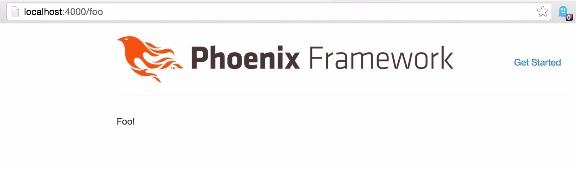
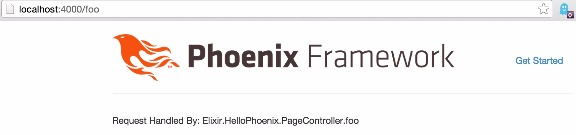
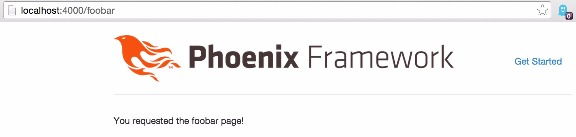
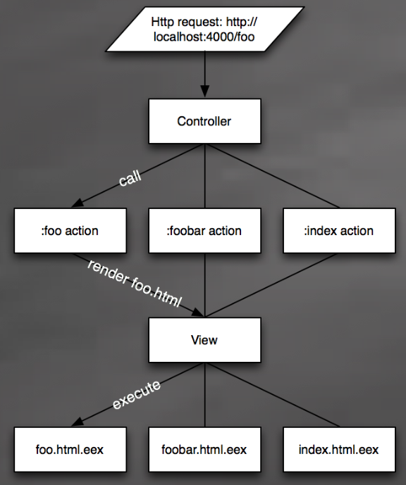

# Templates Are Just Functions

I began reading through the [Phoenix Guides](http://www.phoenixframework.org/docs/overview) a few days ago. They are really straight forward and easy to follow. However, instead of reading them through as if I were learning a new concept from scratch I read them as if I already knew how things *should* work, which just so happened to be a great way to get myself really confused.

## The problem (or more so, my confusion)

I was doing fine, right up to the [Views](http://www.phoenixframework.org/docs/views) and [Templates](http://www.phoenixframework.org/docs/templates) guides. The Views guide explains what views are and how to use them. Okay, that seems pretty straight forward, but where do templates fit in and why are they separate from the view?

In other frameworks the view is the template. The controller renders a view, which is usually some HTML mixed with special markup that writes values returned from functions or variables within the controller. Some views/templates even allow you to execute code within them.

The part that really boggled my mind was when the guide presented a function in a view and then presented markup within the template to retrieve the return value of that function.

The function within the HelloPhoenix.PageView module:

```
def handler_info(conn) do  
  "Request Handled By: #{controller_module conn}.#{action_name conn}"
end
```

The call within the template to the function in the view:

```
<p><%= handler_info @conn %></p>
```

This somehow appeared backwards to me. Why was the template passing the `@conn` variable to the handler\_info/1 function? Shouldn't the handler\_info already know about the conn data structure because it was declared inside the view? Wasn't the view responsible for rendering the template, or at least parsing the template to be rendered?

## Templates are just functions

I decided to ask [Chris Mccord](http://www.chrismccord.com/), author of the [Phoenix Framework](http://www.phoenixframework.org/), what was actually happening when a page gets rendered. He helped me through the realization that templates are just compiled down to functions. Matter of fact, a template is nothing more than a function that is injected into the view at compile time.

For some reason it took my mind a few minutes to understand this. Actually, it took Chris a few minutes to get me to understand this.

### Chris's Example

The first thing Chris had me do was to write a render function in my page view.

```
defmodule HelloPhoenix.PageView do  
  use HelloPhoenix.Web, :view

  def render("foo.html", _assigns) do: "Foo!"
end
```

After making sure to add `"/foo"` to the router, and def `foo(conn, _params)...` to the controller, I started up the server and pointed my browser to <http://localhost:4000/foo>. To my surprise, the following page was rendered:



## The Ah-Ha moment

So the view can render a page without a template. I sort of already knew that from doing the previous guides, but creating my own render function in the page view and trying it out for myself really solidified that as fact.

At this point in our conversation I still wasn't sure why `@conn` was passed to the `handler\_info/1` function. So far, Chris had me prove that render was just a function in the view module, and even though he had previously said "templates are *just functions*" I wasn't associating that with templates are *just functions within the view module*.

He continued with:

> At compile time, `def render("index.html", assigns), do: # your compiled eex template here`  
> that would be injected into your module.

It wasn't until he said the following that it finally took hold and sprouted to life:

> It is exactly the same as if you wrote the function yourself

I really don't know what exactly it was about this last statement that just made it all click, but it did. I've heard Chris repeat over and over again, in his various different talks about Phoenix, that rendering is very fast because views (templates in this case) are compiled, not parsed. More specifically, if you watch the ElixirConf 2014 Rise of the Phoenix talk, Chris introduces this concept at around the 15 minute mark.

## Small steps

After my Ah-Ha moment, I decided that I would solidify this new found knowledge by writing a render function in my page view that would make a call to the handler\_info/1 function. The same function that started this little learning journey.

Calling handler\_info/1 in the template was easy and automated. What I wanted to see was how easy it would be to do the same thing from within the view using my own render function.

Turns out it's ridiculously simple.

```
def render("foo.html", assigns) do  
  handler_info(assigns.conn)
end
```

The result:



### This is all just Pattern Matching

Chris mentioned, in the same conversation, that the render function is pattern matched within the view module, so I thought I'd test that out.

I changed the render function in the view module to pattern match on a page parameter.

```
def render(page, assigns) do  
  case page do
    "foo.html" ->  handler_info(assigns.conn)
    "foobar.html" -> "You requested the foobar page!"
  end
end
```

I intentionally didn't pattern match using other functions just to prove a point, but it could have easily been separated out into separate functions like so:

```
def render("foo.html", assigns) do  
  handler_info(assigns.con)
end

def render("foobar.html", _assigns), do: "You requested the foobar page!"
```

After creating a new foobar function in the controller and placing `"/foobar", PageController, :foobar` in the router I directed my browser to both <http://localhost:4000/foo> and <http://localhost:4000/foobar>. Sure enough the previously seen foo view rendered exactly the same, and foobar was live as well.



## Visualizing the request

Now that I know that a view can render multiple templates because they are just render functions that get pattern matched I can visualize the path that each request takes.



## Wrapping it up

Understanding that a template is nothing more than an injected render function in the view takes away some of that "it's magic" feel from the way the process works and puts more power into my finger tips. I believe that understanding how things work at a low level makes me a better programmer.

Hopefully this article will help someone out if the template/view concept isn't quite clicking. I doubt it will be the first time that I don't get something so simple (which means more articles).

### Side Note: Elixir has the best community

I'd like to thank [Chris Mccord](https://www.twitter.com/chris_mccord) for taking the time out to explain this amazingly simple concept and for putting up with my newbie questions.
