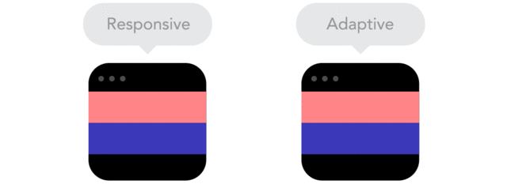
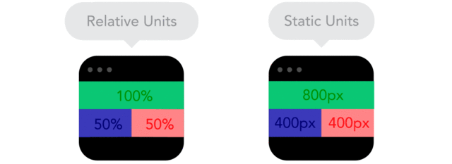
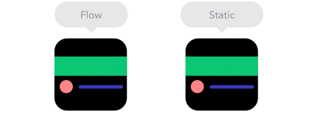
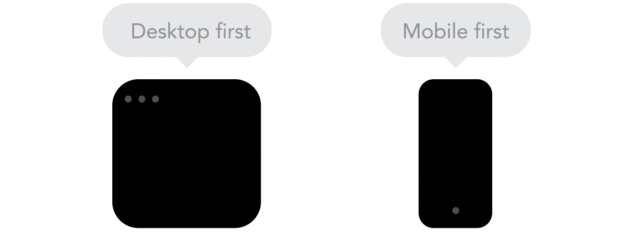
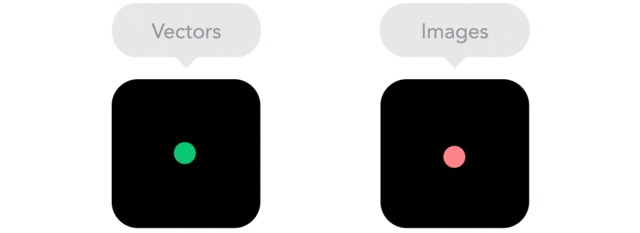
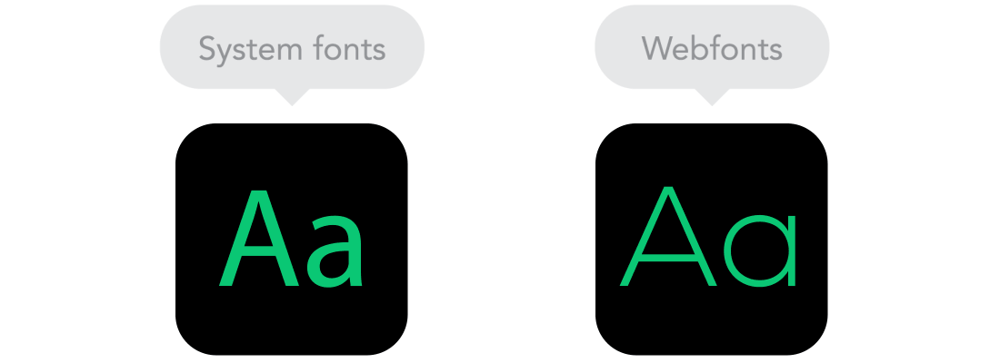

# Essa ótima série de GIFs explica conceitos do design responsivo

## Alguns GIFs parecem valer mais do que muitas palavras

por [Jacqueline Lafloufa](http://www.b9.com.br/author/jlafloufa/ "Posts de Jacqueline Lafloufa")

Notas

Likes

Tweets

Pin It

Conversar com especialistas às vezes pode ser enervante. Você até sabe o que está querendo fazer, mas não sabe dar nome aos bois e acaba chamando as coisas pelos nomes errados, ou não compreende completamente o conceito que querem lhe passar.

Também é assim na conversa com designers. Você quer um design que fique bem no smartphone, mas que também não fique esquisito no mobile. Como explicar isso?

E se, de repente, bem no meio do projeto você reparou que as imagens estão ficando pixeladas demais, ou que estão ficando esticadas quando você abre o site em determinada plataforma, como solicitar uma correção?

Para minimizar esse problema de comunicação com designers, a [**Froont**](http://blog.froont.com/9-basic-principles-of-responsive-web-design/), uma empresa especializada em ferramentas que ajudam a criar sites responsivos, criou essa ótima série de GIFs animados que explicam alguns conceitos de design de sites, como a diferença entre responsivo e adaptativo, uso de breakpoints, elementos agrupados, configurações de largura máxima e até a vantagem do uso de vetores em relação a imagens.

   

Para quem entende pouco do assunto, vale conferir para compreender um mínimo. Para os especialistas, vale salvar alguns desses GIFs para usar como explicação quando algum cliente ou colega estiver mais confuso. A explicação detalhada de cada um dos conceitos pode ser conferida no site da [Froont](http://blog.froont.com/9-basic-principles-of-responsive-web-design/).

    

**Via:**- [FastCo](http://www.fastcodesign.com/3038367/9-gifs-that-explain-responsive-design-brilliantly "FastCo")
