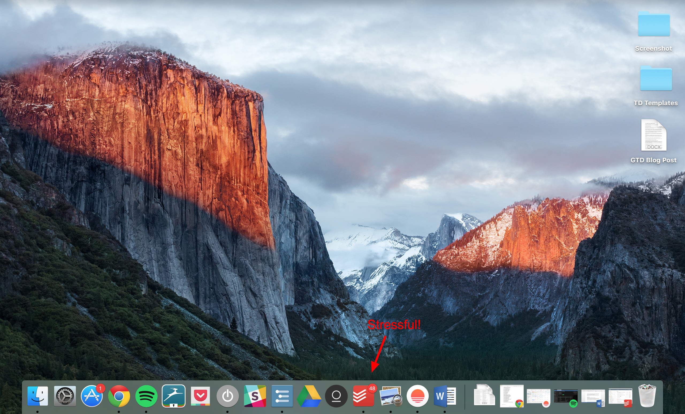
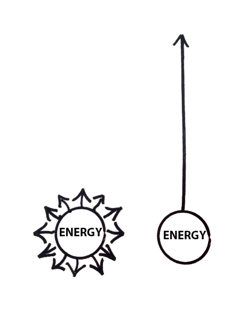
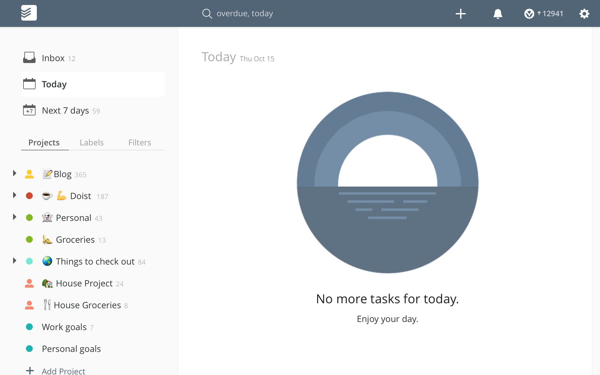

# How I learned to suck less at GTD

by October 15, 2015[General](https://blog.todoist.com/category/general/), [Productivity](https://blog.todoist.com/category/productivity/), [Todoist](https://blog.todoist.com/category/todoist/)

Like many, I’ve attempted to follow David Allan’s famous [Getting Things Done](http://gettingthingsdone.com/) productivity method too many times to count.

I might maintain my GTD set-up for a couple of weeks, maybe even a couple months if I don’t have too much going on. Maybe.

But inevitably my to-do lists begin to scare me. The number of overdue tasks in my Todoist projects slowly ticks up to panic-inducing levels.

At around 50 overdue tasks, I close out of Todoist on my Mac to avoid seeing the number of things I’m doing every time I open my computer.  I stop checking my to-do’s on my phone. After that, I start dropping the ball on my recurring tasks, which just makes things worse.

Eventually – after much guilt and a missed deadline or two – I reach a breaking point. I sit down and spend a few hours braindumping all of my open tasks into my task manager, assigning and rescheduling dates, adding all my context labels like a good GTDer.

After going through this stressful cycle for the umpteenth time, I finally started asking myself what I was doing wrong. Why is it that I can’t seem to maintain GTD for longer than a month? What can I do about it?

The problem with most of the GTD advice I found is that it’s written by people who are naturally pretty good at having their life together.  They might need some advice to tweak their workflow here or there, but for the most part they’re already organized and productive human beings.

I applaud those people. I admire those people.  I’d like to be those people. But I’m not (yet).

Nevertheless, I refuse to believe that I’m somehow fundamentally incapable of Getting Things Done. So I decided to write this post with tips on how to GTD for those of us who missed out on the naturally-having-all-your-life-together gene.

## **Getting Things Done (the extremely abbreviated version)**

The basic idea behind GTD is to write down all of your open loops – every single project or task that you feel responsible – in a system outside of your own head. It can be on paper or digital or a combination of the two – it doesn’t matter as long as it contains ALL of the to-do’s that are weighing on your mind.

Then go through and delete any tasks that are no longer relevant and delegate what you can. For everything left, identify the next, concrete action that needs to be taken in order to move each project forward. Write it down on your to-do list.

(Of course, this is a gross over-simplification. If you’re serious about getting more organized and productive, I’d highly recommend reading David Allen’s book [Getting Things Done](https://gettingthingsdone.com/store/product.php?productid=17035&cat=3&page) for more info.)

There’s hard science to back up the cognitive benefits of GTD.  Our brains are incredibly good at focusing on all of the projects and tasks we’ve left uncompleted (see [Zeigarnik Effect](https://www.brainpickings.org/2012/02/09/willpower-to-do-list/)). Writing down a plan for getting things done calms down the part of our brain that incessantly reminds us of what we need to be doing.  It also makes us more likely to actually follow through on our plans.

GTD promises to help us get a handle on our chaotic lives, to get more done in less time with less stress if we just follow a few simple rules.  It’s kind of seems like magic.

The GTD system is more-or-less easy to maintain when things aren’t too hectic. But as soon as our lives get busy (and they always do), we let one overdue task become 5, then 10, then 100+.  We abandon the system right when we need it the most.

After much research and experimentation, I’ve boiled the solution down to two (just two!) simple changes have made the biggest difference in helping me stick with GTD:

## **Learn to love your Weekly Reviews**

“If you’re not doing a review, you’re not doing GTD.” – David Allan

One of the crucial elements of GTD that I – and I suspect many others – overlook is the Weekly Review.

Using precious time to review, organize, and prioritize your tasks may seem self-indulgent when you’re feeling overwhelmed by your workload, but it is *the key* to reaping the long-term, stress-relieving benefits of GTD.

(Lifehacker editor and Todoist user Alan Henry wrote a fantastically detailed guide on how to actually do an [effective Weekly Review](http://lifehacker.com/5908816/the-weekly-review-how-one-hour-can-save-you-a-weeks-worth-of-hassle-and-headache)

In the past, as my overdue tasks started to accumulate, I would simply avoid my task lists until they snowballed out of control. Not a good long-term strategy.

So I started using [temptation bundling](https://blog.todoist.com/2015/04/09/temptation-bundling/) to help me stop avoiding my task lists.

Temptation bundling is a habit-building strategy that combines something you *should* do with something you to do. For example, if you want to work out more, only listen to your favorite audiobook when you go for a run. Research has shown temptation bundling to be a surprisingly effective way to trick yourself into doing the things you would normally avoid – like reviewing your overflowing to-do list.

Every Sunday morning, I go to my favorite coffee shop and order a big mug of seasonally-appropriate latte. I spend an hour reviewing what I accomplished the week before and organizing my tasks – personal and work-related – for the week to come.  Then I sit and read my latest just-for-fun book.  Simply coupling my weekly review with other things I love doing makes me actually look forward to it every week without fail.

Having an organized to-do list and clarity around what I need to work on at the start of the week makes me much more likely to continually check my to-do list throughout the day – which, it turns out, is an important part of making to-do lists actually work.

So whether it’s going to your neighborhood coffee shop, curling up in your favorite chair, heading outside to a park, sitting down with your favorite dessert, before watching your favorite show or reading a great book, find a way to fall in love with your Weekly Review time. It will go a long way in helping you maintain your GTD system in the long-term.

But developing a Weekly Review habit by itself isn’t enough to tame your GTD task lists, which brings me to critical change #2…

## **Prioritize ruthlessly, then cut out some more**

When I sit down to plan my week – at a safe distance from actually having to do the work – I tend to think I’m Super Woman.

I can take on ten projects at once, and do an amazing job on all of them. With my eyes closed. Backwards. While flying. All while getting enough sleep and exercising regularly.

Then the week actually starts, and I have to face the fact that I’m not Super Woman.

I end up discouraged and afraid of a to-do list that wasn’t realistic to start with.

Then I read Greg McKeown’s book [Essentialism: The Disciplined Pursuit of Less](http://gregmckeown.com/essentialism-the-disciplined-pursuit-of-less/) and it completely changed how I approach my Weekly Reviews. According to McKeown:

> Essentialism is not about how to get more things done; it’s about how to get the right things done. It doesn’t mean just doing less for the sake of less either. It is about making the wisest possible investment of your time and energy in order to operate at our highest point of contribution by doing only what is essential.

There are two things to keep in mind when deciding what you should give your time and energy to:

**We as human beings are truly terrible at estimating how much time and resources a task or project will take to complete.** We all succumb to the [Planning Fallacy](https://zapier.com/blog/why-we-miss-deadlines/) of underestimating how much time we need to accomplish things. When you’re planning your work schedule – whether daily, weekly, or monthly – always include ample buffer time.

**Everything you add to your to-do list has an opportunity cost in time and energy you could be giving to something else.** Your time and energy are finite resources. Once you’ve used them up, they’re gone. You’re never going to see them again. That means any new project you take on has two costs: the time and energy the project will require of you whatever other project, task, or activity you’re sacrificing to make room for the new project.

I love the metaphor of thinking about your time and energy as a glass jar of jelly beans.  Collecting more and more jelly beans is great, but there comes a point when you can’t fit any more into the jar without either crushing some of the jelly beans you’ve already got (which is just sad) or taking some of them out.

It’s easy to forget that when you’re trying to be a good GTDer. Too often, we begin to measure productivity by how many tasks we check off our lists. We don’t take the time to stop and ask ourselves if those were really the things we really want to be working on.

Here are the four things I now try to keep top of mind during my Weekly Review and throughout my work week:

**1.** **Just because you put it on your to-do list doesn’t mean you have to do it.** Circumstances change quickly. Today’s fast-paced work environment requires us to adapt quickly. Sometimes that means giving up on a project in favor of one that will have more of an impact. It’s ok to delete a task to free up space for something more important.

**2.** **Just because someone asks you to do something doesn’t mean you have to say yes.** We all want to be team players, but each time we say “yes” we spread our precious time and energy even thinner.  This is the piece of advice I have the hardest time with. Two strategies McKeown offers are have been particularly helpful for me:

- If your boss asks you to take on a project and you feel you can’t refuse outright, use this line instead: “*Yes. What should I deprioritize instead*?” This forces your manager to consider the constraints of your current workload and the opportunity cost of the new project.
- If you (like me) have a very hard time saying no outright, say “*Let me check my calendar and get back to you.* This gives you the space to think through what the commitment would actually entail and to rehearse a polite way to say “

**3.** **Just because it sounds like a cool project or awesome opportunity, doesn’t mean you should take it on.**The fear of missing out (FOMO) often makes us say yes to too many attractive opportunities.  Take a moment to step back and really think through the opportunity cost of taking them on. As TED speaker Derek Sivers put it “No more yes. It’s either HELL YEAH! Or No.”

**4.** **It’s ok to reschedule today’s tasks for tomorrow, or later in the week, or just someday/maybe.** I used to think that rescheduling tasks to get to inbox zero at the end of the day was cheating. Of course, we all need deadlines to help us stay accountable, but it’s impossible to get everything done according to plan all the time. When you don’t allow yourself the flexibility to reschedule, you end up with 48 overdue tasks (see screenshot above). When you’re avoiding your task manager out of guilt and anxiety, it’s not doing anyone any good.  Celebrate the things you have accomplished, and create a fresh plan every daily and weekly.

If you’ve made it to the end of this post, chances are you’ve had some of the same troubles I’ve had maintaining a GTD system. (I certainly hope I’m not alone.) So here’s what I’d like you to invite you to do:

Leave a comment below with 1) your record for the most overdue tasks you’ve had in your task manager of choice (mine is 72!) and 2) one thing you’re going to try to make your GTD system more sustainable.

And if you have any awesome strategies for sticking with your GTD system, please post them too!

**About the author:** *Becky Kane is a content marketer and copywriter at [Todoist](http://www.todoist.com/). When she’s not writing about her attempts to become a more productive human being, you can usually find her out running around Minnesotan lakes and filling her brain with random facts from podcasts. You can connect with her on Twitter at [@19kane91](https://twitter.com/19kane91).*
